<div align="center">

# Rem0te

**Self-hosted remote support for customer businesses, powered by RustDesk.**

One operator, many customer businesses — each with its own computers, its own
people and its own history. Rem0te is the portal around a self-hosted RustDesk
server that keeps them organised and separate.

[](https://github.com/agit8or1/rem0te/actions/workflows/ci.yml)
[](https://github.com/agit8or1/rem0te/releases)
[](LICENSE)
[](https://github.com/agit8or1/rem0te)

[Quick start](#quick-start) · [How access is protected](#how-rem0te-protects-customer-access) · [Screenshots](docs/screenshots.md) · [Walkthrough](#watch-the-walkthrough) · [Documentation](docs/README.md) · [Security](#security) · [MSPReboot](https://mspreboot.com)

</div>

---

<a href="docs/images/github/dashboard-light.png">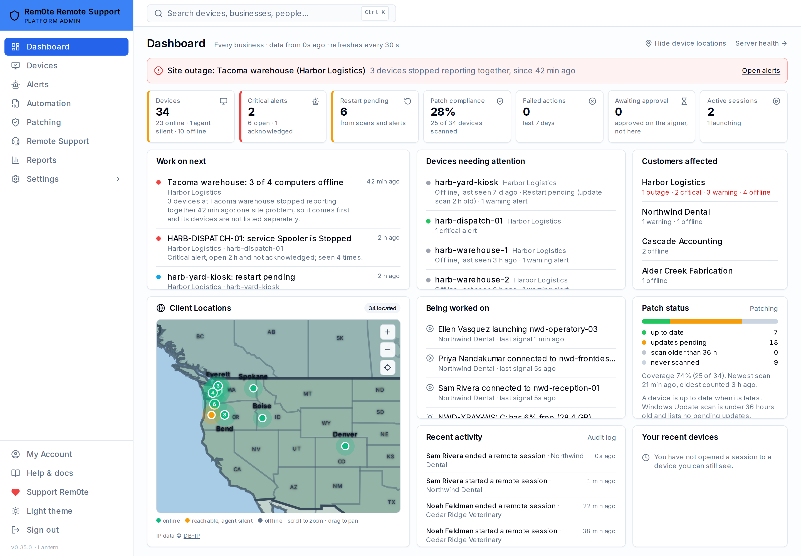</a>

<sub><i>The operator's view — every customer business, computer and session in one place. <a href="docs/images/github/dashboard-light.png">Full size</a> · <a href="docs/screenshots.md">55 more screenshots</a></i></sub>

---

## How rem0te protects customer access

**Which technician can reach this customer's PC?** Only someone the server says yes to, for that one
computer, at that moment. Hiding a button is not how it works.

Take two customers, *Acme* and *Birch*, that both have a PC named `FRONTDESK`:

- **The right machine is chosen by its id, never its name.** Connect, the password, the launcher token and
  the session all name one computer's database id. The list a person picks from contains only computers of
  the business they are working in, re-read from the database on every request. A technician assigned to Acme
  sees one FRONTDESK.
- **Without access, nothing is released.** If that technician opens Birch's FRONTDESK by URL or API, they get
  the same *404 Computer not found* as for an id that does not exist, and the attempt is audited.
- **Within Acme, it depends who is asking.**
  - A Business User needs `computers:connect` and a grant for that PC.
  - An L1/L2/L3 preset technician never receives the password. Interactive control needs a temporary grant
    that someone else approved.
  - On endpoints as shipped, preset launches are **refused**, because the computer cannot enforce consent or
    view-only. The portal does not open something it cannot restrict.
- **Enrollment is bound to one business.** The installer link carries a single-use, expiring token minted in
  that business. Every heartbeat authenticates with a per-device secret, not the RustDesk ID, and nothing a
  device reports can move it to another business.

**What evidence will I have afterwards?**

- Audit entries for every password reveal, launch grant, refusal, launcher token and session change.
- A session record that says how each step is known: *Client opened* is not a connection; *Connection
  confirmed* comes from the endpoint's agent, or from the technician, recorded as theirs.
- A per-person list of the passwords they have seen.

**What you will not have.** Rem0te authorizes the *launch*. RustDesk carries the session. So the portal
cannot see what happens inside a session or end it, and anyone holding a computer's password can connect
without the portal. That is why offboarding tells you which passwords to rotate.

Clipboard, file transfer and view-only for business members are RustDesk defaults, not Rem0te restrictions.
So are terminal and chat, and Rem0te ships no remote shell of its own. Each control, the layer that enforces
it, its default and its limits: **Settings → Security → Security Features**, and
[docs/security-model.md](docs/security-model.md).

Found a problem? Report it privately: [SECURITY.md](.github/SECURITY.md).

## What's new in 0.30

**Patch status you can trust the age of.** Each computer's Patches tab now leads with its evidence: which agent
reported it, when, and whether that is fresh, stale or unknown. Then last boot, restart pending, the relevant KBs,
and who manages patching — WSUS, Intune and the rest, with what each means, or *unknown* from the standard agent,
never "nobody". Each update from an approved plan shows whether a later scan confirmed it. A *restart pending*
alert sent to ClientSt0r carries a redacted copy of the summary for the ticket. **The ticket ↔ RMM contract is
published with signed examples** from a real run, and capabilities now name each organization's business and
pause state. The whole workflow is proved end to end against a reference peer. Against the real ClientSt0r it is
measured not to work yet. [capabilities.md](docs/capabilities.md) · [CLIENTST0R.md](docs/contracts/ticket-rmm-v1/CLIENTST0R.md)

## What's new in 0.29

**Know when a computer needs you.** Monitors watch for a computer offline, a disk nearly full, the processor or
memory pinned, a Windows service stopped, matching events in an event log and a restart pending for days. They are
inherited global → business → site → computer. One alert per problem: repeats are counted, and a site that loses
three or more computers raises one site outage instead of a page per machine. Maintenance windows hold
notifications for planned work, and are not containment. Up to four escalation levels notify webhooks, and
alerts can be offered to ClientSt0r, which links back the ticket it opens. Every computer gains installed software
and a change history. **Settings → API keys** is a new screen (keys could only be made through the API before).
**The documentation is reorganised:** a grouped index, a contents panel on every page, search with highlighting
(press <kbd>/</kbd>), and annotated screenshots of the main screens. [monitoring.md](docs/monitoring.md)

## What's new in 0.28

**Stop writes during an incident, in three places.** A global write pause, or a suspension of one business, stops
approved actions (including plans already approved), remote connections, agent updates and ClientSt0r jobs. A
Business Owner can suspend their own business, and the MSP can't lift that. An MSP pause is lifted by a second
person, always with a fresh sign-in. The approval signer keeps its own copy, which only its operator can lift.
A signed `control/pause.json`, published from the release machine, makes the agents refuse even if the portal is
compromised. **The audit log is tamper-evident.** Entries are hash-chained, a database trigger guards them, and
the chain is verified hourly. It can be streamed off the host with signed checkpoints and checked against that
copy with `rem0te-audit verify`. `/api/v1/healthz` and `rem0te-external-check.py` let a monitor on another
machine watch it. [containment.md](docs/containment.md) · [incident-recovery.md](docs/incident-recovery.md)

## What's new in 0.27

**Windows updates in stages, a canary first.** A deployment names Microsoft security, critical, rollup and ordinary
updates and the computers in each ring. Ring 0 is one canary computer. Each ring is one plan that two people on the
approval roster approve with a passkey, and the next ring can't be requested until the canary reports every update
*effective*: no longer offered, recorded in Windows' history, no restart pending. Too many failures and the
deployment pauses itself. Each computer asks Windows Update itself what it may install, and refuses to install
anything if WSUS, Intune or Configuration Manager manages it. It never restarts. A *Patches* tab on every computer
shows what Windows Update offers it. [staged-patching.md](docs/staged-patching.md)

## What's new in 0.26

**Fix one thing without connecting, after people approve it.** The first approved action starts a Windows
computer's Print Spooler, once. Approvers authorize the exact plan with a passkey, on a separate approval page
that the portal neither serves nor controls. Servers need two approvers, and a business can require its own
sign-off. The computer re-checks the signature, its own identity, the window and the approvals before it runs the
job, at most once. A result reports the service state, never that a document printed. ClientSt0r can propose an
action but never approve one. [approved-actions.md](docs/approved-actions.md)

## What's new in 0.21

**Set the server's address in the app.** Every install is reached at its own
address, and support links, sign-in redirects, passkeys, launcher links and
installer downloads are built from it. It used to live only in the server's
environment file; now a Platform Admin sets it in *Settings → General*, and
the server checks the address really leads back to it before saving.
[setup.md](docs/setup.md#public-address)

## What's new in 0.20

**Find out why a connection fails, before anyone calls.** *Test connection*
checks the server, the computer and your own RustDesk, says which one is wrong,
and labels every fix that would change something.
[connecting.md](docs/connecting.md#test-connection-v020)

**Session states that mean what they say.** "Client opened" is not "connected";
a connection is confirmed by the remote computer's agent or by you; anything
unproven reads *Status unknown*, and duration appears only when it was measured.

**MSP technicians, scoped.** Give a technician (or a group) one business, some
capabilities, optionally some computers, optionally for a week or weekdays
9–5, with Business Owner approval where wanted. A business switcher and an
*All assigned* overview. [technicians.md](docs/technicians.md)

**Customers can ask for help.** A per-business support link, a status page that
reveals nothing else, and a queue technicians claim, hand off and close.
[support-requests.md](docs/support-requests.md)

**Controlled RustDesk updates.** Exact versions, pilot batches, maintenance
windows, deferral during sessions, bounded retries, automatic pause on
failures, and a supported-version pin. [updates.md](docs/updates.md#staged-rollouts-v020)

**Access review and offboarding** that tell the truth: who can reach a
computer and why, and when someone leaves, which RustDesk passwords they had —
because revoking access does not change a password already seen.
[offboarding.md](docs/offboarding.md)

**SSO and passkeys.** OIDC sign-in matched by issuer and subject (never email),
passkeys for sign-in and step-up, step-up for sensitive actions, and a
recovery script. [sign-in.md](docs/sign-in.md)

## What's new in 0.18

**Every computer describes itself.** Hardware, storage, network adapters, who
is signed in, uptime, and how many Windows updates it is waiting on — collected
by the managed agent on its heartbeat, with live CPU, memory and disk gauges
that say how old their sample is. [inventory.md](docs/inventory.md)

**Read a Windows event log without connecting.** Pick a log, a window and the
levels; the request is collected on the computer's next heartbeat. Five logs,
allowlisted twice, behind its own permission — somebody else's Security log is
not the same as a name and an online dot.

**Works from Tactical RMM.** Right-click an agent in TRMM and connect through
Rem0te, or open that computer's page. Hostnames collide between customers, so
Rem0te asks rather than guessing — and remembers your answer.
[tactical-rmm.md](docs/tactical-rmm.md)

**Upgrade the agent from the console.** *Reinstall agent* re-runs the installer
on the next heartbeat, keeping the machine's configuration, password and
enrolment. It is also the only way to reach a machine whose RustDesk client is
already current.

**A dashboard that fits one screen**, with host CPU, memory, disk and live
bandwidth for the operator, and a count of sessions actually relaying through
the server.

Full detail in the [changelog](CHANGELOG.md).

---

## Why it helps

**Every customer's computers in one place.** No spreadsheet of RustDesk IDs, no
"which machine was that again?". Computers are grouped by the business that owns
them, with platform, online state and last-seen time.

**Connect without passing passwords around.** A technician clicks **Connect**;
Rem0te authorises the request and hands the credentials to the RustDesk client on
their own PC. Nothing is typed, emailed or kept in a shared note — and every
reveal is written to the audit log.

**Give each person exactly the access they need.** A Business Owner decides who
may see which computers and what they may do, without the operator being in the
loop for every change.

**Diagnose before you interrupt anyone.** Each computer reports its own
hardware, disk space, signed-in user, uptime and pending Windows updates, and
you can pull a slice of its Windows event log without starting a session. Half
of "can you take a look at my PC?" is answerable without touching the machine
— and reading event logs is a separate permission from seeing the computer,
because someone else's Security log is not the same as a name and an online
dot.

---

## See it in action

<table>
<tr>
<td width="50%"><a href="docs/images/github/client-map-dark.png">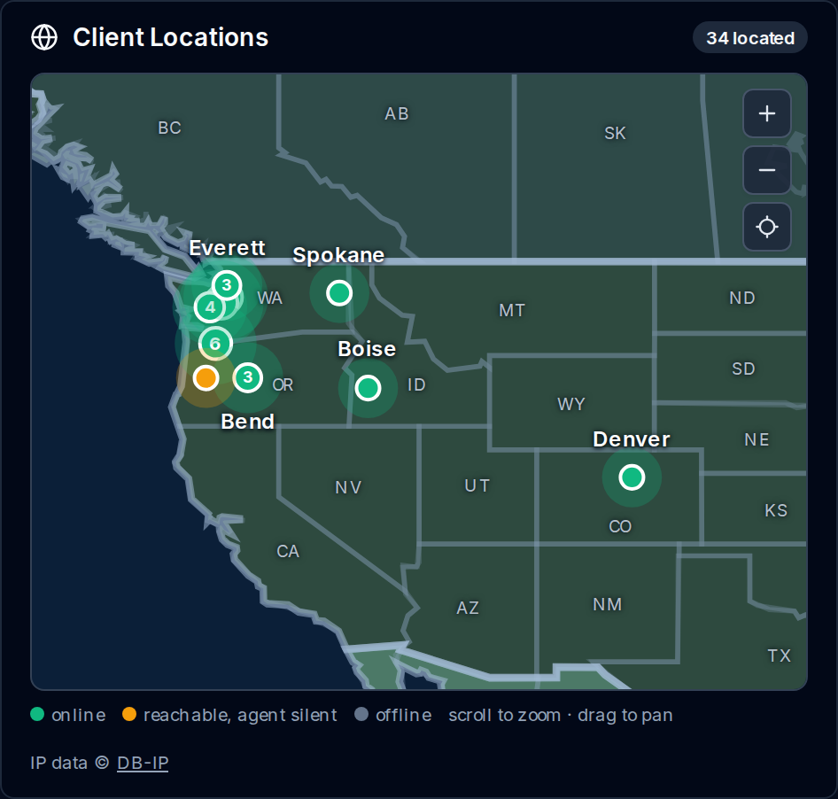</a><br><sub><b>Know where the estate is.</b> Managed computers plotted from their last check-in, clustered by city. <i>Dark</i></sub></td>
<td width="50%"><a href="docs/images/github/business-computers-dark.png">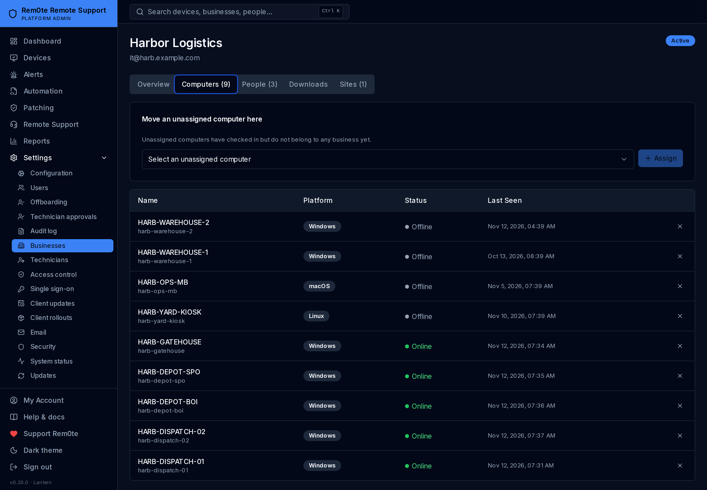</a><br><sub><b>Answer "my PC is broken" fast.</b> One customer's machines, with live status. <i>Dark</i></sub></td>
</tr>
<tr>
<td width="50%"><a href="docs/images/github/device-specs-dark.png">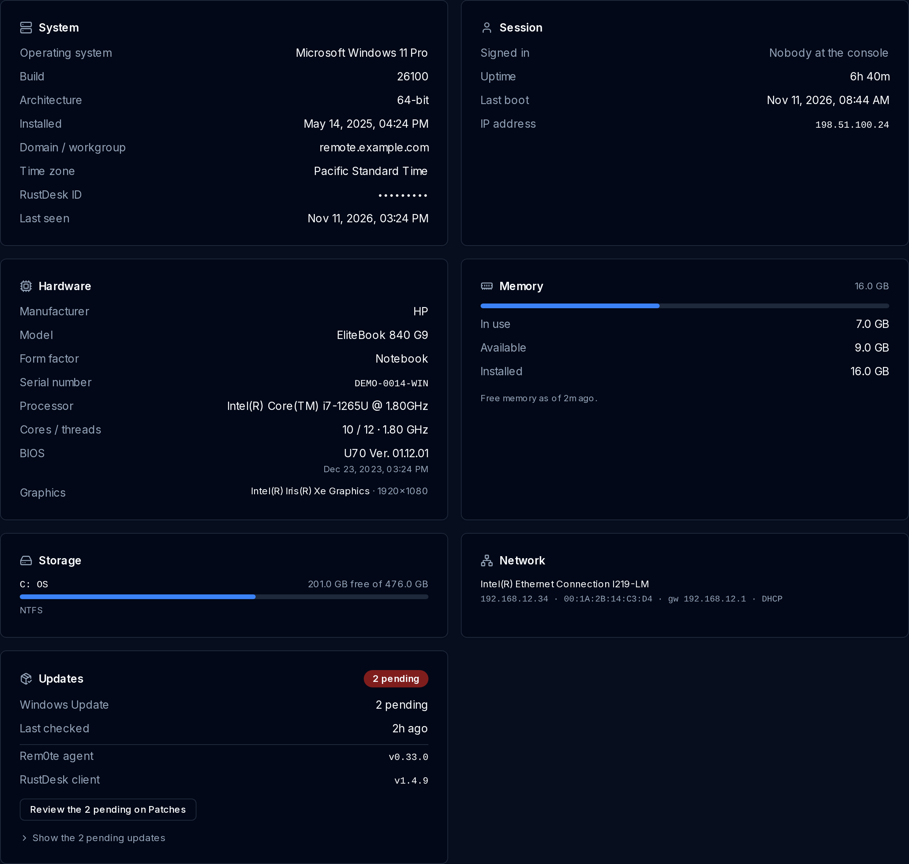</a><br><sub><b>Know the machine before you touch it.</b> Hardware, disk space, who is signed in, how long it has been up, and what it is waiting to install. <i>Dark</i></sub></td>
<td width="50%"><a href="docs/images/github/device-event-log-dark.png">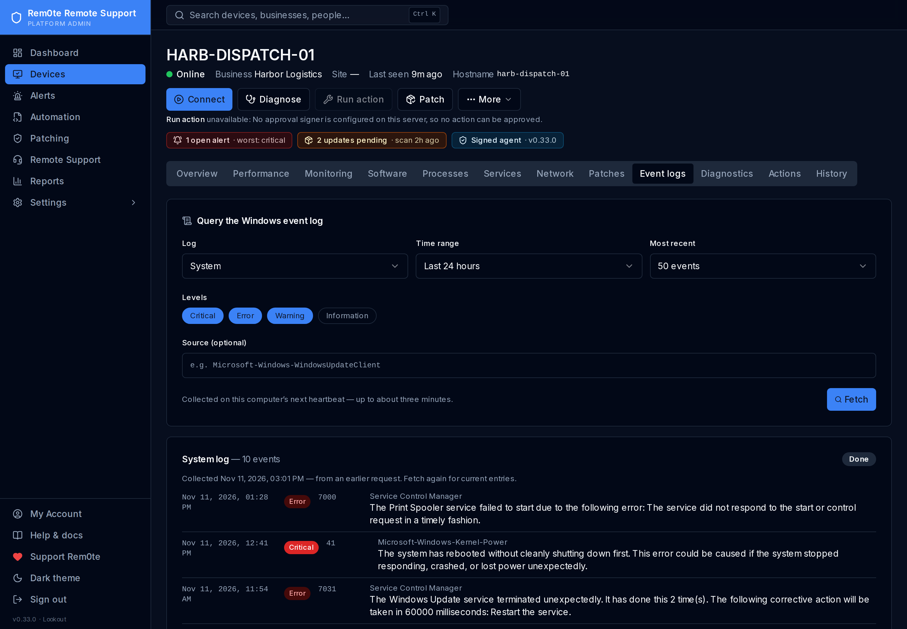</a><br><sub><b>Read the event log without connecting.</b> Five Windows logs, filtered by level and window — and reading them is its own permission. <i>Dark</i></sub></td>
</tr>
<tr>
<td width="50%"><a href="docs/images/github/add-device-light.png">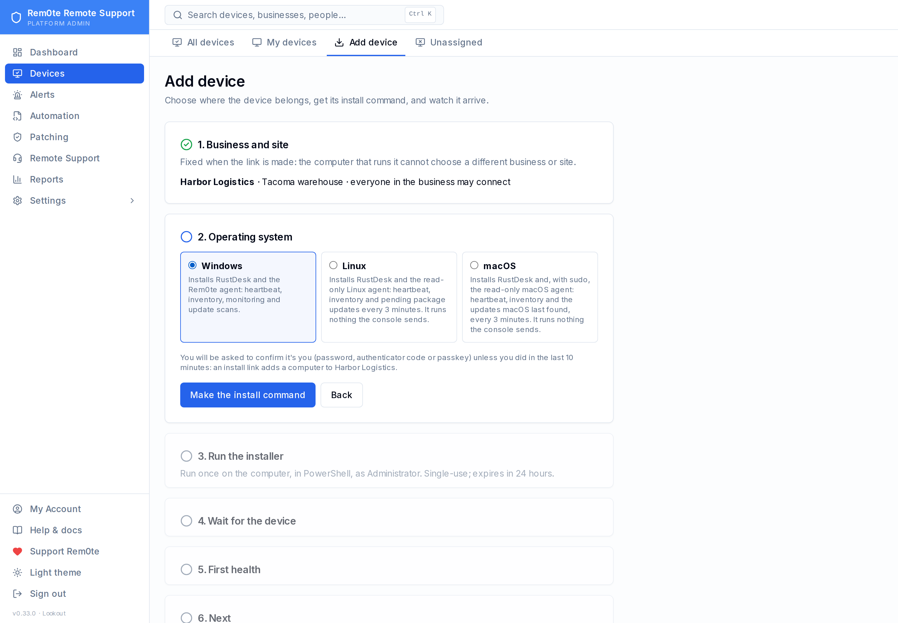</a><br><sub><b>Onboard a machine in one run.</b> The business and site are fixed into the install link; the machine cannot pick another. <i>Light</i></sub></td>
<td width="50%"><a href="docs/images/github/access-users-dark.png">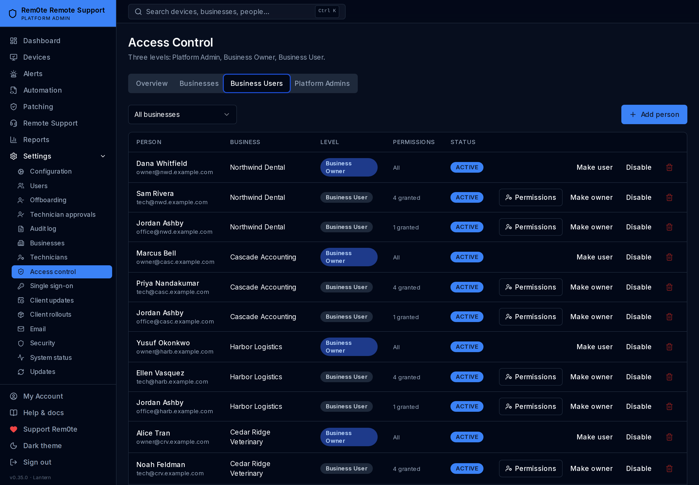</a><br><sub><b>Delegate safely.</b> Each user shows the capabilities actually granted, not a role name. <i>Dark</i></sub></td>
</tr>
<tr>
<td width="50%"><a href="docs/images/github/trmm-match-dark.png">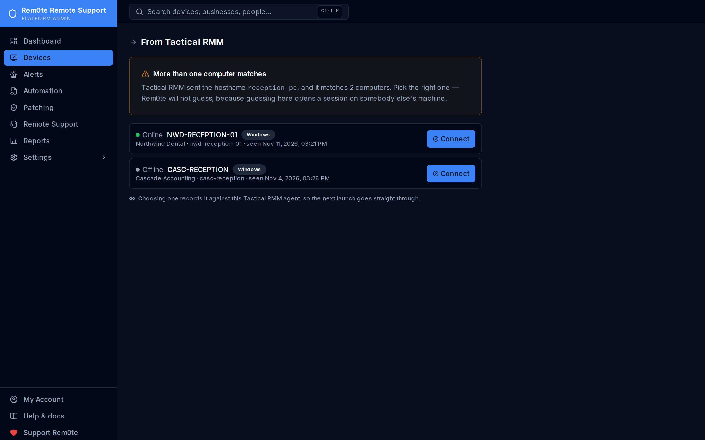</a><br><sub><b>Launch from Tactical RMM.</b> Right-click an agent in TRMM and connect through Rem0te. Two customers with the same hostname? It asks, then remembers. <i>Dark</i></sub></td>
<td width="50%"><a href="docs/images/github/device-resources-light.png">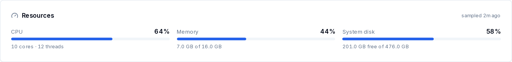</a><br><sub><b>See the state before you connect.</b> CPU, memory and disk sampled on the heartbeat — and the card says how old the reading is. <i>Light</i></sub></td>
</tr>
<tr>
<td width="50%"><a href="docs/images/github/quick-connect-light.png">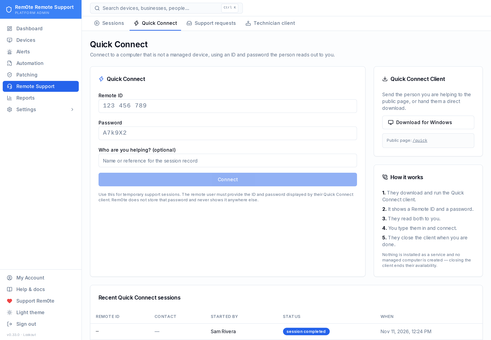</a><br><sub><b>Help a machine you don't manage.</b> No install, no enrolment — it ends when they close the client. <i>Light</i></sub></td>
<td width="50%"><a href="docs/images/github/audit-timeline-dark.png">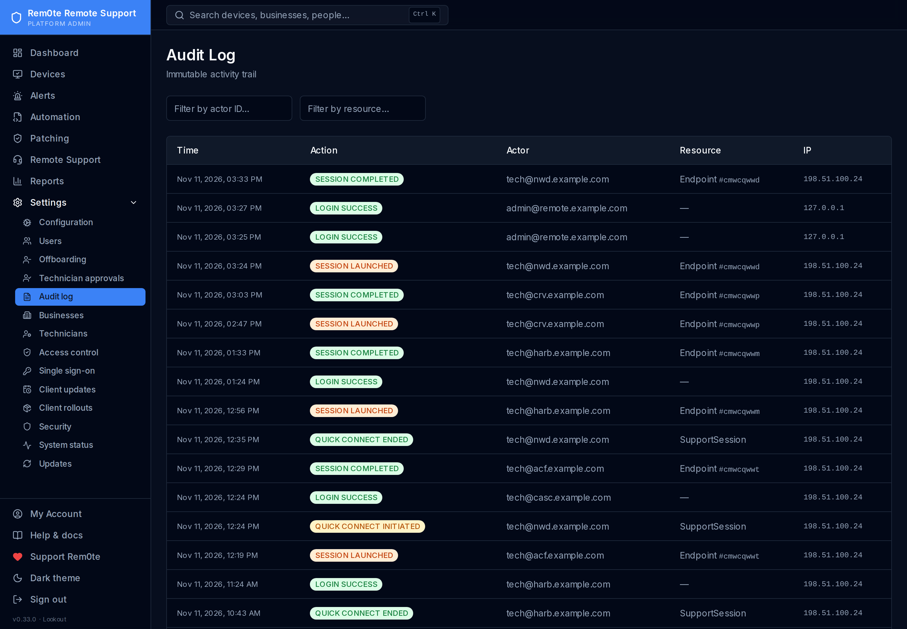</a><br><sub><b>Prove what happened.</b> An append-only trail of sign-ins, sessions and credential reveals. <i>Dark</i></sub></td>
</tr>
</table>

**[→ See all 59 screenshots](docs/screenshots.md)** — the dashboard, search, the device list and
every device tab, reports, the script library, patching, administration and configuration, in light
and dark and at phone width. Captured from v0.36.

---

## Watch the walkthrough

A recorded tour of the real application — the dashboard, three end-to-end
workflows, then Quick Connect, session history and the audit log, in both themes.

> Recorded at **v0.13.5**. Everything in it still works the same way, but the
> dashboard has since been rebuilt to fit one screen and the device page has
> gained inventory, resource gauges and an event-log tab — so the
> [screenshots](docs/screenshots.md) are the current picture of those two.

<a href="https://github.com/agit8or1/rem0te/releases/download/v0.13.5/walkthrough.mp4"></a>

**[▶ Watch the walkthrough](https://github.com/agit8or1/rem0te/releases/download/v0.13.5/walkthrough.mp4)** (2 min 28 s)
 · [52-second highlight](https://github.com/agit8or1/rem0te/releases/download/v0.13.5/highlight.mp4)
 · [transcript](docs/media/walkthrough-script.md)
 · [captions](docs/media/walkthrough.vtt)

> Everything shown is an isolated demo environment — fictitious businesses,
> synthetic devices, and no remote session at any point. The walkthrough is
> **caption-led: there is no narration and no audio track.** The transcript
> carries a narration-ready script if you want to add one.

---

## How the pieces fit

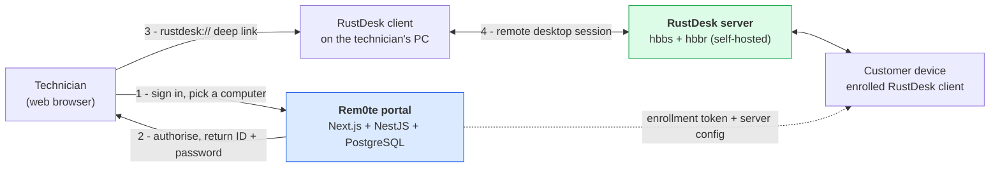

**Rem0te adds** the portal: businesses, accounts and permissions, managed device
enrollment, credential storage and release, session records and the audit log.
**RustDesk provides** the remote desktop itself — the `hbbs` rendezvous server,
the `hbbr` relay, and the clients. Rem0te never sees the pixels or the keystrokes.

**Browser launching, not browser-based control.** Clicking **Connect** opens a
`rustdesk://` deep link, which the OS hands to the RustDesk client already
installed on the technician's machine. **A local RustDesk client is required.**
There is no in-browser remote desktop.

### Managed devices vs Quick Connect

|  | **Managed device** | **Quick Connect** |
|---|---|---|
| Set up by | Running a one-time enrollment installer | The person being helped runs a client |
| Lives in | The business's computer list, permanently | Nowhere — no computer record is created |
| Connect using | Stored credentials, released on authorisation | An ID and password they read out |
| Ends when | You remove it | They close the client |

---

## Who does what

Three levels, and no reseller hierarchy.

| Level | Scope |
|---|---|
| **Platform Admin** | The operator. Runs the service, creates and manages every customer business, owns platform settings. |
| **Business Owner** | Full control of **one** business — its computers, people, sessions and history. Nothing outside it. |
| **Business User** | Exactly the capabilities their Business Owner granted, over the computers they were given. |

A **Business** is the boundary that matters, and it is enforced on the server
rather than by hiding buttons. Full model in [docs/access-control.md](docs/access-control.md).

---

## Does this need RustDesk Pro?

**No.** Rem0te runs against the open-source RustDesk server and the standard
open-source clients. The installer fetches `hbbs`/`hbbr` from the OSS
[`rustdesk/rustdesk-server`](https://github.com/rustdesk/rustdesk-server)
releases, and every client configuration Rem0te generates sets `api-server = ''`
— RustDesk's own API server, a Pro component, is deliberately unused. Rem0te's
portal fills that role.

No paid component, licence key or subscription is required by this project.
Rem0te is MIT-licensed. RustDesk is a separate project under its own licence.

---

## Quick start

Full instructions, including manual installation, in [docs/setup.md](docs/setup.md).

```bash
git clone https://github.com/agit8or1/rem0te
cd rem0te
sudo bash deploy/scripts/install.sh your-domain.example.com admin@example.com
```

The installer sets up Node.js, PostgreSQL, Redis, Caddy (automatic HTTPS),
fail2ban, the RustDesk server and its keypair, builds the app, runs migrations,
seeds a Platform Admin and starts the systemd services. It prints the login URL
and admin credentials at the end — **save them immediately**.

### Enrolling a customer's computer

1. **Businesses → Add Business** — create the customer.
2. **Enroll Computer** — choose the business, who may connect, and the platform.
   The business is bound into the token here and the machine cannot change it.
3. **Generate Installer** — a one-time command or a Windows installer executable.
4. Run it once on the target machine, as administrator.
5. The computer appears in that business's list; the users you selected see it
   under **My Computers**.

---

## Requirements and limitations

**Server** — Ubuntu 22.04 LTS or Debian 12, 1 GB RAM minimum (2 GB recommended),
10 GB disk, a public IP. A domain is strongly recommended; automatic HTTPS
depends on it. Node.js 20+, PostgreSQL, Redis and Caddy are installed for you.
Deployment is plain systemd — Docker is not required.

**Ports** — 80 and 443 for the portal, plus RustDesk's own: 21115 (TCP),
21116 (TCP **and** UDP), 21117 (TCP), 21118–21119 (TCP websocket, optional).

**Endpoints** — enrollment scripts are generated for **Windows**, **Linux** and
**macOS**. Windows additionally has a compiled installer executable.

**RustDesk** — `hbbs`/`hbbr` are installed from the latest OSS release. Generated
client configuration targets the RustDesk **1.4.x** client series.

### Limitations

- **Part of an RMM, not all of one.** Rem0te monitors computers, keeps a software inventory and change history,
  reports Windows Update status, deploys Windows updates in approved stages, and hands alerts and ticket analysis
  to ClientSt0r. It has no scripting or remote shell, no third-party patching, no software deployment and no
  backup. What works depends on the agent: the standard agent reports patches **read-only**, deploying needs the
  signed agent and the approval signer, and Linux and macOS get remote access only. None of the signed-agent
  patching has run on real Windows yet. [What each agent can do](docs/capabilities.md) has the full table.
- **ClientSt0r cannot pair yet.** Rem0te implements the ticket-rmm-v1 contract, and ClientSt0r 3.17.659 speaks
  a different protocol: four measured gaps, listed in
  [CLIENTST0R.md](docs/contracts/ticket-rmm-v1/CLIENTST0R.md).
- **No in-browser remote control** — a local RustDesk client is required.
- **One RustDesk server per instance.** Relay host and public key are
  platform-wide settings, not per-business.
- **No trend or time-series charting.** The dashboard has stat tiles, a
  seven-day session bar chart and a client map; there is no charting library and
  no historical graphing beyond that.
- Automatic HTTPS requires a domain; a bare IP works but over plain HTTP.

---

## Security

- **Report a vulnerability:** follow [SECURITY.md](.github/SECURITY.md) and do
  **not** open a public issue. Private reporting is enabled on this repository.
- **Who can reach a computer, and the evidence you get:**
  [docs/security-model.md](docs/security-model.md).
- **What is enforced:** [docs/SECURITY-AUDIT.md](docs/SECURITY-AUDIT.md) records
  the review passes. This is an **internal review by the project, not an
  independent third-party audit**.
- Business isolation is covered by an automated suite
  (`apps/api/scripts/e2e-business-access.mjs`) and static invariant checks
  (`scripts/check-security-invariants.mjs`), both run by CI on every push.

## Updating

Rem0te, the RustDesk clients on endpoints, and `hbbs`/`hbbr` update
independently — [docs/updates.md](docs/updates.md) explains which is which. The
in-app updater is **off by default** and requires a GPG-signed release tag.

## Documentation

**[Start at the docs index](docs/README.md)** — it routes by what you are doing.

| Guide | For |
| --- | --- |
| [Screenshots](docs/screenshots.md) | The full gallery — every screen, light and dark. |
| [Troubleshooting](docs/troubleshooting.md) | Something will not connect. Start here. |
| [Technician Guide](docs/technician-guide.md) | Day-to-day use — connecting, Quick Connect, enrolling. |
| [Connecting](docs/connecting.md) | What happens when you click Connect. |
| [Clients](docs/clients.md) | Every RustDesk client Rem0te hands out. |
| [What each agent can do](docs/capabilities.md) | Capabilities by agent type, configuration, and what is tested on real Windows. |
| [Inventory & event logs](docs/inventory.md) | What a computer reports about itself, and reading its Windows event log. |
| [Tactical RMM](docs/tactical-rmm.md) | Connecting and querying from inside Tactical RMM. |
| [Setup](docs/setup.md) | Installing and operating a server. |
| [Architecture](docs/architecture.md) | What runs where, and the RustDesk config chain. |
| [Access Control](docs/access-control.md) | The three-level model and capabilities. |
| [API Reference](docs/API-REFERENCE.md) | Every route and its required capability. |
| [Public API](docs/PUBLIC-API.md) | Scripted RMM/PSA integration, scopes and examples. |

## Contributing

Issues, ideas and pull requests are welcome.

- [Report a bug](https://github.com/agit8or1/rem0te/issues/new?template=bug_report.md)
- [Request a feature](https://github.com/agit8or1/rem0te/issues/new?template=feature_request.md)
- [Discussions](https://github.com/agit8or1/rem0te/discussions)

Every change bumps the version and adds a changelog entry — see [CLAUDE.md](CLAUDE.md).

---

## More tools from MSPReboot

Rem0te is published by **[MSPReboot](https://mspreboot.com)**, an MSP consulting
practice that also releases free, self-hostable tools for MSPs. The other
open-source projects listed there:

| Project | What it is |
|---|---|
| [ClientSt0r](https://github.com/agit8or1/clientst0r) | Customer documentation, assets and knowledge base |
| [OPNMGR](https://github.com/agit8or1/OpnMgr) | OPNsense firewall fleet management |
| [Depl0y](https://github.com/agit8or1/Depl0y) | Proxmox infrastructure and VM deployment |
| [St0r](https://github.com/agit8or1/St0r) | UrBackup backup visibility and administration |

These are separate projects with their own repositories and licences.

**Rem0te is MIT-licensed and free to self-host** — the install guide above is
all you need, and nothing here requires an engagement. If you would rather not
run it yourself, **MSPReboot offers hosting and support for Rem0te**:
[get in touch](https://mspreboot.com/contact).

## License

MIT — see [LICENSE](LICENSE).

---

<sub>Project managed by **Luna**, a German Shepherd Dog with discerning taste in remote support software. 🐾</sub>
