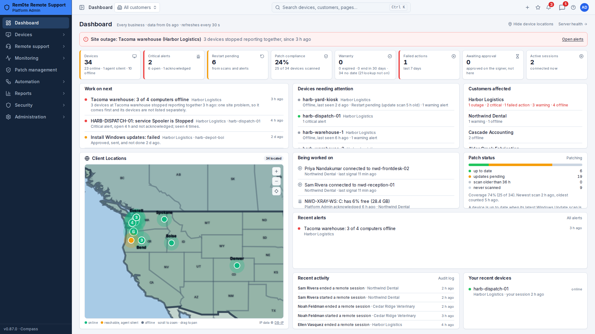
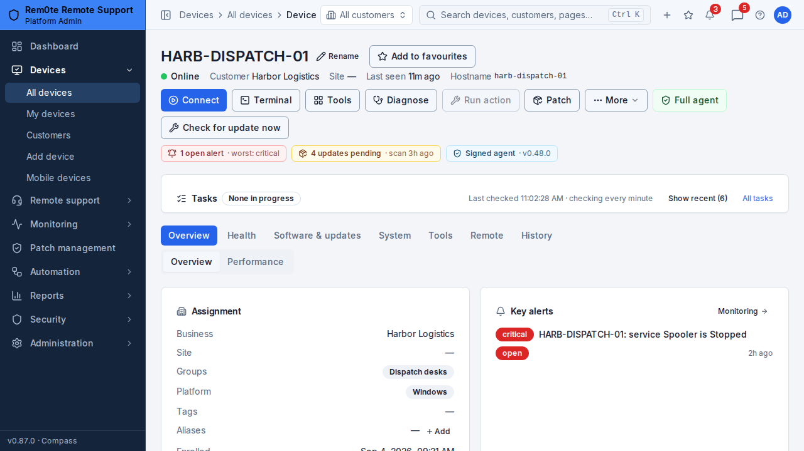
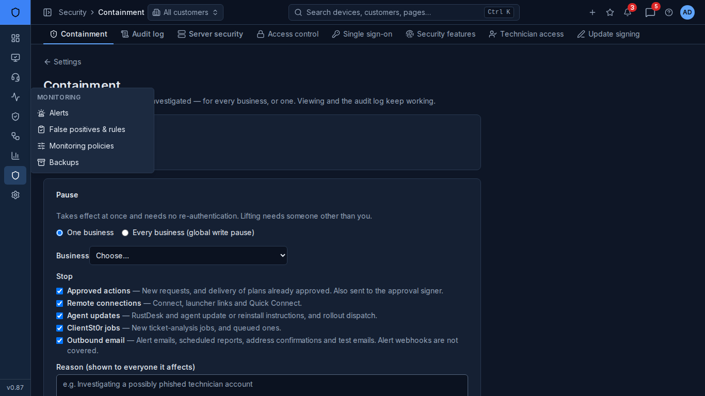
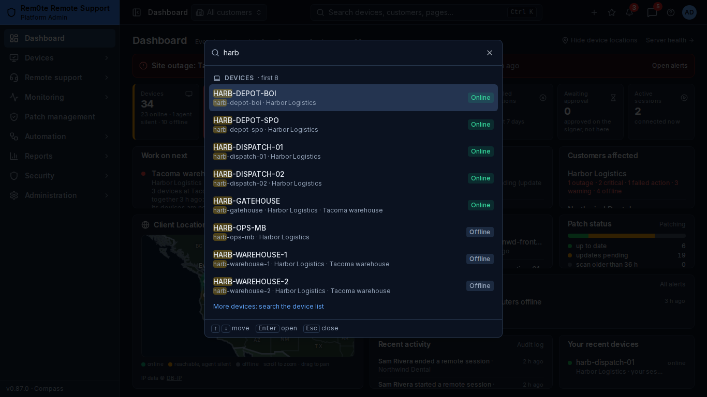
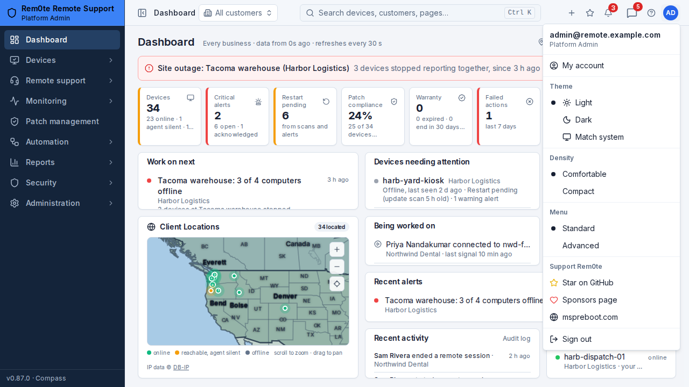
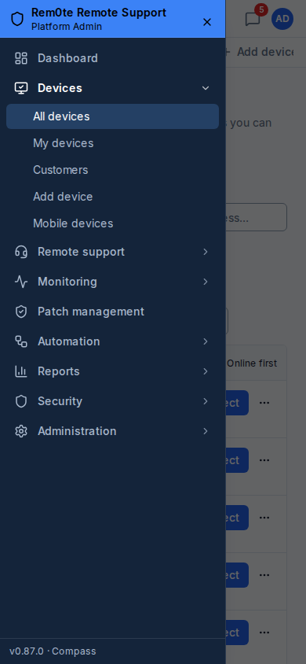

# Navigation architecture

How the console's menu, header, Ctrl+K palette, favourites, recent items and
device tabs are built (0.87 *Compass*), what decides what a person sees, and
the rules that keep all of it presentation only. Where each pre-0.87 entry went
is in [NAVIGATION_MIGRATION.md](NAVIGATION_MIGRATION.md); the colours, type and
spacing are in [UI_DESIGN_SYSTEM.md](UI_DESIGN_SYSTEM.md).

**Navigation is not access control.** Hiding an entry hides a link; the page
and every API route behind it check for themselves, exactly as before. A person
who types a URL they may not use gets the page's own refusal. Nothing in this
page relaxes a server check.

## The pieces

| Piece | File | What it does |
|---|---|---|
| The menu model | `apps/web/components/layout/nav-model.ts` | The one list of groups and pages. Pure: no fetch, no React state |
| The sidebar | `components/layout/sidebar.tsx` | Draws the model: expanded (232 px) or collapsed (60 px), and the phone drawer |
| The header | `components/layout/top-bar.tsx`, `header-menus.tsx` | Toggle, breadcrumbs, customer context, search, quick actions, favourites, alerts, chat, tasks, help, profile |
| Section tabs | `components/layout/section-tabs.tsx` | The tab row above a hub's pages, from `hubTabs()` |
| The palette | `components/search/command-palette.tsx` | Ctrl/Cmd+K: server search plus pages, recent items and quick actions |
| Per-person state | `apps/web/lib/navigation.ts` | Reads and writes `/me/navigation`; mirrors it in `localStorage` (`nav.prefs`) so the first paint is right |
| Shell effects | `components/layout/shell-effects.tsx` | Records visits; applies density (`html[data-density]`) |
| Record bars | `components/layout/record-bar.tsx` | The star on a device or customer page; *Keep in view* for a Platform Admin |
| The API | `apps/api/src/navigation/` | Preferences, favourites and recent items, each person's own |

## The menu model

`NAV` is nine groups, in this order: **Dashboard, Devices, Remote support,
Monitoring, Patching, Automation, Reports, Security, Administration.** The ids
(`dashboard`, `devices`, `remote`, `monitoring`, `patching`, `automation`,
`reports`, `security`, `admin`) are also the API's `GROUP_IDS` and migration
0104's CHECK on pinned groups; §96 fails if the three disagree.

Each page (a *leaf*) has:

- `href` — the page. **No URL changed in 0.87**; every leaf is a page that
  existed before, and the unit test checks each one has a `page.tsx`.
- `show(ctx)` — whether this person is offered it: their capabilities, Platform
  Admin, Business Owner, technician assignments. It mirrors the page's own
  gate; it is not the gate.
- `tier` — `standard` or `advanced` (below).
- `hub` — the section-tab row the page belongs to, if any.
- `keywords` — extra words the palette matches.

`locate(path)` finds the group and leaf for any path (the longest matching
`href`, then a group's `also` list), which drives the highlighted row, the
auto-expanded group and the breadcrumbs. `allPages(ctx)` is what the palette
searches. `hubTabs(path, ctx)` gives the tab row.

## Standard and Advanced

Each person chooses a mode in the profile menu; it is stored with their
preferences. **Standard** lists only `tier: 'standard'` pages in the sidebar
(29 for a Platform Admin). **Advanced** lists everything (58).

Standard mode never makes a page unreachable. Every advanced page has a `hub`,
so it is a section tab on a standard page's tab row, and every page is in the
palette's *Pages* group whatever the mode. `unit-nav-model.mjs` checks both for
every role.

## The sidebar

- **Expanded**, 232 px: group rows 36 px, page rows 32 px (compact density:
  32 and 28), icons 18 px. The group holding the current page opens by
  itself; others open on a click (`aria-expanded`, `aria-controls`). A group
  can be **pinned** open (the pin on hover or focus); pins are stored.
- **Collapsed**, 60 px: one icon per group. Hover or focus shows the name in a
  tooltip; a click opens a **flyout** (a Radix menu) with the group's pages.
- **A one-page group** (Dashboard) is a link, not a button.
- **1080p**: with every group of a Platform Admin open in Standard mode, the
  menu fits a 1,080-pixel-high window without scrolling. The unit test adds up
  the rows (header 48, footer 37, rows) and fails above 950 px; in practice
  groups are closed and it is far shorter. It scrolls inside itself if a
  window is smaller.
- **Phones and narrow tablets** (below 768 px): the same component inside a
  modal drawer from the header's menu button (focus kept inside, Esc and a tap
  outside close it, following a link closes it).
- The footer is the version line. Help, Documentation, About, My account and
  sign out moved to the header.

## The header

From the left: the drawer button (phones) or the collapse toggle
(`aria-pressed`), breadcrumbs (group › page › record, from `locate()`), the
**customer context**, the search button (Ctrl/Cmd+K), quick actions, favourites,
the critical-alerts bell, chat, tasks, help, and the profile menu.

- **Customer context.** A technician switches the customer they work in (the
  0.20 cookie, as before). A Platform Admin can *keep a customer in view*: the
  choice is stored (`contextBusinessId`) and offered on the header and the
  customer's page. It is a label and a shortcut to that customer's devices; it
  narrows no query by itself.
- **Profile menu.** Theme (Light, Dark, **System**; the theme store is still
  `localStorage.theme` through `ThemeProvider`), density (Comfortable,
  Compact), mode (Standard, Advanced), My account, About, sign out, and —
  for staff only (Platform Admins and MSP technicians, owner decision 2b) —
  *Support Rem0te*.
- **Alerts bell.** Critical active alerts the person can see (the alerts list's
  own query, limit 10), polled every 60 s and not while the tab is hidden.
- **Polling.** The task watcher no longer polls in a hidden tab, and the chat
  inbox slows to a quarter of its rate (UX_AUDIT.md F-9).

## The palette

Ctrl+K (Cmd+K on a Mac) or the search button. With nothing typed it shows
recent items and quick actions. Typing searches, at once:

- **The server** (`GET /search`), as before for devices, customers, sites,
  people and alerts, plus two groups new in 0.87:
  - **Scripts** — the script library's own gate (`anyRight`), its list rule
    (`libraryWhere` with `listScope`) with the name AND-ed, and `viewOf` on
    every row, so a reviewer-only person sees only scripts they may see.
  - **Policies** — patch policies and automation schedules (not restart
    windows), each through its detail page's own `scoped()`; a non-admin's
    candidates are their own customer's only. Needs `computers:view`.
- **Pages** — `allPages(ctx)`, labels and keywords, at most six.

Every server group starts from its list page's where builder, so the palette
can never show a record the list would not (§28, §96). `e2e-nav-prefs.mjs` and
`e2e-ui.mjs` check that Customer B's devices, customer record, script, patch policy
and schedule never reach Customer A's owner, user or technician, by a shared
word or by B's exact name, while a Platform Admin finds them.

## Favourites and recent items

Stored on the server (migration 0104), so they follow a person between
browsers.

- **What is kept** is a kind (`device`, `business`, `site`, `script`, `page`)
  and a reference: a record's id, or a console path. **Never a name or a
  URL.** A page reference must be a console path (`/a/b`, lower case, at most
  six segments, no query, no `..`, no `//`); the API and 0104's CHECK use the
  same expression.
- **Named on every read** through the record's own page's rule (the device
  list's `scopedWhere`, `GET /businesses`' and `GET /sites`' `listWhere`, the
  library's rule). A record the person can no longer see drops out of both
  lists on the next read; the row is kept and comes back with the access.
  Saving one the person cannot see is a 404, the same as a missing one.
- **Bounded**: 50 favourites (`409 FAVORITES_FULL`), 15 recent items (older
  ones deleted), counted inside the write's transaction.
- **Own rows only**: every query names `userId: actor.userId`; no route takes
  another person's id. Not audited: it is presentation, like a theme.
- Recent items are recorded by the shell 800 ms after a device, customer, site
  or script page is opened.

## The device page

The 15 tabs are seven groups, a row of buttons above a tab list that shows only
the open group's tabs:

| Group | Tabs |
|---|---|
| Overview | Overview, Performance |
| Health | Monitoring, Events |
| Software | Software, Patches |
| System | Processes, Services, Network |
| Tools | Diagnostics, Actions |
| Remote | Terminal, Files, Chat |
| History | History |

`?tab=<id>` still opens any tab directly and opens its group. Remote control
(Connect) and **Terminal** are buttons in the header. The action menu and the
Tools panel (§85, `lib/device-tools.ts`) are unchanged; destructive actions stay
in their own section with their confirmations. When no approval signer is set,
the reason is the disabled Run button's description and the Tools panel's
(owner decision 5b), not a line under every header.

## Standalone

Rem0te runs on its own. The application switcher renders nothing; no link to
another product is drawn in the header; *Ask AI* is not drawn when no AI
provider is set (owner decision 3b). See
[ux/STANDALONE_REQUIREMENTS.md](https://github.com/agit8or1/rem0te/blob/main/docs/ux/STANDALONE_REQUIREMENTS.md).

## Tests

| Suite | What it proves |
|---|---|
| `apps/web/scripts/unit-nav-model.mjs` (CI) | Every leaf is a page; no duplicates; nine groups agreeing with the API and 0104; every pre-0.87 URL in the migration table is reachable and in the group it says; Standard mode hides no page; role visibility; the 1080p budget |
| `apps/api/scripts/unit-navigation.mjs` (CI) | The closed lists, the page and record reference rules, the strict request bodies |
| `apps/api/scripts/e2e-nav-prefs.mjs` (port 4101, `run-e2e.sh`) | Preferences, favourites, caps, own rows only, losing access hides, recent items, nothing stored is a name, not audited, search scripts and policies isolated |
| `apps/web/scripts/e2e-ui.mjs` (CI) | Collapse and its persistence after a reload with the browser copy cleared, the flyout, the palette with no other customer, favourites, the drawer, every old route, standalone |
| `scripts/check-security-invariants.mjs` §96 | The rules above, statically |

## What it looks like

Captured on the scratch docs stack (demo data, masked), 0.87.0.

