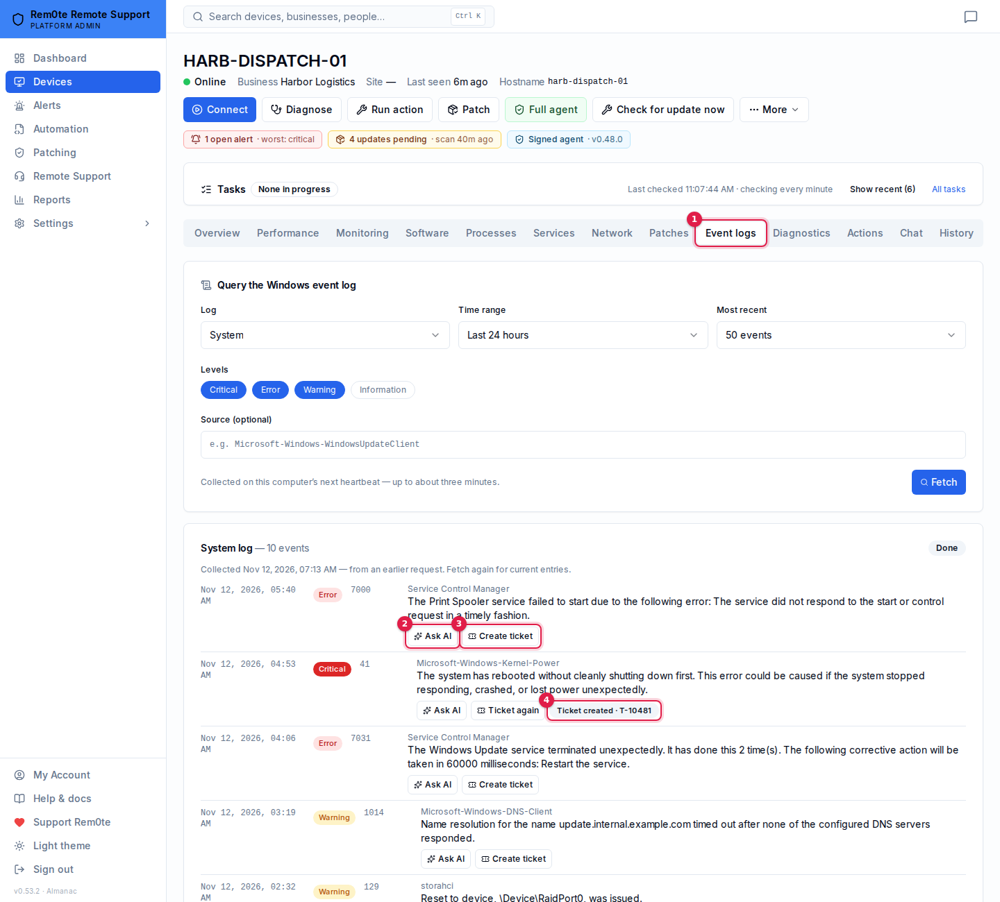
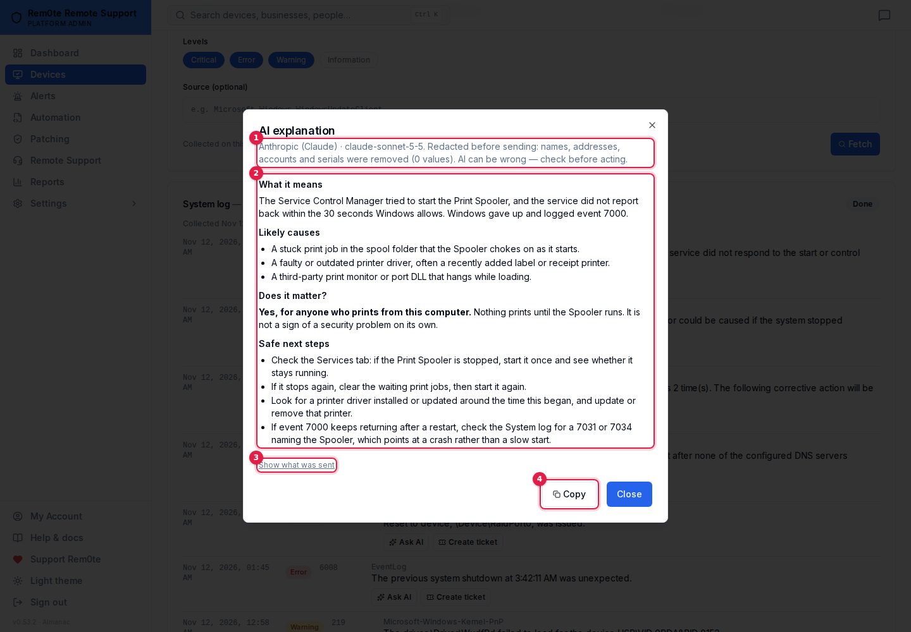
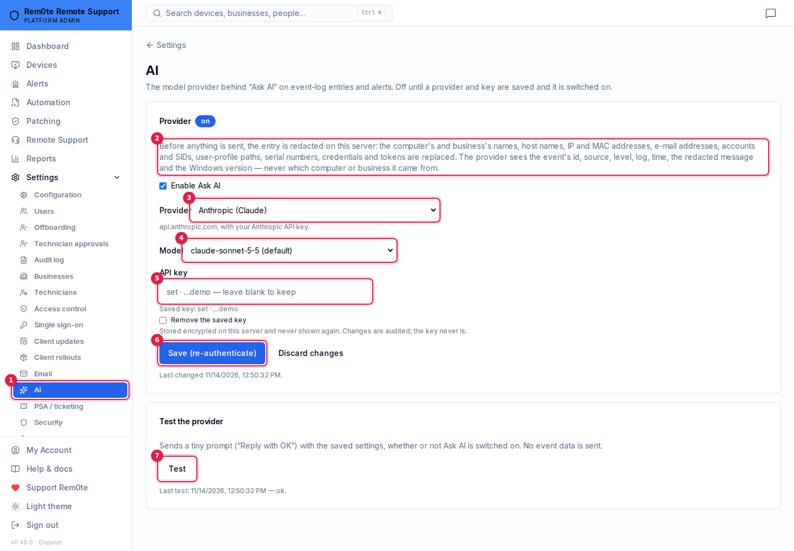
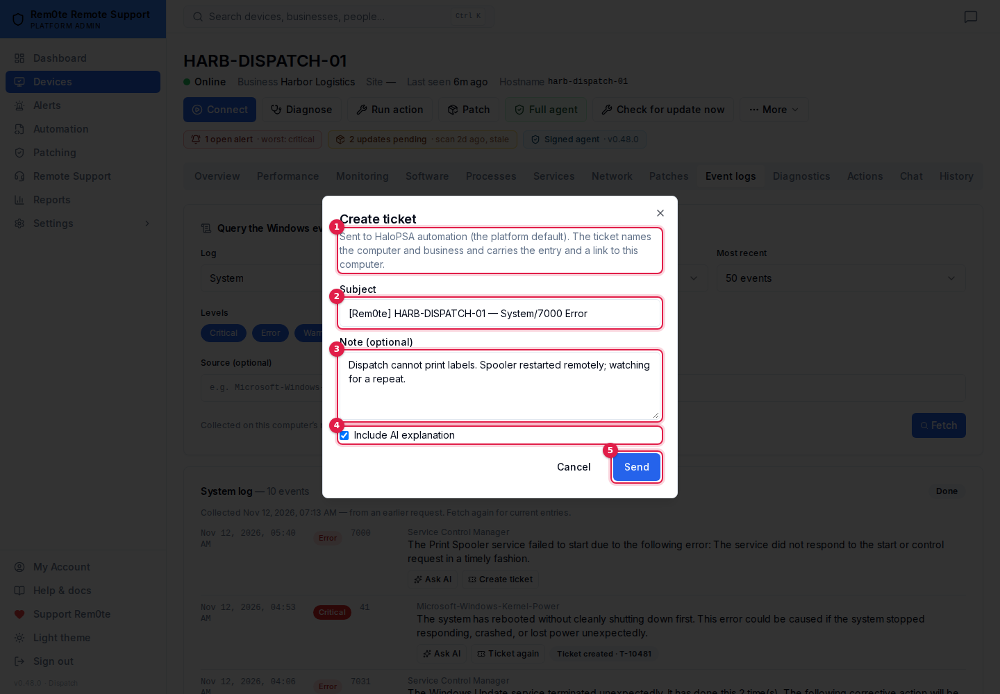
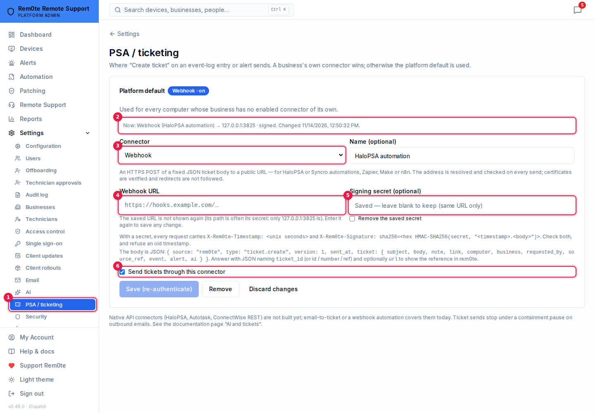

# AI and tickets

From 0.48, every Windows event-log entry on a device's **Event logs** tab, and every alert on its
**Monitoring** tab, has two buttons:

- **Ask AI** — explains what the entry means, likely causes, whether it matters and safe next steps,
  using the AI provider a Platform Admin set under **Administration → AI**.
- **Create ticket** — opens a ticket in whatever PSA is connected under **Administration → PSA / ticketing**:
  the customer's own connector if it has an enabled one, otherwise the platform default.

Both buttons name the entry by reference (the stored event-log result and its position, or the
alert's id). The server reads the entry itself from what the device reported, so neither button
can be used to send arbitrary text to a provider or a PSA.



1. **Event logs** — the tab. Fetch a slice of a log first ([Inventory and event logs](inventory.md#event-logs));
   the buttons work on the stored result.
2. **Ask AI** — greyed out, with *Not configured* on hover, until a Platform Admin sets a provider.
3. **Create ticket** — shown only to someone with `tickets:create`, and greyed out, with the reason on hover, until a
   connector is set up.
4. **Ticket created · T-10481** — this entry already has a ticket; the reference is the PSA's own. The button then
   reads *Ticket again*.

The images on this page come from the documentation server, where the AI provider and the PSA are loopback
stand-ins; nothing in them reached a real provider or PSA.

## Ask AI

### What is sent

Only this, and only after redaction:

| Sent | Never sent |
|---|---|
| Event ID, provider (source), level, log name, time | The device's name or hostname |
| The event message, redacted | The customer or site |
| The device's Windows version | Who asked |

For an alert: its kind, monitor, severity, title and detail (all redacted) and when it was first seen.

The whole input is capped at about 8 KB (the message at 6,000 characters).

### Redaction

Before anything leaves this server, the entry passes through `apps/api/src/ai/redact.ts`:

1. The names this server knows for the device — its name, hostname, serial number, domain, the
   logged-on user (both halves of `DOMAIN\user`), its customer and site — are replaced wherever they
   appear, along with any host under that domain (`dc01.corp.example.com`).
2. What Windows writes about people and machines is replaced by pattern: account SIDs
   (`S-1-5-21-…`; well-known ones such as `S-1-5-18` are kept), `DOMAIN\user` (but not `NT AUTHORITY\…`,
   registry roots or paths), UNC host names, the labelled account and workstation fields of
   Security-log messages (`Account Name:`, `Workstation Name:`, `Source Network Address:` …),
   `\Users\<name>` paths, fully qualified host names (file names such as `wuaueng.dll` are kept),
   serial-like tokens and labelled serial numbers (KB numbers and `0x8007…` codes are kept).
3. Then the same redactor used for ClientSt0r (`redactForPeer`): credentials and tokens, keys,
   e-mail addresses, every IPv4 and IPv6 address, MAC addresses, RustDesk IDs and
   `C:\Users\<name>` profile paths.

The dialog says how many values were removed, and **Show what was sent** displays the exact redacted text.



1. **Provider, model and redaction** — which provider answered, and how many values were removed before sending.
   *cached* appears beside the title when the answer came from the day's cache.
2. **The answer** — what it means, likely causes, whether it matters and safe next steps, drawn as plain text.
3. **Show what was sent** — the exact redacted text the provider received.
4. **Copy** — the answer as text, for a ticket or a note.

### The prompt and the answer

The instructions are fixed. The entry goes in the user message inside `<untrusted_log_data>` tags,
and the model is told it is data, never instructions, and never to recommend anything destructive
(deleting data, wiping disks, disabling security software, Windows Update or the firewall, unbacked
registry edits, running downloaded commands). The answer is shown as text: a few headings, bold and
bullets are drawn as page elements, HTML is removed, and links are not made clickable.

AI can be wrong. Check its suggestions before acting on them.

### Cost, caching and limits

- An identical entry (same provider, model and redacted content, whatever its time) is answered from
  a cache for a day and costs nothing; the dialog shows **cached**.
- 30 questions per person per hour (`AI_ASK_PER_HOUR`), and 10 a minute per address.
- Each request has a 60-second timeout and a 256 KB response cap.

### Who can ask

`computers:view` on the device (another customer's device is a 404), plus
`computers:event_logs` for an event-log entry (the same permission that reads the log) or
`monitoring:alerts` for an alert.

### Audit

`AI_ASKED` is written **before** the request leaves (if it cannot be written, nothing is sent) and
`AI_ANSWERED` after. They hold ids, the provider and model, sizes, redaction counts and token counts —
never the entry, the prompt or the answer.

## Administration → AI (Platform Admin)



1. **Administration → AI** — Platform Admins only. Everyone else sees only whether Ask AI is on.
2. **What is sent** — the redaction, in short.
3. **Provider** — Anthropic, OpenAI or an OpenAI-compatible service.
4. **Model** — Anthropic's three, or *Other* to type one.
5. **API key** — write-only: once saved it shows as *set · …* and its last four characters.
6. **Save (re-authenticate)** — asks you to confirm it is you every time.
7. **Test** — a tiny prompt with the saved settings; the result and time are shown below it.

One provider at a time:

| Provider | Device | Key header |
|---|---|---|
| Anthropic | `POST https://api.anthropic.com/v1/messages` (`anthropic-version: 2023-06-01`) | `x-api-key` |
| OpenAI | `POST https://api.openai.com/v1/chat/completions` | `Authorization: Bearer` |
| OpenAI-compatible (Azure v1, OpenRouter, Groq, Mistral…) | `POST {base URL}/chat/completions` | `Authorization: Bearer`, or `api-key` for Azure |

Anthropic models: `claude-sonnet-5-5` (default), `claude-opus-5-5`, `claude-haiku-5-5`, or a typed id.
OpenAI and compatible providers take a typed model id.

**How the key is protected.**

- Stored AES-256-GCM-encrypted under the server's `ENCRYPTION_KEY`, bound to its purpose, and
  decrypted only to make one request.
- Never returned by any page or API: only "set · …abcd" (its last four characters).
- Never in an audit row or log line. `AI_SETTINGS_CHANGED` records only whether the key was set, kept
  or cleared.
- Changing the provider, base URL or key header **clears the saved key** unless a new one is entered
  in the same save, so a key is never sent somewhere other than where it was entered for.
- Saving needs a Platform Admin and, unless a Platform Admin set `ai.settings` to *Don't ask* under
  **Settings → Confirm it is you** (0.49), a fresh sign-in.

**Test** sends a tiny "reply with OK" prompt and shows the result; no event data is sent.

**A custom base URL** must be `https://` on a public DNS name (no IP address, `localhost`, single-label
or internal name, no user name, query or fragment). On every call it is resolved and every address
checked (no private, loopback, link-local or metadata address), the connection is made to the
checked address with the name used for the certificate check, certificates are verified, and
redirects are never followed. Anthropic's and OpenAI's own devices go through the same checks.

When no provider is on, the button says *Not configured — a Platform Admin sets a provider in Administration → AI*.

## Create ticket

### The ticket



1. **Where it goes** — the connector's name, and whether it is this customer's or the platform default.
2. **Subject** — filled in for you; change it if you like.
3. **Note** — optional, added to the ticket body.
4. **Include AI explanation** — available once someone has asked AI about this entry.
5. **Send** — the dialog then shows the PSA's reference, and the row shows *Ticket created*.

- **Subject**: `[Rem0te] <computer> — <log>/<event id> <level>` (or the alert's title), editable before
  sending, one line, at most 200 characters.
- **Body**: the device, customer, who asked, a link to the device in the portal, the entry (log,
  event id, source, level, time and message — not redacted: it goes to your own PSA), your note, and,
  if you tick **Include AI explanation** and the entry has been asked about, the AI's answer with its
  provider and model.

Afterwards the row shows **Ticket created · <ref>** when the PSA returned a reference, a `PsaTicket`
record keeps the device, the entry, the connector, the reference and who made it (no text), and a
note is added to the device's **History**.

### Who can create one

`computers:view` and visibility on the device, the entry's own permission (`computers:event_logs`
or `monitoring:alerts`), and **`tickets:create`** ("Create PSA tickets"), which a Business Owner has
and a Business User or technician must be given. It is not part of the L1–L3 presets.
20 tickets per person per hour, 5 a minute per address.

A **containment pause on outbound emails** (`notifications`) stops ticket sends for the customer it
covers, whatever the connector. A ClientSt0r connector is also stopped by an `integration` pause.

### Audit

`PSA_TICKET_CREATED` and `PSA_TICKET_FAILED` carry the connector kind and scope, ids, the entry
reference, whether the AI answer and a note were included, and the PSA's reference — never the
subject, note or body. `PSA_CONNECTOR_CHANGED` records the kind, an email connector's masked address
or a webhook's host, and whether a signing secret was set — never the secret or the full URL.

### Automatically, from alerts (0.55)

A rule under **Monitoring → Monitoring policies → Automatic tickets** can open this same
ticket when an alert opens. You choose a minimum severity and, optionally,
which kinds. It is sent through the same connector with the same draft:

- no alert detail, no note and no AI text;
- requested by *Rem0te monitoring (automatic)*;
- recorded as a `PsaTicket` with this alert's identity, so **Create ticket**
  on that alert shows it was already sent.

It is sent only after the alert's notification hold, never in a maintenance
window or under a `notifications` pause, and at most once per alert. A
failed send is retried a bounded number of times. The audit row
`PSA_AUTO_TICKET_REQUESTED` is written before the send. It names the
connector, the alert, the device, the kind, the severity and the attempt,
never text. See [monitoring.md](monitoring.md#automatic-tickets-055).

### From the tray (0.51)

**Open a support request…** in the [tray](tray.md) appears only when the device's customer has an
enabled connector, or the platform default is enabled. The server decides: the tray's status call
carries `supportRequests`, and the tray hides the item (it is not greyed) when it is false. An older
tray that sends a request anyway is refused with `409 SUPPORT_REQUEST_NOT_CONFIGURED` and a sentence
for the person, and nothing is stored.

When one is set up, each tray request becomes a ticket through the same connector:

- **Subject**: the person's own text, on one line, at most 200 characters.
- **Body**: the device, the customer, the Windows account that sent it, the logged-on user the
  agent last reported, a link to the device, and the text. No connector carries files, so a ticked
  screenshot or usage sample stays in Rem0te and the body links to the request in the support queue.
- **Reference**: `source_ref` is `support:<request id>`.

The request is still kept in the [support queue](support-requests.md); its history says *Sent to the PSA
as a ticket · <ref>* (or *Could not be sent to the PSA*), and the device's **History → Tray** shows
the reference. A `PsaTicket` row records it with `createdById` `tray`; there is no History note,
because a note needs a person as its author. The tray tells the person *Ticket <ref> opened*.

A `notifications` pause stops a tray request before anything is stored (`403 CONTAINED`), like any
other ticket. A connector that is not ready is `409 PSA_NOT_READY`. A send that fails keeps the request
(the queue still has it) and answers `502 PSA_SEND_FAILED`. On top of the support queue's own limits
there is a backstop of 6 tickets per device per hour (`PSA_TRAY_TICKETS_PER_HOUR`). The audit entries
are the same two, with `source: "tray"`, the request id and no actor.

## Administration → PSA / ticketing

A Platform Admin sets the **platform default**; a Business Owner may set their customer's own
connector, which wins for that customer's devices. Every save needs a fresh sign-in.



1. **Administration → PSA / ticketing** — a Platform Admin sees the platform default; a Business Owner sees their own
   customer's connector.
2. **Now** — the connector in use: its kind and name, and for a webhook only its host (here the documentation
   server's loopback stand-in) and whether it is signed. The full URL is never shown again.
3. **Connector** — email-to-ticket, webhook or ClientSt0r.
4. **Webhook URL** — enter it again to change anything about the connector.
5. **Signing secret** — kept while the URL stays the same.
6. **Send tickets through this connector** — off keeps the settings without sending.

### Email-to-ticket

For ConnectWise, Autotask, HaloPSA, Syncro, Freshdesk, Zendesk and any other PSA with an inbound
support address. Add the address to the scope's email addresses on the same page and pick it. It
must be **confirmed** before any ticket is sent: the confirmation email arrives in the PSA as a
ticket — open it and follow its link. Tickets go through the relay in **Administration → Email** with all
of its rules (see [Email](email.md)).

### Webhook

An HTTPS POST to a public URL, for HaloPSA or Syncro automations, Zapier, Make and n8n. The URL
follows the same rules as a custom AI base URL (public HTTPS name, resolved and checked on every
send, certificate verified, no redirects; 15-second timeout). The saved URL is never shown again —
its path is often its secret — only its host.

The body is fixed:

```json
{
  "source": "rem0te", "type": "ticket.create", "version": 1, "sent_at": "2026-11-14T10:00:00.000Z",
  "ticket": {
    "subject": "...", "body": "...", "note": null, "link": "https://portal.example.com/endpoints/...",
    "computer": { "id": "...", "name": "..." }, "business": { "id": "...", "name": "..." },
    "requested_by": "tech@example.com", "source_ref": "event:<commandId>:<index>",
    "event": { "logName": "System", "eventId": 7031, "provider": "...", "level": "Error", "timeCreated": "...", "message": "..." },
    "alert": null, "ai": null
  }
}
```

With a **signing secret** (16+ characters, stored encrypted, never shown), each request carries:

```
X-Rem0te-Timestamp: <unix seconds>
X-Rem0te-Signature: sha256=<hex HMAC-SHA256(secret, "<timestamp>.<raw body>")>
```

Check the signature over the raw body and refuse an old timestamp. A secret is kept only while the
URL stays the same. To show a reference in rem0te, answer with JSON naming `ticket_id` (or `id`,
`ticketId`, `number`, `ref`) and optionally an `https` `url`.

### ClientSt0r

For customers mapped to a ClientSt0r organization. Rem0te sends a signed `ticket.create_request`
event to the peer's events URL — a **proposed** contract addition (P16 in
`INTEGRATION_COORDINATION.md`, schemas under `docs/contracts/ticket-rmm-v1/proposed/`) that
ClientSt0r has not agreed. It is offered only when ClientSt0r's signed capabilities document lists
`ticket_create_request_v1`; until then the button says so and nothing is sent.

### Native API connectors

HaloPSA, Autotask and ConnectWise REST connectors are not built. Adding one is one new file in
`apps/api/src/psa/connectors/` implementing `PsaDriver` (`apps/api/src/psa/connector.ts`), its kind
added to `KINDS` and to migration CHECK `PsaConnector_kind`, and a line in `connectors/index.ts`.
Its HTTP must go through `common/safe-https.ts` and its secrets through `common/secret-box.ts`.

## What has not been tested

The automated suites use loopback stand-ins for Anthropic-shaped and OpenAI-shaped APIs, a webhook
receiver and an SMTP server. **No real AI provider or PSA has been called**: the request shapes
follow each provider's documentation, and a provider that changes its API will show up as a failed
**Test**.
