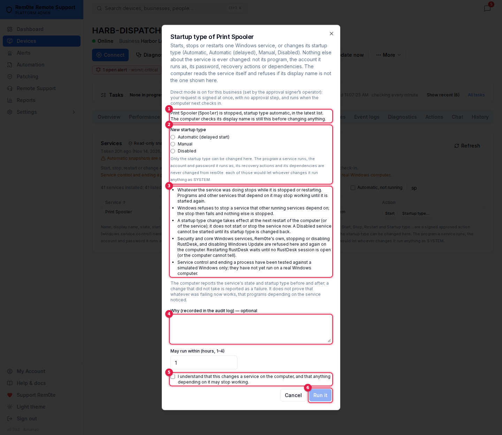
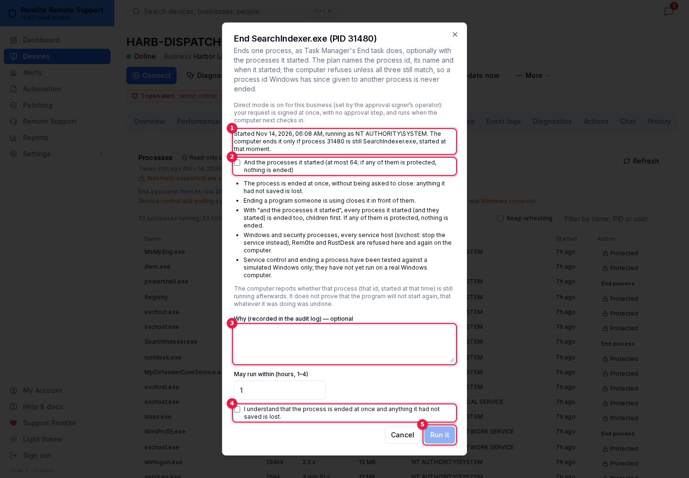
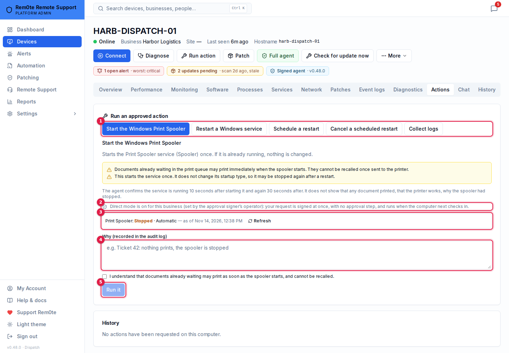
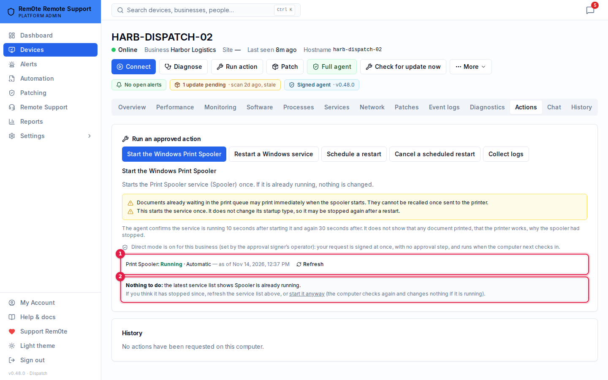
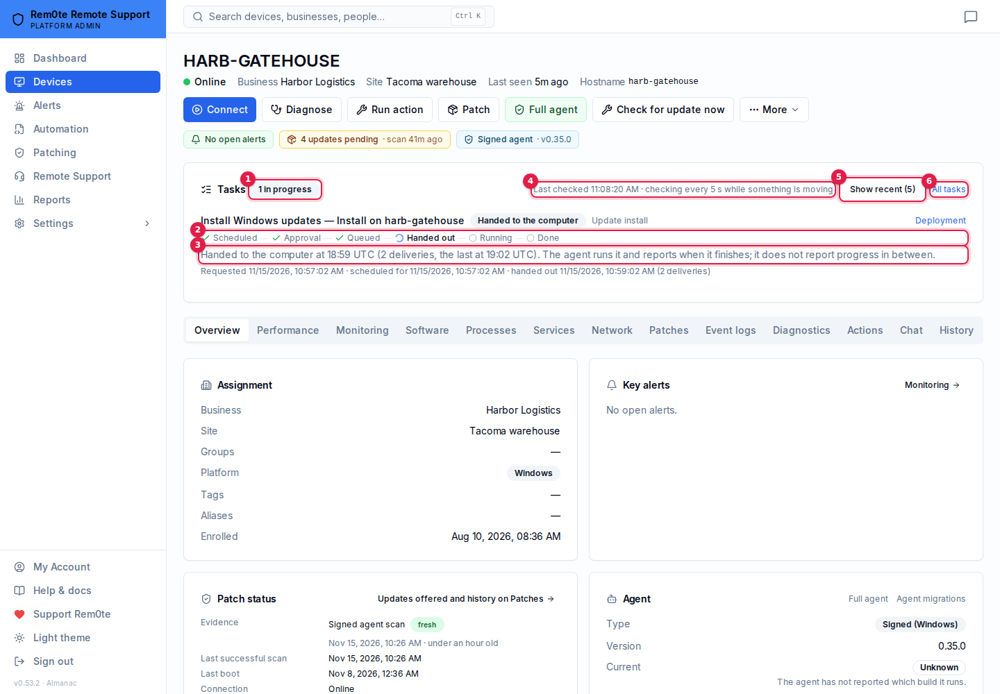
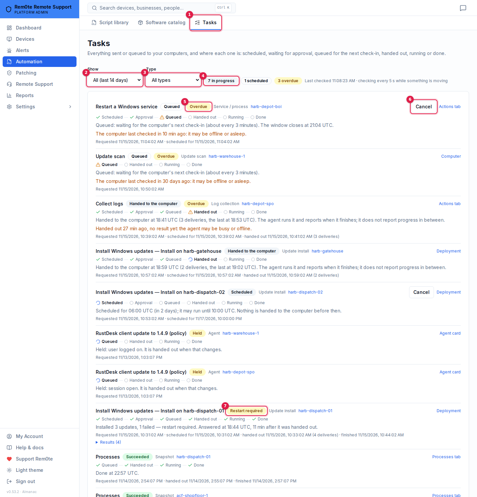

# Approved actions

rem0te 0.26 can make one change on a customer computer outside a remote session: **start the Windows Print Spooler,
once**. It happens only after people on an approval roster have authorized that exact plan with a passkey, on a page
the portal does not serve, and only on a computer whose agent checks all of it again before anything runs.

From 0.27 the catalog has a second action, **installing named Windows updates**, which is requested only through a
staged deployment of a canary and rings. See [Staged patching](staged-patching.md).

From 0.32 it has four **maintenance actions**, each on one computer: restart one service from a fixed list, schedule
a warned restart, cancel a pending restart, and collect a fixed set of logs. See
[Maintenance actions (0.32)](#maintenance-actions-032).

From 0.34 it has a seventh, **running an approved script-library version** (`windows.script.run@1`) on up to 25
computers. It runs only bytes whose SHA-256 two approvers have added to the signer's own allowlist, and each run is
approved again by two approvers who did not write the script. See [Script runs (0.34)](#script-runs-034) and
[Script library](script-library.md).

Also from 0.34, the eighth and ninth are the **software actions**: install and uninstall one allowlisted winget
package, pinned by version and installer SHA-256, requested only from the software catalog (one computer, or a
canary and rings). See [Software deployment](software-deployment.md). From 0.41 the tenth removes a program from a
computer's installed-software list (`windows.software.remove@1`).

From 0.45 the eleventh and twelfth are **controlling a service** (`windows.service.control@1`: start, stop, restart,
or change its startup type) and **ending a process** (`windows.process.stop@1`), each on one computer, requested from
that computer's Services and Processes tabs. See [Services and Task Manager (0.45)](#services-and-task-manager-045).
The rest of this page describes the Print Spooler action, and the machinery every action shares.

Those twelve are the whole catalog. You can't request a command, a script that isn't an allowlisted library version,
a path, a URL, a service's binary path, logon account, password, recovery actions or dependencies, a restart message
of your own, or a log file or time range of your own. Credential extraction, removing backups, disabling defenses, granting admin rights and wiping
disks aren't in the catalog and never will be. Nor can you request a package outside the catalog, an installer of
your own, installer switches, or a per-user install. They aren't switched off; nothing exists to request them.

> **Warning.** Documents already waiting in the print queue may print as soon as the spooler starts. They can't be
> recalled once they reach the printer. The requester confirms this, and the approval page shows it.

## Direct mode (the default for a single operator)

If you run the portal alone, there is nobody to be the second person this page is built around. From 0.40 the
approval signer's operator can turn approvals off, per business or for every business, with one command on the
signer:

```bash
$S policy set --business default --approval direct      # every business without its own entry, and the script allowlist
$S policy set --business <businessId> --approval direct  # one business
$S policy set --business <businessId> --approval signed  # back to approvals
$S policy show
```

(`$S` is the signer CLI from [Setting it up](#setting-it-up), step 2.) Nothing else sets it: no route on the portal or
the signer writes the policy, and every change is appended to `policy-changes.log` in the signer's directory. Without
an entry a business is in **signed** mode, the rest of this page.

**What happens in direct mode.** A request goes through every check it always has — your permissions, the catalog and
its parameters, the computer's readiness, containment pauses, the signer's own pauses, the script allowlist,
software and script revocations — and then the signer signs it at once, with no approvers. The plan says so in a
signed field (`policy.approval: "direct"`) and names who asked. The portal never shows an approval page: the job goes
straight to *Approved*, labelled **Approved automatically (direct mode) by *you*, *time***, and runs when the computer
next checks in. Patch policies and software rings work the same way: a patch policy is active as soon as it is
proposed, and its rings are signed inside its window as before.

**Confirming it is you (0.49).** Whether a direct request also asks you to confirm it is you is set per function under
**Settings → Confirm it is you** ([sign-in.md](sign-in.md#which-functions-ask-049)): `actions.direct` covers every
direct-mode request (actions, patch and software rings, uninstalls, service and process changes, script runs) and
`scripts.direct` a direct-mode allowlist proposal. *Ask* (the default for a new installation): each request asks for a
fresh sign-in, and the confirmation lasts 10 minutes. *Don't ask* (where 0.47's *Confirm before everyday changes* was
Off, as on this installation): signing in, with its MFA, is enough. Turning a confirmation off asks once, and every
change is in the audit log.

**What it gives up: a second person.** In signed mode a compromised portal can propose a plan but cannot make it
run. In direct mode it can: anyone who fully takes over the portal (its code or its sign-ins) can run catalog actions
on that business's computers — what an RMM's own agent normally allows, and what the standard agent already allows
through remote sessions. Turn it on only where that is the trade you want.

**What still protects:**

- Your **sign-in** (with its MFA), plus a fresh confirmation for each request while `actions.direct` is set to
  *Ask* under **Settings → Confirm it is you**, and the permission for the action (`actions:request`, and the action's own
  capability where it has one).
- The **catalog**: still closed parameters (twelve actions from 0.45, with service control and ending a process).
  Direct mode makes nothing new requestable.
- The **audit log**: every request, with who asked; the signer logs each plan it signed in direct mode.
- **Containment pauses**, in the portal and on the signer, and **revocations** of scripts and software.
- The agent's own checks: **maintenance windows** and **session rules**, its own risk computation, the window, the
  target, the agent build, and the **signer's signature**. The portal still holds no key a computer accepts.

**What it cannot be combined with.** Customer sign-off needs a customer to approve before signing, so the signer
refuses `--approval direct` for a business that requires it, and refuses turning sign-off on while a business is
direct; each says why. **ClientSt0r proposals are refused** in direct mode (`DIRECT_MODE_PORTAL_ONLY`): there is
nobody signed in behind them, and a proposal would otherwise run unseen.

**Scripts follow the signer's `default` setting.** The script allowlist is the signer's own, for every business, so
whether a proposed version is added at once is decided by `--business default`. In that mode the library also lets
the author review their own version, recorded as *self-reviewed*. A run of an allowlisted script follows its
business's setting, like any plan.

**Turning it off.** Set `--approval signed`. A new request then waits for approvals again. A plan signed in direct
mode before that stays signed until its window closes; cancel it on the Actions tab if it must not run. A patch policy
activated in direct mode carries no approvals, so the signer signs nothing more under it once the business is signed
again (`policy_not_approved`): approve a new one.

**Computers need the 0.40 agent.** An older agent cannot read the signed direct field and refuses the plan
(`bad_plan`); the Actions tab says so. Nothing runs on it, and nothing else changes: update it, then request again.

## Who does what

| Step | Who | Where | What it can and cannot do |
|---|---|---|---|
| **Request** | A technician whose access level allows it, a Business Owner, a Business User granted `actions:request`, a Platform Admin. Or ClientSt0r, as a mapped technician | The computer's **Actions** tab, or `POST /api/integration/v1/action-proposals` | Proposes a plan. Authorizes nothing |
| **Approve** | People on the **approval signer's roster**, each with a user-verified passkey | The signer's own origin (e.g. `https://approve.example.com/approve/<job>`) | Signs the exact plan. Never the requester |
| **Customer sign-off** | A Business Owner on the roster for *that* business, where its policy requires it | The same page | Must be a different person from every approver |
| **Deliver** | The portal | Heartbeat | A courier only. It rechecks access and device first, and cannot alter or forge a plan |
| **Execute** | `rem0te-agent.exe` on the computer | The endpoint | Verifies everything itself, runs the job at most once, reports what it saw |

**How many approvals:**

| Computer | Approvals | Who decides the risk |
|---|---|---|
| A standard workstation (`deviceClass` WORKSTATION, and Windows reports a workstation product type) | 1 | The catalog, at the portal, the signer *and* the agent |
| Anything else: server, unknown class, a "workstation" whose Windows says it's a server | 2, from different people | The agent recomputes it from its own product type, so a plan that understates risk is refused |
| Protected device classes (domain controllers, hypervisors, backup servers, RMM hosts) | Not possible in this release | Refused at request time |

**An AI suggestion gets no shortcut.** A ClientSt0r proposal with `origin: ai_suggestion` needs exactly the approvals
a person's request needs. The approval page labels it as an AI suggestion and names the ticket.

## Why a compromised portal can't do this

The portal and its database are what an attacker is most likely to get. So neither of them holds anything that can
make a computer act:

- **The signing key isn't the portal's.** Job approvals are signed by the **approval signer**. It's a separate process
  under its own Unix user (`rem0te-approver`), with its own state directory, key, roster and policy. It runs from a
  root-owned install the portal's user cannot write. It loads no Nest, no Prisma and no portal module, and
  `build-approval-signer.mjs` and the security invariants check that.
- **Approval is a passkey assertion the signer verifies itself.** The roster holds each approver's passkey public
  key, added by an operator after a fingerprint read-back. The signer never reads the roster from the portal. Every
  decision needs a fresh, single-use challenge, user verification, the signer's own origin and RP ID, and a counter
  that has moved forward. The challenge is derived from the plan's digest, the decision and the role, so the
  passkey's signature itself covers the exact plan the approver was shown.
- **The agent trusts approval keys only from the offline-rooted update chain.** `approval/keys.json` is a signed
  target, like the agent binary ([update-signing.md](update-signing.md)). The portal mirrors it but can't change it.
- **Three key holders, kept apart.** Release signing keys sit offline with the release machine. The job-approval key
  sits with the approval signer. Portal administration is a role in the portal. None of them can act as another.

The end-to-end test proves this by planting envelopes straight into the database. One is signed by an attacker's key.
The other is a real envelope with an altered plan. The portal delivers both, as a courier would, and the agent
refuses both (`unknown_key`, `bad_signature`).

What a compromised portal *can* still do is deny service. It can refuse to deliver, cancel plans awaiting approval,
or withhold results. It can also re-deliver an envelope the agent has already consumed, which the agent answers from
its journal without running anything.

## What is signed

The plan an approver sees, and the signature covers:

- the catalog action and its version (`windows.service.start@1`) and parameters (`{"service":"Spooler"}`);
- the **agent build** that may run it (the sha256 of the signed `windows/rem0te-agent.exe` target);
- the **target**: business, hostname, device class, RustDesk ID and the sha256 of the device secret. These are the
  identifiers the computer was enrolled with, not a hostname alone;
- the requester and where the request came from (portal or ClientSt0r; technician or AI suggestion; ticket);
- the **policy**: risk, approvals required and customer sign-off, re-derived by the signer and refused if the portal
  claims otherwise;
- every approver: user, role, passkey credential hash and time;
- the **window** (`notBefore`–`notAfter`, at most 24 hours) and a **single-use job id**.

The signed bytes are canonical JSON, prefixed `rem0te-action-plan-v1\n`, signed with Ed25519.

## What the computer checks

Before it touches anything, `rem0te-agent.exe action --job <id> --envelope <file>` checks, in order:

1. **Its journal.** A job id runs at most once, ever. A re-delivered envelope gets the recorded result. A job the
   journal shows as *executing* (the agent died mid-action) is reported **uncertain**, with the service state seen
   now, and is never run again.
2. The envelope's signature, against `approval/keys.json` fetched through the signed update chain.
3. A strict parse of the plan. Any field it doesn't know is a refusal.
4. The action and parameters, against the catalog compiled into this agent.
5. That it is the target: its own RustDesk ID and the sha256 of the secret in `heartbeat.dat`.
6. The window, by its own clock. A plan that isn't valid yet isn't consumed, so clocks that disagree only delay it.
7. That it is the named agent build.
8. The approvals: enough distinct approvers for the risk *it* computes from its own Windows product type, none of
   them the requester, plus a distinct customer sign-off when the plan's policy requires one.

Only then does it write *executing* to the journal (fsync, then rename), start the service, and check it again
10 seconds and 30 seconds later. The startup type isn't changed, so a disabled spooler stays disabled and the start
fails.

## What the result means, and what it doesn't

| Outcome | Meaning |
|---|---|
| **Succeeded** | The spooler was started and was still running at both checks |
| **Succeeded** (*already running*) | It was already running; nothing was changed |
| **Failed** | It wouldn't start, or it didn't stay running |
| **Refused by the computer** | A check above failed, and the reason is given. Nothing ran |
| **Not executed** | The window closed before the computer saw the plan |
| **Outcome uncertain** | No result within 30 minutes, or the agent was interrupted mid-action |

A result is the service state the agent saw. **It isn't evidence that any document printed**, that the printer works,
or why the spooler had stopped. rem0te never claims any of those.

**Uncertain outcomes are reconciled before any retry.** While a job is uncertain, no new request for that action on
that computer is accepted. The requester, a Business Owner of that business or a Platform Admin checks the computer
and records what they found under **Reconcile** on the Actions tab. That's possible only once the computer can no
longer run the job: either it answered from its journal, or the signed window has closed. A reconciled job can never
run alongside a retry.

## Rechecked at dispatch

Between approval and the first delivery, the portal rechecks everything that may have changed:

- the computer is still in that business, with the same device identity and device class;
- the requester still has access to it, and their access level still allows the request;
- the requester isn't paused by a fleet limit, and a write is admitted.

If any check fails, the plan is canceled with the reason, and the cancellation is audited (`ACTION_DISPATCH_BLOCKED`).
A plan whose window has closed expires undelivered.

## Evidence

Each step is in the activity log, against the job:

`ACTION_REQUESTED` (with the digest) → `ACTION_APPROVAL_UPDATED` → `ACTION_DISPATCHED` → `ACTION_RESULT` (with the
outcome and what was observed). Refusals and blocks are recorded as `ACTION_DISPATCH_BLOCKED`, cancellations as
`ACTION_CANCELED`, reconciliations as `ACTION_RECONCILED`.

The signer keeps its own record of every decision in its state directory, outside the portal's database: who, with
which credential, when, and over which digest.

## Maintenance actions (0.32)

Four more catalog actions, each requested from the computer's **Actions** tab (**Run action** at the top of its page
opens it), each naming one computer. They use everything above unchanged: the separate signer, passkey approvals,
the agent's own checks, the journal, the dispatch rechecks, containment and the audit trail. What is different:

- **Two different approvers, always.** All four are high impact on any computer, workstation or not. The portal, the
  signer and the agent each derive that independently; a plan that claims `low` is refused (`risk_mismatch` at the
  signer, `risk_understated` at the agent).
- **Closed parameters.** One allowlisted service name, one whole number of minutes, or nothing at all.
- **Not offered to ClientSt0r.** `capabilities` lists only the Print Spooler start and update install, and a
  proposal naming a maintenance action is `ACTION_NOT_IN_CATALOG`. Offering them is a change to the ticket-rmm
  contract that ClientSt0r has not agreed to.

| Action | Parameters | What the agent does |
|---|---|---|
| `windows.service.restart@1` | `{"service": <one of the list below>}` | Re-checks the name against a charset (`^[A-Za-z0-9_]{1,64}$`) and its own allowlist. Journals *executing*, then *stopping*, asks the service manager to stop it and waits up to 60 s, journals *starting*, starts it, and checks it 10 and 30 seconds later. A stopped service is only started. A service with running dependents is refused by Windows, and nothing else is stopped. The startup type is never changed |
| `windows.reboot.schedule@1` | `{"delayMinutes": 5…1440}` (the page offers 5, 15, 30 min; 1, 2, 4 h), and from 0.54 optionally `"onlyIfRequired": true` and `"ignoreRemoteSession": true` ([below](#scheduling-a-restart-054)) | Runs `%SystemRoot%\System32\shutdown.exe /r /t <seconds> /d p:4:1 /c <fixed warning>`. Never immediate. If Windows already has a restart or shutdown pending, it changes nothing (`restart_already_scheduled`) |
| `windows.reboot.cancel@1` | none | Runs `shutdown.exe /a`. Reports `no_change` when nothing was pending |
| `windows.logs.collect@1` | none | Collects the fixed sources below, redacts them, and returns them in its result. Also needs `computers:event_logs` |

**The service list** is `Spooler`, `wuauserv` (Windows Update), `BITS`, `W32Time` (Windows Time), `WinRM` and
`RustDesk`. Each is an ordinary service whose restart is a routine repair and whose absence for a few seconds harms
nothing permanent. Left off deliberately:

- security products and the security subsystem: Defender (`WinDefend`, `WdNisSvc`, `Sense`), the firewall
  (`mpssvc`, `BFE`), Security Center, `lsass`, `SamSs`, `KeyIso`, `VaultSvc`, `Netlogon`. Restarting them is what
  an intruder wants, and a failed restart leaves the computer unprotected;
- `EventLog`: restarting the event log is how activity is hidden;
- `RpcSs`, `DcomLaunch`, `RpcEptMapper`: Windows will not stop them, or stops everything with them;
- `Dnscache` (DNS Client): Windows 10 and later refuse to stop it, so the action could only fail;
- `LanmanWorkstation` (Workstation): stopping it drops every open file and mapped drive, and Netlogon depends on it
  on a domain member.

The list is compiled into the agent and repeated in the portal's catalog; the security invariants check the two
agree and that no security or core service is on it. Changing it is a new agent release and a review.

**The restart warning** is fixed text. Its only inputs are the time and delay the agent computed itself and the job id
it verified:

> Your IT support provider has scheduled a restart of this computer for 14:30 on Tue 10 Nov (in 30 minutes). Please
> save your work and close your programs before then: programs still open will be closed without saving. Approved
> maintenance, reference 1a2b3c4d.

The delay counts from when the computer receives the approved plan, at its first check-in after approval. So a
restart plan's signed window is at most **2 hours** (the portal refuses longer with `WINDOW_TOO_LONG`, and the signer
and the agent refuse it too): a restart must not land many hours after the time its approvers had in mind.

**Canceling** is a second action with its own two approvals. If you may need to cancel, request and approve the
cancel early; a restart whose delay ends first is not stopped. It cancels whatever is pending on the computer,
including a restart someone else scheduled there — and, from 0.34, one an update plan scheduled.

**Update restarts use the same path (0.34).** An update plan with the restart rule `if_required_in_window`
([Staged patching → Restarting after updates](staged-patching.md#restarting-after-updates)) schedules its restart
through the code `windows.reboot.schedule` runs: the same `shutdown.exe /r` call, the same fixed warning, the same
reboot record for the cancel, after a fixed 15 minutes. The session rule is the same too, but its result differs: the
updates are already installed, so an open session (or "cannot tell") does not end the job `not_executed`. The
install's result stands, and the restart is reported `restart_deferred`. It also defers if the restart would fall
after the plan's window. It has not yet run on a real Windows computer.

**Open sessions.** Before scheduling a restart, and before restarting the RustDesk service, the agent counts
incoming RustDesk sessions (the `rustdesk.exe --cm` connection-manager processes, the same signal the heartbeat
reports). If one is open, the job ends `not_executed` (`remote_session_open`); if the agent cannot tell, it ends
`not_executed` (`session_state_unknown`). Either way nothing changed and it is final: request it again. The check runs
after the signed pause and before the job is journaled *executing*. It is made **once, when the restart is
scheduled**: someone who connects during the warning period sees the Windows warning on screen but does not stop the
restart. **A signed-in user does not stop the restart. They see the 15-minute warning, and unsaved work is lost.**
Console and Remote Desktop sessions are not checked, deliberately: people leave themselves signed in, so a rule
that waited for them would mean a computer that never restarts. The warning is the safeguard.

### Scheduling a restart (0.54)

**At a date and time.** The restart form (Actions tab, the Patches tab's restart banner, and **Schedule restart…** in
the device list's bulk bar) offers *At the next check-in* or *Schedule*: a date and time in a named zone (the
computer's site, your profile, this browser, or UTC), up to **14 days** ahead (`SCHEDULE_TOO_FAR`, `SCHEDULE_IN_PAST`,
`INVALID_TIMEZONE`). The portal sends it as `restartAt` and signs the plan's `notBefore` as that time minus the
warning, so the computer restarts at the time chosen; the plan runs for at most 2 hours after that. Nothing is
handed out before `notBefore`, the agent refuses it early by its own clock, and until it reaches the computer it is
canceled with the existing cancel (**Automation → Tasks**, or the computer's Tasks panel).

**Only if a restart is required** (`onlyIfRequired: true`). The computer decides when the plan runs, from Windows'
own pending-restart state (Component Based Servicing, Windows Update's `RebootRequired`, pending file renames). If
nothing is pending it reports `no_change` (`no_restart_required`) and does not restart; if it cannot read the
registry it reports `not_executed` (`reboot_state_unknown`).

**The RustDesk exception** (`ignoreRemoteSession: true`), at the owner's request: *Restart even if a technician is
connected through RustDesk (their session is dropped)*. It reverses, for that one request, the rule above that an
open RustDesk session stops a restart.

- The checkbox is never ticked by default. The flag is in the plan only when ticked, so every other plan keeps its
  bytes and digest.
- The agent honours it only from the signed plan and skips only the session check. The warning always shows.
- The result records `sessionOverride` and how many sessions were open. The audit has it on the request and the
  result, and Tasks says *restarted although a technician was connected through RustDesk*.
- It applies to `windows.reboot.schedule` and to a patch policy's restarts
  ([Staged patching → Restart windows](staged-patching.md#restart-windows-054)). It does not apply to restarting the
  RustDesk service.

**Both flags need the 0.54 agent.** An older agent refuses a plan carrying either (`params_not_allowed`: its parameter
check allows only `delayMinutes`). The portal refuses the request first, for a computer reporting an older agent
(`ENDPOINT_NOT_READY`). Publish the 0.54 agent before using them.

**Bulk and device groups.** **Schedule restart…** in the Devices list acts on the selection, or on a device group's
members as you see them when you click (at most 200). Each computer gets its own plan, exactly as if requested from
its Actions tab: its own scope, readiness, containment and one-at-a-time checks, its own approval in signed mode, and
its own audit entry. One that cannot take it is refused on its own with the reason. In direct mode the fresh sign-in
is asked once for the whole request.

**Collected logs.** Fixed sources, in this order, at most 12 KB from each and 40 KB in all:

| Source | What |
|---|---|
| `system_errors`, `application_errors` | Critical and Error events from the System and Application logs in the last 24 hours, at most 50 each, newest first (`wevtutil qe … /f:text`), with the computer, user, task, opcode and keyword lines dropped |
| `agent_journal` | One line per recent approved action on this computer, from the agent's journal |
| `agent_log` | The end of the agent's own log |
| `rustdesk_log` | The end of the newest `.log` under the RustDesk service profiles' log directories. A person's own profile is never read; links are not followed |

The agent redacts before anything leaves the computer: control characters, user-profile paths (`C:\Users\<name>`
becomes `%USERPROFILE%`), opaque tokens of 40 characters or more, and anything written as `password=`, `secret:`,
`token=`, `api_key=`, `Authorization: Bearer …`. The portal does not trust that copy: it applies the diagnostics
catalog's redaction and the same credential rule again, and the size caps, before storing it. Names of people,
computers, files and network addresses can remain; the requester confirms that before asking.

Who sees it: requesting a log collection needs `computers:event_logs` as well as permission to request actions (for a
technician, from the same grant as the computer, as for the Event Log tab). Anyone viewing the job without it sees
that text was collected and withheld, never the text. A requester who loses that permission between approval and
delivery has the plan canceled at dispatch (`requester_lost_capability`). The activity log records each source's size,
not its text.

**Results.** The service restart reports the state before, after the stop and at both checks. The restart schedule
reports the time it scheduled the restart for; **it cannot report the restart itself**, which shows afterwards as a
new boot time in the inventory. An interrupted job (the agent stopped mid-action) is reported uncertain with how far
it got (`stopping`, `starting`, `scheduling`, `canceling`, `collecting`) and, for a service restart, the service's
state now; reconcile it as for the spooler (`running`, `stopped`, `restart_scheduled`, `no_restart_scheduled`,
`other`).

**Where it is inert.** Like the first two actions, these need an approval signer installed and a computer on a 0.32+
signed agent build. Production has no signer installed, so the Actions tab says "no approval signer is configured"
and requests nothing; a computer whose agent does not report an action shows that action as not available on it.

## Services and Task Manager (0.45)

> **Not yet run on real Windows.** Both actions are proven against a simulated service manager and process table,
> through the real portal, signer and agent decision code. The Windows calls are compiled and vetted, but have not run
> on a Windows computer. The tabs say so too.

Two actions, each on one computer, requested from the computer's own tabs and never from the Actions tab
(`ACTION_NOT_DIRECT`):

| Action | What it does | Requested from |
|---|---|---|
| `windows.service.control@1` | Start, stop or restart one service, or set its startup type to Automatic, Automatic (delayed start), Manual or Disabled | **Services** tab: the row's *Start*, *Stop*, *Restart* and *Startup type…* buttons |
| `windows.process.stop@1` | End one process, optionally with the processes it started (children first, at most 64) | **Processes** tab: the row's *End process* button |

Both are **high impact on any computer**, need an approval signer, a computer on a 0.45+ signed agent that reports the
action, and the computer online. They are never offered to ClientSt0r. Only one service change and one *End process*
can be open per computer at a time.

**Direct mode.** In a business in direct mode the request is signed as soon as you make it, with no approval step, so
the button asks you to confirm it is you while `actions.direct` is set to *Ask* (Settings → Confirm it is you), and the dialog says *it runs as soon as you request it*. In
signed mode it waits for two approvers as any other action does. The containment *actions* pause stops both: the tabs
show the pause and request nothing, and the agent refuses a plan under a signed pause before it asks Windows anything.

**Editing a service is its startup type only.** Nothing in rem0te changes a service's program (binary path), the
account it runs as or its password, its recovery actions or its dependencies. Each of those would let whoever
changes it run a program of their choice as SYSTEM, so the action has no parameter for them, the portal's request has
no field for them, and the agent's only configuration call passes *no change* for everything but the start type. Do
those on the computer itself, in a remote session.

### What the plan names, and what the computer checks

A service plan names the service's key name, the display name the latest service list showed, the operation and (for
a startup-type change) the start type. A process plan names the process id, its image name and its start time, from
the latest process list, to the millisecond. The portal refuses anything its own latest snapshot doesn't list
(`SERVICE_NOT_IN_SNAPSHOT`, `PROCESS_NOT_IN_SNAPSHOT`): refresh the tab and try again.

On the computer, after the signed pause and before anything is journaled as executing, the agent reads the service or
process itself:

- **A service** must exist, be a service (a kernel or file-system driver, or a boot or system start type, is refused
  `not_a_service`) and still have the display name the plan names (`service_changed` otherwise). It then starts,
  stops or reconfigures it through the service control manager only — never `sc.exe` or PowerShell — reads it back,
  and reports both the state and the startup type it found. Starting a running service, or setting the startup type
  it already has, is `no_change`.
- **A process** must still have that id **and** that name **and** that start time. Windows reuses process ids: if
  the id now belongs to a process started later, or with another name, the plan is refused `process_changed` and
  nothing is ended. The agent opens the process, checks its start time again on the very handle it will end it
  through, then calls `TerminateProcess` — never `taskkill` — and reports whether it is still running. A process that
  is already gone is `no_change`. Ending is immediate: the program isn't asked to close, and anything unsaved is lost.

### What is protected

Refused by the portal and again by the computer, compared case-insensitively. The tabs show *Protected* on these rows
with the reason, and no buttons.

- **Services, never changed in any way:** Defender and Defender for Endpoint, Windows Security, the firewall and its
  filtering engine, System Guard, web threat defence, the event log, the security accounts manager, key isolation, the
  credential vault, Netlogon, cryptographic services, Group Policy; RPC, the DCOM launcher, the session manager, Plug
  and Play, Power, the user profile service, WMI, the Windows Modules Installer, the broker and event services the
  shell depends on, Application Information; **Task Scheduler** (the agent's heartbeat is a scheduled task); and DHCP
  Client, DNS Client, Network Store Interface and Workstation, which the computer needs to be reached. Any service whose
  name begins `Rem0te` is rem0te's own and is never touched.
- **RustDesk** can be started, restarted or set to Automatic, never stopped or set to Manual or Disabled. A RustDesk
  restart waits for no open RustDesk session: with one open, or when the agent can't tell, it is `not_executed`
  (`remote_session_open`, `session_state_unknown`) and nothing is restarted.
- **Windows Update, the Update Orchestrator, Windows Update Medic and BITS** can be stopped and restarted, never
  disabled.
- **Processes, never ended:** System and Idle (process ids 0 and 4), Registry, Memory Compression, Secure System,
  `smss`, `csrss`, `wininit`, `winlogon`, `services`, `fontdrvhost`, `dwm`, `lsass`, `lsaiso`, Defender's
  `MsMpEng`, `NisSrv` and `MpDefenderCoreService`, `MsSense`, `SecurityHealthService`, `SgrmBroker`, and rem0te's and
  RustDesk's own processes. **`svchost`** is refused with *stop the service instead*: a service host runs several
  services, and ending it stops all of them. If any process in a tree is protected, nothing in it is ended.

### The tabs

The **Processes** tab is a task manager: name, process id, user, CPU time, memory and start time, sortable and
filterable, with the total memory. *Keep refreshing* asks for a new process list at most once a minute while the tab is
open; the automatic snapshots (§50) keep their own five-minute cadence while anyone has the tab open. Command lines
are not shown: the process list never collects them.

The **Services** tab shows each row's buttons only when that operation is allowed for that service, and *Startup
type…* offers only the start types allowed for it. After a request finishes, the tab asks for a new list so the row
shows what the computer now reports; the last result for the row (what the computer saw, or why it refused) is shown
beside it.



1. **What the latest list says** — the service's state and startup type, and that the computer checks its display
   name again before changing anything.
2. **New startup type** — only the types allowed for this service; the current one is not offered. Below it, what is
   never changed: the program, account, password, recovery actions and dependencies.
3. **The warnings** — what stops while the service is stopped, when a startup type change takes effect, what is
   refused, and that this has been tested only against a simulated Windows.
4. **Why** — optional, recorded in the audit log (shown to the approvers in signed mode).
5. **The confirmation** — tick it to enable the button.
6. **Run it** — in direct mode the plan is signed at once and runs at the computer's next check-in; in signed mode
   the button is *Request it*.



1. **What the computer checks** — when the process started and as whom. It ends it only if that process id still
   has that name and that start time.
2. **And the processes it started** — ends the tree, children first, at most 64; nothing if any of them is
   protected.
3. **Why** — optional, recorded in the audit log.
4. **The confirmation** — the process ends at once, and anything unsaved is lost.
5. **Run it** — as for a service.


## Script runs (0.34)

`windows.script.run@1` runs one approved [script-library](script-library.md) version as SYSTEM in Windows
PowerShell, with typed arguments and a timeout. It uses everything above unchanged — the separate signer, passkey
approvals, the agent's checks, the journal, the dispatch rechecks, containment, the audit trail — and adds:

- **An allowlist on the signer.** The signer keeps its own list of approved script hashes in its state directory
  (`scripts/`, `script-revocations/`). An entry is added only by two passkey approvals on the signer's page, after
  the approvers read the content the signer holds and the hash it computed. The portal can propose an entry and
  revoke one; it can't add, activate or edit one. Revocation is by content SHA-256 and permanent.
- **Revocation reaches signed runs (0.36).** The signer publishes a signed revocation statement (every revoked script
  hash and archived software entry), the portal relays it at `GET /api/v1/public/approval/revocations.json`, and a
  0.36 signed agent refuses a revoked run before journaling it, and runs nothing signed after the newest statement it
  holds. See [Script library → Revocation](script-library.md#revocation).
- **Closed parameters.** `{"scriptVersionId", "sha256", "parameters", "timeoutMinutes"}`: a version id, its content
  hash, arguments checked against the version's declared parameters (by the portal, the signer and the agent), and a
  timeout of 1, 5, 10, 15 or 30 minutes. The plan carries a `script` block that must be exactly the signer's entry.
- **Always high risk.** Two different approvers on any computer. Neither may be the requester or anyone who wrote or
  edited the script (`contributor_cannot_approve` at the signer, `contributor_approved` at the agent).
- **Up to 25 computers** of one business per plan, each with its own result.
- **Requested from the script library**, not the Actions tab: `POST /endpoints/:id/actions` with this action is
  `ACTION_NOT_DIRECT`. Results appear on each computer's Actions tab.
- **The content travels beside the envelope**, on the heartbeat. The agent refuses it unless it is exactly the signed
  length and SHA-256.
- **Bounded execution.** A fresh temporary folder, a constant command line
  (`powershell.exe -NoProfile -NonInteractive -ExecutionPolicy Bypass -File run.ps1`), arguments read from a JSON
  file and splatted, a job object with a 1 GiB memory limit that is terminated at the timeout, and the first 64 KB of
  stdout and stderr kept, redacted on the computer and again by the portal. Output is kept 90 days.
- **Not offered to ClientSt0r.**

Results: `succeeded` (exit code 0), `failed` with `exit_code`, `timed_out` (stopped with everything it started; it may
have done part of its work), `failed` with `start_failed` or `workdir_failed`. Refusals before anything runs:
`script_missing`, `script_mismatch`, `bad_declarations`, `arguments_not_allowed`, `contributor_approved`,
`no_content`, `content_mismatch`, and `no_script_host` from an agent built without the runner.

**Not yet run on a real Windows computer.** The decision code and real PowerShell 7 on Linux are tested end to end
(`e2e-script-run.mjs`); Windows PowerShell 5.1, the SYSTEM context and the job object are not.

## Patch policies: approved once, signed by the signer

From 0.32, a person can approve a bounded **patch policy** instead of each update ring
([Staged patching → Patch policies](staged-patching.md#patch-policies)). It is the one case where a plan is signed
without its own two approvals, so the design keeps the decision on the signer:

- **The policy is approved like a plan**, on the signer's own origin at `/approve/policy/<id>`, by two people on the
  roster other than its author, with their passkeys. Customer sign-off applies if the business requires it. On
  quorum the signer signs `rem0te-patch-policy-approved-v1` over the policy's digest and the approvals.
- **Each ring plan is evaluated by the signer** against the stored, signature-checked policy. The check is
  `evaluatePolicyPlan`, a pure function in `apps/api/src/actions/patch-policy.ts` that loads no Nest, Prisma or
  portal module. It checks:
  - every target's enrolled identity;
  - the ring order, against the signer's own ledger;
  - classes, severities and KBs;
  - the window, the expiry and the requester;
  - the restart rule: a plan may ask for no more than the policy allows (0.34, `reboot_not_allowed`);
  - the previous ring's gate, including canary-effective, computed only from results and scans **the computers
    signed themselves** (0.34).

  Only then is the plan signed, carrying the policy's approvers.
- **Ring results are signed by the computers (0.34).** Each 0.34 agent has an Ed25519 result key it generated and
  never exports. The policy names each computer's key, so two approvers vouch for it, and on approval the signer pins
  it write-once to the computer's enrolled identity (`device-keys/`). Before a later ring is signed, the signer checks
  every previous-ring result and the canary's scan under that key. A result that is missing, forged, from another
  computer, about another plan or stale is refused with a named code. The portal relays the agents' signatures as
  received; it holds no device key and has no code that signs a device statement. The first time a computer's key is
  named is trusted on first use: compare the fingerprint on the approval page with `rem0te-agent.exe status`. See
  [Staged patching → Signed results](staged-patching.md#signed-results-034).
- **The portal can propose a policy and ask for it to be revoked.** It can't approve a policy, un-revoke one, or sign
  under one. `POST /internal/v1/policies/:id/plans` is a request for the signer to decide; a refusal comes back as
  `409` with the code, and the signer keeps the last 50 with the policy.
- **Revocation** is a write-once file on the signer (`revocations/<id>.json`), merged into the policy on every read.
  Neither the portal nor the signer's own server rewrites it.
- A containment pause on the signer refuses new policies, policy decisions and every plan under a policy.

The signer operator's CLI:

```bash
$S patch-policy list                                   # status, signature check, approvals, plans signed, last refusals
$S patch-policy revoke --id <policyId> --reason 'why'  # one-way
$S device-key list                                     # 0.34: pinned result keys, fingerprints, the policy that pinned each
$S device-key forget --endpoint <endpointId> --reason 'why'  # remove a pin after reading the new fingerprint on the computer
```

## Setting it up

For the full production order, including patching, see [Patching setup](patching-setup.md).

You need a working signed update chain first ([update-signing.md](update-signing.md)). That's how computers learn
the approval key.

**1. Install the signer (root, once).**

```bash
cd apps/api && npx nest build
node scripts/build-approval-signer.mjs --out /tmp/rem0te-approver
(cd /tmp/rem0te-approver && npm install --omit=dev) && echo ok     # must print ok
sudo useradd --system --home /var/lib/rem0te-approver --shell /usr/sbin/nologin rem0te-approver
sudo rsync -a --delete /tmp/rem0te-approver/ /opt/rem0te-approver/
sudo chown -R root:root /opt/rem0te-approver && sudo chmod -R go-w /opt/rem0te-approver
sudo install -d -m 0750 -o root -g rem0te-approver /etc/rem0te-approver
sudo tee /etc/rem0te-approver/signer.env >/dev/null <<'ENV'
APPROVAL_SIGNER_DIR=/var/lib/rem0te-approver
APPROVAL_ORIGIN=https://approve.example.com
APPROVAL_RP_ID=approve.example.com
APPROVAL_PUBLIC_PORT=3201
APPROVAL_INTERNAL_PORT=3202
ENV
sudo cp deploy/systemd/rem0te-approval-signer.service /etc/systemd/system/
```

Give it its **own hostname**, not a path on the portal's. Uncomment the `approve.` site at the end of
`deploy/caddy/Caddyfile`. On the same origin as the portal, any script the portal served could drive the approval
page.

**2. Generate the key, and publish its public half through the release chain.**

```bash
S="sudo -u rem0te-approver env APPROVAL_SIGNER_DIR=/var/lib/rem0te-approver node /opt/rem0te-approver/dist/approval-signer/main.js"
sudo systemctl start rem0te-approval-signer   # creates the state directory
$S keygen > approval-keys.json                # refuses to overwrite an existing key
```

Take `approval-keys.json` (public keys only) to the release machine, and sign it in with the next release:

```bash
rem0te-release release -repo DIR ... -add approval/keys.json=./approval-keys.json
```

`rem0te-release` refuses a key list the agent would reject.

**3. Enrol the approvers.** Each approver adds a passkey to their account (**Account → Passkeys**). Under it they
see an **approval fingerprint** and an export. They send the export to the operator, then read the fingerprint
aloud **from their own screen**:

```bash
$S roster add --export '<export>' --approve '*' --confirm-fingerprint 1a2b-3c4d-5e6f-7a8b   # MSP approvers: every business, or a list of business ids
$S roster add --export '<export>' --customer <businessId> --confirm-fingerprint ...      # a customer's own sign-off
$S roster list
$S roster disable --user <userId>                                                          # takes effect on the next decision
```

A mismatched fingerprint is refused. That step is what stops a tampered export: the export travels through the
portal, but the fingerprint is read from the approver's own screen.

**4. Set customer sign-off, per business.** This lives on the signer, not in the portal:

```bash
$S policy set --business <businessId> --customer-signoff required
$S policy set --business default --customer-signoff not_required
```

**4a. Or, for a single operator, direct mode** (0.40, [above](#direct-mode-the-default-for-a-single-operator)):

```bash
$S policy set --business default --approval direct
```

Steps 3 and 4 are then not needed for the businesses it covers.

**5. Point the portal at it.** In `/etc/reboot-remote/api.env`, set
`APPROVAL_SIGNER_INTERNAL_URL=http://127.0.0.1:3202`, then restart the API. The portal accepts only a loopback URL
here.

**6. Update the agents** to a 0.26+ signed build. The heartbeat then reports `windows.service.start@1` and the
build's digest. A computer isn't offered the action until it runs the currently published build, because any other
build would refuse the plan.

## Requesting one

On the computer's page, open **Actions**. Read the warning, give a reason, tick the confirmation, and choose the
button. In **signed mode** the reason is shown to the approvers and the button is **Request approval**: the page then
shows the status and an **Open approval page** link while the plan awaits approval. Send that link to the approvers.
Nobody can approve from the portal; there is no approve route. In **direct mode** the reason goes to the audit log,
the button is **Run it**, and the plan is signed at once.

**The service's state, before you ask (0.47.1).** When you pick *Start the Windows Print Spooler* or *Restart a
Windows service*, the panel shows that service's state and startup type from the computer's latest service list, and
when that list was taken. It is the same read the **Services** tab makes, so the two never disagree. **Refresh** asks
the computer for a new list (it arrives at its next check-in).

- If the list says the Print Spooler is **Running**, the request is replaced with **Nothing to do**. The list may be
  out of date, so a *start it anyway* link stays; the computer checks again before it acts and changes nothing if
  the Spooler is running.
- With no service list yet, or no such service in it, the panel says so and you can request as before.

This is only what the page shows. The agent's own check, the catalog and what is signed are unchanged.



1. **The action picker** — the actions this computer can be asked for from here. Service control, ending a process,
   software and updates are requested from their own tabs.
2. **Direct mode** — this business signs at once. In signed mode this line says who must approve instead.
3. **The service's state** — from the latest service list, with its time and **Refresh**.
4. **Why** — recorded in the audit log (shown to the approvers in signed mode).
5. **The button** — *Run it* in direct mode, *Request approval* in signed mode. It stays disabled until there is a
   reason and the box is ticked.



1. **Running** — the latest service list says the Spooler is already running.
2. **Nothing to do** — the request is replaced by this note, with *start it anyway* for a list you think is stale.

The approval page shows the business, the computer (hostname, class, RustDesk ID), the action and its parameters, the
warning, who asked and why, the window, the agent build and the plan digest. **Approve** and **Reject** each ask for
a passkey. A rejection is final.

## Following a task (0.52)

Every task sent or queued to a computer — an approved action, an update install or restart, software, a script,
service or process control, a snapshot, a diagnostic, an update scan, an agent upgrade, a migration or a reinstall —
has the same lifecycle, shown in three places: the computer page's **Tasks** panel, **Automation → Tasks** (every
computer you can see, filterable by state and type), and a toast when one you started finishes.

| Step | What it means |
|---|---|
| **Scheduled** | Its start (`notBefore`) has not come. Nothing is handed out before it. It can be canceled |
| **Waiting for approval** | Signed mode: two approvers have not both approved it on the signer. It can be canceled |
| **Queued** | Approved, waiting for the computer's next check-in (about every 3 minutes). The sentence says if it is held instead — by a containment pause, or because the computer has not checked in for a while |
| **Handed out** | Given to the computer at its check-in, with how many times it was delivered and when last |
| **Running** | The agent reported it started (not every kind reports this) |
| **Done** | The result, with one row per item where there are items (updates, with Windows' HRESULT text) |

A task handed out with no answer for longer than its kind usually takes (10 minutes for a restart, a service or a
snapshot; 15 for a script; 20 for software and a scan; 30 for an update install or an agent upgrade) is marked
**Overdue** with what that usually means. Nothing is retried, canceled or changed because of it.

The pages re-read every 5 seconds while something is moving and every minute otherwise, and show when they last
checked. The toast is a small poll of `GET /tasks/mine`, which returns only tasks you started.

All three are reads: `GET /tasks`, `GET /tasks/mine` and `GET /endpoints/:id/tasks`, each needing View computers and
reaching computers only through the same visibility rule as the device list. They change nothing a computer is sent.
The one thing a read does is the pull every job read makes: a plan still awaiting approval is checked with the signer,
so a plan approved there shows as approved here. **Cancel**, on a scheduled or still-unapproved plan, is the existing
`POST /actions/:id/cancel`, which cancels only targets that were never handed out.

Snapshots taken automatically and the 12-hourly inventory scan are not listed: nobody asked for them.



1. **In progress** — how many of this computer's tasks are moving; *None in progress* otherwise.
2. **Steps** — where each task is.
3. **The sentence** — where it is in words: when it was handed out, how many deliveries, what it waits for.
4. **Last checked** — when the panel last read, and how often it reads.
5. **Show recent** — the last two weeks, finished ones included; *Show in progress only* folds them away.
6. **All tasks** — Automation → Tasks.



1. **Tasks** — under Automation.
2. **Show** — in progress, scheduled, failed or overdue, finished, or everything in the last 14 days.
3. **Type** — update installs, restarts, software, services and processes, scripts, logs, snapshots and the rest.
4. **In progress** — with how many are scheduled and overdue beside it.
5. **Overdue** — longer than its kind usually takes, with what that usually means underneath.
6. **Cancel** — on a task scheduled or awaiting approval that has reached no computer.
7. **The outcome** — here *Restart required*; *Results* opens the per-update rows.

The count beside the chat icon in the top bar is your own tasks in progress, and links to this page filtered to
them.

## Refusal codes

| Code | Meaning |
|---|---|
| `ACTION_NOT_IN_CATALOG` | Not a catalog action. Commands, scripts and the blocked categories are always this |
| `ACTION_NOT_DIRECT` | Requested through its own workflow, not the Actions tab: update install (a patch deployment) and, from 0.34, software install and uninstall (the software catalog) |
| `PARAMS_NOT_ALLOWED` | The parameters aren't the catalog's (another service, an extra field) |
| `ACTION_NOT_GRANTED` | Your role or access level doesn't include requesting this, on this computer |
| `PROTECTED_DEVICE_CLASS` | The computer is a protected class |
| `ENDPOINT_NOT_READY` | No enrolled identity, a legacy agent, an agent that doesn't report the action, or a build other than the published one |
| `WINDOW_TOO_LONG` | 0.32: the requested window is longer than the action allows (a restart schedule: 2 hours) |
| `ACTION_PENDING` | An earlier request for this action on this computer is still unresolved |
| `ACTION_UNRECONCILED` | An earlier outcome is uncertain. Reconcile it first |
| `ACTION_NOT_DIRECT` | Updates are requested through a patch deployment, and (0.34) script runs from the script library |
| `NOT_APPROVED`, `SCRIPT_NOT_ALLOWLISTED`, `SCRIPT_REVOKED`, `SCRIPT_WRONG_BUSINESS` | 0.34 script runs: see [Script library](script-library.md#refusals) |
| `APPROVAL_SIGNER_ERROR`, `APPROVAL_SIGNER_REFUSED`, `APPROVAL_SIGNER_UNREACHABLE` | The signer didn't answer, or refused the plan (e.g. `policy_mismatch` after a policy change, `paused` while the signer holds a pause, or for a script run `script_not_allowlisted`) |
| `STEP_UP_REQUIRED` | 0.40 direct mode: confirm it is you (a fresh sign-in) before a request that is signed at once |
| `DIRECT_MODE_PORTAL_ONLY` | 0.40: a ClientSt0r proposal for a business in direct mode. Only a person signed in to the portal can request one |
| `PROTECTED_SERVICE`, `PROTECTED_PROCESS` | 0.45: a service or process that is never changed from here (see [What is protected](#what-is-protected)). The computer refuses it again (`protected_service`, `protected_process`) |
| `SERVICE_NOT_IN_SNAPSHOT`, `PROCESS_NOT_IN_SNAPSHOT` | 0.45: the computer's latest service or process list doesn't show that service (with that display name) or that process (that id, name and start time). Refresh the tab |
| `SERVICE_CONTROL_NOT_POSSIBLE`, `PROCESS_STOP_NOT_POSSIBLE` | 0.45: the tab's reason: an agent without the action, offline, no signer, a pause, your access, or an earlier request on the computer still open |
| `CONTAINED` | Actions are paused for this business, or globally ([Containment](containment.md)). An approved plan is held, not canceled, and is delivered when the pause is lifted |

Agent refusal reasons: `bad_signature`, `unknown_key`, `bad_plan`, `job_mismatch`, `not_signed`, `unknown_action`,
`params_not_allowed`, `bad_targets`, `wrong_target`, `not_yet_valid`, `expired`, `artifact_mismatch`,
`risk_understated`, `too_few_approvals`, `requester_approved`, `no_customer_signoff`, `paused` (0.28: a signed
`control/pause.json` covers this business or computer. Like every refusal it is final: lifting the pause doesn't revive
the job; request it again), `bad_window` (from 0.32 also a restart plan whose window is over 2 hours). From 0.40
`bad_plan` is also what an agent older than 0.40 answers to a direct-mode plan, and what a 0.40 agent answers to a
direct plan that asks for customer sign-off.

Signer codes added in 0.40: `policy_mismatch` (a plan that says direct for a business in signed mode, or the other
way), `direct_with_customer_signoff`, and `policy_not_approved` for a ring under a patch policy that was activated in
direct mode after the business left it.

0.32 maintenance results that are not refusals: `remote_session_open` and `session_state_unknown` (not executed,
nothing changed), `restart_already_scheduled`, `stop_failed`, `start_failed`, `did_not_remain_running`,
`schedule_failed`, `cancel_failed`, `no_maintenance` (an agent built without the maintenance surface).

0.34 software results: `managed_elsewhere`, `hash_mismatch` and `manifest_hash_mismatch` (refused, nothing installed),
`winget_unavailable`, `winget_too_old` and `detection_failed` (not executed), `download_failed`,
`installer_not_found`, `install_failed`, `uninstall_failed` and `not_effective` (failed), `timeout` (uncertain),
`no_software` (an agent built without the software surface). See
[Software deployment](software-deployment.md#refusals-and-results).

0.45 service and process results: `service_not_found`, `service_changed` (another display name now), `not_a_service`
(a driver, or a boot or system start type), `protected_service`, `process_changed` (the process id now belongs to a
process with another name or start time), `protected_process`, `tree_too_large` (all refused, nothing changed);
`not_running` and `no_change` (nothing to do); `did_not_stop`, `did_not_remain_running`, `start_type_not_applied`,
`still_running`, `terminate_failed` and `verify_failed` (failed); `no_service_control` / `no_process_control` (an
agent built without them).

## What has been proven, and what hasn't

| Level | State |
|---|---|
| **Fixture-tested** | Yes. `internal/action` Go tests cover every refusal, replay, crash and verification path. `unit-approval-signer.mjs` (99 checks from 0.34; 79 in 0.32) covers synthetic passkeys through the real WebAuthn verification: forged origin and RP ID, missing user verification, reused and cross-decision challenges, counter regression, the requester approving, quorum, customer sign-off and restart. `e2e-approved-action.mjs` (76 checks) runs the portal, the signer and the agent's real decision code against a simulated Windows, including the compromised-database envelopes |
| **Fixture-tested, 0.40** | Direct mode: `internal/action` Go tests (`direct_test.go`: no approvers accepted only under the signed field, still refused under a signed pause, for a revoked script, for understated risk, with customer sign-off or an unknown mode, and when the field is added after signing). `unit-approval-signer.mjs` (252 checks) adds the CLI, the read-only policy route, admission, signing at admission, patch-policy and allowlist activation, and the customer sign-off exclusion. `e2e-approved-action.mjs` (92 checks) requests on a server in direct mode, runs it on the agent's real decision code with no approval step, and checks the fresh sign-in, ClientSt0r refusal, the pause, Birch's isolation, the return to signed mode and an agent from 0.38 refusing (`bad_plan`) |
| **Fixture-tested, 0.32** | `internal/action` Go tests for the maintenance actions (allowlist, charset, delay bounds, session check, journal steps, interruption, redaction and size caps); `unit-approval-signer.mjs` adds the maintenance admission and two-approver cases; `e2e-maintenance-actions.mjs` runs all four through the portal, the signer and the agent's real decision code against a simulated Windows (service manager, `shutdown.exe`, `wevtutil` and the session count are simulated) |
| **Fixture-tested, 0.34** | `internal/action` Go tests for script runs (every refusal, at-most-once, interruption, exit code, timeout, output cap), including runs under real **PowerShell 7 on Linux**; `unit-approval-signer.mjs` adds the script allowlist and script-run cases; `e2e-script-run.mjs` runs the whole path through the portal, the signer and the agent's real decision code with PowerShell 7 |
| **Fixture-tested, 0.34** | `internal/action` Go tests for the software actions against a stub winget run through the agent's real exec path (success, already installed, hash and manifest mismatch, winget missing or too old, managed elsewhere, timeout, not effective, restart required, argument injection in every field); `unit-approval-signer.mjs` adds the software admission, two-approver and 25-computer cases; `e2e-software-deploy.mjs` runs the catalog, single installs and uninstalls, rings, compliance and isolation through the portal, the signer and the agent's real decision code. winget, App Installer under SYSTEM, the uninstall registry and file versions are simulated |
| **Fixture-tested, 0.45** | Service control and ending a process: `internal/action` Go tests (`svcproc_test.go`: closed parameters, the refusal lists, every operation with read-back, no change, failures, the RustDesk session check, a reused process id, trees, the signed pause, interruption, direct plans). `unit-service-process.mjs` (109 checks) compares the portal's parameters, charsets and protected lists with the agent's Go source. `e2e-service-process.mjs` (96 checks) runs every operation in direct and signed mode through the portal, the signer and the agent's real decision code against a simulated service manager and process table, including plans a compromised portal would forge. **The service control manager and OpenProcess / TerminateProcess calls have not run on real Windows** |
| **Fixture-tested, 0.52** | Task progress and scheduled installs: `unit-task-progress.mjs` and `e2e-task-progress.mjs` (see [Staged patching](staged-patching.md#what-has-been-proven-and-what-hasnt)), against the simulated agent. Scheduling has not run on real Windows |
| **Paired lab** (real Windows workstation, real authenticator, real ClientSt0r) | **Not done.** (0.34: nor Windows PowerShell 5.1, the SYSTEM context or the job object for script runs, nor winget under SYSTEM for the software actions.) The Windows calls (service control manager, registry product type, `rustdesk --get-id`, and from 0.32 `shutdown.exe`, `wevtutil.exe` and the RustDesk process count) are compiled and vetted for Windows but haven't run on a lab machine |
| **Production-ready** | **No.** It needs the paired lab first, and an operator who has done the key and roster ceremonies |

## Known limits

- Twelve actions, on Windows only. Every action but update install, script run and the two software actions names one
  computer per plan; an update ring, a script run or a software ring names up to 25.
- 0.45: a service is controlled only by a key name in the `ServiceNameRE` charset (letters, digits, underscore), so
  per-instance services with `$` or `.` in their name (`MSSQL$SQLEXPRESS`) are listed but can't be controlled. The
  process list never collects command lines, so the Processes tab doesn't show them.
- The RustDesk session check is made once, when a restart is scheduled, and sees RustDesk sessions only.
- A scheduled restart is reported as scheduled. Whether it happened is seen only from the next boot time (and, after
  an update restart, from the next patch scan).
- A compromised portal can delay, cancel or withhold delivery. It can't sign or alter a plan.
- Under a patch policy, ring results are signed by the agents (0.34), but each computer's result key is trusted on
  first use: the first approved policy that names it is what vouches for it. Comparing the fingerprint with
  `rem0te-agent.exe status` is the only proof. A portal can still withhold results, so the next ring starts late or
  never.
- The signer is a single process with file state. Back up `/var/lib/rem0te-approver`; losing the key means
  generating a new one and publishing a new `approval/keys.json`. Plans signed by the old key are then refused.
- Roster membership is managed by the operator CLI. The portal neither shows nor changes it.
- The first agent download is trusted as downloaded, as for signed updates; there's no Authenticode signature yet.
