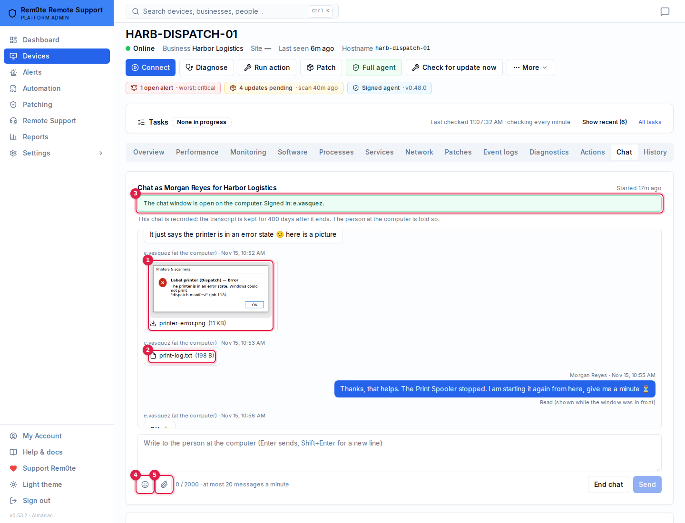
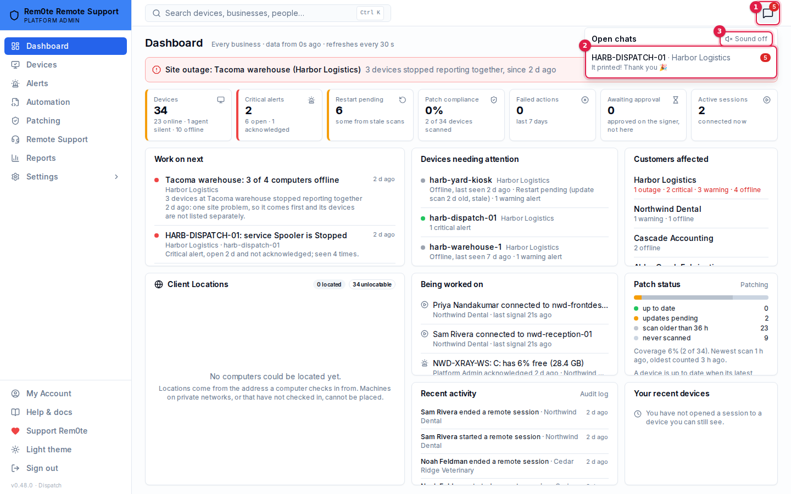

# Chat with the person at a device

From 0.34 a technician can chat with whoever is signed in at a managed Windows device. The technician writes on
the device's **Chat** tab. Transcripts belong to the device, are kept 400 days unless the customer has turned
recording off, and can be linked to a support request.

**From 0.36 the person's side is the [tray icon](tray.md)**, on both the signed and the standard agent. A badge on
the icon shows new messages, and the chat opens in a small window showing the portal's `/assist` page. The person
can also start a chat from the tray. The 0.34 Win32 chat window is gone. A signed agent that still speaks chat
protocol 1 (0.34 or 0.35) keeps working through `/enrollment/chat/*` until it updates.

> **Not yet run on real Windows.** The portal side, the tray host, the tray and their pipe protocol are tested: an
> end-to-end suite against the real API, Go unit tests against a fake portal and a fake desktop, and the chat page
> in a browser. The agent and the tray build and vet for Windows.
>
> These parts **have never run on a Windows machine**:
> - starting the tray in the signed-in user's session;
> - the pipe access list;
> - the notification icon;
> - the WebView2 window.
>
> Treat them as untested until they have run on Windows.

## Emoji, files and pictures (0.44)

Both sides have an **emoji picker** (the smiley button by the message box). It is built in: the same list of 132
emoji is compiled into the console and the `/assist` page, and nothing is fetched from a CDN. An emoji is ordinary
text. It goes through the same path as any other character and is drawn as text, never as an image.

Both sides can also **send a file or a picture**: the paperclip button, a paste, or (on `/assist`) a drop onto the
window.

- **What counts as a picture is decided by the file's first bytes**, never by its name or the type the browser
  declared. PNG, JPEG, GIF and WebP are shown in the chat. Everything else, SVG and HTML included, is a file.
- **A picture** is served as its real type, inline. It carries `X-Content-Type-Options: nosniff`, a
  `default-src 'none'; sandbox` CSP and `Cache-Control: private, no-store`. A picture whose name claims another
  type gets its real extension added (`photo.png` that is really a JPEG becomes `photo.png.jpg`).
- **A file** is only ever a download: `application/octet-stream`, `Content-Disposition: attachment`, nosniff and
  the same sandbox CSP. A browser that opened it directly would still not render it. A file named like a picture or
  a web page gets `.bin` added, so it does not look like something it is not.
- **Names are cleaned** before they are stored. Only the last path segment is kept. Control, zero-width and
  bidirectional characters are removed, and characters Windows reserves become `_`. Windows device names (`CON`,
  `NUL`...) are prefixed, and the name is cut to 120 characters, keeping the extension. The name is shown as text.
- **Who can read a file:** exactly who can read the transcript. On the console that is `computers:view` and the
  device visible to you; anyone else gets a 404. On `/assist` it is the page's cookie, and only files in the chat
  that cookie is bound to.
- **Who can send one:** on the console, `support:chat` over that device. On `/assist`, the cookie plus the
  `x-assist` header. Both are checked before the upload is read. A **remote connections** pause refuses a file
  from either side (`403 CONTAINED`).
- Files are stored in the database with their message, not on disk. They go when the chat's messages go (see
  *Retention*).



1. **A picture** — shown in the chat because its first bytes say it is a PNG. Its name below it downloads it.
2. **A file** — only ever a download, whatever its name says.
3. **Whether the window is open** — the chat window is open on the device, so the person sees your messages as you send them.
4. **The emoji picker** — the built-in list; an emoji is sent as text.
5. **The paperclip** — send a file or picture (you can also paste one into the message box).

The tray's chat window has not yet shown a picture, opened the file picker or saved a download on a real Windows
device; see [What has been proven](#what-has-been-proven-and-what-hasnt).

## The chat inbox: new messages anywhere in the console (0.44)

A **chat icon in the header** shows the number of unread replies across every open chat you can see. Click it for
the list of open chats: the device, its customer, how many replies are unread and a preview of the newest. Choose
one to go to that device's Chat tab.

- When a new reply arrives, wherever you are in the console, a **notification** names the device and shows the
  first part of the message, with **Open**. You get none for the chat you are looking at.
- The **browser tab's title** starts with the unread count, for example `(2) Rem0te`.
- An optional **sound**, off by default, can be switched on in the inbox panel. The setting is kept in that browser.
- A chat the person **started from the tray** shows up the same way.
- **Read marks are yours.** Viewing a chat marks its replies read for you, not for your colleagues.
- **Only chats on devices you can see**, and only with `computers:view`. A Business User sees only the devices
  they have been given access to.
- The console asks every 10 seconds. The API answers *unchanged* without building the list when nothing moved, and
  otherwise looks at no more than 50 open chats in one query.



1. **The chat icon** — its badge is the number of unread replies across the chats you can see.
2. **An open chat** — the device and customer, the unread count and the newest reply. Choose it to open that
   device's Chat tab.
3. **Sound** — the optional chime, off by default and remembered in this browser.

## Which devices can chat

Windows devices with a tray, which means either of these:

- the **signed agent** reporting chat protocol 2 (the tray), or protocol 1 (the 0.34 window);
- the **standard agent** with its tray installed and paired (see [tray.md](tray.md)).

The Chat tab is on every device you can see. On a device that cannot chat, it says why:

| The device | What the tab says |
|---|---|
| Linux or macOS | Chat is not available on Linux / macOS: only the Windows agents have a tray. Deferred by decision (0.36.1): those agents are read-only by design, and there is no Linux or macOS test machine to prove a chat window on |
| Windows, standard agent without a tray | The standard agent cannot chat until its tray is installed. Re-run its installer from a 0.36 or later portal |
| Windows, signed agent older than 0.34 | The agent is too old to chat; it gains chat with its next update |
| No device secret bound | The device has not been bound to a device secret; re-run the installer |
| Archived | An archived device cannot chat |

**The standard agent from 0.36.** Its tray runs as the signed-in user from the machine's Run key. It reaches the
portal with a tray key that only opens `/tray/*`, and shows chat in the same `/assist` page. The Windows account
it reports is not verified the way the signed agent's is; [tray.md](tray.md) explains what that allows and what it
does not. A technician's chat reaches a standard device when its tray next asks: within 10 minutes, or sooner,
because the heartbeat writes a signal file that the tray watches.

**Why the 0.34 window needed the signed agent** (the signed tray host keeps this design): A Windows service runs as SYSTEM in session 0, which has no
desktop the person can see. Showing a window means starting a process *as the signed-in user, in their session*
(`WTSQueryUserToken` + `CreateProcessAsUser`) and talking to it over a pipe whose access list names only SYSTEM and
that user. The standard agent is a PowerShell scheduled task: it could do this through P/Invoke, but the code would
be generated text that nothing on the build host can parse or test, and the pipe and process-token handling is
exactly the part that must not be wrong. The signed agent is a compiled, signed Go binary with unit tests, verified
before it runs. Its code reaches a device only through the signed update chain, so a compromised portal cannot
change what the chat window does.

Until 0.36, production devices on the standard channel could not chat. From 0.36 they can, once their installer
has been re-run from a 0.36 portal so that the tray is installed.

## What the technician sees

- **Start chat.** This needs the *Chat with the person at a device* permission (`support:chat`). It creates the
  conversation and records `CHAT_STARTED` in the audit log. The device picks it up at its **next check-in**,
  normally within three minutes. Until then the panel says *Waiting for the device's next check-in*.
- **Where the chat stands on the device**, as the agent last reported it. Nothing here is inferred:

  | Shown | Meaning |
  |---|---|
  | Waiting for the next check-in | The device has not picked the chat up yet |
  | Opening the chat window | The agent is starting the window |
  | The chat window is open | It is on screen, with who it opened for |
  | Nobody is signed in | No interactive session; the agent keeps checking and opens the window when someone signs in |
  | The chat window could not be opened | The agent's reason is shown |
  | The device has not been in touch for over a minute | A live chat host polls every 25 s; it may be offline or asleep |
  | Ended | By the technician, by the person closing the window, or after two hours with no message |

- **Receipts on each message**, set only when the device confirms each step:

  | Receipt | Set when |
  |---|---|
  | Sent | Stored by the portal; nothing confirmed yet |
  | Delivered | The agent's chat host has it |
  | Shown | The window drew it |
  | Read | The window drew it while it was the window in front |

  A message that the device never confirms stays *Sent*. "Read" means the window was in front when the message
  appeared or when it was next brought forward; it cannot tell whether the person read it.

- **Earlier chats**: the last 25 conversations, each with message counts and its transcript.

**Who can read a transcript:** anyone who can see the device. Transcripts are not private to the technician who
wrote them. A Business User sees transcripts only for devices they have been given access to. Another customer's
device is a 404, exactly like the device itself. Writing needs `support:chat`; for an MSP technician, it also needs
an assignment that grants it over that device.

## What the person at the device sees

From 0.36: the tray's chat window, described in [tray.md](tray.md). It has the same banner, the same plain text and
the same Enter to send. It also has a line saying **whether this chat is recorded**. Closing the window does not end
the chat: the person ends it with **End chat**, which asks once more, and the tray's badge brings them back. The
rest of this section describes the 0.34 window, still used by signed agents on chat protocol 1.

A small window titled **Support chat - *Customer name***, with a banner that names the technician and the customer
and says the customer **will never ask for your password** and that links in the chat are never opened. Both names
come from the portal (the technician's first and last name, never the e-mail address; the customer's name), not from
anything a message can set. They are drawn above the transcript where a message cannot reach.

- Messages are plain text in a read-only box. Nothing in them is a link, and nothing is ever opened.
- The person types in the box below (up to 2,000 characters) and presses **Enter** or **Send**.
- **Closing the window ends the chat.** The technician's panel shows *The person closed the chat window*. A new chat
  needs a new **Start chat**.
- When the technician ends the chat, the window says so and stops accepting input.

The window opens on the **console session** (the person at the screen). If nobody is signed in at the console, it
opens on the one active Remote Desktop session when there is exactly one. With none, or with several, it reports
*Nobody is signed in* instead of choosing.

## Limits

| Limit | Value | Why |
|---|---|---|
| Message length | 2,000 characters, refused, never cut | Enforced in the API, the database (`CHECK`) and the agent. Counted in UTF-16 code units (0.44), the way a browser's `maxlength` counts, so an emoji outside the basic plane counts as two |
| File size | 10 MB a file | Refused with 413 (`ATTACHMENT_TOO_LARGE`); the upload stops being read past the limit |
| Files per chat | 20 files, 50 MB in all | `ATTACHMENT_COUNT` / `ATTACHMENT_TOTAL` (409); claimed in one conditional update, so two uploads at once cannot both pass |
| File name | 120 characters | Cut, keeping the extension |
| Technician messages | 20 a minute per conversation | Rate limit (`CHAT_RATE_LIMITED`, 429) |
| Replies from the device | 20 a minute per conversation, 30 a minute per device | Rate limit; the window also refuses past 20 a minute |
| Messages per conversation | 1,000 | Then start a new chat |
| Control characters | Dropped, both ways | C0/C1 controls, ESC, DEL, bidirectional overrides and isolates, line and paragraph separators. Tabs and newlines are kept; at most 20 newlines in a row |
| Inactivity | Two hours with no message ends the chat (`inactive`) | So a forgotten chat does not keep a window open |
| Chat host lifetime | 12 hours, then it exits; the next heartbeat starts it again if the chat is still open | |

Text is stored as entered (after dropping control characters) and rendered as text in both places. The portal never
treats it as HTML or markdown.

## Containment

A **remote connections** pause ([containment](containment.md)) covers chat. While one covers the device's
customer, starting a chat, sending a message and sending a file (from either side, 0.44) are refused
(`403 CONTAINED`), and the tab says why. A chat already
open stays readable, and it can still be ended.

## Audit

| Entry | When | Meta |
|---|---|---|
| `CHAT_STARTED` | A technician starts a chat, or (0.36) the person starts one from the tray | `conversationId`, `recorded`, `by: end_user` when the person started it, `supportRequestId` if linked |
| `CHAT_ENDED` | Ended by the technician, the person (closing the window) or inactivity | `conversationId`, `reason`, message counts each way, duration in seconds |
| `CHAT_ATTACHMENT_SENT` | A file or picture was sent, by either side (0.44) | `conversationId`, `attachmentId`, `by`, `kind`, `contentType`, `sizeBytes`. Never the name or the content |
| `CHAT_PRUNED` | The retention sweep deleted transcripts | how many conversations, messages and files, the retention, the cutoff |
| `ENDPOINT_HEARTBEAT_REJECTED` | A chat poll or reply with a wrong or missing device secret | `rustdeskId`, `reason` (`chat_poll_unauthenticated` / `chat_reply_unauthenticated`) |

**Message text is never written to the audit log**, and neither are names or the signed-in account. The transcript
lives in its own tables. When it is pruned the audit entries stay, because they are sealed and pruning never changes
or deletes an audit row.

## Retention

A chat that is **not recorded** (0.36, set per customer; see [tray.md](tray.md#recording)) keeps no text at all.
Each text message is deleted once both sides have it, and whatever is left is deleted when the chat ends. A file
or picture stays until the chat ends, because both sides load it from the server, and then it is deleted with
everything else (0.44). The rest of
this section is about recorded chats.

Ended conversations are deleted with their messages and files **400 days** after they ended. An hourly sweep in the API deletes
them in batches and records one `CHAT_PRUNED` entry per pass that deleted anything. The same sweep ends chats that
have been quiet for two hours.

| Variable | Default | Meaning |
|---|---|---|
| `CHAT_RETENTION_SWEEP` | on | `off` stops the sweep: no pruning and no inactivity ending |
| `CHAT_RETENTION_DAYS` | 400 | Kept for this many days after the chat ended; clamped to 30–3650 |
| `CHAT_SWEEP_SECONDS` | 3600 | How often the sweep runs |
| `CHAT_PRUNE_BATCH` / `CHAT_PRUNE_BATCHES` | 500 / 20 | Conversations per delete, and deletes per pass |
| `CHAT_MAX_WAITERS` | 500 | Chat polls the API holds open at once; clamped to 1–20,000 |

Turn the sweep off on any scratch API pointed at a database that holds transcripts you want to keep;
`scripts/run-e2e.sh` does.

## How it works

This is the 0.34 path (chat protocol 1), still used by signed agents that have not updated. From 0.36 the tray
host replaces the chat host and the window: see [tray.md](tray.md#credentials).

```
Portal (technician)                API                          Computer (signed agent)
  Start chat ───────────────► ChatConversation OPEN
                                    │  heartbeat (≈ 3 min) ◄──── rem0te-agent heartbeat
                                    │  → chat: { open: true }  ──► starts `rem0te-agent chat` (SYSTEM)
                                    │                                 │ WTSQueryUserToken → CreateProcessAsUser
                                    │                                 ▼
                                    │                          `rem0te-agent chat-window` (the user, their desktop)
                                    │                                 ▲ two one-way named pipes, DACL: SYSTEM + that user
  Send ─────────────────────► ChatMessage                            │
                                    │ ◄── POST /enrollment/chat/poll (device secret, held ≤ 25 s)
                                    │ ──► messages; ◄── delivered / shown / read
                                    │ ◄── POST /enrollment/chat/reply (device secret)
```

- **The fast path.** The heartbeat is every three minutes, too slow for a conversation, so it only says *a chat is
  open*. A 0.34 signed agent (chat protocol 1) then starts a chat host; a 0.36 agent starts the tray instead
  ([tray.md](tray.md)). The host **long-polls** `POST /enrollment/chat/poll` with the
  device secret, exactly as the heartbeat authenticates. The API holds each poll for up to 25 s and answers early
  when a technician sends or ends. Between polls the host sends the receipts and the window's state, and it posts
  replies to `POST /enrollment/chat/reply`. A reply carries a client id, so a retry after a dropped connection
  stores nothing twice.
- **One held poll per device.** A second poll from the same device releases the first. The API holds at most
  `CHAT_MAX_WAITERS` polls at once; past that it answers at once with `retryAfterMs`, and the host waits that long.
- **The window process is unprivileged and holds no secret.** It is the same signed `rem0te-agent.exe`, started
  as the user with `chat-window` and the two pipe names. It has no HTTP client, cannot read the device secret
  (`heartbeat.dat` is SYSTEM and Administrators only), and talks only to the host. The pipes are created
  first-instance-only and local-only, with a protected DACL of SYSTEM plus that user's SID. The host checks that the
  process at the other end is the one it started, and that its first frame carries a per-launch random nonce. Frames
  are size-limited JSON with a closed set of fields per type; anything else closes the window.
- **The window** is plain Win32: static text for the banner (no `&` accelerators), a read-only `EDIT` for the
  transcript, an `EDIT` for input and a Send button. There is no rich-text control, so nothing in a message can
  become a link.

## Capacity

Chat costs nothing on devices without an open chat beyond the heartbeat's one indexed lookup, and that lookup is
made only for signed agents that can chat. An open chat adds one HTTP request every ≤ 25 s while the window is open
(or every 15 s while nobody is signed in), each a handful of indexed queries. A held poll costs a timer and one
small object in the API, not a database connection: the API re-reads the database every 10 s while holding.
Fifty open chats at once are about two requests a second. The `CHAT_MAX_WAITERS` cap (500) bounds memory if a fleet
misbehaves. These figures are **estimated** from the code paths; chat has not been load-tested. See
[server-sizing.md](server-sizing.md).

## API

| Route | Capability | |
|---|---|---|
| `GET /endpoints/:id/chat` | `computers:view` | Support, whether you may write, containment, the open chat and the last 25 |
| `GET /endpoints/:id/chat/conversations/:cid` | `computers:view` | The transcript (newest 500, oldest first) |
| `POST /endpoints/:id/chat/conversations` | `support:chat` | Start, or return the chat already open. Optional `supportRequestId` (needs `support:requests`, same customer and device) |
| `POST /endpoints/:id/chat/conversations/:cid/messages` | `support:chat` | `{ text }` |
| `POST /endpoints/:id/chat/conversations/:cid/attachments` | `support:chat` | Multipart `file`, at most 10 MB (0.44) |
| `GET /endpoints/:id/chat/conversations/:cid/attachments/:aid` | `computers:view` | The file, served as described above (0.44) |
| `GET /chat/inbox?since=` | `computers:view` | Open chats on devices you can see, with your unread counts; `{ unchanged: true }` when `since` is still current (0.44) |
| `POST /chat/inbox/read` | `computers:view` | `{ conversationId, upTo? }`: your read mark, which only moves forward (0.44) |
| `POST /endpoints/:id/chat/conversations/:cid/ack` | `support:chat` | `{ ids }`: the panel has shown these replies. In a chat that is not recorded, that deletes them (0.36) |
| `POST /endpoints/:id/chat/conversations/:cid/end` | `support:chat` | End it |
| `POST /enrollment/chat/poll` | device secret | The 0.34 chat host only (chat protocol 1); the 0.36 tray uses `/tray/*` and `/assist` ([tray.md](tray.md)) |
| `POST /enrollment/chat/reply` | device secret | The agent's chat host only |

Refusals: `CHAT_UNSUPPORTED` (409, with the reason above), `CONTAINED` (403), `CHAT_ENDED` (409), `CHAT_TOO_LONG` /
`CHAT_EMPTY` (400), `CHAT_RATE_LIMITED` (429), `CHAT_FULL` (409), `ATTACHMENT_MISSING` / `ATTACHMENT_EMPTY` (400),
`ATTACHMENT_TOO_LARGE` (413), `ATTACHMENT_COUNT` / `ATTACHMENT_TOTAL` (409).

## What has been proven, and what hasn't

| | Evidence |
|---|---|
| Portal routes, scoping (customer A / B, a Business User without access gets 404), containment, caps, receipts only from the agent, the long-poll and its cap, user-closed and inactivity endings, retention pruning, no message text in the audit log | `apps/api/scripts/e2e-chat.mjs`, the real API from `dist` on a scratch database, with the device simulated over the real device routes |
| Text, names, support reasons, presence, receipts, retention bounds; the emoji lists, magic bytes, file names, download headers and caps (0.44) | `apps/api/scripts/unit-chat.mjs` |
| Files both ways, inline pictures against disguised files, headers, the 10 MB and per-chat caps, scoping, containment, recording off, retention, the inbox and per-user read marks, emoji through the text path (0.44) | `apps/api/scripts/e2e-chat-attachments.mjs` (port 3703), the real API from `dist` on a scratch database |
| The tray host and the tray (0.36, replacing the 0.34 chat host): frames, hello nonce, the closed field set per frame, receipts, the unread badge, the per-minute cap, the pipe server | `go test ./internal/tray/` against a fake portal and a fake operating system; text cleaning and the limiter in `go test ./internal/chat/` |
| Windows build | `GOOS=windows go build` and `go vet` |
| Static guarantees (routes, scoping, containment, secret, audit meta, caps, the window holding no secret, pipe flags and ACL) | `scripts/check-security-invariants.mjs`, the chat section |
| The tray path (0.36): codes, the `/assist` page, recording on and off, user-started chats | `apps/api/scripts/e2e-tray.mjs`; the page in Chromium by `apps/web/scripts/e2e-ui.mjs` |
| **The window or the tray on a real Windows desktop, `CreateProcessAsUser`, the pipe DACL, session selection, Fast User Switching, RDP, WebView2, and (0.44) pictures, the file picker, paste, drop and downloads inside the WebView2 window** | **None. Not run on Windows.** |
