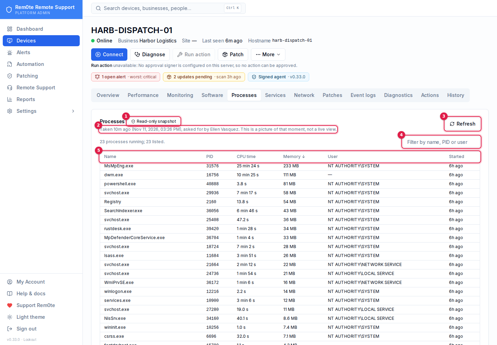
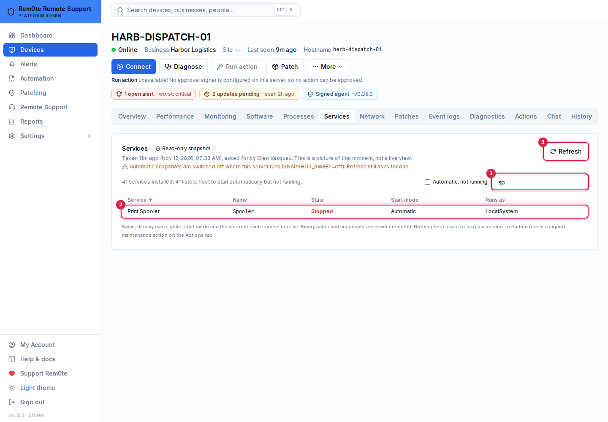
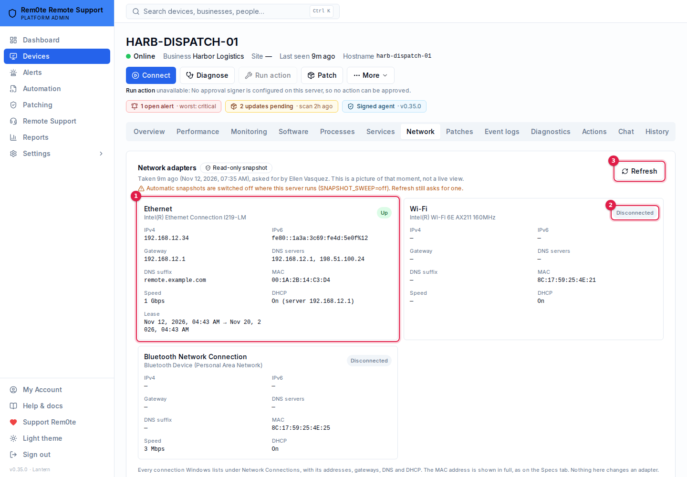

# One-click diagnostics

From 0.31 a Windows computer with the standard agent has a short list of **read-only diagnostics** a technician
can run with one click: disk space, services, recent errors, the busiest processes, network reach, DNS, pending
updates, restart status and a fresh inventory. Each one is a fixed check that the agent already carries. Nothing
on the computer is changed, no approval is needed, and every run is recorded in the audit log.

From 0.33 the same catalog also carries three **full snapshots** — every process, every service and every network
connection — shown on the device page's **Processes**, **Services** and **Network** tabs rather than in the
Diagnostics list. See [The Processes, Services and Network tabs](#the-processes-services-and-network-tabs).

This is not a "run a command" feature, and it cannot become one. The request names a **catalog key** and nothing
else; there is no box to type into. Why that matters is in [inventory.md](inventory.md#why-there-is-no-run-a-command-button).

## The catalog

| Key | What it reports | Takes | Needs |
|---|---|---|---|
| `refresh_inventory` | Hardware, OS, disks, network adapters and installed software, written to the Specs tab (the same collection as the Refresh button) | About a minute | View computers |
| `disk_space` | Size, free space and percent free of every fixed volume | Seconds | View computers |
| `service_health` | Services set to start automatically that are not running, and every service a monitor watches on this computer, with its state | Seconds | View computers |
| `recent_system_errors` | Critical and Error events from the System and Application logs in the last 24 hours, grouped by source and event id: count, first and last time, and one shortened message | Seconds | **Read event logs** |
| `top_processes` | The ten processes using the most processor time and the ten using the most memory: name, process id, CPU seconds, working set | Seconds | View computers |
| `network_connectivity` | Whether the computer can open a TCP connection to this rem0te server on port 443, and each network adapter's state and addresses | Seconds | View computers |
| `dns_resolution` | The DNS servers in use, and the answer and time for this server's name and for `dns.msftncsi.com` | Seconds | View computers |
| `pending_updates` | Updates Windows Update offers but has not installed (the existing update scan), written to the Patches tab. Installs nothing | Several minutes | View computers |
| `reboot_status` | Whether a restart is pending and which signal says so — component servicing, Windows Update, files waiting to be replaced, the update agent — and the last boot | Seconds | View computers |
| `process_list` (0.33, Processes tab) | Every running process: name, process id, processor time, working set, the user it runs as (where the agent can read it) and when it started | Seconds | View computers |
| `service_list` (0.33, Services tab) | Every installed service: name, display name, state, start mode and the account it runs as | Seconds | View computers |
| `network_adapters` (0.33, Network tab) | Every connection Windows lists under Network Connections: status, speed, MAC, IPv4/IPv6, gateways, DNS servers and suffix, DHCP server and lease | Seconds | View computers |

Every entry is `risk: read_only`, expected impact *none*, approvals *none (read-only)*, supported on Windows only.
The keys are stable and snake_case: `INTEGRATION_COORDINATION.md` §5 (in the repository root) proposes
offering this catalog to ClientSt0r later (P1/P2). No integration route exists yet.

**Why those permissions.** Everything except `recent_system_errors` reports what the Specs and Monitoring tabs
already show, so it needs only *View computers* — the same as the inventory Refresh button. The 0.33 snapshots add
the account each process and service runs as; that is the same kind of fact as the signed-in user the device header
already shows, so they stay at *View computers* too. Command lines, which can carry secrets, are never collected
by any key. `recent_system_errors`
returns event-log message text, which is exactly what *Read event logs* gates on the Event Log tab. Someone without
it sees that the diagnostic ran, and when, but not what it said.

## What a run looks like

There is no connection into a managed computer, so a run is a request the computer collects:

| Status | Means |
|---|---|
| **Requested** | Waiting for the computer's next check-in, normally within three minutes |
| **Delivered** | The heartbeat handed it to the computer |
| **Running** | The agent said it started |
| **Completed** | The result arrived and was stored |
| **Failed** | The agent reported an error, the result was malformed, or the requester lost access before delivery |
| **Expired** | It stalled — and the run says where (below) |

Each step's time is shown, with who asked and how old the result is. Clicking **Run** again while a run of the
same diagnostic is still open returns the open one.

**Why a run expires**

| Stalled at | After | The run says |
|---|---|---|
| Requested | 15 minutes | The computer did not check in: it is probably offline, asleep, or its heartbeat task is not running |
| Delivered | 10 minutes | It never started: the agent probably predates 0.31 — reinstall the agent from the Specs tab |
| Running | 5, 10 or 30 minutes (by how long the diagnostic takes) | No result arrived: the computer may have gone offline mid-run |

**Limits.** At most 20 runs per computer and 40 per person in any ten minutes (HTTP 429 beyond that), three runs
handed to a computer per check-in, and the fleet abuse guard applies as it does to an event-log fetch.

## What the computer does

The heartbeat response carries `diagnostics: [{ id, key }]` — never parameters — and only to a heartbeat that
authenticated with the device secret. The agent checks the key against its own copy of the catalog, maps it to one
fixed function compiled into `heartbeat.ps1`, and posts `running`, then the result, to
`/enrollment/diagnostic-result` with the device secret. The functions only read: CIM queries, `Get-Service`,
`Get-WinEvent`, `Get-Process`, registry presence checks, a DNS lookup and one TCP connect to this server. A key it
does not know is refused and reported as failed.

**Never collected:** command lines, executable or service binary paths, process modules, environment variables,
the contents of the pending-rename list (it holds file paths), or any secret. The account a process or service runs
as is collected by the 0.33 snapshot keys only (`process_list`, `service_list`) and by no other key. Event messages
have user-profile paths (`C:\Users\name\…`) replaced with `%USERPROFILE%` on the computer and again on the server.

## What the server keeps

Every result is re-shaped field by field before it is stored (`apps/api/src/diagnostics-catalog/catalog.ts`):
unknown fields dropped, strings clamped and stripped of control characters, profile paths and long opaque tokens
redacted, numbers range-checked, lists cut (50 error groups, 10 processes, 16 adapters…), and the whole result
capped at **32 KB** — **128 KB** for the three snapshot keys, which list everything. A run is only updated by the computer it was staged for, under its own key. `service_health`
keeps only the monitored services this server asked about. `refresh_inventory` and `pending_updates` go through the
inventory service exactly as the automatic collections do, and the run keeps a summary.

The catalog is closed in four places: the request (unknown key: 400 `UNKNOWN_DIAGNOSTIC`), the heartbeat, the
result, and the database — `DiagnosticRun.key` has a `CHECK` constraint listing the twelve keys (migration 0042
added the snapshots), and results over 64 KB (256 KB for a snapshot) are refused by another. Adding a diagnostic is
a migration on purpose. `scripts/check-security-invariants.mjs` §20 checks all of it, and §31 the snapshots.

**Who may see what.** Every route here applies business scope *and* the device-list visibility rule: a Business User
sees only the computers granted to them (or marked company-wide), and any other computer — in their business or
not — reads as missing (404). Before 0.33 only business scope was checked here, so such a user could stage a run on
a computer they could not see (it then failed at delivery) and read that computer's run history.

**Audit.** `ENDPOINT_DIAGNOSTIC_REQUESTED` (who, which key, the run) and `ENDPOINT_DIAGNOSTIC_COMPLETED` (outcome
completed, failed or expired, size, whether truncated) — never result content. **Automatic snapshots (0.35) are not
audited run by run** (see [below](#automatic-snapshots)): the run itself, with no requester, is their record, and
changing the schedule is audited (`SNAPSHOT_SCHEDULE_CHANGED`, before and after). A result posted with the wrong device
secret is `ENDPOINT_HEARTBEAT_REJECTED`, reason `diagnostic_result_unauthenticated`.

## Routes

| Route | Who |
|---|---|
| `GET /endpoints/:id/diagnostics/catalog` | View computers; the catalog with `allowed` per entry for you |
| `POST /endpoints/:id/diagnostics/runs` `{ "key": "disk_space" }` | View computers, plus the entry's permission |
| `GET /endpoints/:id/diagnostics/runs` | View computers; results withheld where you lack the entry's permission |
| `GET /endpoints/:id/diagnostics/runs/:runId` | As above |
| `GET /endpoints/:id/diagnostics/snapshots/:key` (0.33) | View computers; `key` is `process_list`, `service_list` or `network_adapters` (anything else: 400 `UNKNOWN_SNAPSHOT`). The newest completed result, `takenAt`, an open refresh (`pending`) and a newer failure (`lastFailure`); from 0.35 also `automatic` (`state`, `reason`, `nextAt`, `intervalMinutes`, `basis`), `agentSilent` and `agentVersion`. Reading it marks the tab as open (see below) |
| `GET /admin/snapshot-schedule`, `PUT /admin/snapshot-schedule` (0.35) | Platform Admin. The automatic snapshot schedule; `PUT` takes any of `enabled`, `minutes` (per key) and `watchMinutes` |
| `POST /enrollment/diagnostic-result` | The computer, with its device secret |

## The Processes, Services and Network tabs

From 0.33, a Windows computer's page has three more tabs. Each shows the newest result of one catalog key, **when it
was taken and how old it is**, and a **Refresh** that asks for a new one exactly as **Run** does on the Diagnostics
tab — the request carries the key and nothing else, and the computer answers on its next check-in (normally within
three minutes). While a refresh is on its way the old snapshot stays on screen with the refresh beside it; if the
refresh fails or expires, the reason is shown and the last good snapshot stays. A snapshot more than a day old is
flagged. These are pictures of a moment, not live views.

From 0.35 the server also takes them **automatically** ([Automatic snapshots](#automatic-snapshots)), and the tab
**updates itself**: it re-reads every 4 seconds while a refresh is on its way and every 30 seconds while it is open
(not while the browser tab is hidden), so a new snapshot appears without a reload. Under the age it says how often the
snapshot is refreshed and roughly when the next automatic one is due.

| Tab | What it lists | Bounds |
|---|---|---|
| **Processes** | Name, PID, processor time since start, working set, user, start time; sortable and filterable. If the agent could not read users (`Get-Process -IncludeUserName` needs elevation), the tab says so | The agent sends the 1,000 largest by memory; the server keeps 1,000 and cuts to 128 KB |
| **Services** | Display name, name, state, start mode (including delayed start) and the account it runs as; a filter, and *Automatic, not running* | 1,000 services; 128 KB |
| **Network** | One card per connection: status, speed, IPv4/IPv6, gateway, DNS servers and suffix, MAC, DHCP server and lease | 32 adapters, 16 addresses each |

1. **Read-only snapshot** — what the tab is, and that nothing on it acts on the computer.
2. **When it was taken** — and how old it is; flagged after a day.
3. **Refresh** — asks for a new one on the computer's next check-in.
4. **Filter** — by name, PID or user.
5. **The columns** — click one to sort.

1. **Filter** — by display name or name; *Automatic, not running* beside it.
2. **A service** — state, start mode and account. This Print Spooler is the one the open Windows-service alert is about.
3. **Refresh** — as on Processes.

1. **An adapter** — status, speed, addresses, gateway, DNS, MAC and the DHCP lease.
2. **A disconnected adapter** — listed with its status rather than hidden.
3. **Refresh** — as on Processes.

**There is nothing to click that acts on the computer** — no end task, stop, start or restart. Restarting a service
is a signed maintenance action on the Actions tab (signed agent, allowlisted services, approvals); ending a process
is not offered at all. When a result had to be cut to fit, the tab says so.

## Automatic snapshots

*Added in 0.35.* Before 0.35 a snapshot existed only once someone pressed Refresh, so a computer nobody had looked at
showed *Never taken on this computer*. Now the server asks for each one itself.

**How.** On the heartbeat — not a sweep over the fleet. When a computer checks in and one of its snapshots is older
than its interval, that heartbeat's response asks for it, as an ordinary diagnostics run with **no requester**. It is
delivered, sanitised, capped (128 KB) and stored exactly like one a person asked for, and the tab shows it as taken
*automatically*. A computer that is not checking in is never asked, so nothing piles up for it. A Refresh while an
automatic run is open returns that run, so the computer collects once.

**When** (defaults; Settings → Monitoring & API → *Automatic snapshots*, Platform Admin, audited):

| | Default | Range |
|---|---|---|
| Processes, Services, Network adapters | every **6 hours** each | off, or 1 hour – 7 days |
| While the snapshot's tab is open | every **5 minutes** | off, or 3 – 60 minutes |
| Switch | on | — |

The 6 hours is the inventory pass's cadence. A process list is out of date within minutes, so polling it hourly across a
fleet buys little: the 5-minute interval while the tab is open is what keeps it current when someone is looking. "Open"
means the snapshot was read in the last 90 seconds (the tab re-reads every 30 s), by someone who can see the computer;
a refused read does not count. The sizes behind the numbers are in [server-sizing.md](server-sizing.md#automatic-snapshots-035).

After a failed or expired automatic run the next one waits an hour (or the interval, if shorter) rather than going
out on the next heartbeat. At most `SNAPSHOT_MAX_PER_MINUTE` (default 120) scheduled runs start per minute across the
server, so the first round after an upgrade or an outage is spread over a couple of hours; a key held back stays due.
Watched runs are not held back.

**Who is asked.** A computer that is active, on Windows, bound to a device secret, running an agent from **0.33 or
later** (older agents do not know the snapshot keys: 0.31–0.32 refuse them and anything earlier never starts them),
and checking in (a heartbeat in the last 30 minutes, the same window the device header uses for *Online*). When one of these fails, the tab says which instead of offering a
Refresh that would expire:

| The tab says | Why |
|---|---|
| *Reachable (RustDesk) · agent silent …*. Its agent has not checked in since …, so remote control should work but nothing can be collected until it does (or, when RustDesk cannot reach it either, just "Its agent has not checked in since …") | `agent_silent`: no heartbeat for 30 minutes (the header's *Reachable (RustDesk) · agent silent* window). `isOnline` can still be true through RustDesk (0.34); nothing can be collected until the agent checks in |
| This computer's agent (0.32.0) predates 0.33 … | `agent_too_old`; reinstall the agent |
| … has never reported its version … | `agent_unknown` |
| Collected by the Windows agents only … | `unsupported_platform`: the Linux and macOS agents run nothing the console asks for |
| Automatic snapshots are turned off on this server | `disabled` in Settings |
| … not on an automatic schedule | `key_off`: this key's interval (and the open-tab one) is off |
| … switched off where this server runs (SNAPSHOT_SWEEP=off) | `process_off` |

No snapshot is ever made up: a tab with nothing taken says *Never taken* and why.

**What is kept.** Only the newest completed automatic run of each key per computer: an older one is deleted when a
newer one completes, and a failed one when the next is asked for. People's runs are left to the
[retention sweep](data-retention.md), which also covers automatic ones. The database refuses an automatic run of any
key but the three snapshot keys, and a second open automatic run of a key (migration 0059).

**Containment does not apply.** No pause kind covers reading: a pause stops writes, and viewing keeps working during
one ([containment.md](containment.md)) — the same as the automatic inventory pass and a manual Refresh.

**Off switch.** `SNAPSHOT_SWEEP=off` in the API's environment stops all automatic requests in that process (Refresh
still works); Settings then says so. The e2e runner and the browser suite set it for every suite but
`e2e-auto-snapshots.mjs`. `check-security-invariants.mjs` §50 checks the rules above.

**MAC addresses** are shown in full, as on the Specs tab: no masking policy applies to them today. (RustDesk IDs
are masked in the device list; that is a different identifier.)

**What the agent runs.** Three functions in `heartbeat.ps1`, reached only from the catalog switch:
`Get-Process -IncludeUserName` (falling back to `Get-Process`), `Get-CimInstance Win32_Service`, and
`Get-CimInstance Win32_NetworkAdapter` / `Win32_NetworkAdapterConfiguration`. Every string put into a result goes
through one of two helpers first — one strips control characters and clamps, the other also requires an explicit
charset (process names may not contain a path separator; accounts, service names, MACs, addresses and DNS suffixes
each have their own) — and is checked again on the server. A **build-time guard** (`assertSnapshotBlockSafe` in
`public/windows-script.ts`) refuses to produce an installer whose snapshot block calls anything but `Get-*`
cmdlets (plus `Sort-Object` / `Select-Object`), uses `Invoke-*`, `iex`, script blocks, the call operator,
`New-Object` or `Add-Type`, reads `PathName`, `CommandLine`, `.Path`, modules or the environment, or puts a field
into a result without one of the helpers — the same idea as `RustdeskService.joinPs()`, for the one script that is
not built from statements.

**Linux.** Not offered. The standard Linux agent reads only command ids and three fixed command types from the
heartbeat response, never a diagnostics run, and `systemctl` is deliberately absent from it (§24). Adding these
would mean widening what that agent reads and runs, so the tabs are not shown for Linux and a request is refused
(`DIAGNOSTIC_OS_UNSUPPORTED`).

## How far this has been tested

| | Real Windows | Simulated | Integration |
|---|---|---|---|
| The diagnostics block in `heartbeat.ps1` | **No** | Parsed by PowerShell 7.4's parser, both installer variants; run under pwsh against stub cmdlets (`unit-diagnostics-catalog.mjs`) | — |
| Request, delivery, results, expiry, limits, cross-business refusal, audit | — | — | Real API and database with a simulated heartbeat (`e2e-diagnostics-catalog.mjs`) |
| The 0.33 snapshot functions | **No** | Parsed with `ParseFile()`; run under pwsh 7.4 against stub `Get-Process` / `Get-CimInstance`, elevated and not, with hostile values and 1,505 processes (`unit-system-inventory.mjs`); the build-time guard proven by mutation | Request → heartbeat → result, hostile and oversized results, visibility, A/B isolation, capability, audit (`e2e-system-inventory.mjs`) |

The stubs stand in for `Get-CimInstance`, `Get-Service`, `Get-WinEvent`, `Get-Process`, the registry and the TCP
connect. Until it has run on a real Windows machine, treat property names that differ between Windows PowerShell 5.1
and PowerShell 7 (for example a delayed-start service's `StartType`) as unverified. The same goes for the snapshots:
`Win32_Service.DelayedAutoStart` is absent on older Windows builds (the start mode then reads *Automatic*),
`Get-Process -IncludeUserName` has not been run as SYSTEM on a real machine, and a real `Win32_NetworkAdapter`
`Speed` for a disconnected adapter is assumed to be the Int64 maximum (dropped as unknown).

## See also

- [inventory.md](inventory.md) — the specs, update scan and event-log fetch these reuse
- [monitoring.md](monitoring.md) — monitors, whose watched services `service_health` reports
- [capabilities.md](capabilities.md) — what each agent type can do
