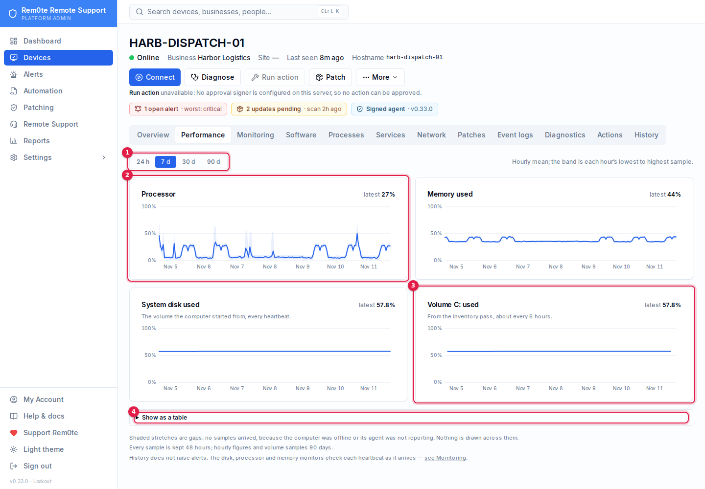

# Metric history

From 0.33 Rem0te keeps **processor, memory and disk use over time** for every computer whose agent reports
them, and shows it on the computer's **Performance** tab: 24 hours, 7, 30 or 90 days. Before 0.33 the console
had the latest reading only — the gauges on Overview — and nothing to say whether a full disk filled last
night or over three months.

Everything on the tab is a stored measurement. Nothing is estimated or filled in: a stretch with no samples is
drawn as a **gap**, never as a line.

## What is recorded

| Series | Comes from | How often | Kept |
|---|---|---|---|
| Processor (%) | the heartbeat's `cpuLoadPercent` | every heartbeat, at most one a minute (≈ every 3 min) | 48 h raw, then hourly |
| Memory used (%) | the heartbeat's memory total and free | as above | as above |
| System disk used (%) | the heartbeat's system-volume total and free | as above | as above |
| Each volume used (%) | the inventory pass's disk list | every inventory pass (≈ every 6 h) | 90 days |

These are the values the Windows and Linux agents already send; no agent changed for 0.33. The **system disk**
is the volume Windows started from (`%SystemDrive%`) or `/` on Linux. Every other fixed volume (`D:`, `/home`
on its own mount) is reported only by the slower inventory pass, so its chart has a point about every six
hours and a gap only after two missed passes (13 h). The system volume therefore appears twice — once per
heartbeat, once per inventory pass — and the two agree.

**Only the computer itself can add history.** A sample is written only from a heartbeat that carried the
computer's device secret; a volume sample only from an inventory result, which also needs it. A heartbeat
from a node with no bound secret (an installer from before device secrets) keeps the computer online and
writes no history. RustDesk-only computers (macOS, Linux without the agent) have no Performance tab.

History starts with each computer's first heartbeat after the server was upgraded to 0.33. Nothing earlier
was stored, so there is nothing to backfill.

## Reading the charts

1. **Range** — 24 hours, 7, 30 or 90 days.
2. **A chart** — the hourly mean as the line, the hour's lowest to highest as the band.
3. **A volume** — disk use is sampled every six hours, so its line moves in steps.
4. **Show as a table** — latest, lowest, mean and highest of each series over the range.

- **24 h** draws every sample. **7, 30 and 90 days** draw each hour's **mean** as the line and the hour's
  **lowest to highest** sample as a pale band — a processor that spiked to 100 % for three minutes shows in
  the band even when the hourly mean is 20 %.
- **Shaded, hatched stretches are gaps**: no samples arrived. For the per-heartbeat series that is 10 minutes
  with nothing — the same threshold at which the server marks a computer offline. For hourly series it is an
  hour with no samples at all. The cause is the computer being off, asleep, disconnected, or its agent not
  running; history cannot tell which, and the hover says *Offline or not reporting*.
- Nothing before the computer was added is a gap.
- Hover (or focus the chart and use the arrow keys) for the value at a point. **Show as a table** lists the
  latest, lowest, mean and highest of each series over the range.

## Downsampling and retention

| Store | Contents | Default | Setting | Allowed |
|---|---|---|---|---|
| Raw samples | one row per heartbeat (≤ 1/min) | 48 hours | `METRIC_RAW_HOURS` | 24 – 168 |
| Hourly roll-up | per hour: sample count, min / mean / max of each metric | 90 days | `METRIC_HOURLY_DAYS` | 7 – 400 |
| Volume samples | one row per volume per inventory pass | 90 days | `METRIC_HOURLY_DAYS` | 7 – 400 |

A value outside the allowed range is clamped to it, and an unparsable one takes the default, so history can be
made short or long but never unbounded. The raw floor is 24 hours because the 24 h range reads raw samples.

The **sweep** (every 5 minutes) does two things, in order:

1. **Roll up** complete hours that have samples and no roll-up, oldest first, at most
   `METRIC_ROLLUP_HOURS_PER_PASS` (6) per pass. An hour is complete two minutes after it ends. Each hour is
   recomputed from its raw samples and written as an upsert, so running a pass twice — or two API instances
   both running it — changes nothing.
2. **Prune** past retention in batches of `METRIC_PRUNE_BATCH` (5,000) rows, at most `METRIC_PRUNE_BATCHES`
   (10) per table per pass. A raw sample is pruned only once its hour has been rolled up: if the sweep was off
   for a week, turning it back on rolls the backlog first and loses nothing raw still held.

Ranges longer than 24 hours combine the roll-up with the hours not rolled yet (the current hour, and any
backlog), computed from raw when the chart is opened — a chart never has a hole just because the sweep has
not run.

Normally a pass looks only at raw samples newer than the newest rolled hour (an index range of about an hour
of samples). On a process's first pass and every `METRIC_FULL_SCAN_PASSES` (12, i.e. hourly) it compares all
of raw against the roll-up instead, which also finds an hour that was skipped — after a clock step or a
database restore.

| Variable | Default | Meaning |
|---|---|---|
| `METRIC_SWEEP` | on | `off` stops the roll-up and pruning in this process. Recording and reading continue; raw samples then accumulate (bounded by one per computer per minute) until it is on again |
| `METRIC_SWEEP_SECONDS` | 300 | how often the sweep runs (2 – 3600) |
| `METRIC_RAW_HOURS` | 48 | raw retention |
| `METRIC_HOURLY_DAYS` | 90 | hourly and volume retention |
| `METRIC_MIN_INTERVAL_SECONDS` | 60 | at most one sample per computer per this long (30 – 900) |
| `METRIC_ROLLUP_HOURS_PER_PASS` | 6 | hours rolled per pass (1 – 48) |
| `METRIC_PRUNE_BATCH` / `METRIC_PRUNE_BATCHES` | 5000 / 10 | rows per DELETE / DELETEs per table per pass |
| `METRIC_FULL_SCAN_PASSES` | 12 | every how many passes the roll-up does the full comparison |

## Storage per 1,000 computers

Measured on PostgreSQL 16 with 1,000 synthetic computers at full default retention (a heartbeat every
3 minutes, two volumes each), table plus indexes after `VACUUM ANALYZE`:

| Table | Rows | Size | Per row |
|---|---|---|---|
| `EndpointMetricSample` (48 h raw) | 960,000 | 180 MB | 196 B |
| `EndpointMetricHourly` (90 d) | 2,112,000 | 450 MB | 223 B |
| `EndpointDiskSample` (90 d, 2 volumes) | 720,000 | 137 MB | 200 B |
| **Total** | | **≈ 770 MB** | |

So about **0.8 MB per computer**, growing linearly: each extra volume adds ≈ 70 MB per 1,000 computers, and
`METRIC_HOURLY_DAYS` scales the larger two tables (400 days is ≈ 3.2 GB per 1,000). Most of each row is the
computer's id, repeated in the table and its primary-key index.

Sweep cost at that size, on the same host: the normal pass's search for unrolled hours took 40 ms and rolling
one hour (20,000 samples) 0.5 s; the hourly full comparison took 1.7 s.

## How history relates to monitoring

Monitoring is unchanged and does not read history. The **disk space, processor load and memory use** monitors
(see [monitoring.md](monitoring.md)) evaluate each heartbeat's reading as it arrives and raise or resolve
alerts from that; history records the same reading so a technician can see afterwards how it got there. A
monitor's threshold is not drawn on the charts, and nothing on the Performance tab raises, acknowledges or
resolves an alert. A maintenance window or a containment pause does not stop history being recorded.

## API

`GET /api/v1/endpoints/:id/metrics?range=24h|7d|30d|90d` — capability `computers:view`. The computer must be
one you can see on the device list (a Business User: granted or company-wide computers; a technician: their
assignment); any other id, including another business's, is a 404.

The response carries `resolution` (`raw` or `hour`), `from`, `to`, `retention`, column arrays under `series`
(`t` in epoch milliseconds; `cpu`, `memory`, `disk` — for hourly also `…Min`, `…Max` and `samples`), `gaps` as
`{from, to}` intervals, and `disks.volumes` (one entry per drive, with its own `gaps`). A metric a sample did
not carry is `null`. Points exist only where samples do.

## Troubleshooting

- **No Performance tab** — the computer runs RustDesk only, or you lack `computers:view`.
- **"No samples in this range"** — the computer has not sent an authenticated heartbeat since the upgrade.
  Check the Overview's agent row: a computer enrolled before device secrets needs its installer re-run from
  an enrolment link before the server will take anything it reports.
- **Hourly charts stop at about now − 1 h and the current hour looks spiky** — that hour is not rolled yet and
  is computed from its raw samples; it settles once the sweep rolls it.
- **The database keeps growing** — check `METRIC_SWEEP` is not `off` and the API log for
  `[MetricHistory] sweep failed`.
