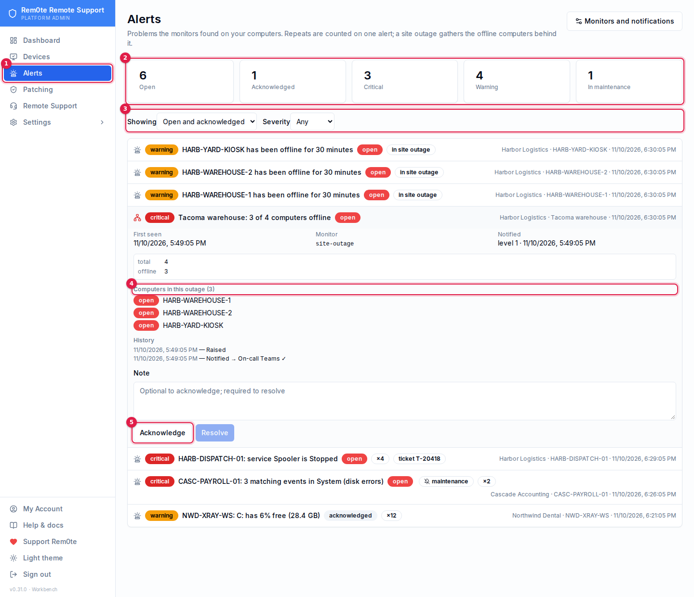
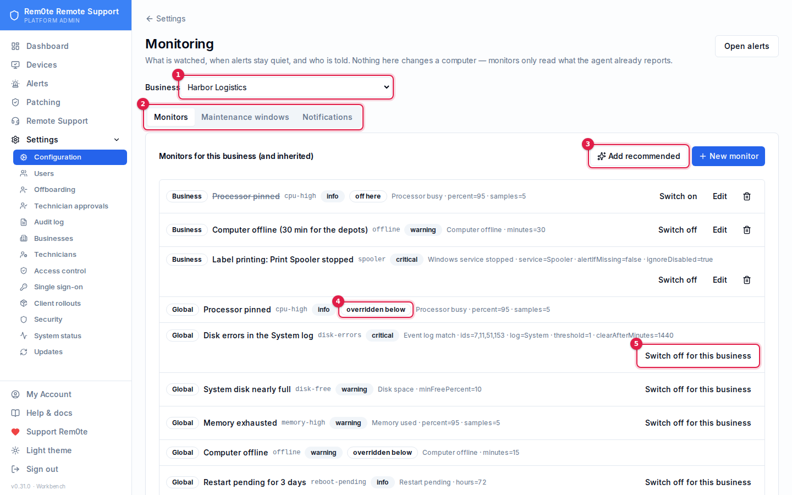
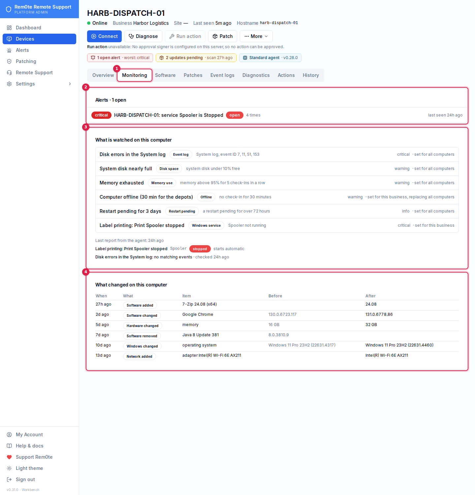
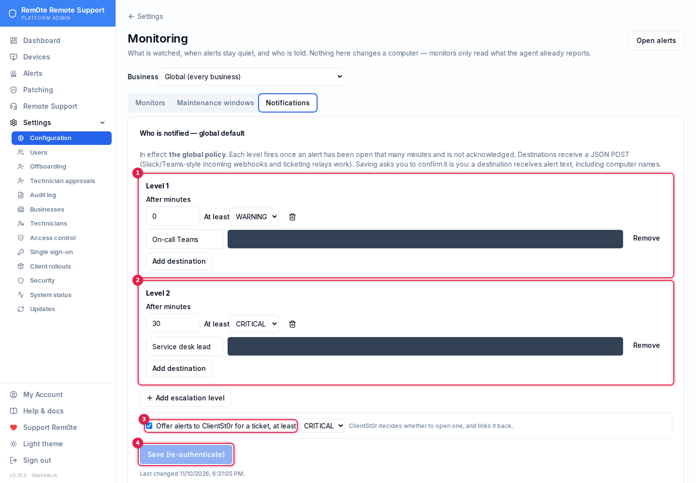

# Monitoring and alerts

Since 0.29, Rem0te watches the computers it manages and raises an **alert**
when something needs a person: a computer offline, a disk nearly full, a
Windows service stopped, matching events in an event log, a restart pending
for days. Alerts are deduplicated, a site-wide outage is recognised as one
problem, alerts can be held for maintenance, and unacknowledged alerts
escalate to further destinations — including a ticket in ClientSt0r.

**Monitoring only reads.** A monitor never changes a computer. Everything it
uses is something the agent already reports: the heartbeat (CPU, memory,
disk, restart pending), the inventory, and a small monitor report listing
the services and event queries the server asked about.



1. **Alerts** in the sidebar — shown to anyone with `monitoring:alerts`.
2. Totals for what is open now, including how many are held by a maintenance window.
3. Filter by state and severity. The default is open and acknowledged.
4. A site outage lists the computers it gathered; they are not notified on their own while it is open.
5. **Acknowledge** stops escalation; **Resolve** needs a note.

## Where things are

| What | Where | Who |
|---|---|---|
| Alerts | **Alerts** in the sidebar | anyone with `monitoring:alerts` |
| One computer's alerts, monitors, change history and software | Computer → **Monitoring** tab | anyone who can see the computer |
| Monitors, maintenance windows, notifications | **Settings → Monitoring & API → Monitoring** | `monitoring:configure` for the whole business, a Business Owner, or the MSP |

Presets that allow viewing inventory also grant `monitoring:alerts`. A
technician sees alerts only for computers their grant covers; a site-outage
alert needs the whole business in view.

## Monitors

A monitor has a **key**, a **kind**, a **severity** (info, warning,
critical) and parameters.

| Kind | Raises when | Clears when |
|---|---|---|
| Computer offline | no heartbeat for *minutes* (default 15) | the computer reports again |
| Disk space | system disk below *minFreePercent* free | two good heartbeats in a row |
| Processor busy / Memory used | above *percent* for *samples* heartbeats in a row | two good heartbeats |
| Windows service stopped | the named service is not Running (optionally: missing; disabled ignored by default) | it is Running again |
| Event log match | at least *threshold* events since the last report match *ids*, *levels* or *provider* in one of System, Application, Security, Setup | no match for *clearAfterMinutes* |
| Restart pending | Windows has wanted a restart for *hours* | the restart happens |

An event-log monitor must name at least one of IDs, levels or provider — a
monitor on every event in a log is a flood, not a monitor. The agent asks
for at most 100 events per query and sends one sample, truncated.

**Add recommended** creates a starter set — offline, disk, CPU, memory,
restart pending, and disk errors (System log IDs 7, 11, 51, 153) — as ordinary
monitors you then adjust. Nothing is created without that click.



1. **Business** — the MSP picks one; blank is the global layer every business inherits. A Business Owner sees only their own.
2. Monitors, maintenance windows and notifications are separate tabs.
3. **Add recommended** — the starter set, added as ordinary monitors.
4. *Overridden below* — this business has its own monitor with the same key, so the global one does not apply here.
5. **Switch off for this business** — adds a disabled override with the same key.

### Inheritance

Monitors are set at four levels: **global** (the MSP, for every business),
**business**, **site** and **computer**. For each key, the most specific
monitor wins. So to change the offline threshold for one business, add a
business monitor with the key `offline`; to switch it off there, add it
disabled ("Switch off for this business" does exactly that). Removing the
override brings the inherited one back.

A computer's **Monitoring** tab leads with its alerts (open ones first, worst
severity first; resolved ones folded away), then lists the monitors actually in
effect — by name and kind, with what each watches for in words — and where each
came from. Its open alerts also show in the attention strip at the top of the
computer's page. From 0.31 installed software has its own **Software** tab.



1. The **Monitoring** tab on a computer's page (`?tab=monitoring` links straight to it).
2. Its open alerts, first.
3. Monitors in effect, where each came from, and what the agent last reported for services and event queries.
4. Changes between inventories. Installed software is on the **Software** tab (`?tab=software`) from 0.31.

## Alerts

There is **one alert per problem**, not per occurrence: while an alert is
open, a repeat raises its count (×3) and moves *last seen*. When the
monitor sees the problem clear, the alert resolves itself ("resolved
(cleared)").

- **Acknowledge** — "someone has this." Stops escalation. A note is optional.
- **Resolve** — closes it with a note (at least three characters). If the
  problem is still there, the next check raises a new alert.

Offline alerts wait three minutes before anyone is notified, so a computer
that restarts does not page anybody.

### Site outages

When three or more computers at one site are offline and they are at least
half of that site, Rem0te raises a single critical **site outage** alert and
groups the offline alerts under it. While it is open the grouped alerts are
not notified on their own — one page for a site that lost its internet, not
forty. It clears when fewer than a quarter (or fewer than two) remain
offline; the grouped alerts still open are then notified normally.

Sites need at least three computers for this to apply.

## Maintenance windows

A maintenance window **holds notifications** for a business (or every
business), optionally only for some monitor keys, for up to 14 days and
scheduled up to 90 days ahead. Alerts are still raised and shown, marked
*maintenance*; anything still open when the window ends is notified then.
Ending a window early releases what it held at once.

A maintenance window is **not containment**. It changes who is told, not
what reaches a computer. To stop changes reaching computers during an
incident, use [containment](containment.md).

## Who is notified

**Settings → Monitoring → Notifications** holds up to four escalation
levels. Each fires once an alert has been open (and unacknowledged) that
many minutes, for alerts at or above its severity, and sends a JSON `POST`
to each of its destinations (up to five: Slack- or Teams-style incoming
webhooks, a ticketing relay, your own endpoint). A level is fired once per
alert; when the alert resolves, every level that was notified is told.

```json
{ "type": "alert.notify", "level": 0, "alert": { "id": "…", "title": "PC-12 has been offline for 15 minutes", "severity": "warning", "state": "open", "business": "…", "computer": "PC-12", "firstSeenAt": "…" } }
```



1. Level 1 fires at once for warnings and above.
2. Level 2 fires after 30 minutes unacknowledged, for critical alerts only.
3. Offer alerts at or above a severity to ClientSt0r for a ticket.
4. Saving asks you to confirm it is you.

A business uses its own policy if it has one, otherwise the global one.

- A business's policy is set by a **Business Owner** of that business or the
  MSP; the global one by the MSP.
- **Saving asks you to re-authenticate**: a destination receives alert text,
  including computer names.
- A business destination must be `https` on a public host name — no IP
  addresses, `localhost` or internal names. The audit log records hosts only,
  because a webhook URL's path is often its secret; people who cannot change
  the policy see addresses shortened.

### Tickets in ClientSt0r

With **Offer alerts to ClientSt0r** on, alerts at or above the chosen
severity are sent to ClientSt0r as signed alert events (`alert.raised`,
`alert.updated`, `alert.resolved`). `alert.raised` is sent when the first
notification would be, so a maintenance window holds it as well. ClientSt0r decides whether to open a
ticket and links it back; the alert then shows the ticket. A *restart pending* alert also carries a redacted
patch summary (0.30) for the ticket. Details and the
contract routes are in [the ClientSt0r integration](integration-clientst0r.md).

## Change history and software

Every inventory is compared with the one before. Changes to hardware,
operating system, disks, network adapters and installed software are kept
on the computer's **Monitoring** tab — "software added: 7-Zip 24.08",
"memory changed: 16 GB → 32 GB". The first inventory is the baseline and
records no changes.

Installed software comes from the Windows uninstall registry (64- and 32-bit),
skipping system components and updates, up to 500 entries. Agents older than
0.29 do not report it; the tab says so.

## Operator settings

| Variable | Default | Meaning |
|---|---|---|
| `MONITOR_SWEEP` | on | `off` stops the sweep (offline, restart pending, outage correlation, notification) |
| `MONITOR_SWEEP_SECONDS` | 60 | how often the sweep runs |
| `MONITOR_OFFLINE_HOLD_SECONDS` | 180 | how long an offline alert waits before notifying |

## Troubleshooting

- **No alerts at all** — check Settings → Monitoring has monitors (add the
  recommended ones), and that the computer's Monitoring tab lists them.
- **A service monitor never fires** — the service name is the short name
  (`Spooler`, not *Print Spooler*). The tab shows what the agent reported.
- **Nobody was notified** — the alert's history shows each notification and
  its HTTP result. Check for an active maintenance window, an acknowledged
  alert, or a level whose minimum severity is above the alert's.
- **Forty offline alerts for one site** — the site needs at least three
  computers assigned to it for outage grouping to apply.
