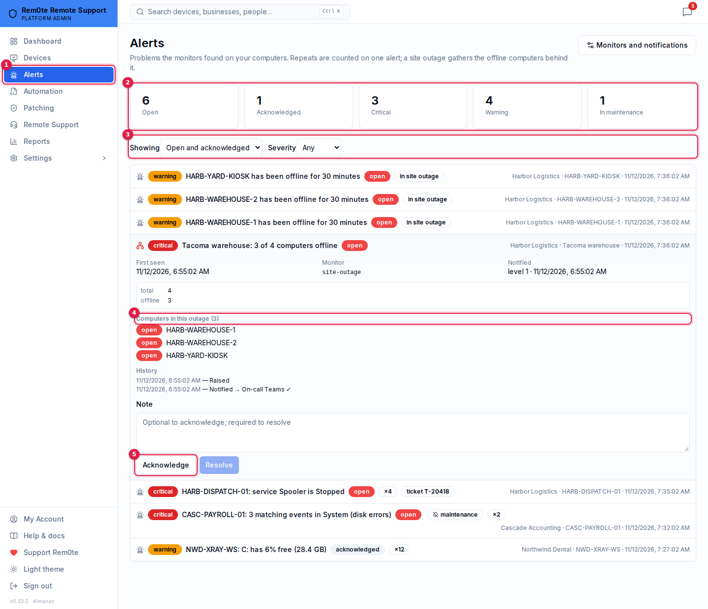
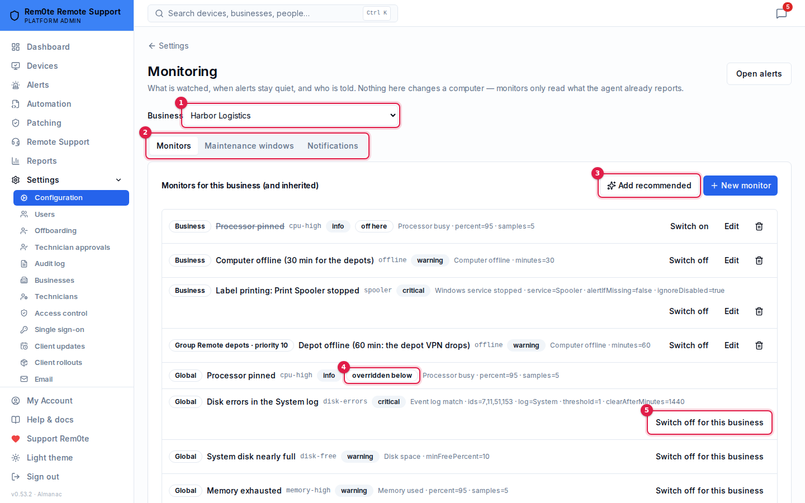
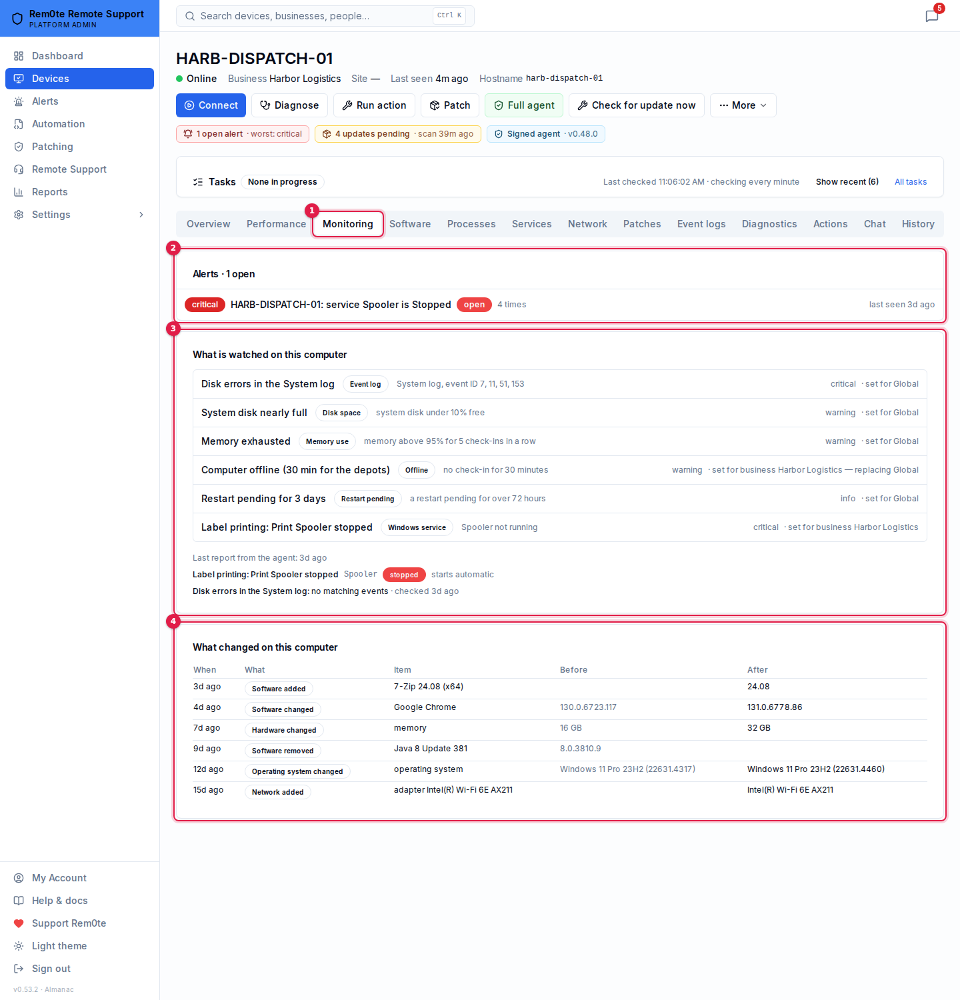
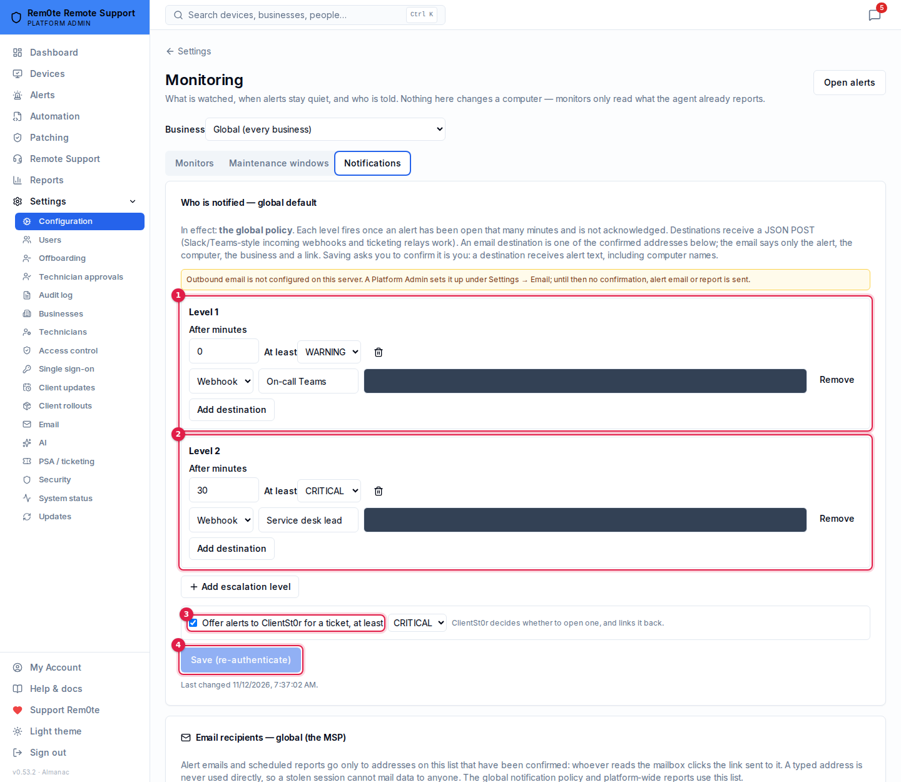

# Monitoring and alerts

Since 0.29, Rem0te watches the computers it manages and raises an **alert**
when something needs a person: a computer offline, a disk nearly full, a
Windows service stopped, matching events in an event log, a restart pending
for days. Alerts are deduplicated, a site-wide outage is recognised as one
problem, alerts can be held for maintenance, and unacknowledged alerts
escalate to further destinations — including a ticket in ClientSt0r.

**Monitoring only reads.** A monitor never changes a computer. Everything it
uses is something the agent already reports: the heartbeat (CPU, memory,
disk, restart pending), the inventory, and a small monitor report listing
the services and event queries the server asked about.

Monitors judge each reading as it arrives. The same readings are also kept
over time (0.33) and charted on a computer's **Performance** tab — see
[metric-history.md](metric-history.md). History raises no alerts, and
monitoring does not read it.



1. **Alerts** in the sidebar — shown to anyone with `monitoring:alerts`.
2. Totals for what is open now, including how many are held by a maintenance window.
3. Filter by state and severity. The default is open and acknowledged.
4. A site outage lists the computers it gathered; they are not notified on their own while it is open.
5. **Acknowledge** stops escalation; **Resolve** needs a note.

## Where things are

| What | Where | Who |
|---|---|---|
| Alerts | **Alerts** in the sidebar | anyone with `monitoring:alerts` |
| One computer's alerts, monitors, change history and software | Computer → **Monitoring** tab | anyone who can see the computer |
| Monitors, maintenance windows, notifications | **Settings → Monitoring & API → Monitoring** | `monitoring:configure` for the whole business, a Business Owner, or the MSP |

Presets that allow viewing inventory also grant `monitoring:alerts`. A
technician sees alerts only for computers their grant covers; a site-outage
alert needs the whole business in view.

## Monitors

A monitor has a **key**, a **kind**, a **severity** (info, warning,
critical) and parameters.

| Kind | Raises when | Clears when |
|---|---|---|
| Computer offline | no heartbeat for *minutes* (default 15) | the computer reports again |
| Disk space | system disk below *minFreePercent* free | two good heartbeats in a row |
| Processor busy / Memory used | above *percent* for *samples* heartbeats in a row | two good heartbeats |
| Windows service stopped | the named service is not Running (optionally: missing; disabled ignored by default) | it is Running again |
| Event log match | at least *threshold* events since the last report match *ids*, *levels* or *provider* in one of System, Application, Security, Setup | no match for *clearAfterMinutes* |
| Restart pending | Windows has wanted a restart for *hours* | the restart happens |
| Agent silent (0.36; recommended from 0.36.1) | RustDesk still reaches the computer but its agent has not checked in for *minutes* (default 60, 30 – 10,080) | the agent checks in again |
| Drive space, every fixed drive (0.55; recommended) | any fixed drive (C:, D:, …) the inventory reports is below *minFreePercent* (default 10) or *minFreeMb* — **one alert per drive** | that drive is 2 points above the line, or is no longer reported |
| Not restarted (0.55) | the computer has been up for *days* (default 30, 1 – 365) | it restarts |
| Security updates outstanding (0.55; recommended) | a security or critical update has been offered for *days* (default 30, 1 – 180) | it is installed, or no longer offered |
| Update install failed (0.55; recommended) | an update failed to install in the last *days* (default 7, 1 – 90) | it installs, or the failure is older than the window |

An event-log monitor must name at least one of IDs, levels or provider — a
monitor on every event in a log is a flood, not a monitor. The agent asks
for at most 100 events per query and sends the count and the newest event
(its ID, level, provider and the first 300 characters of its message); from
0.66 it also sends the five newest, so each can be classified (see *Alert
classification* below). An agent older than 0.66 keeps working with one.

**Add recommended** creates a starter set — offline, disk, CPU, memory,
restart pending, disk errors (System log IDs 7, 11, 51, 52, 55 and 153 at
levels Critical, Error and Warning; before 0.66 IDs 7, 11, 51 and 153 at any
level — see below), from 0.36.1
agent silent (60 minutes, *warning*), and from 0.55 other fixed drives
(10 %, C: excepted), security updates outstanding (30 days) and failed update
installs (7 days), all *warning* — as ordinary monitors you then adjust.
Nothing is created without that click: no monitor is installed at startup, by
an upgrade or by the seed, and the click adds only the starters missing at that
scope. A scope where someone pressed *Add recommended* before 0.36.1 has no
agent-silent monitor until someone presses it again or adds it by hand.

### Agent silent (0.36)

A computer can be *reachable* without *reporting*. `isOnline` stays true while
hbbs sees its RustDesk peer, so a computer whose agent died but whose RustDesk
still runs shows amber *Reachable (RustDesk) · agent silent* on its page
(0.35, [architecture.md](architecture.md#two-meanings-of-online)) — and its
monitoring, patch and inventory values stop updating. The **Offline** monitor
cannot see this: it watches `isOnline`, which is true. The agent-silent monitor
raises when:

- `isOnline` is true (RustDesk reaches it), and
- the agent's last heartbeat is at least *minutes* ago (default 60).

It is **never on by default**, and nothing creates it for you. Since 0.36.1 it
is one of the monitors **Add recommended** creates (the owner's decision; in
0.36 it was offered only on its own); you can also create it alone under
**New monitor → Agent silent (RustDesk still reachable)**, which fills in the
key `agent-silent`, 60 minutes and *warning*. It follows the usual scopes —
global, business, site, device group (by priority) and computer — so you can
turn it on for one business, give kiosks a longer threshold, or switch it off
for a site.

- **Threshold** 30 minutes to 7 days. Not below 30 minutes: that is the window
  in which the page still says *Online*, and an alert would contradict it.
- **The alert** reads "*PC*: agent silent for 3 d — remote control should still
  work", and its detail says what to do: **Update agent** on the computer's
  Agent card, or re-run the installer on the machine. The title's age is
  rewritten as it grows (tens of minutes, then hours, then days), not every
  sweep.
- **Clears** on the first sweep after the agent checks in.
- **Not reachable any more** — the computer drops off RustDesk too: no new
  agent-silent alert is raised (that is the Offline monitor's case), and an open
  one stays open rather than resolving and re-raising every time hbbs restarts.
- **Never reported** — a computer whose agent has never checked in (RustDesk
  only, or an install that never completed) is not this monitor's case.
- **Where it shows** — the alert list, the computer's Monitoring tab, an
  *Agent silent alert* chip at the top of the computer's page, and a line on
  its Agent card, the last two linking straight to the alert.
- **Not sent to ClientSt0r.** The integration contract lists the alert kinds it
  carries and this is not one; with ticketing on, an agent-silent alert is
  notified as usual but not offered for a ticket. Carrying it needs a contract
  revision agreed with ClientSt0r.

### Drives, uptime and updates (0.55)

These four read only what the server already stores, so they need no agent
update. The sweep looks at them at most every five minutes
(`MONITOR_INVENTORY_SECONDS`, default 300).

- **Drive space (every fixed drive).** This reads the drive list from the
  inventory pass. On Windows that is every `Win32_LogicalDisk` of type 3 (a
  fixed drive), and the pass runs about every six hours. A pass older than 48
  hours is not used. **Each drive gets its own alert**, keyed
  `<monitor>:<computer>:<letter>`, so D: and E: filling up are two problems.
  Only a single letter and a colon counts as a drive. A Linux or macOS mount
  point is ignored, and so is a malformed entry.
  - *Only these drives* narrows the monitor to the drives you name.
  - *Except these drives* leaves drives out.
  - **How it relates to Disk space.** The older *Disk space* monitor reads the
    system disk from every heartbeat, so it is quicker. The recommended
    drive-space monitor therefore leaves C: out, so a full C: is not alerted
    twice.
  - It clears only at the line plus 2 points, so a drive hovering on the line
    does not flap.
  - A drive that disappears from the inventory, such as a removed disk,
    resolves its alert.
- **Not restarted.** This uses the boot time from the computer's heartbeat.
  An offline computer is not judged, because it may have restarted since.
  This monitor is *not* in the recommended set.
- **Security updates outstanding.** This needs the **signed agent's patch
  scan**. On a standard agent, or with a scan more than 36 hours old, the
  monitor does nothing.
  - An update's age counts from **when Rem0te first saw it offered**. Windows
    does not say when an update was released. On a computer that is new to
    Rem0te, the clock starts at its first scan.
  - Only the Security and Critical classifications count. A browse-only
    (optional) update never does.
- **Update install failed.** This reads Windows Update's own install history
  from the patch scan, and the results of Rem0te patch deployments to that
  computer.
  - A failure followed by a later successful install of the same update is
    forgotten.
  - The alert lists up to ten failures with their KB and error code.

### Automatic tickets (0.55)

**Settings → Monitoring → Automatic tickets** opens a ticket in the PSA when
an alert opens. You set this at the platform level, and a business can have
its own rule. A business's rule *replaces* the platform rule there, even when
it is switched off. The rule says:

- the lowest severity that opens a ticket (default *critical*);
- optionally, which kinds open one (none ticked means every kind).

The ticket goes through the PSA connector under **Settings → PSA /
ticketing**: the business's own, or else the platform default. It is the
ticket **Create ticket** on that alert would make: the alert's title, kind and
severity, the computer, the business and a link back to the alert. It carries
no alert detail, no note and no AI text (see
[ai-and-tickets.md](ai-and-tickets.md#create-ticket)). It is marked as
requested by *Rem0te monitoring (automatic)*.

**When an alert is ticketed:**

- **Once.** There is never more than one automatic ticket per alert; the
  database holds one row per alert.
- **Only alerts that open after the rule is switched on.** Switching it on
  does not ticket the backlog.
- **After the alert's notification hold.** An *Offline* alert waits for the
  site-outage correlation hold, as its notification does.
- **Never** for an alert in a maintenance window, for a site outage itself,
  or for a computer gathered under an open site outage.
- **Never under a `notifications` containment pause.** An alert held by a
  pause is ticketed when the pause is lifted, if it is still open.
- **At most 10 sends per business an hour** (`PSA_AUTO_TICKETS_PER_HOUR`).
  An alert over the budget waits for a later sweep.

**When a send fails:**

- The failure is recorded on the alert's history and in the audit log.
- It is tried again after 5, 30 and then 120 minutes, four sends in all.
  After that it is *not sent*.
- A send interrupted by an API restart is given up rather than repeated,
  because the PSA may already have made the ticket.
- It stops being retried once the alert resolves or the rule no longer asks
  for it.

**Where the ticket shows:** the reference, with the PSA's link when the PSA
returned one, appears on the alert in **Alerts**, on the computer's
**Monitoring** tab and in the dashboard's **Recent alerts**. Resolving the
alert does not close the ticket, because no connector supports that yet.

**Who may change the rule, and what is recorded:**

- The rule follows *who is notified* (below). The platform rule belongs to
  the MSP. A business rule belongs to the MSP, that Business Owner, or
  someone with `monitoring:configure` for the whole business.
- Saving or removing it asks you to confirm it is you
  (`monitoring.autoticket` under *Settings → Confirm it is you*).
- Each change is audited (`MONITOR_TICKET_POLICY_CHANGED`, before and after).
- Each send is audited **before** it leaves (`PSA_AUTO_TICKET_REQUESTED`),
  then as `PSA_TICKET_CREATED` or `PSA_TICKET_FAILED`. These entries carry
  ids, the kind, the severity and the reference, never the subject or the
  body.

The pass runs inside the monitoring sweep, so `MONITOR_SWEEP=off` stops it.



1. **Business** — the MSP picks one; blank is the global layer every business inherits. A Business Owner sees only their own.
2. Monitors, maintenance windows and notifications are separate tabs.
3. **Add recommended** — the starter set, added as ordinary monitors.
4. *Overridden below* — this business has its own monitor with the same key, so the global one does not apply here.
5. **Switch off for this business** — adds a disabled override with the same key.

### Inheritance

Monitors are set at five levels: **global** (the MSP, for every business),
**business**, **site**, **device group** (0.35) and **computer**. For each
key, the most specific monitor wins — computer, then group, then site, then
business, then global. So to change the offline threshold for one business,
add a business monitor with the key `offline`; to switch it off there, add it
disabled ("Switch off for this business" does exactly that). Removing the
override brings the inherited one back.

A **device-group** monitor applies to the computers in that group *now* — a
rule group's members are computed at each evaluation — and carries a
**priority**: a computer in two groups with a monitor of the same key follows
the lower number (1 first), and two group monitors with the same key cannot
share one. A group that picks computers by their alerts cannot carry a
monitor. See [Device-group policies](group-policies.md) for the full rule,
what the pages show and the measured cost.

A computer's **Monitoring** tab leads with its alerts (open ones first, worst
severity first; resolved ones folded away), then lists the monitors actually in
effect — by name and kind, with what each watches for in words — and where each
came from. Its open alerts also show in the attention strip at the top of the
computer's page. From 0.31 installed software has its own **Software** tab.



1. The **Monitoring** tab on a computer's page (`?tab=monitoring` links straight to it).
2. Its open alerts, first.
3. Monitors in effect, where each came from, and what the agent last reported for services and event queries.
4. Changes between inventories. Installed software is on the **Software** tab (`?tab=software`) from 0.31.

## Alert classification (0.66)

Every event an event-log monitor matches is judged before anything is raised,
by one deterministic, versioned classifier (`apps/api/src/monitoring/classify.ts`).
It never needs AI, and it gives the same answer for the same event every time.

| Class | Means | Alert |
|---|---|---|
| Critical | a catalogued event that strongly indicates a failure (disk bad block, controller error, the disk's own SMART prediction, NTFS corruption) | critical |
| Warning | a catalogued event worth investigating (paging error, I/O retried, a device reset) | warning; critical when it recurs 5 or more times in one report |
| Informational | Windows logged it as Information or Verbose, and the monitor did not ask for that level | info |
| Benign | a **known harmless pattern**, matched on every structured field | none: the event is recorded, not raised |
| Unknown | Rem0te does not know the event | the monitor's own severity |

The rules that keep this safe:

- **Never above the monitor.** The severity you set on a monitor is the ceiling.
  The classifier can lower an alert only on positive evidence: a known-harmless
  pattern, a catalogued event, or an Information/Verbose event under a monitor
  that did not ask for that level.
- **An event Rem0te does not know keeps the monitor's severity.** Your own
  monitors (a backup product's failure event, an application's error) are
  never lowered.
- **The Security log is never lowered by level**, and neither is level 0
  (LogAlways), which is what audit events use.
- **Counted but not seen.** An agent older than 0.66 sends only the newest of
  the matching events. When the agent counted more than it sent, the rest
  cannot be called harmless, so the alert stays at least *warning*.
- **A harmless event cannot hide a real one.** A report holding a harmless
  event and a disk error raises the disk error; the harmless one is only taken
  out of the count the monitor's threshold sees.
- **Known-harmless patterns are narrow.** Each names the log, provider, event
  ID, level (Information or Verbose only), an 8-digit status code and the
  affected component, and every one of them must match. The status code and
  component are read from the device path and the `0x…` code in the message,
  which Windows does not translate — never from words in the message.

### The first known-harmless pattern: TxR inside a shadow copy

`Microsoft-Windows-Kernel-General` event **11**, level **4** (Information),
status **0xC00000A2** (STATUS_MEDIA_WRITE_PROTECTED), on a
`\Device\HarddiskVolumeShadowCopy<n>` path: *"TxR init phase for hive …
finished with result=0xC00000A2"*. Windows tried to start the transactional
registry for a hive inside a Volume Shadow Copy, which is a read-only snapshot.
Backup and System Restore software causes it. It is not a disk error. Any
shadow-copy number matches; another provider, level, status code or component
does not. **Event ID 11 is not suppressed**: `disk` 11 and every storage
controller driver's own 11 (atapi, iaStor…, storahci, stornvme, LSI, megasas…)
are critical.

### Why the disk-errors monitor changed

Before 0.66 the recommended *disk errors* monitor watched IDs 7, 11, 51 and
153 in the System log **from any provider at any level**. On 2026-11-18 it
raised a critical disk alert on DS-HOME1 for the TxR event above. From 0.66 it
asks the agent only for levels Critical, Error and Warning (the genuine disk
events are Error or Warning), and adds 52 (the disk's SMART failure
prediction) and 55 (NTFS corruption). It deliberately names no provider:
"controller error" (11) is logged by each storage controller driver under its
own name, and naming only `disk` would have dropped them. The classifier then
judges each event by provider.

On upgrade, the API corrects every stored `disk-errors` monitor whose
parameters are still exactly the old recommended ones, and records it in the
audit log (*Monitor changed*, `op: corrected`, before and after). A
`disk-errors` monitor whose parameters someone changed is left alone — review
it under Settings → Monitoring.

Open event alerts raised before 0.66 are classified again on start from the
event they stored. An alert's severity moves to the classifier's; one whose
every counted event was a known-harmless pattern is resolved by the monitor
with a note. Each change is in the alert's history (*Reclassified*) and the
audit log. Nothing is deleted.

### What is not monitored

Rem0te reads only what the agent's event-log monitors and inventory report.
There is **no SMART polling** (only the disk's own event 52, if the monitor
asks for it), **no backup-product integration** (a backup failure is
monitored only if you add an event-log monitor for that product's event), and
**no RAID-controller health beyond the Windows event log**. One event is never
treated as proof that hardware is failing; the explanation says so.

### Event fingerprints

Every event the agent sends gets a fingerprint: its log, provider, event ID,
level, status code and component, and its message with what varies taken out
(shadow-copy numbers, GUIDs, dates and times, process IDs, temporary paths,
user-profile names, block addresses and long hexadecimal values). Status codes,
disk numbers and internal codes stay. Each computer, monitor and fingerprint is
one row (*MonitorEventFingerprint*), counted every time it is reported, with
the newest raw event — including the harmless events that never became an
alert, so nothing reported is lost. *View similar alerts* on an alert lists the
alerts with the same fingerprint that you can see.

### What an alert says

Every alert has a plain-English explanation: **What happened?**, **Why was
this alert generated?** (the monitor, what it watches, and how the severity was
decided), **How serious is it?** (honest about what one event can and cannot
show), **Recommended action**, and **Classification details** (a known pattern,
a catalogued event, the event level, or "unverified"). Under it: *View raw
event*, *View similar alerts* and *View matching monitor rule*. The alert list
shows a small badge for an event alert's class (*known failure*, *known
warning*, *informational*, *unverified*, *partly checked*).

## Alerts

There is **one alert per problem**, not per occurrence: while an alert is
open, a repeat raises its count (×3) and moves *last seen*. When the
monitor sees the problem clear, the alert resolves itself ("resolved
(cleared)").

- **Acknowledge** — "someone has this." Stops escalation. A note is optional.
- **Resolve** — closes it with a note (at least three characters). If the
  problem is still there, the next check raises a new alert.

Offline alerts wait three minutes before anyone is notified, so a computer
that restarts does not page anybody.

### Site outages

When three or more computers at one site are offline and they are at least
half of that site, Rem0te raises a single critical **site outage** alert and
groups the offline alerts under it. While it is open the grouped alerts are
not notified on their own — one page for a site that lost its internet, not
forty. It clears when fewer than a quarter (or fewer than two) remain
offline; the grouped alerts still open are then notified normally.

Sites need at least three computers for this to apply.

## Maintenance windows

A maintenance window **holds notifications** for a business (or every
business), optionally only for some monitor keys, for up to 14 days and
scheduled up to 90 days ahead. Alerts are still raised and shown, marked
*maintenance*; anything still open when the window ends is notified then.
Ending a window early releases what it held at once.

A maintenance window is **not containment**. It changes who is told, not
what reaches a computer. To stop changes reaching computers during an
incident, use [containment](containment.md).

## Who is notified

**Settings → Monitoring → Notifications** holds up to four escalation
levels. Each fires once an alert has been open (and unacknowledged) that
many minutes, for alerts at or above its severity, and sends to each of its
destinations (up to five): a JSON `POST` to a webhook (Slack- or Teams-style
incoming webhooks, a ticketing relay, your own endpoint), or, from 0.34, an
email to a **confirmed recipient** — picked from the business's (or the
global) list of addresses whose owners clicked a confirmation link, never
typed. The email carries only the alert's title and severity, the computer
(or site), the business and a link; see [Email and scheduled reports](email.md).
A level is fired once per alert; when the alert resolves, every level that
was notified is told.

```json
{ "type": "alert.notify", "level": 0, "alert": { "id": "…", "title": "PC-12 has been offline for 15 minutes", "severity": "warning", "state": "open", "business": "…", "computer": "PC-12", "firstSeenAt": "…" } }
```



1. Level 1 fires at once for warnings and above.
2. Level 2 fires after 30 minutes unacknowledged, for critical alerts only.
3. Offer alerts at or above a severity to ClientSt0r for a ticket.
4. Saving asks you to confirm it is you.

A business uses its own policy if it has one, otherwise the global one.

- A business's policy is set by a **Business Owner** of that business or the
  MSP; the global one by the MSP.
- **Saving asks you to re-authenticate**: a destination receives alert text,
  including computer names.
- A business destination must be `https` on a public host name — no IP
  addresses, `localhost` or internal names. The audit log records hosts only,
  because a webhook URL's path is often its secret; people who cannot change
  the policy see addresses shortened.
- An email destination must be a confirmed recipient of the policy's own
  scope, checked when the policy is saved and again when mail is sent. A
  `notifications` containment pause stops alert emails; webhooks keep going.

### Tickets in ClientSt0r

With **Offer alerts to ClientSt0r** on, alerts at or above the chosen
severity are sent to ClientSt0r as signed alert events (`alert.raised`,
`alert.updated`, `alert.resolved`). `alert.raised` is sent when the first
notification would be, so a maintenance window holds it as well. ClientSt0r decides whether to open a
ticket and links it back; the alert then shows the ticket. A *restart pending* alert also carries a redacted
patch summary (0.30) for the ticket. Details and the
contract routes are in [the ClientSt0r integration](integration-clientst0r.md).

## Change history and software

Every inventory is compared with the one before. Changes to hardware,
operating system, disks, network adapters and installed software are kept
on the computer's **Monitoring** tab — "software added: 7-Zip 24.08",
"memory changed: 16 GB → 32 GB". The first inventory is the baseline and
records no changes.

Installed software comes from the Windows uninstall registry (64- and 32-bit),
skipping system components and updates, up to 500 entries. Agents older than
0.29 do not report it; the tab says so.

## Operator settings

| Variable | Default | Meaning |
|---|---|---|
| `MONITOR_SWEEP` | on | `off` stops the sweep (offline, agent silent, restart pending, outage correlation, notification) |
| `MONITOR_SWEEP_SECONDS` | 60 | how often the sweep runs |
| `MONITOR_OFFLINE_HOLD_SECONDS` | 180 | how long an offline alert waits before notifying |

## Troubleshooting

- **No alerts at all** — check Settings → Monitoring has monitors (add the
  recommended ones), and that the computer's Monitoring tab lists them.
- **A service monitor never fires** — the service name is the short name
  (`Spooler`, not *Print Spooler*). The tab shows what the agent reported.
- **Nobody was notified** — the alert's history shows each notification and
  its HTTP result. Check for an active maintenance window, an acknowledged
  alert, or a level whose minimum severity is above the alert's.
- **A computer shows "agent silent" but no alert** — the agent-silent monitor
  exists only where someone added it — with *Add recommended* (0.36.1) or
  under New monitor. The Offline monitor does not fire for
  it, because RustDesk still reaches the computer.
- **A disk-errors alert that is not about a disk** — open it and read *Classification
  details*. *Unverified* means Rem0te does not know that provider's event: the
  alert has the monitor's severity. If the event is harmless, resolve the alert
  and narrow the monitor (levels or a provider). A `disk-errors` monitor someone
  edited before 0.66 still has its old parameters — compare it with the
  recommended ones above.
- **An alert says "partly checked"** — the agent counted more matching events
  than it sent (agents older than 0.66 send one). Look in the computer's event
  log at the time of the alert for the others.
- **Forty offline alerts for one site** — the site needs at least three
  computers assigned to it for outage grouping to apply.
