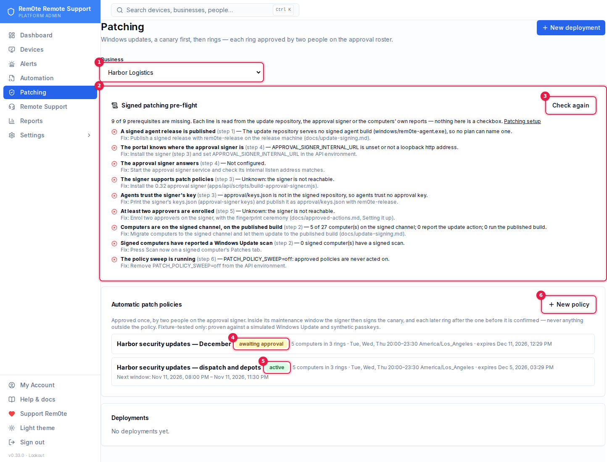

# Patching setup

This page is the order of work for turning on signed Windows patching on a production server: installing updates
from a computer's **Patches** tab, staged deployments, and automatic patch policies. Each step links to the page that
holds the detail. This page doesn't repeat them.

**Check where you are first.** As a Platform Admin, open **Patching**. The **Signed patching pre-flight** card at the
top (`GET /api/v1/patching/preflight`) lists each prerequisite below as present or missing. Every line is read from
real state: the served update repository, the approval signer's own answers, and what the computers report. None of
it is a checkbox someone ticked. Run it again after each step.

> **Fixture-tested only.** The automatic path has been proven end to end against a simulated Windows Update,
> synthetic passkeys and a scratch approval signer (`e2e-patch-policies.mjs`). It has not yet run on a real Windows
> computer, a real Windows Update service or a real authenticator. Before relying on it, run it once in a lab with a
> canary you can watch.

## Where the keys live

Every private key in this setup is generated by you, the owner, and stays with you.

| Key | Generated on | Lives on | Never on |
|---|---|---|---|
| Update root keys (2 of 3) | The release machine | Separate offline media | The portal host, the repository |
| Targets, snapshot, timestamp keys | The release machine | The release machine | The portal host, the repository |
| Approval signing key | The signer's own host or user, by `approval-signer keygen` | `/var/lib/rem0te-approver`, readable only by the `rem0te-approver` user | The portal's account, the repository |
| Approvers' passkeys | Each approver's own authenticator | That authenticator | Anywhere else: only the public half is enrolled |

The portal holds **public** halves only: the update repository's metadata and `approval/keys.json`. Nothing in this
repository is a real key. The test suites generate throwaway keys in a temporary directory and delete them afterwards.

## 1. Publish a signed release

Pre-flight check: **A signed agent release is published.**

Set up the offline-signed update chain and publish the agent (`windows/rem0te-agent.exe`, 0.32 or later) through it:

- [Update signing → Setting up (once)](update-signing.md#setting-up-once)
- [Update signing → Shipping a release](update-signing.md#shipping-a-release)
- [Update signing → Portal configuration](update-signing.md#portal-configuration) (`UPDATE_REPO_DIR`)

A patch policy with more than one ring needs the **0.34** agent on every computer in every ring but the last: those
computers' signed results are what open the next ring
([Staged patching → Signed results](staged-patching.md#signed-results-034)). An older agent signs nothing, and the
policy is refused (`RESULT_KEY_MISSING`) until it has upgraded and scanned once.

Plans name the build by its digest, and a computer on any other build refuses the plan. So "published" here means the
build the computers will actually run.

## 2. Move computers to the signed channel

Pre-flight checks: **Computers are on the signed channel, on the published build** and **Signed computers have
reported a Windows Update scan.**

Follow [Update signing → Moving existing agents](update-signing.md#moving-existing-agents). GPO or Intune is the
method that doesn't trust the portal. From 0.34 you can also move one computer, or a selection, from the console:
**Upgrade to signed agent** on the computer's **Overview → Agent** card (or **Upgrade to signed…** for selected devices
on **All devices**), with a reason and a fresh sign-in, and follow it on **Devices → Agent migrations**. That run trusts
the portal once, as every standard-agent update already does; it is refused in *Signed only* mode. Each computer then:

- reports `windows.update.install@1` in its heartbeat;
- updates itself to the published build;
- sends a signed Windows Update scan within its first check-ins. To get one sooner, press **Scan now** on its
  **Patches** tab.

A computer still on the standard agent shows its updates read-only. Its Patches tab has no **Install updates** button
and says why. When the computer can be moved from the console it says so and offers **Open the Agent card**; when it
can't, it names exactly what is missing — for example *No signed release is published. Publishing one needs the
offline signing keys only you hold*, with a link to [Update signing → Roles and keys](update-signing.md#roles-and-keys).

## 3. Install the approval signer on a separate host or user

Pre-flight checks: **The signer supports patch policies** and **Agents trust the signer's key.**

Follow [Approved actions → Setting it up](approved-actions.md#setting-it-up), steps 1 and 2:

- Install the standalone signer (`apps/api/scripts/build-approval-signer.mjs`), never the portal's `dist`.
- Run it as its own `rem0te-approver` user, or better on a separate host.
- Give it its own hostname.
- Generate its key with `approval-signer keygen` **as that user**. Take the printed `approval-keys.json` (public
  keys only) to the release machine.
- Sign it into the next release as `approval/keys.json`.

Patch policies need the **0.32** signer. An older signer answers 404 on `/internal/v1/capabilities`, and the
pre-flight reports it as too old.

Signed results need the **0.34** signer, rebuilt with `build-approval-signer.mjs`. Policies approved by an older
signer carry no result keys; after the upgrade they can run their canary but no later ring
(`result_key_not_pinned`), so approve them again once their computers run the 0.34 agent.

## 4. Point the portal at the signer

Pre-flight checks: **The portal knows where the approval signer is** and **The approval signer answers.**

In `/etc/reboot-remote/api.env`, set:

```bash
APPROVAL_SIGNER_INTERNAL_URL=http://127.0.0.1:3202
```

Then restart the API. Only a loopback `http://` URL is accepted. If the signer is on another host, carry its internal
port over an SSH tunnel or a WireGuard link that ends on the portal's loopback. Never expose the internal listener.

## 5. Enrol the approvers

Pre-flight check: **At least two approvers are enrolled.**

Follow [Approved actions → Setting it up](approved-actions.md#setting-it-up), steps 3 and 4. The fingerprint is
read aloud from the approver's own screen. If the business needs customer sign-off, set it on the signer.

You need two approvers other than whoever will propose the policy. Nobody approves their own request.

## 6. Create the first policy

Pre-flight check: **The policy sweep is running.** It runs unless `PATCH_POLICY_SWEEP=off`.

Try one computer first: on its **Patches** tab, choose **Install updates**, then pick an update and give a reason.
That builds a one-computer deployment whose plan two approvers approve on the signer. Watch it reach **effective**.
Then:

1. Open **Patching** → **Automatic patch policies** → **New policy**. You need a fresh sign-in.
2. Choose the computers:
   - **Ring 0** is the canary: one computer that is representative and that someone can restart.
   - Later rings can each hold up to 25 computers.
3. Choose what it may install:
   - the classes (Security, Critical, Update Rollups, Updates);
   - optionally, severities;
   - any KBs it must never install.
4. Choose when:
   - the maintenance window's days, its local start and end, and its IANA time zone (for example `America/Chicago`).
     The window follows daylight-saving time.
   - the soak time between rings;
   - the number of failed computers allowed per ring;
   - the expiry, at most 90 days;
   - the restart rule: **Never restart** (the default) or **Restart if required, inside the window** (0.34).
5. Propose it. Two approvers open the signer's approval page and approve it with their passkeys.



1. **Business** — policies belong to one business.
2. **Pre-flight** — each requirement in this guide, checked against the server as it is. On this demo server every
   check fails (no signer, sweep off), which is what it should say.
3. **Check again** — re-runs them.
4. **Awaiting approval** — proposed, not yet approved by two people on the signer.
5. **Active** — approved; it acts only inside its windows.
6. **New policy** — needs a fresh sign-in.

From then on, inside each open window:

- The sweep proposes a deployment of the canary's offered, policy-allowed updates. The signer signs the canary plan
  without further approval.
- Once a later scan confirms the canary **effective** and the soak has passed, the signer signs the next ring.

It signs nothing outside the policy. The bounds are listed in
[Staged patching → Patch policies](staged-patching.md#patch-policies).

**Revoking** is one-way: **Revoke** on the policy's page (fresh sign-in), or on the signer host (`$S` as in
[Approved actions → Setting it up](approved-actions.md#setting-it-up), step 2):

```bash
$S patch-policy revoke --id <policyId> --reason 'why'
$S patch-policy list
```

**Restarts.** By default computers are never restarted, and "restart required" waits for a person. From 0.34 a
policy, a deployment or a Patches-tab install can choose **Restart if required, inside the window**: after
installing, a computer Windows says needs a restart shows the fixed warning and restarts 15 minutes later, unless a
RustDesk session is open (or it cannot tell) or the window would close first, in which case it reports the restart
deferred. See [Staged patching → Restarting after updates](staged-patching.md#restarting-after-updates). It has been
tested against a simulated Windows only and has not yet run on a real Windows computer: try it with **Install
updates** on one computer you can watch before choosing it for a policy. Leave enough of the maintenance window after
the install for the 15-minute warning, or every restart defers.

## Settings

| Variable | Default | What it does |
|---|---|---|
| `APPROVAL_SIGNER_INTERNAL_URL` | unset | The signer's internal listener, loopback only. Unset: no approvals, no policies |
| `PATCH_POLICY_SWEEP` | on | `off` stops the sweep: approved policies are never acted on. Scratch, e2e and docs stacks set it off |
| `PATCH_POLICY_SWEEP_SECONDS` | 60 | How often the sweep runs (minimum 2) |

## See also

- [Staged patching](staged-patching.md): deployments, the gate, states, refusal codes, patch policies.
- [Approved actions](approved-actions.md): the signer, the roster, and what a compromised portal can't do.
- [Update signing](update-signing.md): the chain that tells computers which approval key to trust.
- [Containment](containment.md): a pause stops policies too, on the signer and on the computers.
