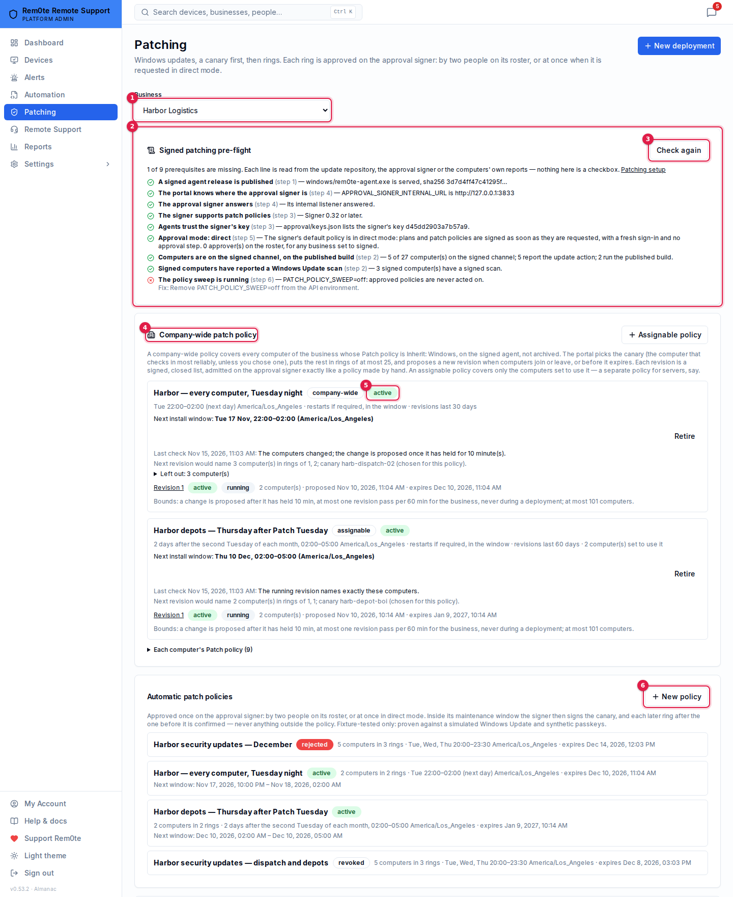
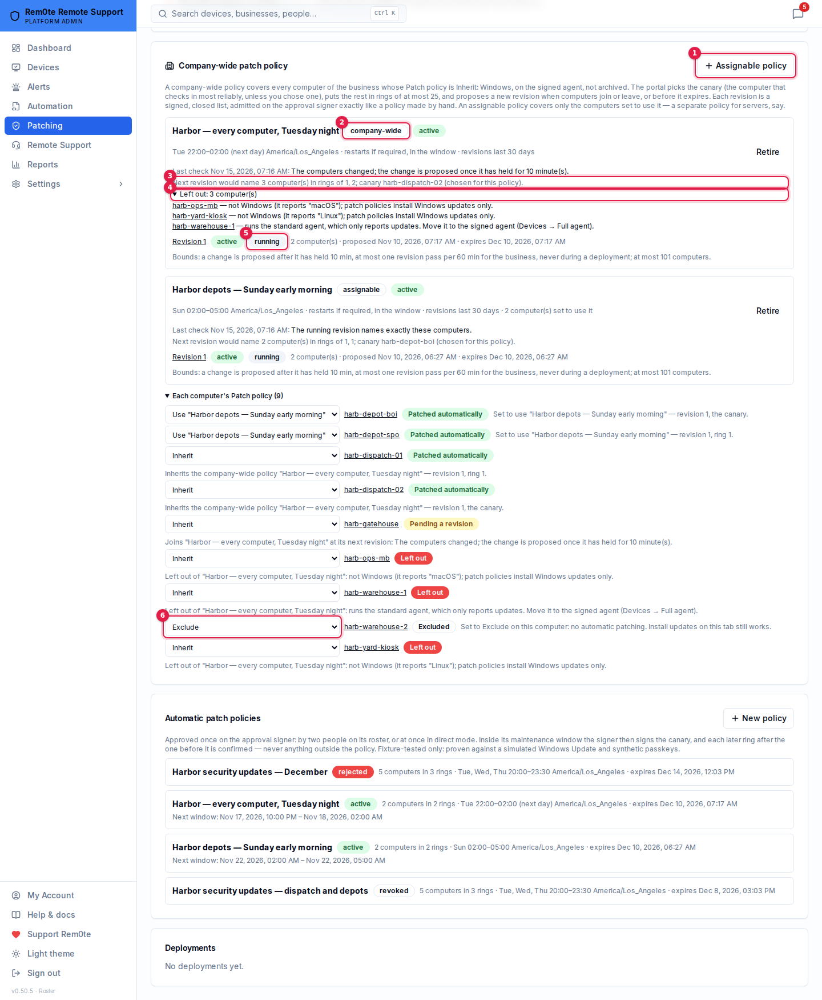
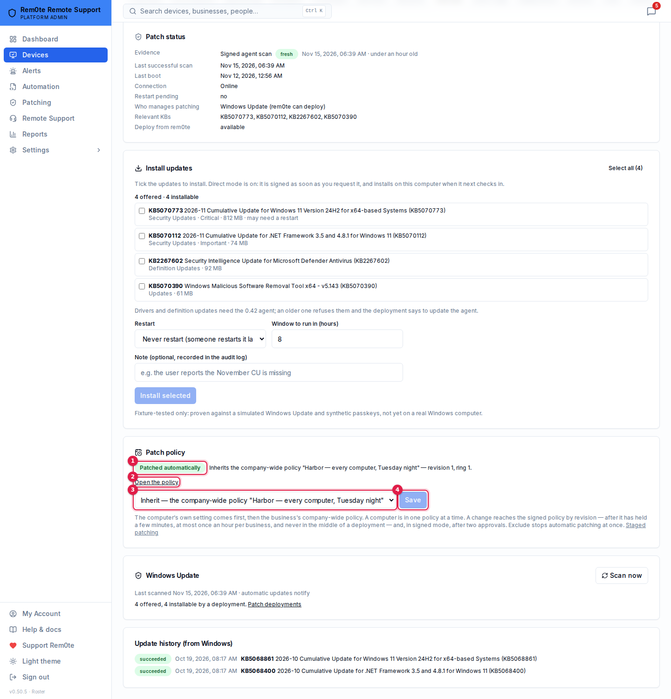

# Patching setup

This page is the order of work for turning on signed Windows patching on a production server: installing updates
from a device's **Patches** tab, staged deployments, and automatic patch policies. Each step links to the page that
holds the detail. This page doesn't repeat them.

**Check where you are first.** As a Platform Admin, open **Patching**. The **Signed patching pre-flight** card at the
top (`GET /api/v1/patching/preflight`) lists each prerequisite below as present or missing. Every line is read from
real state: the served update repository, the approval signer's own answers, and what the devices report. None of
it is a checkbox someone ticked. Run it again after each step.

> **Fixture-tested only.** The automatic path has been proven end to end against a simulated Windows Update,
> synthetic passkeys and a scratch approval signer (`e2e-patch-policies.mjs`). It has not yet run on a real Windows
> device, a real Windows Update service or a real authenticator. Before relying on it, run it once in a lab with a
> canary you can watch.

## Direct mode (the default for a single operator)

If you run the portal alone, set the approval signer to **direct mode** (0.40) at step 5 instead of enrolling
approvers:

```bash
$S policy set --business default --approval direct
```

Installs, rings and patch policies are then signed as soon as you request them, after a fresh sign-in, with no
approval page: a policy is active as soon as it is proposed. What it gives up is a second person — anyone who fully
takes over the portal can then install updates on those devices. What still protects: the fresh sign-in, your
permissions, the audit log, containment pauses, the policy's own filter, window and restart rule, the canary gate, and
each device verifying the signer's signature. Direct mode cannot be combined with customer sign-off, and devices
need the 0.40 agent. The full account is in
[Approved actions → Direct mode](approved-actions.md#direct-mode-the-default-for-a-single-operator); the signed
mode below remains the alternative.

## Where the keys live

Every private key in this setup is generated by you, the owner, and stays with you: on your release machine, or with
the easy way (0.37) under a separate user on the portal host that the portal itself can't read.

| Key | Generated on | Lives on | Never on |
|---|---|---|---|
| Update root keys (2 of 3) | The release machine, or the portal host under `rem0te-release` (0.37) | Separate offline media (`rem0te-signed-export-root`) | The portal's account, the repository, GitHub |
| Targets, snapshot, timestamp keys | The release machine, or the portal host under `rem0te-release` (0.37) | The release machine, or `/var/lib/rem0te-release/keys` (0700, `rem0te-release` only) | The portal's account, the repository, GitHub |
| Approval signing key | The signer's own host or user, by `approval-signer keygen` | `/var/lib/rem0te-approver`, readable only by the `rem0te-approver` user | The portal's account, the repository |
| Approvers' passkeys | Each approver's own authenticator | That authenticator | Anywhere else: only the public half is enrolled |

The portal holds **public** halves only: the update repository's metadata and `approval/keys.json`. Nothing in this
repository is a real key. The test suites generate throwaway keys in a temporary directory and delete them afterwards.

## 1. Publish a signed release

Pre-flight check: **A signed agent release is published.**

Set up the signed update chain and publish the agent (`windows/rem0te-agent.exe`, 0.32 or later) through it.

**The easy way (0.37), on the portal host.** From the checkout you deploy from:

```bash
sudo ./deploy/release/rem0te-signed-setup.sh --apply-env    # keys, repository, timer, UPDATE_REPO_DIR, first publish
sudo systemctl restart reboot-remote-api
sudo rem0te-signed-export-root /media/usb-stick              # move the root keys off the host
sudo rem0te-signed-publish                                   # after every later deploy
```

The keys live under a separate `rem0te-release` user that the portal can't read. That protects against a compromised
portal *application*, not against root on the host. Read
[Update signing → The easy way](update-signing.md#the-easy-way-single-host-037) for what each command does and the
trade-off. Nothing is pushed to GitHub: the owner's `root.json` is written only into a build copy.

**The stricter way**, an offline release machine:

- [Update signing → Setting up (once)](update-signing.md#setting-up-once)
- [Update signing → Shipping a release](update-signing.md#shipping-a-release)
- [Update signing → Portal configuration](update-signing.md#portal-configuration) (`UPDATE_REPO_DIR`)

A patch policy with more than one ring needs the **0.34** agent on every device in every ring but the last: those
devices' signed results are what open the next ring
([Staged patching → Signed results](staged-patching.md#signed-results-034)). An older agent signs nothing, and the
policy is refused (`RESULT_KEY_MISSING`) until it has upgraded and scanned once.

Plans name the build by its digest, and a device on any other build refuses the plan. So "published" here means the
build the devices will actually run.

## 2. Move devices to the signed channel

Pre-flight checks: **Devices are on the signed channel, on the published build** and **Signed devices have
reported a Windows Update scan.**

Follow [Update signing → Moving existing agents](update-signing.md#moving-existing-agents). GPO or Intune is the
method that doesn't trust the portal. From 0.34 you can also move one device, or a selection, from the console:
**Upgrade to full agent** at the top of the device's page or on its **Overview → Agent** card (or **Upgrade to full agent…** for selected devices
on **All devices**), with a reason and a fresh sign-in, and follow it on **Devices → Agent migrations**. That run trusts
the portal once, as every standard-agent update already does; it is refused in *Signed only* mode. Each device then:

- reports `windows.update.install@1` in its heartbeat;
- updates itself to the published build;
- sends a signed Windows Update scan within its first check-ins. To get one sooner, press **Scan now** on its
  **Patches** tab.

A device still on the standard agent shows its updates read-only. Its Patches tab has no **Install updates** button
and says why. When the device can be moved from the console it says so and offers **Open the Agent card**; when it
can't, it names exactly what is missing — for example *No signed release is published. Publishing one needs the
offline signing keys only you hold*, with a link to [Update signing → Roles and keys](update-signing.md#roles-and-keys).

## 3. Install the approval signer on a separate host or user

Pre-flight checks: **The signer supports patch policies** and **Agents trust the signer's key.**

Follow [Approved actions → Setting it up](approved-actions.md#setting-it-up), steps 1 and 2:

- Install the standalone signer (`apps/api/scripts/build-approval-signer.mjs`), never the portal's `dist`.
- Run it as its own `rem0te-approver` user, or better on a separate host.
- Give it its own hostname.
- Generate its key with `approval-signer keygen` **as that user**. Take the printed `approval-keys.json` (public
  keys only) to the release machine.
- Sign it into the next release as `approval/keys.json`.

Patch policies need the **0.32** signer. An older signer answers 404 on `/internal/v1/capabilities`, and the
pre-flight reports it as too old.

Signed results need the **0.34** signer, rebuilt with `build-approval-signer.mjs`. Policies approved by an older
signer carry no result keys; after the upgrade they can run their canary but no later ring
(`result_key_not_pinned`), so approve them again once their devices run the 0.34 agent.

## 4. Point the portal at the signer

Pre-flight checks: **The portal knows where the approval signer is** and **The approval signer answers.**

In `/etc/reboot-remote/api.env`, set:

```bash
APPROVAL_SIGNER_INTERNAL_URL=http://127.0.0.1:3202
```

Then restart the API. Only a loopback `http://` URL is accepted. If the signer is on another host, carry its internal
port over an SSH tunnel or a WireGuard link that ends on the portal's loopback. Never expose the internal listener.

## 5. Choose the approval mode, and enrol the approvers

Pre-flight check: **Approval mode: direct**, or **Approval mode: signed — at least two approvers are enrolled.**

**A single operator:** set direct mode on the signer and skip the rest of this step:

```bash
$S policy set --business default --approval direct
```

**Signed mode** (approvals): follow [Approved actions → Setting it up](approved-actions.md#setting-it-up), steps 3
and 4. The fingerprint is read aloud from the approver's own screen. If the customer needs customer sign-off, set it
on the signer. You need two approvers other than whoever will propose the policy. Nobody approves their own request.

## 6. Create the first policy

Pre-flight check: **The policy sweep is running.** It runs unless `PATCH_POLICY_SWEEP=off`.

Try one device first: on its **Patches** tab, the **Install updates** card lists every update Windows offers it,
each with its own checkbox (0.42; **Select all** ticks every installable one). Tick one and give a reason. Updates that
cannot be installed — feature upgrades, optional previews, anything needing a licence — are listed greyed out with
why.
That builds a one-device deployment whose plan two approvers approve on the signer (in direct mode it is signed at
once). Watch it reach **effective**.
Then:

1. Open **Patching** → **Automatic patch policies** → **New policy**. You need a fresh sign-in.
2. Choose the devices. From 0.62 you just tick them (or **Select all**), and they all install together in the
   window — at most 125, split into plans of 25 that wait for nothing. Tick **Test on one device first** only if you
   want the staged rollout:
   - **Ring 0** is the canary: one device that is representative and that someone can restart.
   - Later rings can each hold up to 25 devices.
3. Choose what it may install:
   - the classes (Security, Critical, Update Rollups, Updates, and from 0.42 Drivers and Definition Updates — only
     Security is ticked to start with, and drivers are installed only if you tick them);
   - optionally, severities;
   - any KBs it must never install.
4. Choose when:
   - the maintenance window: **Weekly** (the days of the week) or, from 0.53, **Monthly** — the nth or last weekday
     of each month plus 0–14 days (Patch Tuesday is *the second Tuesday*; *+ 2* is the Thursday after), or a day of
     the month from 1 to 28 — then its local start and end, and its IANA time zone (for example `America/Chicago`).
     The window follows daylight-saving time. The form shows the next three openings; if there are
     none, the policy would be refused (`window_never_opens`). A monthly window needs the approval signer rebuilt
     from 0.53 (see [Staged patching → Monthly windows](staged-patching.md#monthly-windows-053)); until then it is
     refused at the signer (`invalid_policy`).
   - with *Test on one device first* only: the soak time between rings and the number of failed devices allowed
     per ring;
   - there is no expiry (0.63): the policy stands until it is revoked. A policy made before 0.63 keeps its expiry;
   - the restart rule: **Never restart** (the default) or **Restart if required, inside the window** (0.34);
   - from 0.54, a **restart window**: *Restart if required, in a restart window* or *Restart every device in a
     restart window (maintenance restart)*, with its own weekly or monthly window, and optionally the RustDesk
     exception (never ticked by default). See
     [Staged patching → Restart windows](staged-patching.md#restart-windows-054).
5. Propose it. Two approvers open the signer's approval page and approve it with their passkeys. In direct mode the
   button says **Create policy**, no reason is asked for, and it is active at once, labelled *Approved automatically
   (direct mode)*. An all-at-once policy needs the approval signer from 0.62.



1. **Customer** — policies belong to one customer.
2. **Pre-flight** — each requirement in this guide, checked against the server as it is. On this demo server only
   the policy sweep fails (it is off in the docs stack), which is what it should say.
3. **Check again** — re-runs them.
4. **Company-wide patch policy** — one policy for every device of the customer set to *Inherit*, plus
   assignable ones for a named group (see [Or: one policy for the whole customer](#or-one-policy-for-the-whole-customer-050) below).
5. **Active** — approved; it acts only inside its windows. In two-person mode a new policy is *awaiting
   approval* until two people on the signer approve it.
6. **New policy** — needs a fresh sign-in.

From then on, inside each open window:

- All at once: the sweep proposes a deployment of every ready device's offered, policy-allowed updates, and the
  signer signs every plan without further approval.
- With *Test on one device first*: the sweep proposes the canary's updates; once a later scan confirms the canary
  **effective** and the soak has passed, the signer signs the next ring.

It signs nothing outside the policy. The bounds are listed in
[Staged patching → Patch policies](staged-patching.md#patch-policies).

### Or: one policy for the whole customer (0.50)

Instead of naming rings by hand, open **Patching** → **Company-wide patch policy** → **Company-wide policy** (fresh
sign-in). Choose the classes, window (weekly or, from 0.53, monthly), soak, failure threshold, restart rule and, optionally, the canary
(revisions don't expire from 0.63). The portal names the devices: every Windows device of the customer on the
signed agent whose **Patch policy** is *Inherit*. The canary is the one you chose, or the one that checks in most
reliably, and the rest go in rings of at most 25. Devices it can't include are listed with the reason.

Each set of devices is an ordinary signed policy, a *revision*, approved like any other (at once in direct mode).
When devices join or leave, the portal proposes the next revision: after the change has held
`PATCH_POLICY_SETTLE_MINUTES`, at most once per `PATCH_POLICY_REVISION_MINUTES` per customer, and never while a
deployment is running. Revisions made from 0.63 never expire; a revision made before 0.63 is renewed once more
before it expires, into one that does not. In signed mode the previous revision keeps
running until two approvers approve the new one.

**Assignable policy** is the same thing, but it covers only the devices set to use it, for example servers with a
narrower window. Each device's **Patch policy** setting, on its **Patches** tab or under **Each device's Patch
policy**, is *Inherit*, *Exclude* (no automatic patching, effective at once) or *Use policy X*. Changing it needs
**Edit devices** on that device and a fresh sign-in, and it is audited. A device is in one policy at a time, so
a hand-made policy can't name a device one of these covers. The Patches tab shows which policy patches the device
and why. Device groups aren't a scope: use an assignable policy. See
[Staged patching → Company-wide policies](staged-patching.md#company-wide-policies-and-each-devices-patch-policy-050).



1. **Assignable policy** — create one (*Company-wide policy* appears instead while the customer has none).
2. **The company-wide policy** — its window and restart rule; *Retire* revokes every revision.
3. **What the next revision would name**, and the canary the portal picked, with why.
4. **Left out** — devices it can't include, each with the reason.
5. **The running revision** — an ordinary signed policy; open it to see its rings.
6. **A device's setting** — here *Exclude*; *Inherit* and *Use policy* are the others.



1. **Where it stands** — patched automatically, pending a revision, left out, excluded or none.
2. **Open the policy** that patches it.
3. **Next install window** (0.52) — when it next opens, and the window in words.
4. **Inherit / Exclude / Use policy X.**
5. **Save.**

**Revoking** is one-way: **Revoke** on the policy's page (fresh sign-in), or on the signer host (`$S` as in
[Approved actions → Setting it up](approved-actions.md#setting-it-up), step 2):

```bash
$S patch-policy revoke --id <policyId> --reason 'why'
$S patch-policy list
```

**Restarts.** By default devices are never restarted, and "restart required" waits for a person. From 0.34 a
policy, a deployment or a Patches-tab install can choose **Restart if required, inside the window**: after
installing, a device Windows says needs a restart shows the fixed warning and restarts 15 minutes later, unless a
technician is connected through RustDesk (or it cannot tell) or the window would close first, in which case it reports
the restart deferred. A signed-in user does not stop the restart. They see the 15-minute warning, and unsaved work is
lost. From 0.54 a policy's **restart window** restarts the devices that still need it, and asks again after a
deferral. See [Staged patching → Restarting after updates](staged-patching.md#restarting-after-updates). It has been
tested against a simulated Windows only and has not yet run on a real Windows computer: try it with **Install
updates** on one device you can watch before choosing it for a policy. Leave enough of the maintenance window after
the install for the 15-minute warning, or every restart defers.

**0.54 needs the 0.54 agent and the 0.54 approval signer.** Restart windows, *only if required* and the RustDesk
exception are new parameters on the signed plan. Publish the agent (`sudo rem0te-signed-publish`) and let the
devices update before using them; an older agent refuses such a plan, and the portal refuses to request one for it.
Rebuild and redeploy the approval signer (`apps/api/scripts/build-approval-signer.mjs`): an older signer refuses a
policy with a restart window at admission (`invalid_policy`), and signs no restart under a policy.

## Settings

| Variable | Default | What it does |
|---|---|---|
| `APPROVAL_SIGNER_INTERNAL_URL` | unset | The signer's internal listener, loopback only. Unset: no approvals, no policies |
| `PATCH_POLICY_SWEEP` | on | `off` stops the sweep: approved policies are never acted on. Scratch, e2e and docs stacks set it off |
| `PATCH_POLICY_SWEEP_SECONDS` | 60 | How often the sweep runs (minimum 2) |
| `PATCH_POLICY_REVISION_MINUTES` | 60 | 0.50: at most one automatic revision pass of a customer's company-wide and assignable policies per this many minutes (minimum 1, maximum 1440) |
| `PATCH_POLICY_SETTLE_MINUTES` | 10 | 0.50: how long a change of devices must hold before a revision is proposed (renewal doesn't wait) |

## See also

- [Staged patching](staged-patching.md): deployments, the gate, states, refusal codes, patch policies.
- [Approved actions](approved-actions.md): the signer, the roster, and what a compromised portal can't do.
- [Update signing](update-signing.md): the chain that tells devices which approval key to trust.
- [Containment](containment.md): a pause stops policies too, on the signer and on the devices.
