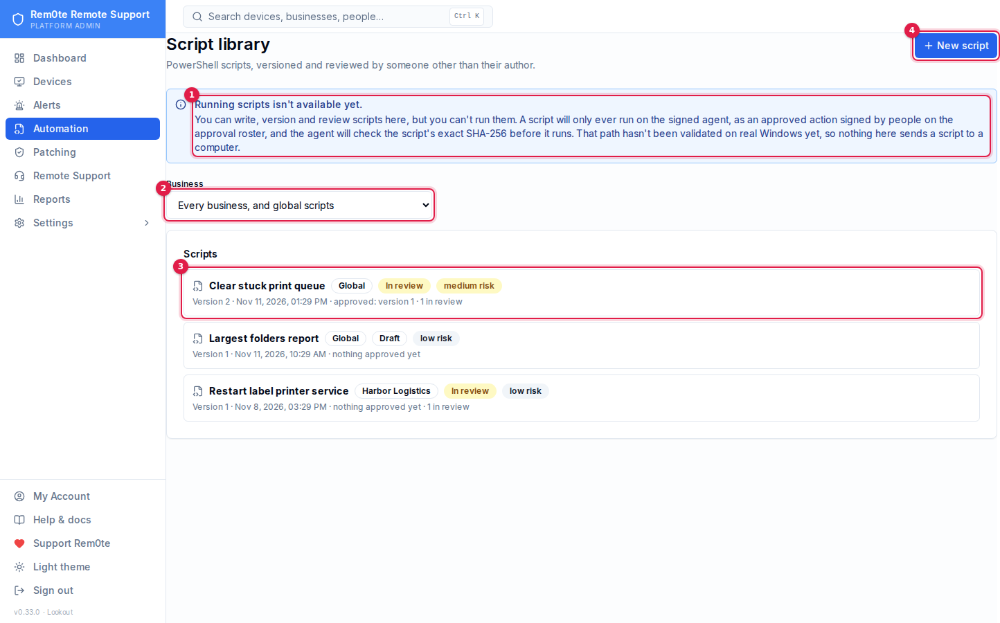
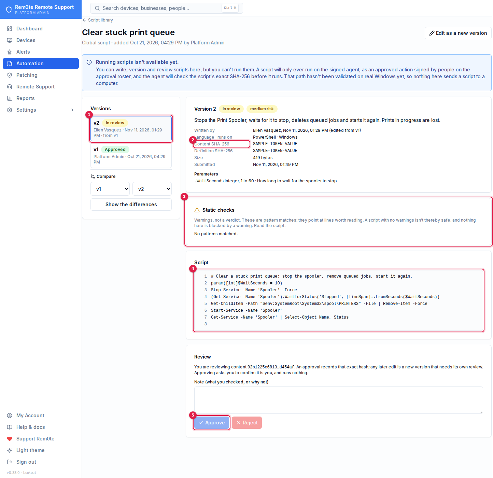

# Script library

rem0te has a **script library**: PowerShell scripts that are written, versioned and reviewed in the portal.
**It can't run them.** Nothing in this release sends a script to a computer, and there's no Run button anywhere.
This page explains how a script *would* run, why the portal will never run one itself, and what this release
ships.

> **Why not yet.** A script can only run on the signed agent, inside the two-approval signed-action chain
> described below. That chain hasn't been run on real Windows yet ([approved-actions.md](approved-actions.md),
> *What has been proven*). Until it has, the library is for writing and reviewing scripts, and it records the exact
> bytes each reviewer approved, so that approval can be bound into a signed plan later.

## What this release does

| | |
|---|---|
| **Scripts** | Name, scope (**global**, set by a Platform Admin, or **one business**), and a list of versions |
| **Versions** | Immutable. Each holds the content, its SHA-256, description, language (PowerShell), target OS (Windows), risk level and declared parameters. Editing makes a new version; nothing changes a version once it is written, and the database refuses to change it too |
| **Review** | Draft → In review → Approved or Rejected. Approved and Rejected are final. The approver must be someone other than everyone who wrote the content, and must hold the review permission. Approving needs a fresh sign-in. The approval records the hash the reviewer saw |
| **Static checks** | Shown to the reviewer as warnings: `Invoke-Expression`, download-and-run, `-EncodedCommand`, credential material, disabling Defender, `Set-ExecutionPolicy`, restarts, hidden Unicode and more. They **flag**; they never block and never mean a script is safe |
| **Diff** | Any two versions of a script, line by line |
| **Audit** | Every create, submit, withdraw, approval, rejection and refused review attempt, with the hashes |

It doesn't do any of this yet: run a script, schedule one, send one to a computer, collect output, or include one in a
plan. Linux and macOS scripts aren't supported either.

1. **The notice** — running scripts is not available yet, on the page itself.
2. **Scope** — global scripts, or one business's.
3. **A script** — its latest version and review state.
4. **New script** — writes version 1 as a draft.

1. **Version 2** — in review, written by someone other than the reviewer, edited from v1. *Compare* below it shows
   any two versions line by line.
2. **Content SHA-256** — the hash an approval records. (Shown as a placeholder here: the capture masks every long
   hex string. The Review box repeats it in short form.)
3. **Static checks** — warnings for the reviewer; they flag, never block.
4. **The content** — exactly the bytes the hash is of.
5. **Approve** — offered only to someone who did not write the content, and it asks for a fresh sign-in.

## How a script would run

Only one way: as an **approved action** on the signed agent, through the chain that already starts the Print Spooler
and installs Windows updates. No second path is planned. The library's own approval would be a precondition for
that chain, never a replacement for it.

1. **Request.** A technician asks for *library script X, version N, with these arguments, on these computers*. The
   portal checks it as it checks any action: scope, access level, containment, protected device classes, readiness.
   It also checks that version N is **Approved** in the library and that the arguments match the declared parameters.
2. **Plan.** The portal builds a plan whose action is a catalog entry, `script.run@1`. Its parameters are the
   **version's content SHA-256**, its definition SHA-256 (parameters, risk, language and OS), and the arguments.
   The script's content goes with the plan for display. The signer re-derives the risk, and a script's risk is
   never below what its author declared.
3. **Approve.** People on the approval signer's roster approve the plan with their passkeys on the signer's own
   origin, as now. The signer shows them **the content itself**, hashes it itself, and refuses the plan if the hash
   doesn't match the one the plan names. It runs its own copy of the static checks and shows its own warnings. It
   doesn't trust the portal's. Library reviewers and the requester are excluded from the roster decision, as the
   requester is today.
4. **Deliver.** The portal hands the envelope and the content to the agent on its heartbeat, as a courier.
5. **Verify.** The agent checks the envelope as it checks every plan (key, signature, strict parse, target, window,
   build, approvals, journal, pause). Then it hashes the bytes it received and refuses unless they are exactly the
   signed SHA-256. It also checks every argument against the declared type and charset, and refuses on any mismatch.
6. **Run, constrained.** The agent writes *executing* to its journal, then runs the script in a fresh PowerShell
   runspace it creates itself:
   - no profile, no `-EncodedCommand`, no command-line interpolation; arguments are bound as typed parameters,
     never concatenated into the script text;
   - a hard timeout (the plan names it, the agent caps it), after which the runspace is stopped and the outcome is
     *timed out*, not *failed*;
   - stdout, stderr and the error stream are captured, capped per stream (for example 64 KiB), truncated with a
     marker, and redacted (secrets, tokens and private-key blocks, as the diagnostics catalog does) **before** they
     leave the computer;
   - the result is the exit state and the capped, redacted output, reported once and journaled like any action.
7. **Evidence.** `ACTION_REQUESTED` → approvals → `ACTION_DISPATCHED` → `ACTION_RESULT`, with the content SHA-256
   in each, alongside the library's own `SCRIPT_VERSION_APPROVED` entry for the same hash.

A constrained runspace limits accidents. It doesn't stop a determined script. The script runs as the agent's
account (SYSTEM), so whatever it's allowed to do, it can do. That's why the real control is people reading the exact
bytes before anything is signed.

## Why the portal can never run one directly

- **The portal holds no key the agent accepts.** The agent runs only plans signed by the approval signer's key,
  which it learns through the offline-rooted update chain. A portal, or someone holding its database, can mark a
  library version *Approved*. That gets them a row in a table, not a signature.
- **The standard agent never executes.** The heartbeat agent (`heartbeat.ps1`) reports and reads. Its diagnostics
  and monitor blocks are fixed, read-only code. Adding "run this text" to it would make the portal's database a
  remote shell on every computer, which is the thing this design exists to prevent.
- **There's no route for it.** The script-library module creates no `ActionJob`, imports nothing from the action
  dispatcher, the signer client or the heartbeat, and has no run, execute, dispatch or send route. The security
  invariants (§23) check that in CI.

## Threat model

| Threat | What stops it | What doesn't |
|---|---|---|
| **A compromised portal or database** marks a malicious version *Approved*, or swaps content after approval | Nothing runs without a signer envelope. The signer shows roster approvers the content and hashes it itself; the agent refuses bytes that don't match the signed hash. In the database, a trigger refuses any change to content, hash, parameters, risk or author, and any status change but the four allowed ones | The library's own *Approved* flag. It's evidence of a review, not a security boundary against someone who owns the database |
| **A malicious author** hides harmful code in a useful script | A different person must approve, after reading the content and the static warnings. Hidden Unicode (bidirectional overrides, zero-width characters) is flagged. Risk is declared by the author and shown; eventually the signer and the agent will refuse a plan that understates it | Static checks are pattern matches. Obfuscated code passes them. A reviewer who doesn't read the script approves whatever is in it |
| **Self-approval** by switching accounts, roles or contexts | Approval compares **user ids**, so a technician context, a business switch or a second role on the same account is the same person. The approver must not be the author of the version, nor of any earlier unapproved version it was edited from ("contributors"). A trivial edit by a friend doesn't launder the original author's code. A database CHECK backs both rules | Two **separate accounts** held by one human. Invite controls and SSO decide that, not the library |
| **Reviewer collusion** | Two people, at least: author and approver. When scripts can run, the signer adds its roster approvals on top (one or two by risk, never the requester, never a library contributor). That's at least three distinct people for a high-risk script | Collusion by everyone involved. The audit trail makes that attributable, not impossible |
| **Tampering after approval** | Content and hashes are immutable (trigger). The approval stores the hash the reviewer's page showed (`expectedSha256`) and refuses a mismatch. Any edit is a new version, starting as a draft | — |
| **Cross-business access** | Every route resolves the business from the actor, not the request. Another business's script is a 404. Global scripts are written only by Platform Admins, and businesses see only their approved versions | — |

## Who can do what

| | Business script | Global script |
|---|---|---|
| **See** | `scripts:author` or `scripts:review` in that business, a Business Owner, a Platform Admin | Platform Admins and independent reviewers (`approvals:review`) see every version; a business's authors and reviewers see approved versions only |
| **Write, edit, submit, withdraw** | `scripts:author` (a Business Owner holds it) | A Platform Admin |
| **Approve, reject** | `scripts:review`, and not a contributor | A Platform Admin or an independent reviewer, not a contributor |

A technician working in a business through an assignment needs the capability on a grant that covers the **whole
business**. A grant for named computers doesn't confer library rights, because a script isn't scoped to a computer.

Approving needs a **fresh sign-in** (the step-up dialog), like lifting a containment pause or changing who's
notified. Rejecting doesn't: refusing is always safe.

## Parameters

A version declares up to 10 parameters, each with a name, a type and limits:

| Type | Limits |
|---|---|
| `string` | A **charset** (`alphanumeric`, `identifier` `[A-Za-z0-9_.-]`, `hostname` `[A-Za-z0-9.-]`, `safe_text` letters, digits, space and `_.,:@-`) and a maximum length (1–256) |
| `integer` | Minimum and maximum |
| `boolean` | — |
| `choice` | 1–20 fixed values, each an identifier |

Charsets are a closed list, not author-supplied regular expressions. The agent has to enforce exactly the same rule
later, and a closed list can be implemented identically in Go and TypeScript, and can't be a slow regex. None of
them allows quotes, `$`, backticks, `;`, `|`, `&`, parentheses or newlines.

## Hashes

- **Content SHA-256**: SHA-256 of the exact UTF-8 bytes of the script. This is what the agent will verify. Line
  endings aren't normalised, so what's hashed is what's shown and what would run. Content is 1 byte to 64 KiB; a
  NUL or other control character (except tab, CR and LF) is refused.
- **Definition SHA-256**: SHA-256 of `rem0te-script-definition-v1\n` followed by canonical JSON of the language,
  target OS, risk, parameters and content SHA-256. It binds what the reviewer approved *about* the script, not only
  its text. A plan would name both.

## Static checks

Each rule is a pattern with a severity (`caution` or `danger`) and a reason, reported per line. They catch the
obvious and help a reviewer find the lines worth reading. **No warnings doesn't mean safe.** The list:

| Rule | Severity |
|---|---|
| `Invoke-Expression` / `iex` | danger |
| Download (`Invoke-WebRequest`, `Invoke-RestMethod`, `Net.WebClient`, `DownloadString`, BITS, `certutil -urlcache`) | danger |
| `-EncodedCommand` / `FromBase64String` | danger |
| Credential material (plaintext `SecureString`, password literals, private-key blocks, LSASS, `mimikatz`, `cmdkey`) | danger |
| Disabling Defender (`Set-MpPreference -Disable…`, exclusions, stopping `WinDefend`) | danger |
| `Set-ExecutionPolicy`, `-ExecutionPolicy Bypass` | danger |
| Restart or shutdown (`Restart-Computer`, `Stop-Computer`, `shutdown /r`) | caution, or danger when forced |
| Clearing event logs or audit policy | danger |
| Deleting shadow copies or backups | danger |
| Adding local administrators | danger |
| Loading code at runtime (`Add-Type`, `[Reflection.Assembly]::Load`, `Invoke-Command`, `Start-Process`) | caution |
| Hidden Unicode (bidirectional overrides, zero-width characters, BOM inside the text) | danger |
| Declared risk *low* with a danger finding | caution |

## Open questions before scripts can run

These need an owner's decision, and real-Windows testing of the signed agent comes first:

1. **Runspace.** A constrained language mode runspace blocks most .NET and COM use, which many admin scripts need.
   A full-language runspace is honest about what a script can do but constrains less. The proposal is full language,
   with the limits above, and the risk recorded as declared.
2. **Whether the signer should hold the library.** Today the signer would see the content in the plan. A signer-side
   copy of approved hashes would let it refuse anything the library never approved, at the cost of another
   database outside the portal.
3. **Output retention.** How long captured output is kept, and whether a business can opt out of keeping it at all.
4. **Approval count.** Whether a library approval should count towards the signer's quorum, or (as proposed) be
   in addition to it.
