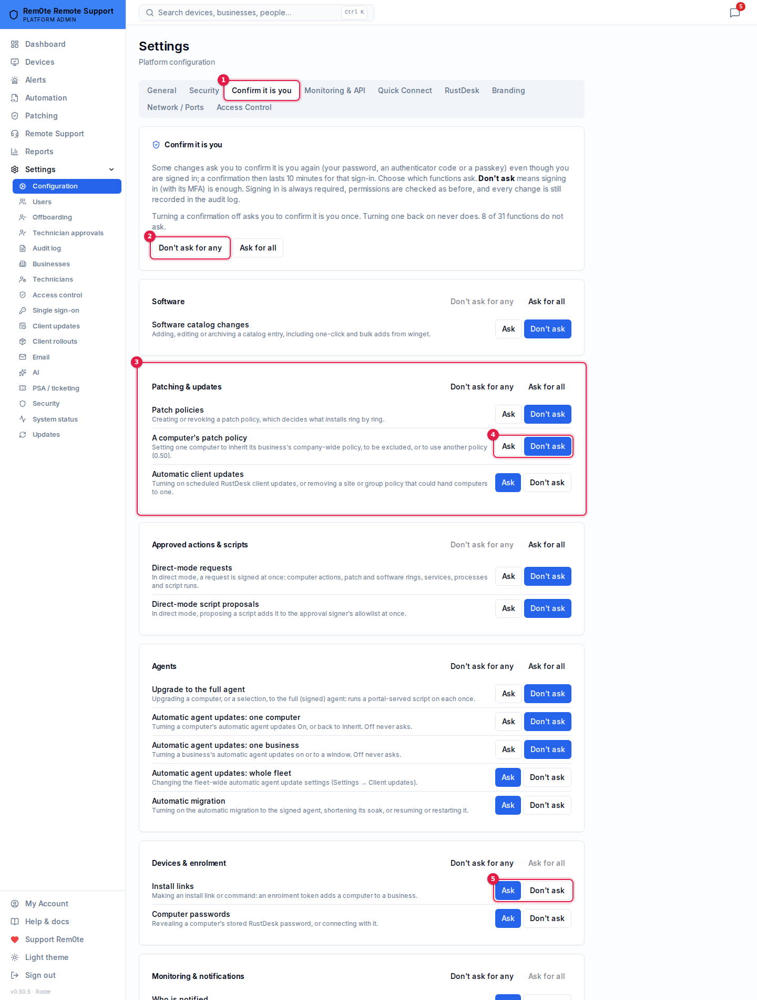

# Sign-in: passwords, SSO, passkeys and step-up

*SSO, passkeys and step-up were added in v0.20.*

## Password

Password sign-in works unless a business (or staff) is set to **SSO required** and the account is linked to a provider ([below](#who-must-use-sso-059)). Even then, the [break-glass accounts](break-glass.md) and the recovery CLI keep a way in that does not depend on the provider. An account created through SSO provisioning has no password until one is set for it. TOTP, lockout and the tenant's *require MFA* policy apply as before.

**The lockout is in the database (0.59).** Failed attempts are counted in `LoginLockout`, so restarting the API no longer forgets them and every API process sees the same count. Before 0.59 the count was in memory.

## Single sign-on (OIDC)

**Settings → Single sign-on** (Platform Admin). Rem0te is an OpenID Connect relying party. It uses the authorization code flow with PKCE, a `state` bound to the browser by a cookie, and a `nonce`. The ID token is verified with [openid-client](https://github.com/panva/openid-client).

### Setting up a provider

1. At the provider, register a web application whose redirect URI is the one shown on the page:
   `https://<your server>/api/v1/auth/sso/callback`. It must match exactly.
2. In Rem0te, add the provider: the **issuer** exactly as the provider publishes it (`iss`), the client ID, the client secret if the client is confidential, and the redirect URI. The secret is stored encrypted and never shown again.
3. **Test discovery**: Rem0te fetches the provider's metadata and reports its endpoints and PKCE support.
4. **Enable** it. A new provider is always created disabled.

The issuer cannot be changed later. Linked accounts are keyed by it, so add a new provider instead.

Only HTTPS issuers are accepted. `OIDC_ALLOW_INSECURE_LOOPBACK=true` relaxes that for `127.0.0.1`/`localhost`, and is for development only.

### How accounts are matched

**By issuer and subject (`sub`) only. Never by email.** Matching by email would let anyone who controls a provider, or a provider that lets users edit their own email, sign in as any account by naming its address. So an identity reaches an account in one of two ways:

- **Linking.** A signed-in person goes to **My Account → Single sign-on → Link** (needs step-up), signs in at the provider, and that identity is attached to their account. One identity per provider per account. An identity already linked to someone else is refused.
- **Provisioning**, only if the provider has *Create accounts* turned on. An unknown identity with a **verified** email that no Rem0te account uses gets a **new** account. That account has no business and no permissions unless a **group mapping** matches: a value in the provider's groups claim, mapped to exactly one business with exactly the listed capabilities, as a Business User. Provisioning never creates an owner or an admin. If the email already belongs to an account, sign-in is refused with a message to sign in by password and link instead.

After the provider, the rest of sign-in is the same as for a password: account status, lockout, and **TOTP, if the account has it** or the tenant requires it. SSO does not skip Rem0te's own second factor — unless the provider's MFA is trusted (below).

**Suggested links (0.59).** When someone signs in at a provider with an unlinked identity whose **verified** email matches an active account here, nothing is linked: the sign-in is refused as before and a *suggestion* is recorded. A Platform Admin sees it under **Settings → Single sign-on → Suggested links** and may confirm it (fresh confirmation, `sso.configure`; audited `SSO_LINKED {by: 'admin'}`; the account holder is emailed when their address is a confirmed mail recipient) or dismiss it. Platform Admin and break-glass accounts are never suggested.

### How far a provider is trusted (0.59)

Each provider has settings that start at the safest value. Every change needs a fresh confirmation (`sso.configure`). A Keycloak walk-through is in [sso-keycloak.md](sso-keycloak.md).

- **acr values.** Name the provider's `acr` value for each level: password, MFA, passkey. Rem0te's level for a sign-in is the `acr` it maps to, **lowered until `amr` agrees**: MFA needs a second factor in `amr` (`otp`, `mfa`, `hwk`, `swk`, `sms`, `fpt`…), passkey needs `hwk`, `swk` or `pop`. An unknown `acr` is level *none*.
- **Trust the provider's MFA** (off). When on, a sign-in at the MFA level or above counts as Rem0te's second factor: no TOTP is asked, and the session is MFA-verified.
- **Trust the provider's passkeys** (off). When on, a step-up at the passkey level through the provider counts as a passkey (`sso-passkey`) for the actions that need one.
- **Platform Admins** (off). A Platform Admin is refused through the provider (`admin_not_allowed`). When on, only at the passkey level (`admin_needs_passkey` otherwise).
- **Organization** (empty). When set, the ID token's `organization` claim must name it (Keycloak 26 organizations: an alias, or an object carrying the id). It is a gate, never a grant: it gives no access.
- **Token authentication.** A client secret, or `private_key_jwt`: Rem0te generates a P-256 key for the provider, keeps the private half sealed, and shows the public JWK and a JWKS URL (`/api/v1/auth/sso/<id>/jwks.json`) to register at the provider.
- **If the provider cannot be reached** — see *Sessions* below.

### Sessions and sign-out (0.59)

Each SSO sign-in records an `SsoSession`: the provider's `sid`, `acr`, `amr`, `auth_time`, the level, and the refresh and ID tokens, sealed.

- **Back-channel logout.** Register `https://<your server>/api/v1/auth/sso/backchannel-logout` at the provider. A `logout_token` is checked against the provider's JWKS (RS256, PS256, ES256 or EdDSA only), its issuer, audience, `iat` (within 5 minutes), the back-channel event, the absence of a `nonce`, and a `jti` that may be used once. It ends **every** Rem0te session of the account it names (by `sid`, or `sub`), because Rem0te's revocation is per account. Audited `SSO_BACKCHANNEL_LOGOUT`.
- **Signing out** of an SSO session also signs out at the provider (RP-initiated logout) when it publishes an `end_session_endpoint`, with `id_token_hint` and the post-logout redirect (`/login?signed_out=1` by default; register it at the provider).
- **The safety net.** About every ten minutes the API uses each session's refresh token at the provider. `invalid_grant` (the session was ended there) ends it here too, audited `SSO_SESSION_REVOKED`. If the provider cannot be reached, a provider set to *fail open* (the default) keeps the session and raises a security alert at most hourly; *fail closed* ends it. `SSO_SESSION_SWEEP=off` stops the sweep; never set it in production.

### Who must use SSO (0.59)

**Settings → Single sign-on → Who must use single sign-on**, per business and for staff (accounts with no business):

- **Off** and **Optional** sign in the same way. Optional asks unlinked people, on My Account, to link.
- **Required** refuses password and passkey sign-in (`403 SSO_REQUIRED`, after the password was checked, so a wrong password still says only *invalid credentials*) for every account **linked** to a provider. The last linked identity cannot be unlinked under it. It can be set only when every active account in scope is linked (the page shows the unlinked count), a provider is enabled, and — for staff — there is a break-glass account. Setting it needs a fresh confirmation (`sso.enforce`); lowering it never does. Audited `SSO_MODE_CHANGED`.
- An account in several businesses takes the strictest mode.
- [Break-glass accounts](break-glass.md) are always exempt.

If the provider is down, lower the mode from the server (the recovery CLI below): `--sso-mode optional <business id | staff>`.

## Passkeys

**My Account → Passkeys.** A passkey is a WebAuthn credential on a phone, computer or security key. Rem0te requires **user verification** (biometric or PIN) on every use, so a passkey sign-in counts as multi-factor on its own and skips TOTP.

- Challenges are stored on the server and single-use.
- A signature counter that goes backwards (a cloned authenticator) is refused.
- Adding or removing a passkey needs step-up (`passkey.manage`), always: from 0.49 it is one of the confirmations that cannot be turned off.

The relying party is the web app's address: `WEBAUTHN_RP_ID` and `WEBAUTHN_ORIGIN`, defaulting to the host and origin of the server's [public address](setup.md#public-address) (*Settings → General*, else `FRONTEND_URL`). Passkeys are bound to that host name, so changing it later makes every existing passkey unusable, unless `WEBAUTHN_RP_ID` pins it. Browsers do not allow an IP address as an RP ID; use a host name (`localhost` in development).

## Step-up

Some actions need you to confirm it is you, even with a valid session: re-enter your password, a TOTP code, or use a passkey. The confirmation lasts 10 minutes and applies only to the sign-in it was made in.

**With an authenticator enrolled, the password alone is not accepted (0.30.1).** Use the authenticator code or a passkey; the API answers `401 TOTP_REQUIRED` to a password, and the dialog offers only the code. Otherwise a stolen session plus a known password would be enough.

**Through the provider (0.59).** An account linked to a provider can confirm there instead: the dialog's *Confirm with <provider>* sends you to the provider with `max_age=0`, `prompt=login` and the `acr` it needs. Coming back, Rem0te accepts it only for the same linked identity, with an `auth_time` after the round trip began, at the MFA level (the confirmation method is `sso-mfa`) or, for an action that needs a passkey, at the passkey level from a provider trusted for passkeys (`sso-passkey`). The request that asked for the confirmation is not kept across the round trip; do it again. An account with no password (SSO-only) confirms only this way.

**A session remembers whether its sign-in passed a second factor.** A sign-in that went through the authenticator, or a passkey sign-in, is MFA-verified; a password or SSO sign-in by someone with no authenticator is not. Revealing a computer's password needs an MFA-verified session from anyone who has an authenticator, so a session that began before the authenticator was enrolled must sign in again (`403 MFA_REQUIRED`).

### Which functions ask (0.49)

**Settings → Confirm it is you** (Platform Admin) lists every function that asks, in groups, each with **Ask** or
**Don't ask**, and *Don't ask for any* / *Ask for all* per group and overall. *Don't ask* means signing in, with its
MFA, is enough for that function. Signing in is always required, permissions are checked first as before, and every
change made with the function is still in the audit log. Everyone else sees the page read-only.



1. **Confirm it is you** — the tab, on *Settings* (`/settings?tab=confirm`).
2. **Don't ask for any / Ask for all** — for every function at once. The line above says how many don't ask.
3. **A group** — *Patching & updates* here, with its own *Don't ask for any* / *Ask for all*.
4. **One function** — *A computer's patch policy*, set to *Don't ask*.
5. **Install links** — still *Ask*: turning other functions off never turns this one off.

Further down, *Always asks* lists the confirmations that are not settings (below).

| Group | Functions (key in the `403`) |
|---|---|
| Software | `software.catalog` — adding, editing or archiving a catalog entry, one-click and bulk winget adds |
| Patching & updates | `patching.policy` — creating or revoking a patch policy; `updates.schedule` — turning on automatic RustDesk client updates, or removing a site or group policy |
| Approved actions & scripts | `actions.direct` — any direct-mode request (actions, patch and software rings, services, processes, script runs); `scripts.direct` — a direct-mode script allowlist proposal |
| Agents | `agent.migrate` — upgrading to the full agent (one or a selection); `agent.autoupdate.computer`, `agent.autoupdate.business`, `agent.autoupdate` — automatic agent updates for a computer, a business, the fleet; `agent.automigrate` — widening, resuming or restarting the automatic migration |
| Devices & enrolment | `enrollment.create` — making an install link; `credential.reveal` — revealing a computer's stored password, and any Connect that releases it |
| Monitoring & notifications | `monitoring.notify` — changing who is notified; `monitoring.autoticket` (0.55) — changing or removing the automatic-ticket rule |
| Reports & email | `email.relay` — the SMTP relay; `email.recipients` — adding, re-sending to or removing a recipient; `reports.schedule` — creating or changing a scheduled report |
| Integrations | `ai.settings` — the AI provider and key; `psa.connector` — ticketing connectors; `apikey.create` — creating any API key |
| Security & access | `containment.lift` — lifting a pause; `temporary.access` — deciding or activating temporary access; `security.controls` — presets, policies, device classes, technician devices, maintenance exceptions, alert suppressions; `security.trust` — trust-change decisions; `chat.recording`; `update.trust` — the update-trust mode; `scripts.review` — approving a script version; `permissions.change` — a user's permissions or level, technician-access approvals, offboarding; `technicians.manage` — technician assignments, groups, platform permissions, ClientSt0r mappings; `sso.configure` — SSO providers, linking your own identity and confirming a suggested link; `sso.enforce` — setting SSO to required (0.59; lowering never asks); `breakglass.manage` — marking or clearing a break-glass account (0.59); `platform.configure` — the server's public address |

The list is one file in the API (`apps/api/src/security-controls/confirm-catalog.ts`); the page, the step-up dialog's
wording and the console's "(re-authenticate)" labels all come from it through `GET /security/confirm-policy`, so a page
never says a function will ask when it has been set not to.

**Always asks, and not on the page as a setting:** changing your own password (it asks for the current one),
setting up or removing your authenticator (it asks for a code), adding or removing your passkeys (`passkey.manage`),
a protected-device exception (a passkey only, `fresh.auth.passkey`), confirming it is you itself, and **turning any
confirmation off on this page** (`confirm.relax`). Turning a confirmation back on never asks. The API refuses a request
to set an always-ask key (`400 CONFIRM_ALWAYS_ASKS`) or a key it does not know (`400 UNKNOWN_CONFIRM_KEY`).

**Every change is audited** as `CONFIRM_POLICY_CHANGED`, with the changed keys before and after. The API reads the
policy at start and every 30 seconds, and applies a change at once. Until it has read the policy — and for any key it
does not recognise — everything asks.

**A new installation asks for everything.** An installation upgraded from 0.47 or 0.48 keeps what it had: where
*Confirm before everyday changes* was **Off**, its seven functions (`actions.direct`, `scripts.direct`,
`software.catalog`, `agent.migrate`, `agent.autoupdate.computer`, `agent.autoupdate.business`, `patching.policy`) start
as *Don't ask*, and everything else asks. Migration 0071 did that, and dropped the old setting and
`PlatformSettings.stepUpActions` (the 0.20 per-action list, which nothing in the console could change).

The API answers `403` with `code: STEP_UP_REQUIRED` and the function's key as `action`, and the web app prompts and
retries the request. Access is always checked **first**, so someone with no business doing the action is refused
outright, not asked to re-authenticate.

### Install links and API keys

Making an install link (`enrollment.create`) and creating an API key (`apikey.create`) were the two confirmations that
could not be switched off from 0.33 and 0.34 until 0.49. They are on the page now, each as its own function, and
turning other functions off never turns them off. What the paragraphs below describe holds while they ask: with
either set to *Don't ask*, a stolen or unattended session can make an install link or a key with no further proof.

| Action (in the `403`) | When |
|---|---|
| `enrollment.create` | Making an install link (*Devices → Add device*, or `POST /enrollment/tokens`), including a re-enrol link for an existing computer. Every role: Platform Admin, Business Owner, technician or Business User with *Add computers* |
| `apikey.create` | Creating **any** API key (0.34). 0.33 asked only for keys carrying `enrollment:write` (action `apikey.enrollment`, now retired). Revoking a key never asks |

**Why every role, not only Platform Admins.** A token always covers exactly one business and does the same thing
whoever made it: it lets any machine that runs it join that business and receive its monitoring, update policies and
relay configuration. A stolen Business Owner session is as good for that as a stolen Platform Admin one, for that
business. The cost is one confirmation per ten minutes of adding devices.

**API keys keep the ability.** A key cannot step up — there is no person at the other end — and provisioning scripts are
what `POST /pub/v1/enrollment/tokens` is for. The key is itself the second proof: a separate secret, bound to one
business, carrying an explicit scope, revocable, and recorded on every token it mints (`mintedVia: "api-key"` and its
id in the `CLAIM_TOKEN_CREATED` audit entry; session mints record `mintedVia: "session"` and the step-up method). What
closes the gap is that *creating* a key needs the fresh confirmation, so a stolen session cannot make a key and
then mint with it. Keys that already had `enrollment:write` before 0.33 keep working; review them under
*Settings → API keys* if a session may have been stolen.

**From 0.34, every API key.** A key of any scope is Business Owner access to its business, for that scope, that
keeps working after the session that made it is signed out, revoked or has its password changed. A stolen session
that could quietly mint a `computers:read` or `audit:read` key would keep reading the business long after the
session was gone, so creating any key now needs the confirmation. Keys are immutable — no route widens a key's
scopes or restores a revoked one — so creation is the only way to get a key's access, and revoking (which only
takes access away) never asks. In the console the prompt appears over the form and the same request is retried;
if you cancel, nothing is created and what you typed is kept. Keys made before 0.34 keep working.

**Registering a computer by RustDesk ID is not gated.** It mints nothing: no token, no device secret, no password
(Platform Admin only, unchanged). The node has no device identity, so its heartbeats are not trusted until an installer
runs with a token — which needs the confirmation.

## Recovery

If SSO, passkeys or the [public address](setup.md#public-address) go wrong, run this on the server. It talks to the database directly and works with the API down. The environment file is readable only by root, so start a root shell with it loaded:

```bash
sudo bash -c 'set -a; . /etc/reboot-remote/api.env; set +a; cd /opt/reboot-remote/api && exec bash'
node dist/cli/auth-recovery.js --status
node dist/cli/auth-recovery.js --disable-sso --yes             # every provider off
node dist/cli/auth-recovery.js --remove-passkeys a@b.com --yes # that account's passkeys
node dist/cli/auth-recovery.js --unlink-sso a@b.com --yes      # that account's SSO links
node dist/cli/auth-recovery.js --sign-out a@b.com --yes        # end every session
node dist/cli/auth-recovery.js --clear-public-url --yes        # back to FRONTEND_URL / PUBLIC_API_URL
node dist/cli/auth-recovery.js --sso-mode optional <business id> --yes  # lower SSO required (0.59)
node dist/cli/auth-recovery.js --sso-mode optional staff --yes
```

`--sso-mode` takes only `off` or `optional`: required is set from the console, after every account is linked.

Without `--yes` it prints what it would do and changes nothing. Every change is written to the audit log.

0.20.0 documented this as `node scripts/auth-recovery.mjs`, but `scripts/` is not part of a deployed server; from 0.21.0 the tool is compiled into `dist/`.

## Limitations

- Tested against a standards-compliant mock provider, not against any particular one (Entra ID, Google, Okta…). Provider-specific quirks, such as groups overage claims, are not handled.
- Single logout (0.59) has been tested against a mock provider only, not a real Keycloak. A Keycloak setup is described in [sso-keycloak.md](sso-keycloak.md) and has not been run.
- Ending one provider session ends every Rem0te session of that account: Rem0te has no per-session revocation.
- The session safety net checks each session about every ten minutes, so a session ended at a provider without back-channel logout can last that long here.
- Turning *Trust the provider's passkeys* off takes up to 10 minutes to reach a confirmation already given.
