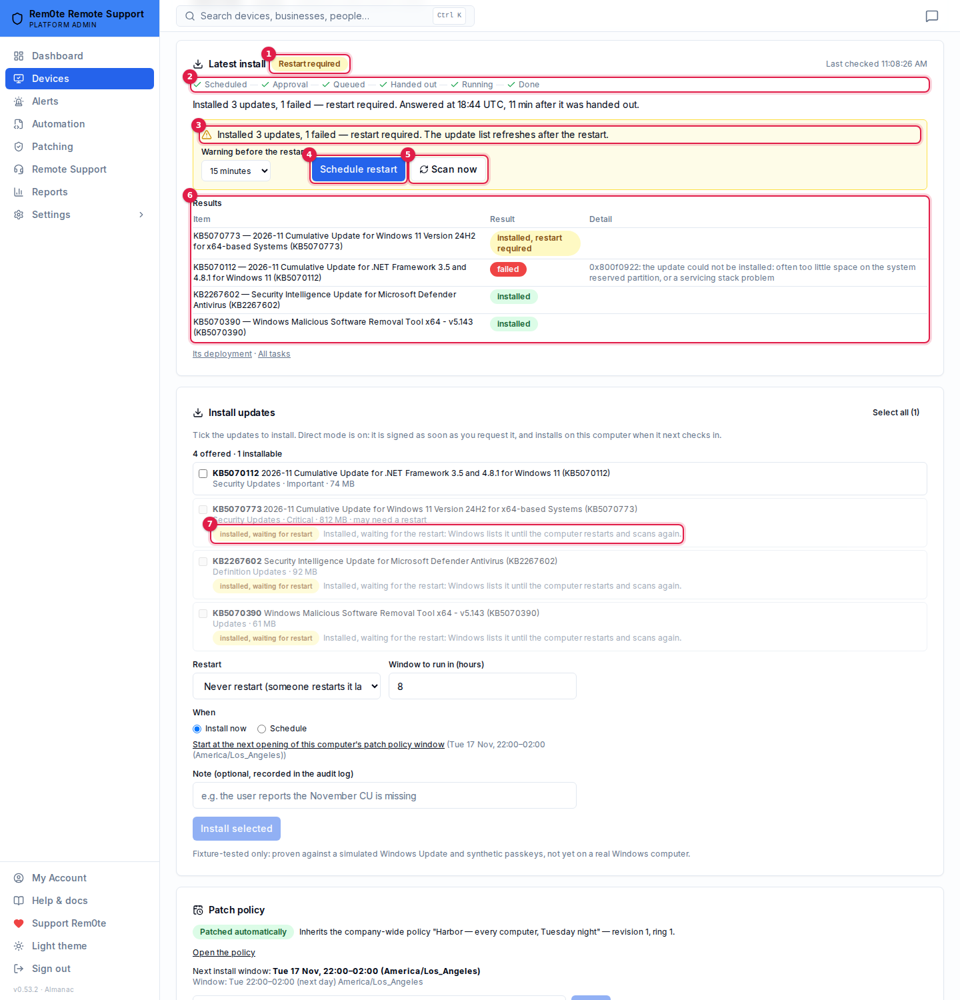
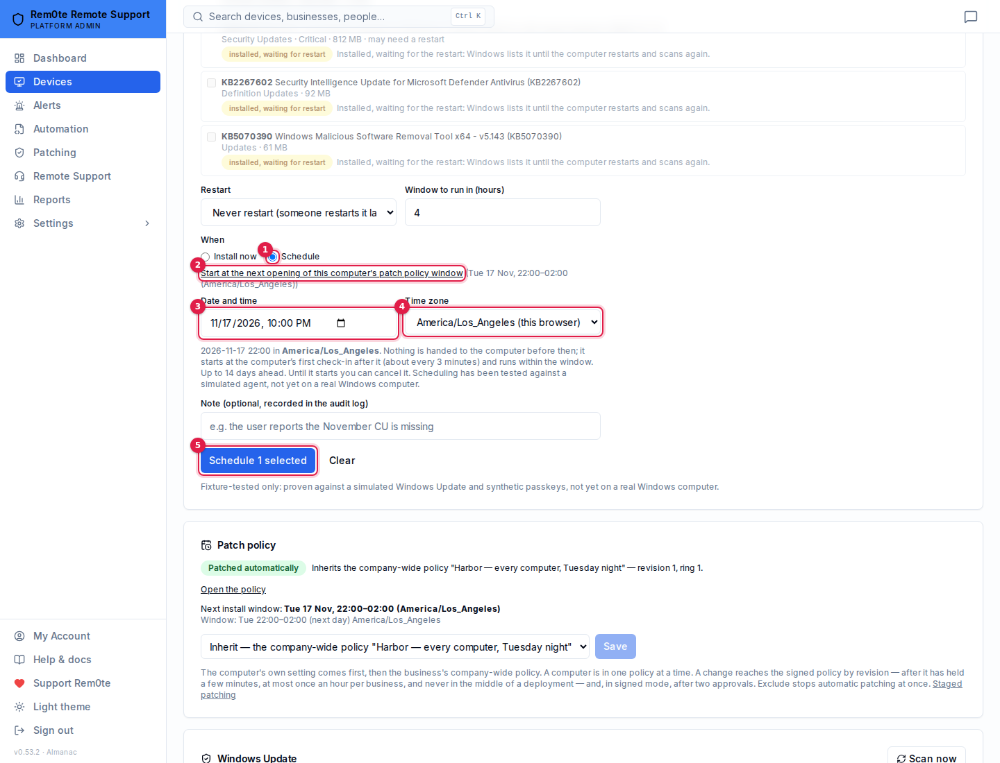
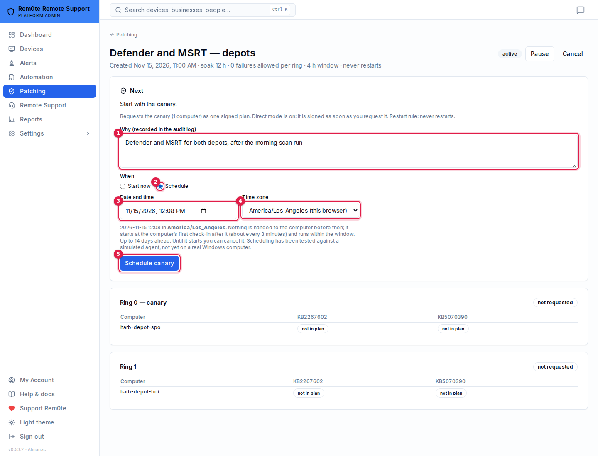
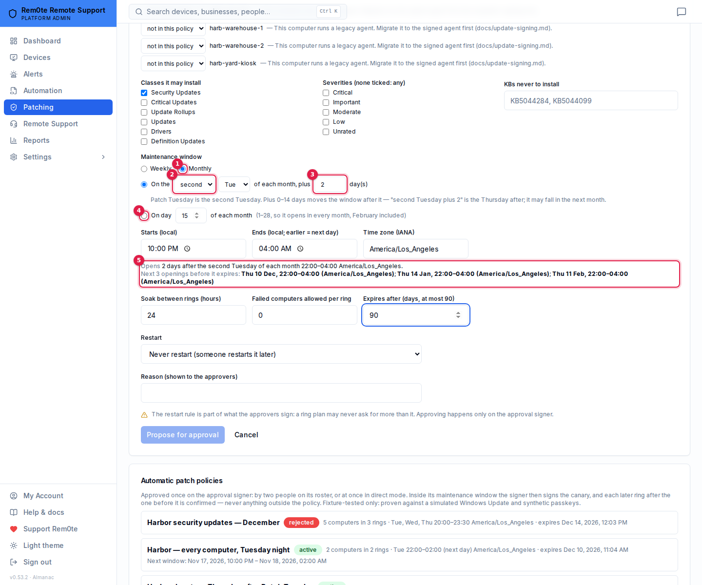
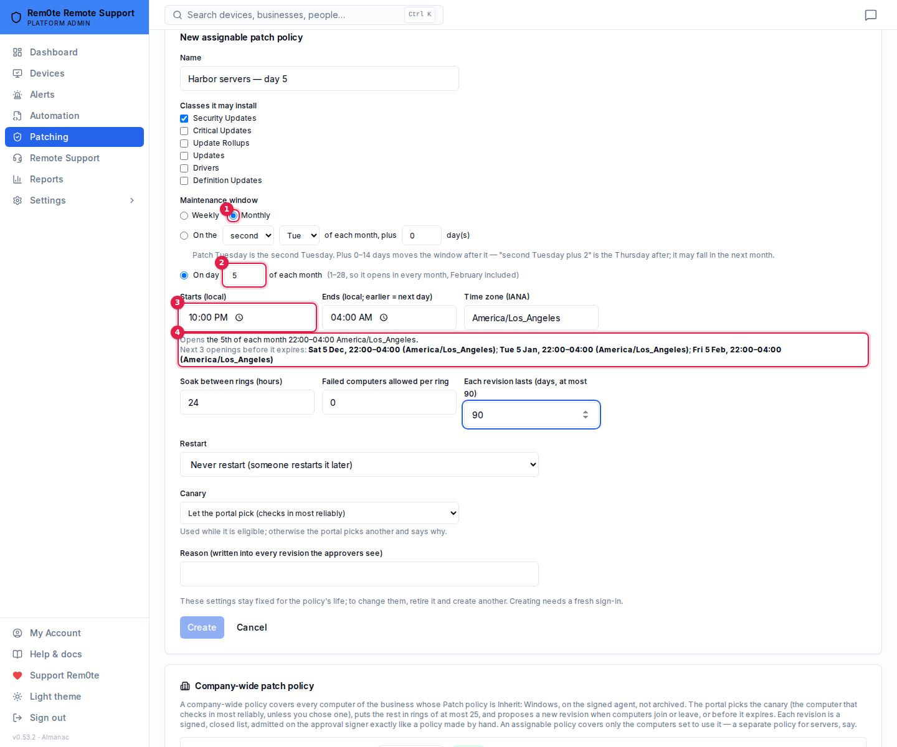
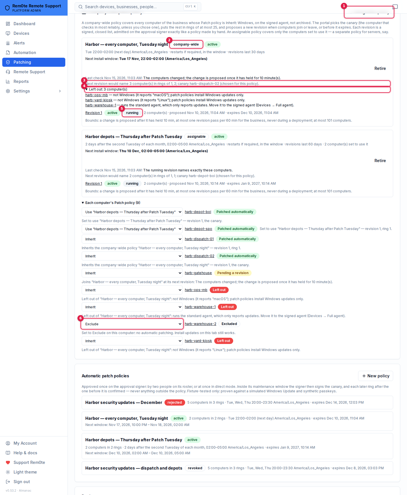
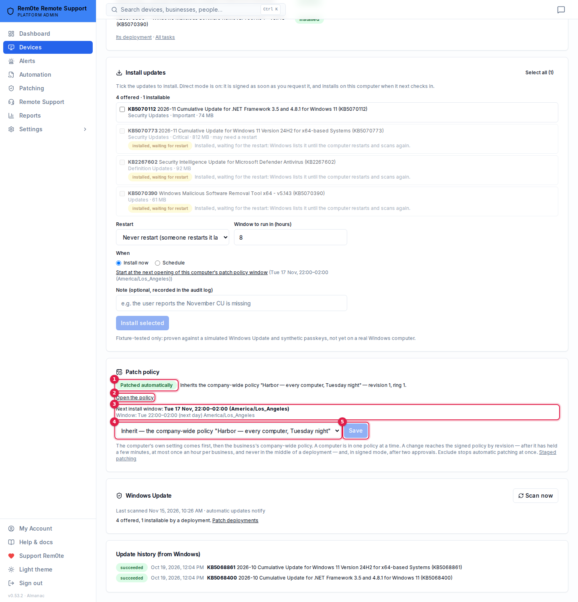

# Staged patching

rem0te 0.27 can install **Windows updates** on customer computers in stages. 0.32 adds
[installing from one computer's Patches tab](#installing-from-one-computers-patches-tab) and
[patch policies](#patch-policies), which are approved once and then run inside a maintenance window. 0.34 adds a
[restart rule](#restarting-after-updates): restart, if Windows requires it, inside the plan's window. For production
setup, see [Patching setup](patching-setup.md). A **canary** computer goes first, then
one or more **rings**. Each ring is a single signed plan that two people on the approval roster authorize with a
passkey. The next ring can't be requested until the canary reports that the updates took effect.

The plan is approved, delivered and executed exactly like the [approved Print Spooler action](approved-actions.md):
the same approval signer, roster, signature and agent checks. This page covers only what is different for updates.

> **Warning.** An installed update may not stay installable *out*. Some can't be uninstalled, and uninstalling is not
> built here. By default rem0te never restarts a computer, so an update that needs a restart is reported as
> **restart required** until someone restarts it. With the 0.34 rule *restart if required, inside the window*, the
> computer restarts itself after a fixed warning, unless someone is connected or the window would close first.

## What can be installed

| Installed by a plan | Never installed by a plan |
|---|---|
| Security Updates, Critical Updates, Update Rollups, Updates | Upgrades (feature updates), Feature Packs, Service Packs, Tools, anything unclassified |
| **Drivers** and **Definition Updates** (0.42) | Optional / preview updates (`BrowseOnly`) |
| Only updates Windows Update **itself offers** that computer at install time | Anything that needs a licence accepted |
| | Anything that says it needs someone at the keyboard (`CanRequestUserInput`), **except drivers** |
| | Third-party software, scripts, files, URLs. A plan names updates only by Windows Update ID and revision |
| | Computers whose updates are managed by **WSUS**, **Windows Update for Business policy**, **MDM (Intune)** or **Configuration Manager** |

**Drivers and definition updates (0.42).** On a real Windows 10 computer, 8 of 11 offered updates were drivers and
one was a Defender security-intelligence update, and none of them could be picked. They can be now. Windows Update
marks nearly every driver as one that *can* request user input (all eight there did), and drivers install unattended
as SYSTEM in practice, so for drivers only that flag no longer refuses the update. Every other classification still
refuses it, and optional, licence-bound and feature updates stay out whatever their class. A patch policy may name
**Drivers** or **Definition Updates** too, but they are never ticked by default. An agent older than 0.42 still
refuses them (`excluded_classification`); the deployment says so and tells you to update the agent.

These rules are enforced twice: by the portal, when you build a deployment, and again by **the computer**, which
asks Windows Update for each named update and decides from that answer. The KBs and titles in a plan are what the
approvers *see*, and they are signed, but the agent never consults them. A misleading title can mislabel an update. It
can't widen what gets installed.

At most 20 updates per plan; ring 0 is exactly one computer; later rings have up to 25 computers; at most five rings.

## How a deployment runs

```
create ──▶ request canary ──▶ 2 approvals ──▶ canary installs ──▶ (restart, scan) ──▶ effective?
                                                                                      │ yes
               ┌──────────────────────────────────────────────────────────────────────┘
               ▼
        request ring 1 ──▶ 2 approvals ──▶ ring installs ──▶ within threshold? reconciled? soaked? ──▶ ring 2 …
                                                                │ no
                                                                ▼
                                                     deployment PAUSES itself
```

1. **Create** (Patching → New deployment). Pick updates from what the business's computers report being offered,
   assign computers to rings, and set the soak time, the failures allowed per ring and the window each ring may run in.
   The portal refuses a computer that's managed elsewhere, isn't ready (legacy agent, unpublished build, protected
   class) or hasn't reported a scan, and refuses an update nobody is offered or that isn't installable.
2. **Request the canary.** This creates a signed plan **awaiting approval** and opens its approval page. Updates are
   always **high impact**, so they always need **two** approvers, even on a single workstation, and never the requester.
3. **The canary installs.** It downloads and installs the updates. Under the default rule it never restarts; under
   *restart if required, inside the window* it may schedule one ([below](#restarting-after-updates)). It reports a
   state for each update (below).
4. **Confirm.** After a restart, if one is needed, the computer's next scan shows whether each update took effect.
5. **Request ring 1** once the gate passes, and so on. Each ring is a new plan with new approvals.

### The gate

A ring can be requested only when the ring before it passes:

| Gate reason | Meaning |
|---|---|
| `in_progress` | The previous ring is awaiting approval, approved or delivered |
| `ring_not_run` | Its plan was rejected, canceled or expired, or reached no computer; request it again |
| `unreconciled` | A computer's outcome is uncertain. Someone has to reconcile it first (below) |
| `too_many_failures` | More computers failed than the threshold allows. **The deployment pauses itself** |
| `canary_not_effective` | The canary hasn't confirmed every update effective. Usually it needs a restart and a scan |
| `canary_proved_nothing` | No update applied to the canary, so it proves nothing. Choose a canary that's offered them |
| `soaking` | The ring passed; the soak time hasn't elapsed |
| `passed` | The next ring may be requested |

A ring over its threshold isn't promoted past. **Resume** the deployment, then request the *same* ring again, leaving
out computers with a reason if you need to. The retry is a new plan and needs new approvals. When the last ring passes,
the deployment is **completed**.

## What each state means

These are the states shown for each update on each computer on the deployment page:

| State | Meaning |
|---|---|
| **awaiting approval** / **scheduled** / **delivered** | The plan isn't approved, is approved but not yet taken, or the computer has it and hasn't answered |
| **installed** | Windows reported the install succeeded. **Not yet confirmed:** a later scan must show it took effect |
| **restart required** | Installed. It takes effect after a restart: one a person makes, or one the in-window rule scheduled |
| **effective** | A scan taken *after* the result no longer offers the update, Windows' own history records it installed (or the computer said it already was), and no restart is pending |
| **superseded** | Windows Update replaced it with a newer update before install. Nothing was installed for it |
| **not offered** | Windows Update didn't offer it to this computer at install time (e.g. it doesn't apply) |
| **excluded** | Windows Update offered it, but the agent refused it (a driver, optional, needs a licence or input) |
| **failed** | Windows reported a failure, with its own HRESULT. Or a later scan offers it again, which means it didn't stay installed |
| **refused** | The computer refused the whole plan (a signature, target, window or `managed_elsewhere` reason) |
| **unknown** | Nobody knows. The installer died, or the computer didn't answer within six hours. Never reported as failed |
| **canceled** | That computer was taken out before delivery (`device_identity_changed`, `requester_no_longer_authorized`, …) |

**Effective is what the computer reports.** It doesn't prove a vulnerability is fixed, and it doesn't cover a
computer that was restored from a backup afterwards.

A computer counts as **failed** for the threshold if it reported failed, partial, refused or not executed, if any of
its updates is failed or unknown, or if its outcome is uncertain, even after it has been reconciled.

### Uncertain outcomes

If the installer stops part-way (a crash, a power cut, a reboot by someone else), the agent can't say what happened.
It reports **uncertain** and never runs that plan again on that computer. The deployment page shows **Reconcile** for
that computer. Check **Settings → Windows Update → Update history** on it, then record what you found. The gate
doesn't move until you do.

## On the computer

- **Every agent shows updates (0.29.1).** The standard agent, on either channel, answers the inventory's update scan
  every 12 hours and on **Scan now**. A computer without the signed agent shows that list on its **Patches** tab:
  offered updates with KB, severity and size, and whether a restart is pending. It is read-only. It never feeds a
  deployment, because installing needs the signed agent and its fuller scan below.
- **Patch status (0.30).** The Patches tab leads with a summary for every agent: the evidence (signed scan,
  standard read-only scan, or none) with its age and **fresh / stale / unknown** (stale is older than 36 hours), last
  successful scan, last boot, who manages patching (WSUS, Intune, WUfB, ConfigMgr, or *unknown* from the standard
  agent), relevant KBs, whether each update from a recent plan was **confirmed by a later scan**, and why deploying
  is or isn't available. Fields and test status: [What each agent can do](capabilities.md).
- **Posture.** The signed agent scans Windows Update (`rem0te-agent.exe patch-scan`) at most every 12 hours, when the
  portal asks (**Scan now** on the computer's **Patches** tab, or **Refresh inventory**), and no more than once every 30
  minutes. The scan reports offered updates, the last 50 history entries, pending-restart signals (component servicing,
  Windows Update, pending file renames, the update agent) and which update manager, if any, owns the computer. It
  installs nothing.
- **Install.** The heartbeat hands the signed envelope to `rem0te-agent.exe action`. That runs **detached**, so a
  download of several hundred megabytes doesn't hold up the heartbeat. A per-job lock means a re-delivery while it runs is
  answered `in_progress`; a lock on Windows Update means a scan and an install never run at once. The job is journaled
  before anything is installed. A re-delivered plan is answered from the journal, and Windows Update is not asked again.
- **What it runs.** A fixed script compiled into the signed agent, run with Windows PowerShell 5.1
  (`%SystemRoot%\System32\WindowsPowerShell\v1.0\powershell.exe -NoProfile -NonInteractive -ExecutionPolicy Bypass`),
  using the Windows Update Agent COM API: search, download, install with `ForceQuiet`. It never calls
  `AcceptEula`, never restarts, and runs nothing it downloads. Scans time out after 15 minutes, installs after 4 hours.

## Refusal codes

Portal, when creating a deployment or requesting a ring:

| Code | Meaning |
|---|---|
| `ACTION_NOT_DIRECT` | Updates can't be requested from a computer's Actions tab. Use a deployment |
| `BAD_RINGS` | Ring 0 isn't exactly one computer, a computer is in two rings, or a ring is empty or too large |
| `NO_PATCH_POSTURE` | A computer hasn't reported a Windows Update scan yet |
| `MANAGED_ELSEWHERE` | A computer's updates are managed by WSUS, WUfB policy, MDM or ConfigMgr |
| `UPDATE_NOT_OFFERED` | No computer in the deployment is offered that update |
| `UPDATE_NOT_INSTALLABLE` | A driver, upgrade, optional update, or one that needs a licence or input |
| `RING_GATE` | That ring can't be requested now. The message says why (the gate reasons above) |
| `ACTION_NOT_GRANTED` | Your access level doesn't include high-impact requests (an L2 technician, for example) |

The agent adds `managed_elsewhere`, `update_agent_busy` (a scan held Windows Update for 20 minutes) and
`lookup_failed` to the refusal reasons listed in [Approved actions](approved-actions.md#refusal-codes).

## Installing from one computer's Patches tab

Since 0.32, a computer's **Patches** tab has an **Install updates** button when the computer can be patched. You
pick from its installable updates, the [restart rule](#restarting-after-updates) (*never*, the default, or *restart
if required, inside the window*) and a window, and give a reason.

- The request becomes a **one-computer deployment**: a single canary ring, marked *one computer* in the list. Its plan
  awaits **two approvals** on the approval signer, like any ring.
- It isn't a direct request. `POST /endpoints/:id/actions` still refuses updates with `ACTION_NOT_DIRECT`.
- When the computer can't be patched, the tab shows no button. It says why and what to do instead:

| Why | What to do |
|---|---|
| It runs the standard agent | Switch it to the signed channel ([Patching setup](patching-setup.md), step 2) |
| No signed build published, or it isn't on it | Publish a release, or let it update itself |
| No device identity | Re-enrol it |
| No signed scan yet | **Scan now** and wait |
| Managed by WSUS, WUfB, MDM or ConfigMgr | Patch it there |
| Offline | Wait until it checks in |
| No approval signer configured | [Patching setup](patching-setup.md), steps 3 to 5 |
| Your access doesn't include high-impact requests | Ask someone whose access does |
| An earlier install is pending or uncertain | Wait, cancel it, or reconcile it |
| Nothing installable is offered | Nothing to do |

The same checks run again when the request arrives, and once more when the deployment is built.

### Watching the install (0.52)

Until 0.52 the tab said nothing between the request and the next scan, so an install that was running looked the
same as one that had failed. On DEWEY-WKS2022 the plan was handed out at 23:33, delivered four times, and answered at
23:45 with eight updates installed and a restart required — and for those twelve minutes the owner saw no change.

Now the tab's **Latest install** card follows the install from the request to the scan after it:

- **Steps**: scheduled (when it was), approval (in signed mode), queued, handed out, running, done. The sentence under
  them says where it is in words: *Queued: it is handed to the computer at its next check-in, about every 3 minutes*;
  *Handed to the computer at 23:33 UTC (4 deliveries, the last at 23:42)*; and so on. It re-reads every 5 seconds
  while something is moving and shows when it last checked.
- **Overdue**: an install handed out more than 30 minutes ago with no answer says so, and what that usually means (a
  large update can take a long time; the agent may be busy or the computer offline). Nothing is retried or canceled
  because of it.
- **Results**: one row per update, with Windows' own result and, for a failure, the HRESULT and its meaning
  (`0x80240022` *all updates failed*, `0x80070005` *access denied*, and so on).
- **Restart required**: *Installed 8 updates — restart required. The update list refreshes after the restart.* with
  **Schedule restart** and **Scan now**. Schedule restart is an ordinary `windows.reboot.schedule` plan, requested
  like the *Schedule a restart* action — its own approvals in signed mode, its fixed warning to the signed-in user,
  its open-session check. When that restart is reported scheduled, the portal asks for a patch scan two minutes after
  the restart time, so the list catches up without anyone pressing Scan now.
- **Installed, waiting for restart**: until a scan after the install, the updates it installed are listed with that
  badge instead of a checkbox — Windows keeps offering them until the computer restarts and scans again, and
  installing them a second time would do nothing.



1. **State** — *Restart required* here; *Queued*, *Handed to the computer*, *Scheduled*, *Overdue* and so on while it
   moves.
2. **Steps** — scheduled, approval, queued, handed out, running, done, with the sentence under them saying where it is.
3. **The restart banner** — how many installed and failed, and that the list refreshes after the restart.
4. **Schedule restart** — a `windows.reboot.schedule` plan with the warning chosen beside it.
5. **Scan now** — asks the computer for a new Windows Update scan.
6. **Results** — one row per update; a failure has its HRESULT and what it means.
7. **Installed, waiting for restart** — an update this install put on the computer, no longer offered for install.

The same task appears in the computer's **Tasks** panel and on **Automation → Tasks**; see
[Following a task](approved-actions.md#following-a-task-052).

## Scheduled installs

From 0.52, **Install updates** on the Patches tab and a deployment's **next ring** can start at a time instead of now.
Choose **Schedule**, a date and time, and a time zone. The form offers the computer's site zone, your profile's zone,
this browser's and UTC, and says which one the time is in. Up to 14 days ahead; for a regular schedule, use a
[patch policy](#patch-policies) and its weekly or monthly maintenance window. From 0.53, when the computer is covered
by a patch policy, the form also offers **Start at the next opening of this computer's patch policy window**: it fills
in that opening's start, as a wall-clock time in the zone chosen in the form, and sets the run window to the policy
window's length (1–24 hours). It is offered greyed out, with the reason, while that window is open (install now) or
more than 14 days away. It is an ordinary one-computer install that starts at that time, not a ring under the policy.



1. **Schedule** — instead of *Install now*.
2. **Start at the next opening of this computer's patch policy window** (0.53) — with that opening in brackets. It
   fills in the date and time below and sets the run window to the policy window's length.
3. **Date and time** — a wall-clock time, up to 14 days ahead.
4. **Time zone** — the computer's site zone, your profile's, this browser's or UTC; the sentence under it repeats the
   time and the zone.
5. **Schedule 1 selected** — the button says *Schedule* rather than *Install* (in signed mode, *Request approval for
   the scheduled install*).

A deployment's next ring has the same choice:



1. **Why** — recorded in the audit log (shown to the approvers in signed mode).
2. **Schedule** — instead of *Start now*.
3. **Date and time** and
4. **Time zone**, as above.
5. **Schedule canary** — or *Schedule ring n*. A ring proposed by a patch policy has no schedule: it runs in the
   policy's own window.

What happens:

1. The portal turns the wall-clock time into an instant in that zone (`zonedToUtc`, the same arithmetic as policy
   windows, DST included). A time more than 5 minutes in the past is `SCHEDULE_IN_PAST`, beyond 14 days
   `SCHEDULE_TOO_FAR`, an unknown zone `INVALID_TIMEZONE`, a date that does not exist `INVALID_REQUEST`.
2. That instant is the plan's **`notBefore`**, and `notBefore` plus the deployment's window hours is its
   **`notAfter`**. Both are inside what is signed: the approvers see the window, and in direct mode the signer signs it
   at the request.
3. **Nothing is handed to the computer before `notBefore`.** The heartbeat skips a plan whose start has not come, and
   the target stays *pending*, never delivered. If an envelope did reach the agent early, the agent refuses it
   (`not_yet_valid`) without consuming or journaling it, and takes it again at its first check-in after the start.
4. At the first check-in after `notBefore` (about every 3 minutes) it runs like any other ring, and the restart rule
   applies inside the scheduled window.

A scheduled install shows as **Scheduled for …** on the Patches tab, the ring, the Tasks panel and the Tasks page. Until
it starts it can be **canceled** — the existing `POST /actions/:id/cancel`, which cancels only targets that were never
handed out. In signed mode the two approvals can come at any time before `notAfter`; a plan approved after its start
runs at the next check-in. A ring under a patch policy cannot be given a schedule: it runs in the policy's own window
(`INVALID_REQUEST`), and a schedule together with *starts in minutes* is refused the same way.

**Scheduling has been tested against the simulated agent only** (`e2e-task-progress.mjs`, `rem0te-action-sim` with
its clock moved). It has not run on a real Windows computer.

Patch policies show their **next install window** — on the company-wide policy list and on each computer's Patch
policy card — computed from the running revision's signed window. From 0.53 a window may be weekly or
[monthly](#monthly-windows-053).

## Patch policies

A **patch policy** (0.32) approves a bounded kind of patching once, so the nightly canary doesn't need two people
every time. Two approvers other than its author approve the policy on the approval signer. After that, **the signer
itself**, not the portal, signs each ring plan, but only if the plan falls inside the policy.

**What the policy binds** (the signer checks each one):

| Bound | Checked against |
|---|---|
| The business and its computers, by enrolled identity (endpoint, RustDesk ID, device-secret hash) | Every target in every plan. A re-enrolled computer is a different computer and is refused |
| 0.34: each computer's **result key**, the key its agent signs its results with | Every result and scan that opens a later ring ([Signed results](#signed-results-034)) |
| The rings, in order. Ring 0 is one canary; later rings hold at most 25 | The signer's own ledger of what it signed. Ring *n* needs ring *n − 1* of the same deployment signed first |
| Classes, severities, excluded KBs | Each update shown in the plan. The plan also carries the filter as `params.allow`, and **each computer applies it** to Windows Update's own answer, so a mislabelled update can't slip past |
| The maintenance window: weekly days, or (0.53) a monthly day; local start and end; IANA time zone | The plan's window must lie inside one occurrence. DST is honoured |
| Soak and failure threshold | The ring gate, re-run by the signer (below) |
| The restart rule: *never*, or *restart if required, inside the window* (0.34) | The plan's `params.reboot`. A plan may ask for no more than the policy: under a *never* policy, a plan asking to restart is refused (`reboot_not_allowed`); under an in-window policy, a plan may ask for either |
| Expiry, at most 90 days | Every plan, and the plan's window end |

**The canary must be effective.** For every ring after the canary, the portal hands the signer the previous ring's
results and scans, **as each computer signed them** (0.34). The signer checks every signature, then re-runs the same
gate the portal uses (`evaluateRingGate`) over the signed facts only: every computer answered, nothing uncertain left
unreconciled, failures within the threshold, the soak passed (counted from the time the computer signed), and **for
the canary, every update effective in a later signed scan**.

**What a compromised portal still can't do:** widen the computers, classes or window, change the ring order, skip
the canary, or keep using a revoked or expired policy. It also can't approve a policy: there's no approve route, and
the passkeys are checked on the signer's own origin. From 0.34 it also can't forge a ring's results: a canary
success it writes, signs with a key of its own, edits, replays from another job or borrows from another computer is
refused (below).

**What it can do** is withhold or delay results, so the next ring starts late or never; and, before a computer's
first policy is approved, propose a result key that isn't the computer's
([the trust-on-first-use window](#the-trust-on-first-use-window)).

### Monthly windows (0.53)

A policy's maintenance window is **weekly** (days of the week) or **monthly**. A monthly window opens once a month, on
one of:

- **the nth or last weekday** — *first*, *second*, *third*, *fourth* or *last* Monday…Sunday — plus an optional
  **offset of 0–14 days**. Patch Tuesday is *the second Tuesday*. *Second Tuesday + 2* is the Thursday after it, and
  *second Tuesday + 7* the Tuesday a week later, which gives the canary a week of other people's reports first. An
  offset may carry the window into the next month (*the last Saturday + 7*); that opening still belongs to the month
  it was counted from, so there is exactly one a month. *Last* is the fifth weekday in a month that has five, and the
  same as *fourth* in a month that has four.
- **a day of the month, 1 to 28.** There is no 29th to 31st: every month has a 28th, so a day-of-month window opens
  every month, February included, and nothing has to define what "the 31st" means in April.

The start, end and time zone work exactly as for a weekly window: wall-clock times in a named IANA zone, an end at or
before the start ends on the next day (so a window can cross midnight, and the end of a month), and the length follows
the local clock across a DST change. The editor (the policy form and the company-wide policy form) shows the window in
words and its **next three openings** in the chosen zone, before the expiry. They are not worked out in the browser:
they come from `POST /patching/window-preview`, which runs the same functions the approval signer holds every ring
plan to. The policy page and the signer's approval page show the next openings too.



1. **Monthly** — instead of *Weekly*.
2. **On the second Tuesday** — the week (*first*…*fourth*, *last*) and the weekday.
3. **plus 2 day(s)** — 0 to 14; *second Tuesday + 2* is the Thursday after Patch Tuesday.
4. **On day …** — the other monthly kind, a day of the month from 1 to 28.
5. **The preview** — the window in words and its next three openings before the expiry, from the server.

The company-wide and assignable policy form has the same editor:



1. **Monthly**.
2. **On day 5** of each month.
3. **Starts / Ends / Time zone** — as for a weekly window; an end at or before the start ends the next day.
4. **The preview** — the next three openings before a revision expires.

**Expiry still applies.** A policy expires at most 90 days after it is proposed, and its window must open at least
once before then, or the policy is refused (`window_never_opens`) by the portal and by the signer. A monthly window
proposed just after its day, with a 14-day expiry, never opens; the editor says so before you propose.

**What it is in the signed document.** The window is a closed union of three shapes, each strict:

| Shape | Fields |
|---|---|
| Weekly (unchanged since 0.32) | `days`, `start`, `end`, `timezone` |
| Monthly, nth weekday | `kind: "monthly"`, `week` (`first`…`fourth`, `last`), `weekday` (`sun`…`sat`), `offsetDays` (0–14), `start`, `end`, `timezone` |
| Monthly, day of month | `kind: "monthly"`, `day` (1–28), `start`, `end`, `timezone` |

A weekly window carries no `kind`, so a weekly document's bytes, digest and approvals are exactly what they were
before 0.53: policies approved earlier keep verifying and running unchanged. Anything else — another `kind`, a weekly
window with a `kind`, a day and a weekday together, a day past 28, an offset past 14 — matches none of the three and
is refused by the portal (`400`) and by the signer at admission (`invalid_policy`). Every occurrence function also
treats an unknown shape as a window that never opens, so a stored document could not be read as weekly by mistake.
The occurrence arithmetic is one set of functions in `apps/api/src/actions/patch-policy.ts`, which the approval
signer's install includes; the portal's sweep, its preview and the signer's ring-plan check all call it
(security invariant §66).

**Deploying it.** The approval signer is a separate install: until it is rebuilt and redeployed from 0.53
(`apps/api/scripts/build-approval-signer.mjs`), it refuses a monthly policy at admission (`invalid_policy`, its schema
is still weekly-only), and weekly policies carry on as before. The agent needs nothing: it never reads a policy's
window, only its plan's own `notBefore` and `notAfter`, which the signer has already checked against the window.

Monthly windows are tested against the simulated agent and the signer (`unit-monthly-window.mjs`,
`e2e-patch-policies.mjs`, `e2e-patch-assignment.mjs`). Like every patch policy, they have not run on a real Windows
computer.

### Company-wide policies and each computer's Patch policy (0.50)

A policy made by hand names its computers ring by ring. A **company-wide** policy names them for you: every computer
of the business whose **Patch policy** setting is *Inherit* — Windows, on the signed agent, not archived. An
**assignable** policy covers only the computers set to use it, for example a separate policy for servers with its own
window and restart rule.

**The signed document does not change.** Each one is still a closed list of named computers in rings, bound to their
enrolled identity. A company-wide policy is a *series* of such documents, called **revisions**. Each revision goes
through the same admission as a policy made by hand: the same per-computer checks, the same `validatePolicyDoc`, and
the same signer. The signer knows nothing about series. It signs a ring plan only inside the revision it holds,
exactly as before. The portal can't widen a running revision. It can only propose another one, which is admitted
(direct mode) or approved (signed mode) like any policy.

**How the portal builds the rings:**

- **The canary** is the computer you chose, while it is eligible. Otherwise it is the previous revision's canary.
  Failing both, it is the computer that checks in most reliably: the most hours with a check-in in the last seven
  days. A canary needs the update action ready on the published signed build. With other computers after it, it
  also needs a result key (§38).
- **The rest** go in rings of at most 25, as even as possible, in a stable order: oldest enrolment first, so a new
  computer joins at the end. A computer whose agent can't sign its results (no result key) goes only in the last
  ring, whose results open nothing. At most 101 computers: a canary and four rings of 25.
- **Left out, with the reason**, on the policy and on each computer's Patches tab:

| Code | Why |
|---|---|
| `not_windows` | It isn't Windows. Patch policies install Windows updates only |
| `no_signed_agent` | It runs the standard agent, which only reports updates |
| `no_identity` | It has no enrolled device identity |
| `in_other_policy` | A policy made by hand already patches it, or names it while awaiting approval |
| `not_allowed` | The access policy refuses high-impact requests on it for the policy's author |
| `no_result_key` | It can't sign its results, and the last ring, the only place it could go, is full |
| `policy_full` | The policy already names 101 computers. The newest are left out |



1. **Assignable policy** — a new policy for only the computers set to use it. *Company-wide policy* is offered here
   while the business has none.
2. **company-wide** — this business's one company-wide policy, active, with its window and restart rule.
3. **Last check** — what the next revision would name: how many computers, the ring sizes, and the canary with the
   reason it was chosen. Here a computer moved back to *Inherit* a few minutes ago, so the change is *settling*.
4. **Left out** — each computer it can't include, with the reason (the codes above).
5. **Revision 1 · running** — the signed revision the sweep patches under; its page shows the rings.
6. **Each computer's Patch policy** — *Inherit*, *Exclude* or *Use* an assignable policy, with what that means for
   the computer now.

**When a revision is proposed.** The sweep (`PATCH_POLICY_SWEEP`) works out the rings the next revision would have.
It proposes one when they differ from the running revision's (a computer joined, left, changed its setting, was
re-enrolled, or its result key changed), or when the running revision is near its expiry. "Near" means seven days,
or a third of a short policy's life. Three bounds apply, checked in this order before anything is proposed:

1. **Never mid-ring.** While the running revision has a deployment that is active or paused, nothing is revised. The
   policy shows `mid_ring`.
2. **Debounced.** A change of computers must hold for `PATCH_POLICY_SETTLE_MINUTES` (10) before it is proposed
   (`settling`). Renewal doesn't wait for this.
3. **At most one revision pass per business per `PATCH_POLICY_REVISION_MINUTES` (60).** The bound is a conditional
   claim row per business, so two API processes can't both take it (`rate_limited`). One pass can revise several
   policies of the business together. Moving a computer from the company-wide policy to an assignable one is
   therefore one pass, not two.

A revision rejected by the approvers isn't proposed again for the same computers. A revision still awaiting approval
when the computers change again is replaced by the next one. Revoking a revision by hand, or on the signer, **retires**
the policy, so nothing proposes it again. **Retire** on the policy does the same and revokes every revision.

**Taking over.** A revision goes live only once it is ACTIVE on the signer and the running revision has no
deployment in progress. In direct mode that is at admission. In signed mode it is after two approvals, and **the
previous revision keeps running until then**. Take-over is one transaction. The running revision's computers are
released first, then the new revision's are made live, then the policy's pointer moves. The replaced revision is
then revoked on the signer and audited as `PATCH_POLICY_SUPERSEDED`. The sweep proposes ring plans only under a
policy's running revision.

**One policy per computer.** Each computer has at most one *live* policy, the one the sweep may patch it under. This
is a partial unique index in the database (`PatchPolicyComputer_one_live`). A trigger allows a live row only for an
ACTIVE policy, and another trigger releases a policy's rows when it stops being ACTIVE. A policy made by hand can't
name a computer another policy patches, one a company-wide or assignable policy covers, or one set to *Exclude*
(`COMPUTER_IN_POLICY`). The sweep plans a computer only while it is live in that policy.

**The Patch policy setting** is on each computer's Patches tab and in the business's policy view (**Patching →
Company-wide patch policy → Each computer's Patch policy**):

| Setting | Means |
|---|---|
| **Inherit** (the default) | The business's company-wide policy, if it has one |
| **Exclude** | No automatic patching. The sweep leaves the computer out at once, before any revision drops it. *Install updates* on its Patches tab still works |
| **Use policy X** | An assignable policy of the same business |

Precedence is the computer's own setting first, then the business's company-wide policy. Device groups are not a
scope for patch policies. Group membership (§46) is computed on every read, and a signed policy names a fixed list,
so a group-scoped policy would be one more source of revisions without saving a step. Use an assignable policy and
set its computers.

Changing the setting needs **Edit computers** on that computer and a fresh sign-in (`patching.override`; an everyday
change under *Confirm it is you*). The write is conditional on the value read. It is audited as
`PATCH_POLICY_OVERRIDE_SET` with the value before and after. The database CHECKs the value, and a trigger refuses a
policy of another business or one that isn't assignable. A computer moved to another business goes back to
*Inherit*. The setting signs nothing. A revision follows under the bounds above, and the Patches tab says where that
stands: *patched automatically*, *pending a revision*, *left out* (and why), *excluded*, or *no automatic patching*.



1. **State** — *Patched automatically* here, with which policy, revision and ring.
2. **Open the policy** — the running revision's page.
3. **Next install window** (0.52) — the next opening of the running revision's signed window, and (0.53) the window
   in words, weekly or monthly.
4. **The setting** — *Inherit* (naming the company-wide policy), *Exclude*, or *Use policy* for each assignable one.
5. **Save** — offered once the choice differs from the saved one; needs **Edit computers** and, unless *A computer's
   patch policy* is set to *Don't ask*, a fresh sign-in.

A company-wide policy's settings (classes, window, soak, threshold, restart rule, how long each revision lasts,
canary) are fixed for its life. To change them, retire it and create another.

### Signed results (0.34)

Before 0.34 a ring's results reached the signer only through the portal, so a compromised portal that wrote a whole
canary success could have ring 1 signed early. Now each signed agent signs its own results.

**The key.** The first time the 0.34 agent needs it, it generates an Ed25519 key from the operating system's random
source and keeps it in `C:\ProgramData\Rem0te\result-key.json` (SYSTEM and Administrators only, beside
`heartbeat.dat`). The file holds the private seed and nothing else. The key never leaves the computer; only its public
half is sent, inside each signed statement. `rem0te-agent.exe status` prints it and its fingerprint
(`1a2b-3c4d-5e6f-7a8b`, the first 16 hex of its sha256).

**What is signed.** Two kinds of statement, each prefixed for its own purpose so one can't be passed off as the other:

| Statement | Signed when | It says |
|---|---|---|
| Result (`rem0te-device-result-v1`) | Every final result of every approved action, as it's journaled | The job id; the sha256 of the exact signed plan bytes the computer verified; its RustDesk ID and device-secret hash; the outcome and reason; when it finished; each update's final state and HRESULT; whether a restart is pending |
| Scan (`rem0te-device-scan-v1`) | Every `patch-scan` | Its RustDesk ID and device-secret hash; when it scanned; whether the scan failed; which updates Windows Update offered; which ones its history records installed; whether a restart is pending |

The journal keeps the signed result, so a re-delivered plan is answered with the same signature. A result journaled
by an older agent is signed on replay, dated when it was recorded. A plan that isn't valid yet isn't consumed, and
nothing about it is signed.

**How the key becomes trusted.** The portal reads each computer's key from that computer's own signed scans, and
only from a scan that verifies under it and names the computer's enrolled identity. It puts the key in the policy
document beside the identity. The signer's approval page shows each key's fingerprint. When two approvers approve
the policy, the signer trusts the key, and **pins it** to the computer's enrolled identity in
`device-keys/<identity>.json` on its own disk. That file is created once and the serving process never changes it.

**What the signer checks**, for each computer of the previous ring, before any later ring is signed:

| Code | Refused when |
|---|---|
| `result_key_not_pinned` | The policy names no result key for that computer: it was approved before 0.34, or for an older agent |
| `result_signature_missing` | The canary has no signed result or no signed scan, or a computer the portal reports as succeeded has no signed result |
| `result_signature_invalid` | A signature doesn't verify under the computer's key: an edited statement, a forger's signature claiming the computer's key, a scan signed as a result, a malformed envelope |
| `result_wrong_device` | It's signed by another key (a forger's own, or another computer's genuine one), or names another enrolled identity |
| `result_wrong_plan` | It's about another job, or about plan bytes other than the ones this signer signed for the ring (a replay) |
| `result_stale` | The result is dated before its plan's window opened, more than four hours after it closed, or in the future; or the canary's newest signed scan is over 36 hours old |
| `device_key_changed` | The policy names a key other than the one pinned for that computer (also refused when such a policy is proposed) |

A computer in the previous ring with no signed result can only count **against** the ring. If the portal reports it
failed, refused, not executed, uncertain or canceled, it counts as failed. The signer can't tell a cancellation from a
hidden failure, so a canceled computer in a policy ring counts too. If the portal reports it hasn't answered, the gate
waits. The portal's own copy of results and scans is still relayed for the record, and the decision never reads it.

**Older agents fail closed.** A computer whose results open a later ring must sign them. That is the canary, and
every ring but the last. A policy that puts a computer without a result key there is refused when it's created
(`RESULT_KEY_MISSING`), and by the signer (`result_key_missing`). The last ring opens nothing, so a pre-0.34 agent may
sit there. A policy approved under 0.32 or 0.33 carries no keys: it can still sign canaries, but every later ring is
refused with `result_key_not_pinned`. Approve a new policy once its computers run 0.34. **Manual deployments are
unaffected:** a person approves each ring, and the signer doesn't read evidence for those plans.

**When a computer's key changes.** A re-enrolled computer is a new identity, so it gets a new pin with its next
policy. A computer that keeps its enrolment but loses `result-key.json` (its agent state was wiped, or the file was
damaged and set aside as `result-key.json.unusable`) makes a new key. The sweep then leaves it out of rings it would
gate, saying so, and the signer refuses a policy naming the new key with `device_key_changed`. Read the new
fingerprint on the computer itself (`rem0te-agent.exe status`), have the signer's operator remove the old pin, then
approve a new policy:

```bash
$S device-key list                                                    # pinned computers, fingerprints, which policy pinned them
$S device-key forget --endpoint <endpointId> --reason 'agent state reset; new fingerprint read on the computer'
```

#### The trust-on-first-use window

The signer can't meet the computer. Every byte between them passes through the portal, and the computer's other
secret, its device secret, is one the portal also holds. So the **first** time a computer's key reaches the signer,
the signer trusts it because two approvers approved the policy that names it, not because it can prove the key is the
computer's. A portal that was already compromised when that first policy was proposed could put its own key there,
then forge that computer's results.

The window is narrow:

- It's open only until the first policy naming that computer is approved. After that the key is pinned, and a
  portal compromised later can't swap it. A policy naming another key is refused, and no HTTP route removes a pin.
- It covers keys only. A substituted key can't widen what a ring installs, add a computer, or run anything on the
  computer itself.
- **You can close it.** Before approving a computer's first policy, compare the fingerprint the signer's approval
  page shows ("first time this signer sees it") with `rem0te-agent.exe status` on the computer. This is the same
  read-back as the approver roster ceremony. The portal's policy page shows the fingerprints too, but that copy comes
  from the portal.

**The sweep.** Every 60 seconds (`PATCH_POLICY_SWEEP_SECONDS`), the API looks at each active policy whose window is
open:

- If a deployment from the policy is still active, the sweep moves it on by one ring when the gate allows.
- Otherwise it proposes one new deployment for this window: the canary's offered, installable, policy-allowed updates,
  at most 20.

It runs once per window. `(policy, window)` is unique in the database, so a restart or a second process can't propose
twice. Each attempt is recorded on the policy and audited (`PATCH_POLICY_PROPOSED`, `PATCH_POLICY_REFUSED`).

- A paused deployment is left alone, and nothing new is proposed while it exists.
- A containment pause stops it on both sides.
- Computers in a later ring that aren't ready are left out of that ring's plan, each with the reason.
- `PATCH_POLICY_SWEEP=off` disables the sweep.

**Revoking** is one-way and lives on the signer. **Revoke** on the policy's page (fresh sign-in) marks it revoked in
the portal at once, cancels what hasn't been delivered, and asks the signer to revoke. The sweep keeps asking until
the signer confirms. The signer's operator can also revoke with `patch-policy revoke`. Either way the signer writes
`revocations/<id>.json` once and never rewrites it, and refuses every later plan.

Policy refusal codes, from the signer: `policy_revoked`, `policy_expired`, `policy_not_active`, `policy_not_approved`,
`policy_digest_mismatch`, `policy_signature_invalid`, `computer_not_in_policy`, `class_not_allowed`,
`severity_not_allowed`, `kb_excluded`, `filter_mismatch`, `outside_window`, `ring_out_of_order`,
`ring_already_signed`, `ring_retry_limit` (three signings of one ring), `canary_not_effective`,
`canary_proved_nothing`, `gate_not_passed`, `evidence_mismatch`, `updates_not_proven`, `requester_mismatch`,
`reboot_not_allowed`, `paused`. From 0.34: `result_key_missing`, `result_key_not_pinned`, `result_signature_missing`,
`result_signature_invalid`, `result_wrong_device`, `result_wrong_plan`, `result_stale`, `device_key_changed`
([Signed results](#signed-results-034)).

## Restarting after updates

0.34 adds one restart rule to update plans. It is a closed parameter, `reboot`, with two values and nothing beside
them: no delay, time, message or command can be chosen.

| Rule | What the computer does after installing |
|---|---|
| `never` (the default everywhere) | Nothing. A pending restart stays pending until someone restarts the computer |
| `if_required_in_window` | Only if Windows then reports a restart is required, it schedules one through the same path as [`windows.reboot.schedule`](approved-actions.md#maintenance-actions-032): `shutdown.exe /r /t 900` with the same fixed warning, so the person at the computer has **15 minutes** to save their work. Programs still open then are closed without saving |

You choose the rule on a deployment, on **Install updates** from a Patches tab, and on a patch policy. Every ring plan
carries it, the approval page shows it, and the approvers sign it.

**When the computer does not restart.** It reports `restart: restart_deferred` with a reason, and leaves the computer
as it is. Nothing retries later; the update stays *restart required* and the next ring waits.

| Reason | When |
|---|---|
| `remote_session_open` | A RustDesk session was open when the install finished |
| `session_state_unknown` | The agent could not tell whether one was. "Cannot tell" counts as open, as for maintenance actions |
| `window_closed` | The restart, 15 minutes after the install finished, would fall after the plan's signed window closes |
| `restart_already_scheduled` | Windows already had a restart or shutdown pending. It is not replaced |
| `install_uncertain` | The installer did not report every result. Restarting under it could interrupt it |
| `schedule_failed`, `no_maintenance` | Windows refused the schedule, or the agent can't schedule restarts |

It also reports `not_required` when Windows needs no restart, or when nothing was installed (a restart already
pending for something else isn't this plan's to make). The checks run in that order: outcome, pending restart,
window, sessions, then the schedule. The session check is made once, when the restart is scheduled; someone who
connects in the 15 minutes after sees the Windows warning.

**Proof the update took effect.** A scheduled restart is reported as scheduled, not as done. The portal then asks
the computer for a patch scan due two minutes after the restart time, and the canary gate opens only when that scan
shows each update effective and no restart pending. A restart that never happened (canceled with
[*Cancel a scheduled restart*](approved-actions.md#maintenance-actions-032), or blocked by Windows) leaves the gate shut.

The **Windows Update script still never restarts** (`wua.ps1`, §15); the only restart is the agent's own
`shutdown.exe` call that `windows.reboot.schedule` uses.

> **Not proven on Windows.** The in-window restart has been tested against a simulated Windows only; it has not yet
> run on a real Windows computer. Try it on one canary you can watch before giving it to a policy.

## Setting it up

Staged patching needs [approved actions](approved-actions.md#setting-it-up) to be set up already: the approval signer,
its roster, and `approval/keys.json` in the signed repository. [Patching setup](patching-setup.md) is the
production order, with a live pre-flight. On top of that:

1. Build and publish the **0.27 signed agent** (`windows/rem0te-agent.exe`) through the offline-signed update chain.
   Agents report `windows.update.install@1` in their heartbeat once they run it.
2. Give the computers time to scan, or press **Scan now** on a computer's **Patches** tab.
3. Choose a canary that's representative, is offered the updates, and that someone can restart.

There are no new server settings.

## What has been proven, and what hasn't

| Level | State |
|---|---|
| **Fixture-tested** | Yes. The Go packages `internal/patch` and `internal/action` test eligibility, manager detection, the parsers' refusal of answers for unrequested updates, every per-update state, crash → unknown, the Windows Update lock, replay, and a second process seeing `in_progress`. `wua.ps1` is parsed by PowerShell in the tests and checked for banned cmdlets. `e2e-staged-patching.mjs` (59 checks) runs the portal, the signer and the agent's real decision code against a simulated Windows Update and registry: posture, deployment refusals, the canary, restart → effective, a three-computer ring with a crash and a failure, auto-pause, resume and retry, identity change, a tampered ring plan, and cancel |
| **Fixture-tested (0.32)** | Yes. `unit-patch-policy.mjs` (114 checks) covers every policy refusal, the window arithmetic across DST in several zones, and the signer's policy records. `e2e-patch-policies.mjs` (75 checks) covers: a one-computer install through two approvals to effective; no button on a standard-agent computer; a policy approved by passkey; the sweep proposing the canary inside the window; the agent installing only the policy's class; ring 1 signed automatically only after the canary was effective; the signer refusing widened rings, a disallowed class, a wider filter, out-of-window plans, a skipped canary, an altered digest, a non-author requester, expired and revoked policies, and a containment pause; and no duplicate after an API restart. Go tests cover the agent's `allow` filter |
| **Fixture-tested (0.34, restart rule)** | Yes, for the restart rule. Go tests: the closed rule, the shared scheduling path and fixed warning, never under *never*, and every deferral (session open, cannot tell, window closing first, a restart already pending, an uncertain install, nothing installed). `e2e-staged-patching.mjs` (94 checks) adds: restart in the window, scheduled, the simulated restart (`rem0te-action-sim -fire-restart`) and the post-restart scan to *effective* and a completed deployment; an open session and a closing window each deferring with nothing scheduled. `e2e-patch-policies.mjs` (84 checks) adds a *never* policy's signer refusing a restart plan (`reboot_not_allowed`), and an in-window policy signing one |
| **Fixture-tested (0.34, signed results)** | Yes. Go tests (`internal/devsig`, `internal/action`) cover creating the key once under concurrency, an unusable key file, signing and opening (forged, claimed key, altered, cross-domain), every journaled result signed, and replay returning the same signature. `unit-patch-policy.mjs` (151 checks) covers forged, replayed, cross-device, cross-plan, stale, malformed and missing signatures, an unsigned canceled target, a pre-0.34 policy, and `result_key_missing`. `unit-approval-signer.mjs` (99 checks) covers the pin on approval, `device_key_changed` at proposal and at signing, the ledger's plan hash, and `device-key list/forget`. `e2e-patch-policies.mjs` (89 checks) covers the portal refusing a canary without a key, the key bound from the agent's own scan, the stored signature equal to the agent's, five forged canary successes refused, and the genuine one opening ring 1 |
| **Fixture-tested (0.50, company-wide policies)** | Yes, against the simulated agent only. `unit-patch-assignment.mjs` (62 checks) covers the ring builder (canary choice, rings of at most 25, keyless computers only in the last ring, the 101 cap, stable order), the membership fingerprint, every revision decision and its bounds, and the setting's parser. `e2e-patch-assignment.mjs` (68 checks) covers a company-wide policy built from the business's computers with the left-out reasons; a new computer joining by revision no sooner than the per-business bound, and no further revision when nothing changed; nothing revised mid-ring; Exclude dropping the computer by revision; *Use policy X* moving a computer to an assignable policy in one revision pass; another business's policy refused by the API and by the database trigger; the one-live-row index and the setting's CHECK; the setting audited before and after and needing a fresh sign-in; a hand-made policy refused over a covered computer (`COMPUTER_IN_POLICY`); signed mode, where the old revision keeps running until the new one is approved; renewal before expiry; and retirement. `e2e-patch-policies.mjs` (100 checks) and `e2e-staged-patching.mjs` (100 checks) still pass |
| **Fixture-tested (0.52, progress and scheduling)** | Yes, against the simulated agent only. `unit-task-progress.mjs` (59 checks) replays the DEWEY-WKS2022 timeline through the lifecycle builder (queued, handed out with four deliveries, overdue at 30 minutes, restart required with eight updates and the HRESULT text) and covers every task kind, the scheduled, approval, containment and quiet-computer states, ordering and the schedule arithmetic. `e2e-task-progress.mjs` (58 checks) covers an install from request to restart required, overdue, the Tasks page's scope, Schedule restart as a `windows.reboot.schedule` plan and the scan requested after it, a scheduled install signed with its `notBefore`, nothing handed out before it, the agent refusing it early (`not_yet_valid`) and running it after, cancel touching only undelivered targets, and a scheduled ring |
| **Paired lab** (real Windows, real Windows Update, real authenticator) | **Not done.** The script hasn't run against a real Windows Update service. Classification IDs, result codes and pending-restart keys are as Microsoft documents them, not yet as observed |
| **Production-ready** | **No.** It needs the paired lab first: a canary, a WSUS-managed computer, an update that needs a restart, and one that fails |

## Known limits

- Windows only, and Microsoft updates only. No third-party patching or feature upgrades. Drivers (0.42) install as
  Windows Update offers them; there is no rollback of a driver from here.
- Installing a driver or a definition update (0.42) has been proven against the simulated Windows Update only. On a
  real computer it is the same `IUpdateInstaller` call as any other update, unattended (`ForceQuiet`), but a driver
  that does stop to ask has not been seen yet.
- The in-window restart has not yet run on a real Windows computer. Its warning is Windows' own shutdown dialog; there
  is no other notice, no postponing by the user, and no retry once deferred.
- No uninstall or rollback.
- Rings are chosen by hand for a deployment and for a hand-made policy. A company-wide or assignable policy (0.50)
  builds them in enrolment order. There is no grouping by model, site or role, and device groups are not a policy
  scope.
- A company-wide policy's settings are fixed for its life; to change them, retire it and create another. It names at
  most 101 computers.
- A change of a computer's Patch policy reaches the signed policy only by revision, so it can take the debounce plus
  up to an hour (more if a deployment is running, and until two approvals in signed mode). Exclude takes effect at once.
- The Devices list doesn't show each computer's patch policy; the Patches tab and the business's policy view do.
- The session check sees RustDesk sessions only, once. Console and Remote Desktop users see the warning.
- A scheduled install (0.52) starts at the computer's first check-in after its time, so up to a few minutes late, and
  not at all if the computer is off for the whole window. Scheduling has not run on real Windows. There are no monthly
  windows, only weekly ones.
- Under a policy, ring results are signed by the computers (0.34), and a forged result is refused. Each computer's
  key is trusted on first use: the first time a policy names it, approvers vouch for it, and only a fingerprint
  read-back on the computer proves it ([The trust-on-first-use window](#the-trust-on-first-use-window)).
- Under a policy, a computer whose result is missing counts as failed, even one that was canceled before delivery.
- A computer managed by WSUS or Intune is refused rather than coordinated with.
- Posture is device-reported, so a compromised computer can misreport its own posture. It can't widen another
  computer's plan, and it can't get anything installed that Windows Update doesn't offer it.
- A compromised portal can delay, cancel or withhold a ring, or misreport the gate *to you*. It can't sign a plan,
  add a computer to a signed ring, or make a computer install an update the plan doesn't name.
