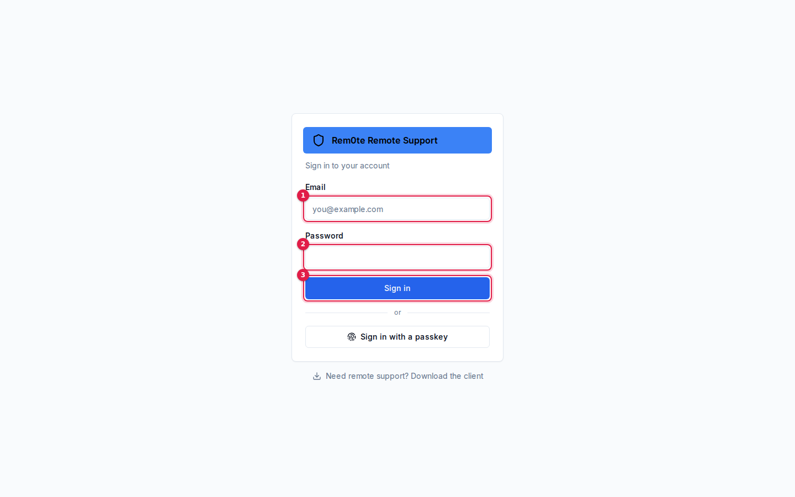
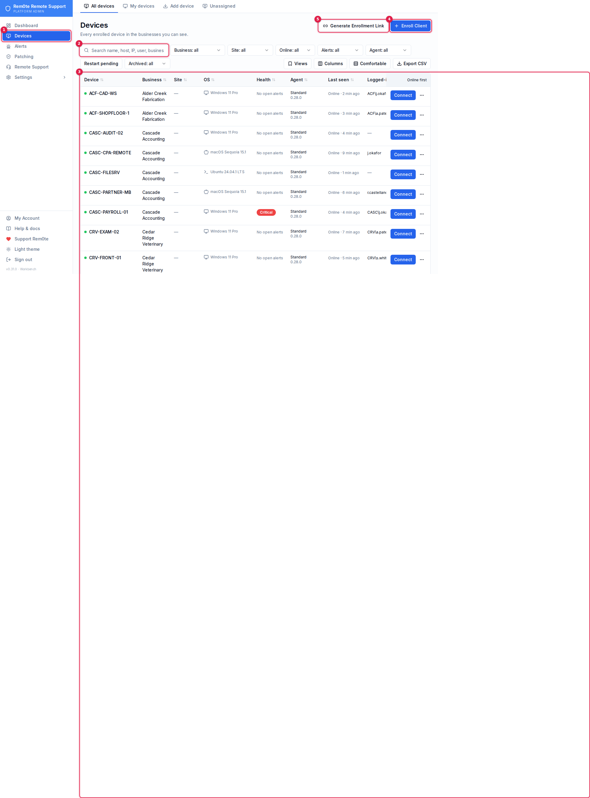
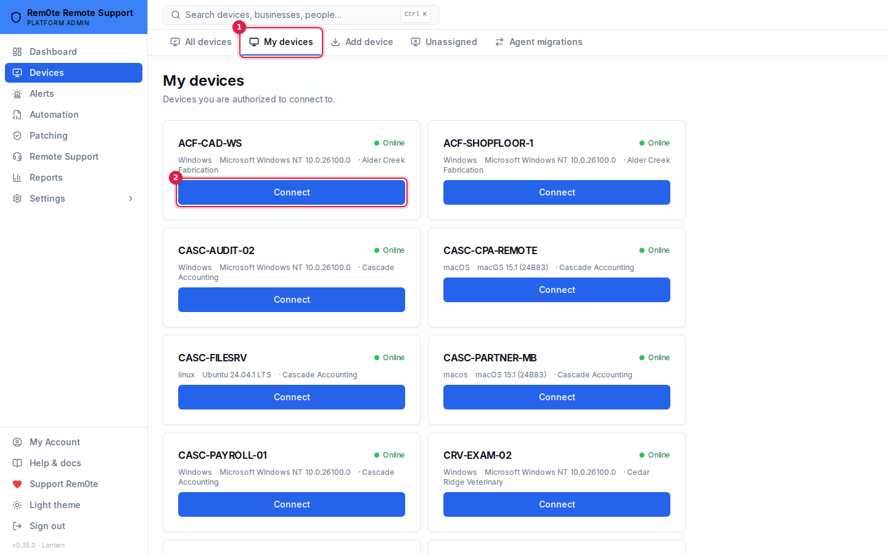
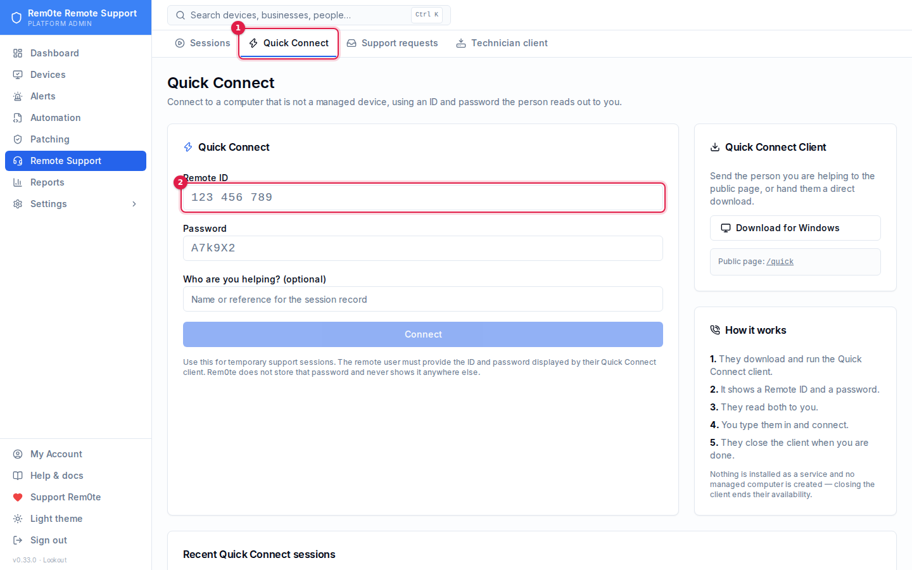
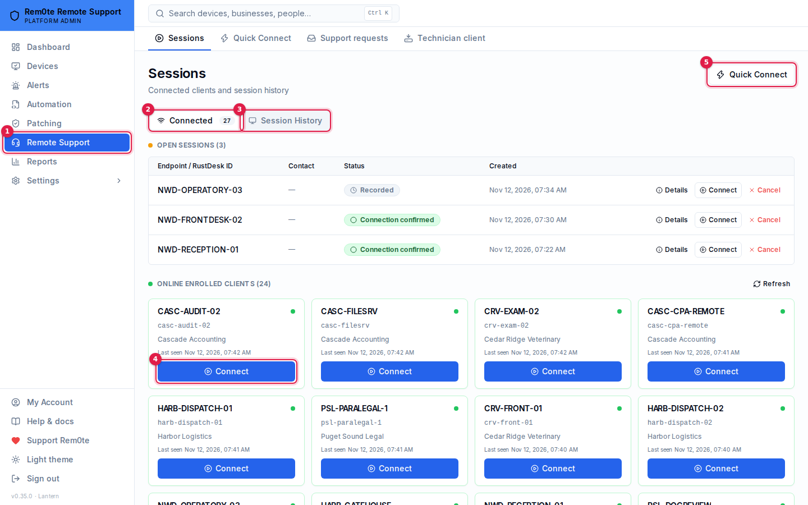
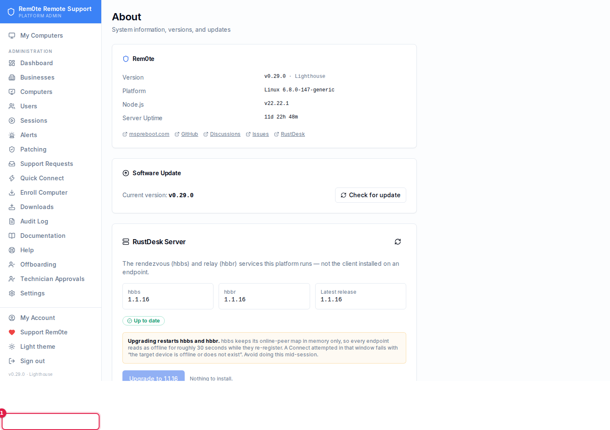

# Technician Guide

Day-to-day use of Rem0te: finding a computer, connecting to it, helping someone
who is not enrolled, and keeping the remote-control client current.

Screenshots are captured from a seeded demo instance. Every business, person and
computer in them is fictional.

> **Terminology.** A **Business** is a customer organisation and is the security
> boundary — a Business User only ever sees computers belonging to their
> business. A **Computer** (also called an endpoint or enrolled client) is a
> machine with the Rem0te agent permanently installed. See
> [access-control.md](access-control.md) for who can do what.

---

## 1. Sign in

1. Your email address.
2. Your password.
3. Sign in.

If your account has two-factor authentication enabled you are asked for a code
next. Recovery codes work here too, and each one is single-use.

### The dashboard: what to work on (0.31)

Signing in lands you on the **Dashboard**. It answers, from stored data, what is
broken, which businesses it affects, which devices need attention, what is
already being worked on, and what to do next. It covers only what you can see:
a Business User sees the devices granted to them, a technician sees their
assignment's business and computers, a Platform Admin sees every business. A
section you have no permission for is not shown at all — it is never shown as a
zero.

| Part | What it is built from |
|---|---|
| **Site outage** strip | An open site-outage alert: several devices at one site stopped reporting together |
| **Devices** | Active devices (archived and not-yet-enrolled ones excluded): online, offline, and *agent silent* — reachable through RustDesk but the agent has not checked in for 30 minutes, so nothing it reports is current |
| **Critical alerts** | Open critical alerts. Alerts in a maintenance window are counted apart, not as critical |
| **Failed actions** | Approved-action and patch targets that failed, were refused or did not run in the last 7 days, plus any whose outcome is unknown (those block new requests until someone records what they found) |
| **Awaiting approval** | Plans waiting for the approval roster. Approval happens on the signer, never here; expired requests are not counted |
| **Restart pending** | Devices whose latest update scan says Windows is waiting for a restart, or that have a *restart pending* alert. A scan older than 36 hours is flagged stale |
| **Patch compliance** | Of the devices with an update scan under 36 hours old, the share that list no pending updates. Coverage (how many devices have such a scan) and the scan ages are shown beside it; with no fresh scan at all it says *No data* |
| **Active sessions** | Sessions connected now, and ones still launching. A session row that has not moved for 12 hours is not shown as live |
| **Work on next** | A ranked list, each item with the reason it is there (below) |
| **Customers affected** | Businesses with an outage, an open alert, an offline device or a failed action |
| **Devices needing attention** | Devices with critical or warning alerts, failed actions, offline, agent silent or restart pending, most serious first |
| **Being worked on** | Live sessions, acknowledged alerts (and who acknowledged them), actions in flight, patch deployments in progress |
| **Your recent devices** | The devices of your own most recent sessions |
| **Recent activity** | Alert, action, patch, session, device and support-request events from the audit log, last 7 days. Needs *View business audit log* |

**How "Work on next" is ordered.** A fixed ladder, then oldest first: site
outages, critical alerts, actions with an unknown outcome, failed actions,
warning alerts, failed client rollouts (Platform Admins), approval requests,
restarts pending from a fresh scan, then info alerts. Acknowledged alerts are
not in it (someone has them), nor are alerts in a maintenance window or offline
alerts grouped under a site outage. Nothing is ranked by anything the dashboard
cannot see, such as a customer's contract.

Every item and figure links to where you act on it — the device's Monitoring,
Patches or Actions tab, the patch deployment, the alerts list. The page polls
every 30 seconds and says how old its data is. Server health (CPU, memory, disk,
relay) is not on the dashboard: Platform Admins find it under **Settings →
System status**. The device map is at the bottom; *Hide device
locations* folds it away, and this browser remembers the choice.

---

## 2. Find a computer

**Devices** lists every machine you can see: in the businesses you can reach,
and — for a Business User — only the machines assigned to you or shared
company-wide; for a technician, only the machines your assignment names.

1. **Devices** — the menu entry; its tabs hold *My devices*, *Add device* and the others.
2. **Search** — matches name, hostname, IP address, OS, alias, RustDesk ID, business,
   site and the signed-in user. The server does the matching, so it searches every page,
   not just the one on screen.
3. **The table** — one row per device. Online devices come first, then by name;
   click any column heading to sort by it instead (click again to reverse).
4. **Add device** — enrol a new machine (§5). Until 0.32 there were two buttons
   here, *Enroll Client* and *Generate Enrollment Link*; both became this one.
5. *(Removed in 0.32 — see 4.)*

*(The screenshot predates 0.31's columns and 0.32's single Add device button; the
numbered parts are where they were.)*

### What the columns mean

| Column | What it shows |
|---|---|
| **Device** | Name, hostname, and a dot: green online, grey offline. |
| **Business / Site** | Who the machine belongs to and where. |
| **OS** | An icon and the reported Windows edition or platform. |
| **Health** | The worst *open* monitoring alert — Critical, Warning, Info — or *No open alerts*. That is not a promise nothing is wrong, only that no monitor says so. |
| **Agent** | *Signed* (the 0.27+ signed agent), *Standard*, or *No agent report*, with when it last checked in. |
| **Last seen** | *Online now*, or how long ago it was last heard from. |
| **Logged-in user** | Who the last heartbeat said was signed in. |
| **CPU / RAM / disk** | The last resource sample and its age. |
| **Pending patches** | From the last update scan: how many are waiting, and a *restart* tag if Windows wants one. |
| **Alerts** | How many monitoring alerts are open (or acknowledged). Click it for the device's Monitoring tab. |

**Every number says how old it is, and an old one is greyed.** A resource sample
is stale after 15 minutes (five missed heartbeats); an update scan after 36 hours.
A greyed value is what the machine last said, not what it is doing now.

Health and Alerts need the **monitoring:alerts** permission. Without it those
columns are not offered and you cannot filter or sort by them — the list says so
at the bottom.

### Filters, columns and saved views

- **Filters** — business (when you can see more than one), site, device group,
  online/offline, open or critical alerts, *Restart pending*, agent type, and
  archived devices.
  They combine, and *Clear* resets them. The address bar carries the current view,
  so you can bookmark it; whoever opens the link still sees only their own devices.
- **Columns** — choose which columns show (a *Group* column is available).
  **Compact / Comfortable** sets the row height. Both are remembered in this
  browser.
- **Views** (0.33) — save the current filters, sort, columns and density under a
  name. A view is stored on your account, so it follows you to another computer.
  It holds only the list's own parameters, never the devices. It is either
  **personal** (only you see it) or **shared** with everyone in one business who
  can see devices. Sharing — and changing or deleting a shared view — is for a
  Business Owner, a technician with *computers:edit* over the whole business, or
  the MSP, and is recorded in the audit log. A shared view's filters cannot name
  another business, or another business's site or group. **Opening a view shows
  only the devices you can see**: a Business User opening the owner's
  "everything" view gets their own devices, and a view filtering on alerts is
  refused to someone without *monitoring:alerts*. Views saved in a browser by
  0.31 or 0.32 are offered for import once (*Import N views saved in this
  browser*).
- **Device groups** (0.33, *Views → Device groups…*) — named, static groups of
  one business's computers, for filtering and for acting on together. A computer
  is in at most one group at a time (the same group an enrolment link can put it
  in). Creating, renaming and deleting groups, and adding or removing members, is
  for a Business Owner, a technician with *computers:edit* over the whole
  business, or the MSP — never a Business User, whatever they hold, because a
  Business User may see only some of the business's computers. A group cannot
  hold another business's computer. Groups grant no access to anything. Every
  change is audited. Groups made before 0.33 that span businesses (or have no
  members) belong to no business: they still filter, and cannot be edited here.
- **Select and act on many** (0.33) — tick rows (the header box ticks the page;
  the selection survives paging and filtering) and a bar offers: **Add / Remove**
  from a group, **Refresh inventory** (also re-checks Windows Update),
  **Queue client update** (Platform Admin only, as on the Updates page) and
  **Export selection**. At most 200 devices per request. The server checks every
  device on its own, with the same checks as doing it to that one device, and
  the result lists every device it refused and why — not visible to you, no
  permission, archived, Linux, no device secret, under an *updates* containment
  pause, already in another group, already current. A bulk refresh counts toward
  your limit on distinct computers per window (the fleet-abuse guard); the list
  stops at that limit and says so, rather than tripping it and pausing you.
  There is deliberately no bulk connect, archive, delete or approved action.
  Each bulk request is recorded in the audit log, once per business it touched,
  alongside each device's own entry.
- **Export CSV** — downloads every device in the current filtered view (not just
  this page), up to 10,000; narrow the filters if there are more. It needs
  *computers:view*, contains exactly what you can see, and **each export is
  recorded in the audit log** with its filters and row count. *Export selection*
  is the same export limited to the ticked devices.
- **Connect** on a row works exactly as it does on the device page. **⋯** opens the
  device, or its Patches, Monitoring or Test connection tab, or copies its hostname.

There is no RustDesk ID column any more. The ID is still on the device's page,
and search still finds a device by it.

**Online means the agent checked in within the last 30 minutes.** The agent
heartbeats every 3 minutes, so a machine that has genuinely dropped shows Offline
a few minutes later, not instantly.

### Search everything — Ctrl+K (0.33)

The **Search** box at the top of every page, or **Ctrl+K** (**⌘K** on a Mac)
from anywhere, searches devices, businesses, sites, people and open alerts in
one go. Type at least two characters (at most 100); results appear when you
pause. **↑ / ↓** move through them, **Enter** opens the highlighted one, **Esc**
closes the box. Ctrl/⌘-click opens a result in a new tab.

| Group | Matches on | Opens | Needs |
|---|---|---|---|
| **Devices** | Name, hostname, RustDesk ID, serial number, signed-in user, IP address, a network adapter's IPv4, alias | The device's page | *View computers* |
| **Businesses** | Name, code, email, city | The business's page | Nothing beyond being in it (as the Businesses list) |
| **Sites** | Name, city, address | The device list filtered to that site | *View computers* |
| **People** | First name, last name, email — "jane doe" finds Jane Doe | The Users list, filtered to that person | *View business users* |
| **Open alerts** | Title (open and acknowledged only) | The device's Monitoring tab, or the alerts list | *See and work alerts* |

**What a device result shows.** Its name, online or offline, business and site,
and — unless the name itself matched — *which* field matched and its value
(*Serial: 5CG1234XYZ*, *RustDesk ID: 123456789*, *Adapter IP: 10.0.4.17*). Only
the field that matched is returned; the others are not sent. Every one of them
is already on the device's own page for anyone who can open it, which is the
only kind of device search can find.

**Order and limits.** An exact match comes first, then one that starts with
what you typed, then one that contains it; among equals, online devices first,
then by name. Each group shows at most **8**. When there are more, the group
says *first 8*; for devices there is a link to the device list's own search,
which pages through everything (it matches a slightly different set of fields:
OS, business and site names, but not serial numbers or adapter addresses).
Archived devices and inactive sites are not found, as on their lists.

**You only find what you could already open.** Each group is built from the
same rule as its own list page — not a copy of it: devices from the device
list's scope (a Business User sees only devices assigned to them or shared
company-wide, a technician only their assignment's), businesses, sites and
people from their list routes, alerts from the alerts list. A group you have
no permission for is **left out**, never shown as empty. Another business's
device, site or person is not found by anything you type — not even its exact
hostname or RustDesk ID. Search grants nothing: opening a result applies that
page's own check again.

**Privacy and limits.** Searches are not written to the audit log (a keystroke
is not an event), and the API does not log the query text — an error is
logged with the path only. A reverse proxy in front of Rem0te keeps its own
access log, which records the address of each request, search included.
Results are sent with `Cache-Control: no-store`. Searching is limited to **120
requests a minute per client address**; past that the box says *Too many
searches* until the minute is up. Typing pauses of 200 ms trigger a request,
so ordinary typing stays well inside it.

**How fast.** Measured end to end through the API on a shared scratch
Postgres 16 (Platform Admin, every device in scope): 50–70 ms over 2,000
devices and 300–450 ms over 20,000 — in line with the device list's own
search (56 ms and 320 ms on the same data), which scans the same way. A
two-letter query that matches nearly every device (*pc*) is the slow case:
about 0.3 s at 2,000 and 1 s at 20,000, because every match has to be ranked.
There is no search index; the measured trade-off is in the 0.33 changelog.

### The device workspace (0.31)

Opening a computer gives you one page for it.

**The header** says who it is and whether it is reachable: name, status
(*Online*, *Offline since …*, or *Online (RustDesk only)* when RustDesk can reach
it but its agent has stopped checking in), business, site and **last seen**,
marked *stale* when the agent has missed its check-ins. Under it, the
**attention strip** lists what needs looking at, each one a link to the tab that
explains it: open alerts with the worst severity (→ Monitoring), *Restart
pending* and pending updates with the age of the scan (→ Patches), a refused
heartbeat or an out-of-date agent (→ Overview), and which agent the computer runs
— *Standard agent*, *Signed agent* or *RustDesk only* (see
[What each agent can do](capabilities.md)).

**The actions:** **Connect**, **Diagnose** (opens Diagnostics), **Run action**
(opens Actions; disabled, with the reason printed underneath, when the computer
lacks the signed agent or no approval signer is configured), **Patch** (opens
Patches) and **More**: view-only connect (technicians), the diagnostics report,
*Reinstall agent* and *Archive computer*, each behind a confirmation that says
what it does.

**The tabs**, each linkable with `?tab=`:

| Tab | What is on it |
|---|---|
| Overview | Assignment, key alerts, patch status, the **Agent** card, recent activity, then the hardware, utilisation, storage, network and update cards, each with its age |
| Monitoring | Alerts first (acknowledge and resolve here), then what is watched on this computer in words, the agent's last report, and what changed |
| Software | Installed software with a filter, and recent software changes (Windows agents only) |
| Processes | Every running process, as a read-only snapshot with its age and a Refresh (standard Windows agent, 0.33) |
| Services | Every service with state, start mode and run-as account; snapshot with age and Refresh (0.33) |
| Network | Every network connection: addresses, gateway, DNS, DHCP, MAC; snapshot with age and Refresh (0.33) |
| Patches | Patch status, updates offered, Windows Update history |
| Event logs | A page of one Windows event log, on request (Windows agents only) |
| Diagnostics | Test connection: server, computer and your own RustDesk |
| Actions | Request an approved action and see past requests |
| History | Remote sessions, technician notes, the AI-written summary (labelled as such) and who can connect |

**The Agent card** (Overview, 0.34) says which agent the computer runs (*Standard*,
*Signed*, or the read-only Linux/macOS agent), its version and whether that is the
current one, the update channel and the portal's update mode, and — for a signed
agent — the result of its last update check. Its buttons:

- **Update agent** (standard Windows agent): re-runs the current installer at the
  next check-in. It is the same as *Reinstall agent*: the same permission, refused
  while updates are paused for the business, and audited.
- **Check for update now** (signed agent): the agent runs its own signed update
  at the next check-in. It installs only what the signed repository lists.
- On Linux and macOS the card prints the exact command to re-run on the computer;
  those agents act on nothing the portal sends.
- **Upgrade to signed agent** (standard Windows agent): asks for a reason and a
  fresh sign-in, then moves this computer to the signed agent at its next
  check-in, keeping its enrolment and RustDesk ID. When it can't be offered, the
  card says exactly why — no signed release published, no device secret, the
  portal in *Signed only* mode, updates paused, a rollout running. A request can
  be cancelled until it completes. **Devices → Agent migrations** lists pending,
  held, not confirmed and completed requests. To move several computers, select
  them on **All devices** and use **Upgrade to signed…** (at most 200; each one is
  refused with its own reason). See
  [Update signing → Moving existing agents](update-signing.md#moving-existing-agents).

Processes, Services and Network are snapshots, not live views: each says when it
was taken, and **Refresh** asks the computer for a new one on its next check-in.
They have no buttons that change the computer — restarting a service is a signed
maintenance action on Actions, and ending a process is not offered
([diagnostics.md](diagnostics.md#the-processes-services-and-network-tabs)). Old links
(`?tab=notes`, `?tab=timeline`, `?tab=access-review`) open History.

---

## 3. Connect to a computer

Use **Connect** on a computer's card in **Devices → My devices**, on its row in **All devices**, or at the top of
its page.

1. **My devices** — the computers this account may connect to.
2. **Connect** — hands the machine's ID and password to your local RustDesk
   client and starts the session.

You do not need to type a password. Rem0te holds the credential for each machine
and passes it to RustDesk for you; if you are prompted for one, something is
wrong — see Troubleshooting below.

Requirements on your own workstation:

- RustDesk must be installed.
- Your RustDesk must be configured for **this** server. If it is pointed at the
  public RustDesk network it will look up the ID there and either fail to find it
  or reach a completely unrelated machine.

Every connection is written to the audit log with who connected, to what, and
when.

---

## 4. Help someone who is not enrolled

Use **Remote Support → Quick Connect** for one-off help where nothing should be installed
permanently — a machine you do not manage, or a person you are helping once.

1. **Remote ID** — the 9-digit number their Quick Connect client shows.
2. **Password** — the short code shown next to it.
3. **Who are you helping** — optional label for the session record.

Send them to the public download page (shown on the right of that screen), they
run the client, and they read you the two values. Nothing is installed as a
service and no managed computer is created — closing the client ends their
availability.

Rem0te does not store the Quick Connect password and never displays it again.

---

## 5. Enrol a new computer

**Devices → Add device** (the button on the Devices page, or the *Add device* tab)
walks through it in six steps on one page:

1. **Business and site.** Pick the business, then a site or *No site*, and who
   may connect — specific people, or everyone in the business. All three are
   fixed into the link when it is made: the machine that runs it cannot pick a
   different business or site. You can only pick a business you manage; the
   server refuses any other, and a site that is not that business's.
2. **Operating system.** Windows gets RustDesk and the Rem0te agent (heartbeat,
   inventory, monitoring, update scans). Linux (0.32) and macOS (0.33, run with
   `sudo`) get RustDesk and the read-only agent: heartbeat, inventory and
   pending updates, and nothing the console sends is acted on
   ([inventory.md](inventory.md)).
3. **Run the installer.** A one-line command (PowerShell as Administrator, or a
   root shell), and on Windows also a one-click installer link to send to the
   person at the machine. It contains a single-use enrolment token that expires
   in 24 hours, and it is shown **once**: reload the page and only the waiting
   continues. If the command is lost, revoke the link and make a new one.
   Making it asks you to confirm it is you (password, authenticator code or
   passkey) unless you did in the last 10 minutes (0.33): a link adds a computer
   to the business, so a session left open must not be enough. Your choices are
   kept while you confirm, and if you cancel nothing is made — press the button
   again.
4. **Wait for the device.** The page checks every few seconds and says *enrolled*
   only when a device has used this link. You can revoke an unused link here.
5. **First health** — what the server has actually received: the business and
   site it landed in, online, the agent and its version (after its first
   heartbeat, up to 3 minutes), whether its device identity is bound, and
   whether its first inventory has arrived. Each line says *waiting* until it is
   true; nothing is assumed.
6. **Next** — open the device, its Monitoring tab, or the business's monitoring
   policies, with the monitors that already apply to it listed.

A Business User who adds a machine for *specific people* that does not include
themselves is told it enrolled, but not shown it: they could not see it in the
list either.

The installer is safe to re-run; it reconfigures an existing install rather than
duplicating it. To re-enrol a machine whose identity is not bound, use *Make an
enrollment link for this computer* on its page: it opens Add device bound to
that computer.

**It will refuse to report success if the machine never reaches the server.** If
you see an error instead of a summary, read it — it prints the service state,
whether ports 443 and 21116 are reachable, and RustDesk's own log. Those are the
facts that distinguish a firewall problem from a service that is not running.

**Already running RustDesk, and only want it listed?** *Register it by RustDesk
ID* (linked at the bottom of Add device) adds it without installing anything. It
then has no agent: no heartbeat, inventory or monitoring.

---

## 6. Review sessions

1. **Remote Support** — Sessions is its first tab.
2. **Connected** — open sessions, then the enrolled clients currently online.
3. **Session History** — past sessions with duration and disposition.
4. **Connect** — start a session with that machine.
5. **Quick Connect** — for a machine that is not enrolled; a session can no longer be recorded by hand.

Each session's status says what is actually known about it. *Client opened*
means RustDesk started on your computer, not that you connected. *Connection
confirmed* comes from the remote computer's agent, or from you. A launch that
gets no further signal reads **Status unknown** after 30 minutes rather than
pretending it failed or succeeded, and duration is shown only when it was
measured. See [connecting.md](connecting.md#what-the-session-status-means-v020).

---

## 7. Keep RustDesk current

**Updates** covers two separate things: Rem0te itself, and the RustDesk client
installed on each managed computer.

1. **Settings → Updates** — Rem0te's own version, then the RustDesk server and clients.
2. **Update all outdated** — queues every machine that is behind.
3. **Check** — re-reads the latest RustDesk release.

Per-machine status reads:

| Status | Meaning |
| --- | --- |
| **Current** | On the latest release. |
| **Outdated** | Behind; an update can be queued. |
| **Unknown** | The machine has not reported a version yet. Endpoints enrolled before v0.8.2 only start reporting after their next installer run. |
| **Queued** | An update is staged and applies on the next check-in. |

Queued updates apply on the machine's next heartbeat, within about 3 minutes. An
offline machine applies it whenever it next checks in — nothing is lost. A queued
update clears only once the machine reports the target version, so a failed
install retries instead of silently disappearing.

---

## 8. Support requests

Customers can ask for help through their business's support link, without an
account. Requests appear under **Remote Support → Support requests** if you hold
`support:requests`.

1. **Claim** a request to take it. If someone beat you to it, you are told who.
2. Check **Matched computers**: computers in the business that match what the
   customer wrote, limited to ones you can connect to.
3. **Connect** through the computer's Connect button or Quick Connect.
4. **Complete** it, or **Hand off** to a colleague, or **Release** it back.

The customer's status page shows your first name and the status, nothing else.
See [support-requests.md](support-requests.md).

## 9. Working for several businesses

If you have technician assignments, the sidebar shows a **business switcher**.
Pick the business you are working in; everything you see is then that
business, limited to what your assignment allows. **All assigned** gives an
overview across all of them, and lists access that is not active right now and
why (expired, outside its hours, awaiting approval). Ask for access to another
business from there. See [technicians.md](technicians.md).

---

## Troubleshooting

**Start with Test connection.** Every computer's page has it, on the
**Diagnostics** tab (the **Diagnose** button opens it). It checks the
server, the computer and, with *Check my computer*, your own RustDesk, and says
which one is wrong. See [connecting.md](connecting.md#test-connection-v020).

**A computer shows Offline but the person says it is on.**
Online is driven by the agent's 3-minute heartbeat, not by RustDesk. A machine
can be running fine while the heartbeat task is broken. Re-running the installer
reinstalls the task and will now tell you if the machine cannot reach the server.

**Connect says "wrong password".**
The credential Rem0te holds and the one the machine has are out of step, or your
own RustDesk resolved the ID on the public network and reached a different
machine. Check that your workstation's RustDesk points at this server first —
that is the more common cause and the more serious one.

**Connect says "ID does not exist".**
The machine is not registered with this server's rendezvous service. It is either
genuinely offline, or its RustDesk cannot reach the server even though the agent
can. Re-run the installer on it; the verification step now reports exactly which.

**A machine was reported "installed successfully" but never appears.**
That was possible before v0.8.2 and is not any more — the installer now refuses
to claim success unless the server confirms it has seen the machine.
