# Technician Guide

Day-to-day use of Rem0te: finding a device, connecting to it, helping someone
who is not enrolled, and keeping the remote-control client current.

Screenshots are captured from a seeded demo instance. Every customer, person and
device in them is fictional.

> **Terminology.** A **Customer** is a customer organisation and is the security
> boundary — a Business User only ever sees devices belonging to their
> customer. A **Device** (also called a device or enrolled client) is a
> machine with the Rem0te agent permanently installed. See
> [access-control.md](access-control.md) for who can do what.

---

## 1. Sign in

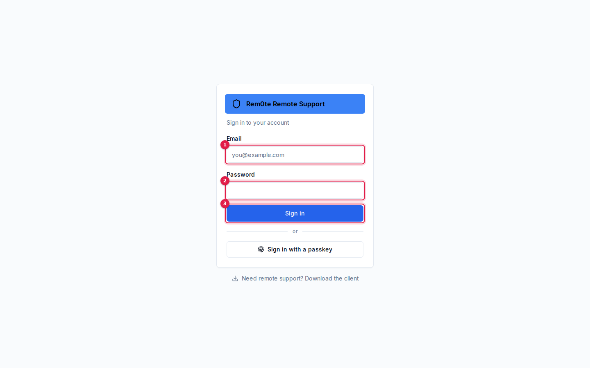

1. Your email address.
2. Your password.
3. Sign in.

If your account has two-factor authentication enabled you are asked for a code
next. Recovery codes work here too, and each one is single-use.

### On a phone or a narrow window (0.34)

Below 768 px wide (a phone, or a tablet held upright) the menu is not drawn
beside the page. The **☰ menu button** at the left of the top bar opens it as a
panel over the page; it holds everything the sidebar holds. The customer
switcher, Help and your profile menu (theme, *Sign out*) stay in the top bar.
Choosing a page closes it, and so
do **Esc**, tapping outside it and the **✕** in its corner. While it is open,
the keyboard stays inside it and a screen reader treats it as a dialog named
*Main menu*.

Wide tables — the device list, reports, API keys — scroll sideways inside their
own box rather than widening the page; swipe the table, not the page. The
device workspace's tab groups and tabs scroll the same way.

### Finding your way (0.87)

The menu is nine groups: **Dashboard, Devices, Remote support, Monitoring,
Patching, Automation, Reports, Security** and **Administration**. The group
holding the page you are on opens by itself; pin one to keep it open.

- **Standard** mode (the default) lists the everyday pages. Every other page
  is a tab on one of them and is in Ctrl+K. **Advanced**, in the profile menu
  at the top right, lists them all.
- **Workspace** (0.90), also in the profile menu, puts a role's pages in
  front. *All pages* is the default. *L1 support* lists the dashboard,
  devices, alerts, remote support (sessions, Quick Connect, support
  requests, the technician client) and Tasks. *L2 support* adds patching,
  the software catalog, the script library and the patch and software
  compliance reports. *L3* adds schedules, client updates and rollouts,
  monitoring policies and alert rules, backups, agent deployment and
  migration, mobile devices, managed sessions and the Security group.
  Administration is in *All pages* only. A group with none of the
  workspace's pages leaves the menu; the page you are on is always listed;
  a line at the menu's foot names the workspace, with *Show every page*.
  On a device's page a workspace orders the tab groups (L1 puts Health,
  Tools and Remote first) and removes none. **A workspace is a menu, not a
  permission**: it never grants or removes anything, every page is still in
  Ctrl+K and opens from a link, and every page checks what you may do
  exactly as before. Escalation and PSA tickets have no page of their own:
  alerts escalate through a monitoring policy's notification steps, and
  tickets show on the alert and the device when a PSA is set up.
- **The toggle** at the top left collapses the menu to icons. Hover or focus
  one for its name; click it for its pages. It stays as you left it, on any
  browser you sign in on.
- **The top bar** holds the breadcrumbs, the customer you are working in,
  search, quick actions, your **favourites and recent items** (the star),
  critical alerts, chat, tasks, Help and the profile menu (theme Light, Dark or
  System; density; mode; workspace; *Sign out*).
- **Favourites.** The star on a device or customer page adds it; the star menu
  adds the page you are on. At most 50. Something you can no longer see drops
  out of the list by itself.

No address changed: an old bookmark still opens its page.
[Where things moved](NAVIGATION_MIGRATION.md) lists every old menu entry.

### The dashboard: what to work on (0.31)

Signing in lands you on the **Dashboard**. It answers, from stored data, what is
broken, which customers it affects, which devices need attention, what is
already being worked on, and what to do next. It covers only what you can see:
a Business User sees the devices granted to them, a technician sees their
assignment's customer and devices, a Platform Admin sees every customer. A
section you have no permission for is not shown at all — it is never shown as a
zero.

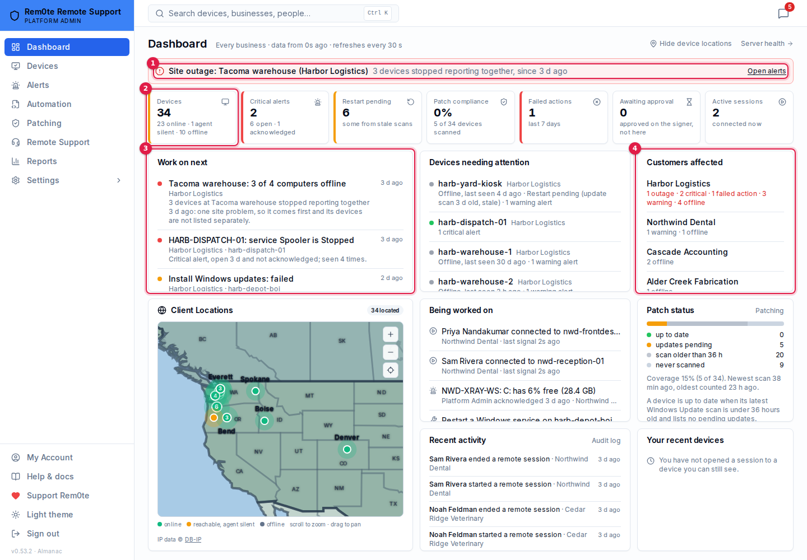

1. **Site outage** — several devices at one site stopped reporting together; *Open alerts* goes to them.
2. **The tiles** — each is a count with what it is counted from underneath; each one links to where you act on it.
   *Devices* splits the fleet three ways: online, agent silent and offline (here 23 · 1 · 10).
3. **Work on next** — the ranked list, every item with the reason it is there.
4. **Customers affected** — the customers with an outage, an alert, an offline device or a failed action.

| Part | What it is built from |
|---|---|
| **Site outage** strip | An open site-outage alert: several devices at one site stopped reporting together |
| **Devices** | Active devices (archived and not-yet-enrolled ones excluded): online, offline, and *agent silent* — reachable through RustDesk but the agent has not checked in for 30 minutes, so nothing it reports is current |
| **Critical alerts** | Open critical alerts. Alerts in a maintenance window are counted apart, not as critical |
| **Failed actions** | Approved-action and patch targets that failed, were refused or did not run in the last 7 days, plus any whose outcome is unknown (those block new requests until someone records what they found) |
| **Awaiting approval** | Plans waiting for the approval roster. Approval happens on the signer, never here; expired requests are not counted |
| **Restart pending** | Devices whose latest update scan says the system (Windows, or a Linux package manager) is waiting for a restart, or that have a *restart pending* alert. A scan older than 36 hours is flagged stale |
| **Patch compliance** | Of the devices with an update scan under 36 hours old, the share that list no pending updates; with no fresh scan at all it says *No data*. The **Patch status** card breaks it down (up to date, updates pending, stale scan, never scanned) with coverage and scan ages |
| **Active sessions** | Sessions connected now, and ones still launching. A session row that has not moved for 12 hours is not shown as live |
| **Work on next** | A ranked list, each item with the reason it is there (below) |
| **Customers affected** | Customers with an outage, an open alert, an offline device or a failed action |
| **Devices needing attention** | Devices with critical or warning alerts, failed actions, offline, agent silent or restart pending, most serious first |
| **Being worked on** | Live sessions, acknowledged alerts (and who acknowledged them), actions in flight, patch deployments in progress |
| **Recent alerts** (0.55) | The newest open and acknowledged alerts: severity, device, customer, how long, and the automatic PSA ticket's reference. Each links to the alert. Needs *View alerts*, and lists only devices you can see. With no monitor configured it says so and links to **Monitoring → Monitoring policies** (*Add recommended*) |
| **Your recent devices** | The devices of your own most recent sessions |
| **Recent activity** | Alert, action, patch, session, device and support-request events from the audit log, last 7 days. Needs *View customer audit log* |

**How "Work on next" is ordered.** A fixed ladder, then oldest first: site
outages, critical alerts, actions with an unknown outcome, failed actions,
warning alerts, failed client rollouts (Platform Admins), approval requests,
restarts pending from a fresh scan, then info alerts. Acknowledged alerts are
not in it (someone has them), nor are alerts in a maintenance window or offline
alerts grouped under a site outage. Nothing is ranked by anything the dashboard
cannot see, such as a customer's contract.

Every item and figure links to where you act on it — the device's Monitoring,
Patches or Actions tab, the patch deployment, the alerts list. The page polls
every 30 seconds and says how old its data is. Server health (CPU, memory, disk,
relay) is not on the dashboard: Platform Admins find it under **Settings →
System status** (*Server health* at the top right). From 0.35 the dashboard
fits the window on a desktop screen (1366 × 768 and up): the figures across
the top, then *Work on next*, *Devices needing attention* and *Customers
affected*, then the map with *Being worked on*, *Patch status*, *Recent
alerts*, *Recent activity* and *Your recent devices* beside it. A long list scrolls inside its
own card instead of lengthening the page — also while a red containment strip
is showing at the top (0.36: the dashboard takes the strip's height off its
own). On a phone the cards stack in that order. *Hide device locations* (top
right) folds the map away — *Work on next* then takes its column — and this
browser remembers the choice.

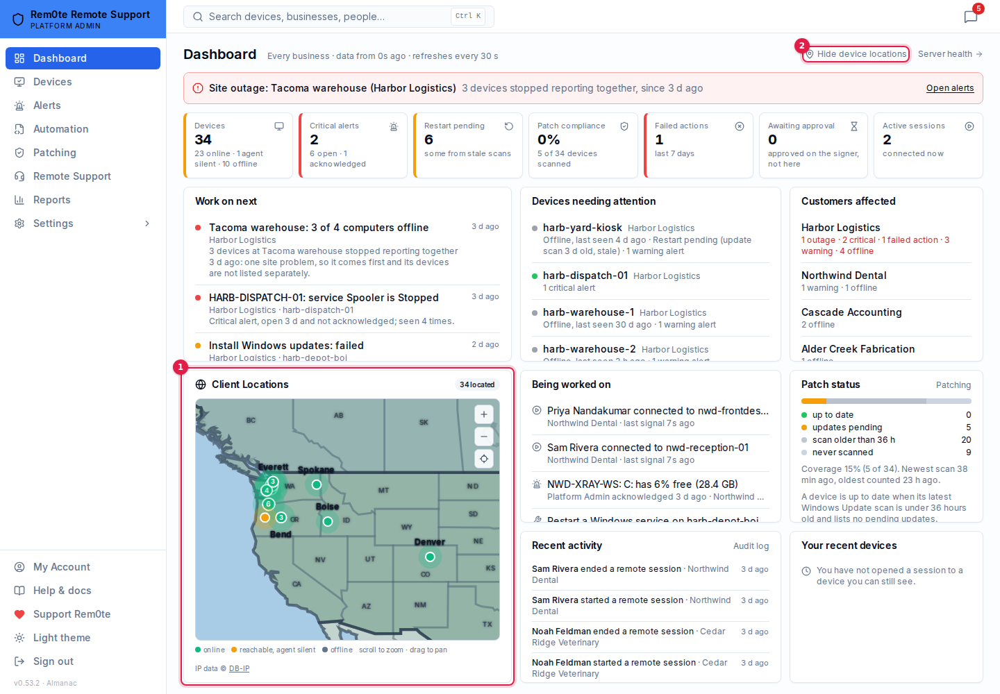

1. **Client locations** — devices placed from the address they last checked in from, clustered by city with a count.
   Green while an agent there is checking in, amber when the only devices there are reachable through RustDesk
   with their agent silent (the marker south of Portland), grey when they are all offline. The map is drawn from a
   bundled outline; no tile server is asked where your customers are.
2. **Hide device locations** — folds the map away; this browser remembers the choice.

---

## 2. Find a device

**Devices** lists every machine you can see: in the customers you can reach,
and — for a Business User — only the machines assigned to you or shared
company-wide; for a technician, only the machines your assignment names.

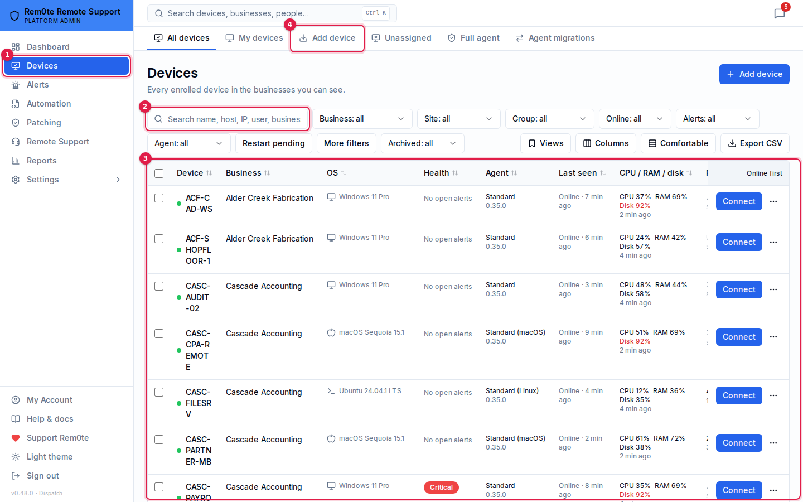

1. **Devices** — the menu group: *All devices*, *My devices*, *Customers*, *Add device* (for anyone with *Add
   devices*) and the others.
2. **Search** — matches name, hostname, IP address, OS, alias, RustDesk ID, customer,
   site and the signed-in user. The server does the matching, so it searches every page,
   not just the one on screen.
3. **The table** — one row per device. Online devices come first, then by name;
   click any column heading to sort by it instead (click again to reverse).
4. **Add device** — enrol a new machine (§5). Until 0.32 there were two buttons
   here, *Enroll Client* and *Generate Enrollment Link*; both became this one.

### What the columns mean

| Column | What it shows |
|---|---|
| **Device** | Name, hostname, and a dot: green online (the agent is checking in), amber reachable through RustDesk with the agent silent, grey offline. A star marks one of your favourites (0.89). **When another device you can see has the same name**, the cell also says its customer and site, at every width (0.89): two "RECEPTION-PC"s in two customers are told apart on the row itself, and each still opens by its own record. On a phone every row says its customer and site there, because the Customer column is hidden. |
| **Customer / Site** | Who the machine belongs to and where. |
| **OS** | An icon and the reported Windows edition or platform. |
| **Health** | The worst *open* monitoring alert, in words (0.68): **Issues** (a critical alert), **Warning** (a warning), **Healthy** (none, or informational ones only, and the agent is reporting) or **Unknown** (no warning or critical alert, but the agent is silent or the device offline: a silent agent raises nothing). Healthy is not a promise nothing is wrong, only that no monitor says so. Click the label to open that device's **Monitoring** tab (0.70). **Clear**, beside Warning or Issues, resolves every open alert on that device after you confirm. It does not change any monitor, so anything still wrong is raised again, as a new alert, at the device's next check; each cleared alert is recorded in the audit log. |
| **Agent** | *Signed* (the 0.27+ signed agent), *Standard*, or *No agent report*, with when it last checked in. |
| **Last seen** | *Online*, *Reachable (RustDesk) · agent silent …* in amber, or how long ago it was last heard from. |
| **Logged-in user** | Who the last heartbeat said was signed in. |
| **CPU / RAM / disk** | The last resource sample and its age. |
| **Pending patches** | From the last update scan: how many are waiting, and a *restart* tag if Windows wants one. |
| **Alerts** | How many monitoring alerts are open (or acknowledged). Click it for the device's Monitoring tab. |

**Narrower windows show fewer columns (0.47.1, 0.48.1).** So the list fits the page beside the sidebar without
scrolling sideways, each of these columns appears only when the window is wide enough for it: **Last seen** from 1440
pixels, **Agent** from 1536, **OS** from 1700, **Site** from 1860 and **Logged-in user** from 2000. At 1280 to 1439
pixels that leaves Device, Customer, Health, CPU / RAM / disk and Pending patches; a 1920-pixel screen shows
everything but Logged-in user. The dot beside each name still says online, agent silent or offline. The column
picker shows each one's width, for example *(1700 px and wider)*. A column you chose is never removed, only hidden
while the window is narrower than that. **Alerts** is off by default, because **Health** already shows the worst open alert (*Healthy* when
there is none); turn it on under **Columns**. A browser that saved its own column choice keeps it. Device names
never wrap on a desktop; long customer and site names are cut short, with the full name on hover; and **Connect** stays pinned
on the right. **On a phone (0.89)** the Customer column is hidden (the Device cell says it), and a long name wraps,
at its hyphens first, rather than sliding under the pinned Connect column.

**Every number says how old it is, and an old one is greyed.** A resource sample
is stale after 15 minutes (five missed heartbeats); an update scan after 36 hours.
A greyed value is what the machine last said, not what it is doing now.

Health and Alerts need the **monitoring:alerts** permission. Without it those
columns are not offered and you cannot filter or sort by them — the list says so
at the bottom.

### Filters, columns and saved views

- **Filters** — customer (when you can see more than one), site, device group,
  online (*Online (agent checking in)*, *Reachable, agent silent* or *Offline*), open or critical alerts, *Restart pending*, agent type, and
  archived devices. **More filters** (0.34) adds platform (Windows, Linux,
  macOS, other), **Windows role** (0.89: *Server* when the reported OS name says
  Server; *Workstation* when it names another Windows edition; a device that reports
  no edition — only "Windows NT 10.0…", which Windows 11 24H2 and Server 2025
  share, or nothing — is in neither, never guessed), OS name contains, tag (exact),
  update state (pending, none pending, scan stale, never scanned, and from 0.89
  *security or critical updates pending*, which only a signed agent's scan can
  say because only it records each update's classification), a RustDesk version range (dotted numbers,
  compared numerically — 1.10 is above 1.9; a device with no reported version
  or a non-numeric one such as a nightly never matches a range) and last seen
  (not seen for N days, which includes never; seen within N days).
  They combine, and *Clear* resets them. The address bar carries the current view,
  so you can bookmark it; whoever opens the link still sees only their own devices.
  On a phone (0.35) the filters sit behind a **Filters** button beside the
  search, showing how many are set; it opens a sheet with the same controls,
  each applying at once, and *Show N devices* closes it. From 0.89 the phone's
  toolbar is one row: search, **Filters**, **Views** and **⋯** (compact rows,
  Export CSV).
- **Columns** — choose which columns show (a *Groups* column is available; it
  lists every group the device is in, and the CSV's *Groups* column does the same,
  separated by `; `).
  **Compact rows** is a toggle (pressed means compact; until 0.89 the button
  showed the current state instead). Both are remembered in this browser.
- **Built-in views** (0.89, at the top of **Views**) — *My favourites*,
  *Recently opened*, *Critical alerts* (with *monitoring:alerts*), *Offline*,
  *Windows servers*, *Windows workstations*, *Linux*, *macOS*, *Restart
  pending*, *Security or critical updates pending*, *Agent needs an update* and
  *Warranty ending* (within 90 days). Each one only sets the list's own filters
  (the customer and site you chose stay), so it shows exactly what the same
  filters would, scoped to you, and nothing is stored; the line above the
  table says which view is open and what it shows. The menu also says which of
  the views the UI directive asks for are not offered yet, and why: failed
  automation and backup failures (the list does not read task or backup
  results yet) and aging hardware (no purchase or manufacture date is
  collected).
- **Favourites** (0.89) — *Add to favourites* in a row's **⋯** menu, or the
  star on a device's page, adds it to *My favourites*, the same favourites as
  the sidebar's (0.87; at most 50, yours alone). *Recently opened* lists the
  devices you opened last (up to 15). Both are yours only: they can be saved
  in a view, which then shows each person their own, but never used in a rule
  group. A favourite you can no longer see is simply not listed.
- **Views** (0.33) — save the current filters, sort, columns and density under a
  name. A view is stored on your account, so it follows you to another device.
  It holds only the list's own parameters, never the devices. It is either
  **personal** (only you see it) or **shared** with everyone in one customer who
  can see devices. Sharing — and changing or deleting a shared view — is for a
  Business Owner, a technician with *computers:edit* over the whole customer, or
  the MSP, and is recorded in the audit log. A shared view's filters cannot name
  another customer, or another customer's site or group. **Opening a view shows
  only the devices you can see**: a Business User opening the owner's
  "everything" view gets their own devices, and a view filtering on alerts is
  refused to someone without *monitoring:alerts*. Views saved in a browser by
  0.31 or 0.32 are offered for import once (*Import N views saved in this
  browser*). Deleting a shared view asks first, in a dialog (0.89).
- **Device groups** (0.33, *Views → Device groups…*) — named, static groups of
  one customer's devices, for filtering and for acting on together. From 0.34 a
  device can be in **several** groups of its customer: adding it to one never
  takes it out of another, removing it from one leaves the rest, and deleting a
  group only removes that membership. The group filter shows every device in that
  group, and each group's count in the menu counts a device once per group it is
  in. An enrolment link can name a group: the new device joins it when it
  installs (re-enrolling an existing device adds that group and keeps its others).
  A device moved to another customer leaves all of the old customer's groups.
  Creating, renaming and deleting groups, and adding or removing members, is
  for a Business Owner, a technician with *computers:edit* over the whole
  customer, or the MSP — never a Business User, whatever they hold, because a
  Business User may see only some of the customer's devices. A group cannot
  hold another customer's device. Groups grant no access to anything. Every
  change is audited. Groups made before 0.33 that span customers (or have no
  members) belong to no customer: they still filter, and cannot be edited here.
- **Rule groups** (0.34, *Views → Save filters as a rule group…*) — a group
  whose members are whichever of its customer's devices match a rule **right
  now**. The rule is the list's own filters: set them, then save. It can use
  site, online/offline, alerts, *Restart pending*, agent type and everything
  under *More filters*; search, customer, group and the archived filter are
  never part of a rule (the group already belongs to one customer, and the
  list's own Archived filter still applies). Nothing is copied or stored as
  members: the server works the membership out every time the group is read, so
  a device that goes offline has left an "Online" group the next time anyone
  looks, with no sweep to wait for. Everyone sees only the members they can
  already see — a Business User sees their own devices in it — and a rule on
  alerts is not offered to, and refused for, someone without
  *monitoring:alerts*. A rule group is in the group filter (marked *rule*), the
  *Groups* column and the CSV like any other group. It cannot be added to or
  removed from by hand, named by an enrolment link, or turned into a static
  group (or back). To change it, set the filters and use *Device groups… → Use
  current filters*. Who may create, edit and delete one is the same as for a
  static group, and each change is audited with the rule before and after. A
  customer can have at most 50 rule groups. If a stored rule can no longer be
  read, it matches nothing (never the whole customer) and the groups dialog says
  so.
- **Select and act on many** (0.33) — tick rows (the header box ticks the page;
  the selection survives paging and filtering) and a bar offers: **Add / Remove**
  from a group, **Refresh inventory** (also re-checks Windows Update),
  **Queue client update** (Platform Admin only, as on the Updates page) and
  **Export selection**. At most 200 devices per request. The server checks every
  device on its own, with the same checks as doing it to that one device, and
  the result lists every device it refused and why — not visible to you, no
  permission, archived, Linux, no device secret, under an *updates* containment
  pause, in another customer than the group, already current. A bulk refresh counts toward
  your limit on distinct devices per window (the fleet-abuse guard); the list
  stops at that limit and says so, rather than tripping it and pausing you.
  There is deliberately no bulk connect, archive, delete or approved action.
  Each bulk request is recorded in the audit log, once per customer it touched,
  alongside each device's own entry.
  **Filtered by a rule group** (0.34), the same bar acts on the group itself:
  the server works out its members when you click — as you see them, at most
  200 (more is refused, never cut short) — and then checks each one exactly as
  above. *Copy into* puts the devices that match now into a static group;
  later matches are not added. The audit entry records the group and how many
  it resolved to.
- **Export CSV** — downloads every device in the current filtered view (not just
  this page), up to 10,000; narrow the filters if there are more. It needs
  *computers:view*, contains exactly what you can see, and **each export is
  recorded in the audit log** with its filters and row count. *Export selection*
  is the same export limited to the ticked devices.
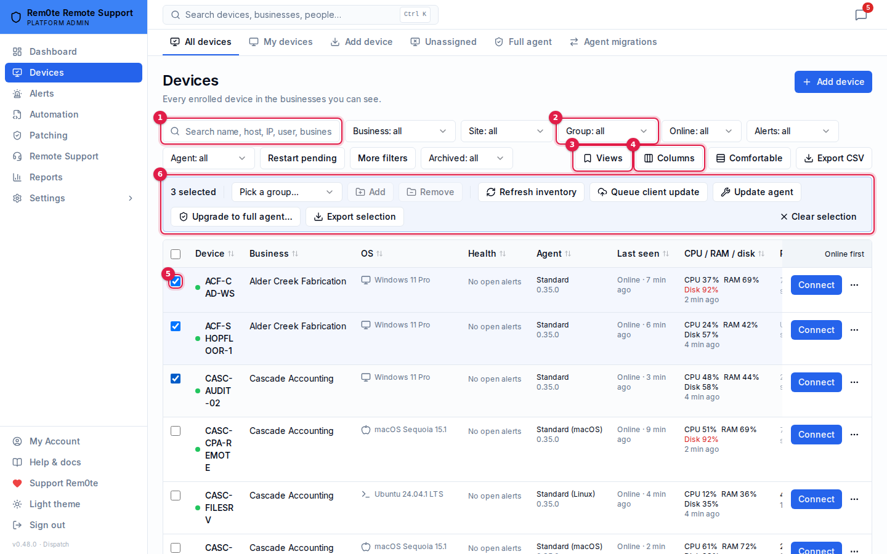

1. **Search** — the device list's own search, across every page.
2. **Group** — one of the filters; the others are customer, site, online, alerts, agent, *Restart pending* and archived.
3. **Views** — saved filters, sort, columns and density, personal or shared (below).
4. **Columns** — which columns show; *Comfortable / Compact* beside it sets the row height.
5. **The row's box** — ticks the device; the header box ticks the page.
6. **The bulk bar** — appears while anything is ticked: group membership, *Refresh inventory*, *Queue client update*, *Update agent*, *Upgrade to full agent…*, *Export selection*.

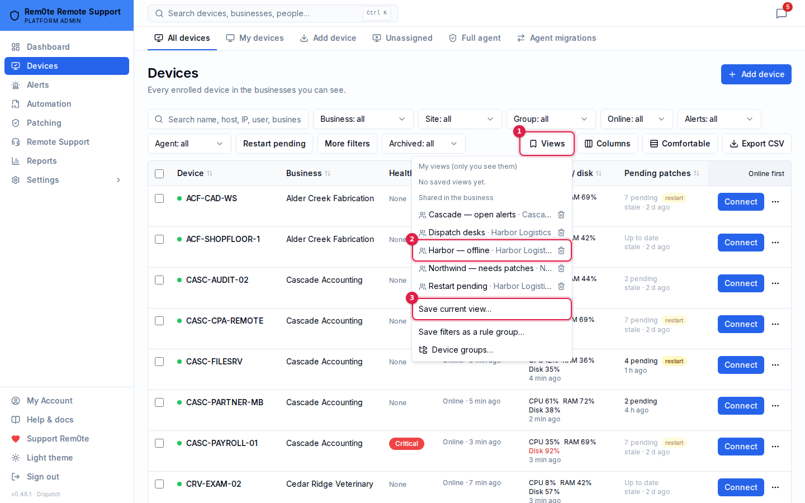

1. **Views** — shows the active view's name once one is open.
2. **A shared view** — with the customer it belongs to. Opening it still shows only the devices you can see.
3. **Save current view…** — the filters, sort, columns and density, under a name; *Save filters as a rule group…* and *Device groups…* below it make and manage groups.

- **Connect** on a row works exactly as it does on the device page. **⋯** opens the
  device, or its Patches, Monitoring or Test connection tab, or copies its hostname.

There is no RustDesk ID column any more. The ID is still on the device's page,
and search still finds a device by it.

**Online means the agent checked in within the last 30 minutes.** The agent
heartbeats every 3 minutes, so a machine that has genuinely dropped shows Offline
a few minutes later, not instantly. A machine RustDesk can still reach whose
agent has gone quiet is neither (0.35): it is amber, **Reachable (RustDesk) ·
agent silent** with how long, and its tooltip says remote control should work
but monitoring, patching and actions are not reporting — try **Update agent** on
its Agent card. The dashboard counts these apart from online ones.

### Search everything — Ctrl+K (0.33)

The **Search** box at the top of every page, or **Ctrl+K** (**⌘K** on a Mac)
from anywhere, searches devices, customers, sites, people, open alerts,
scripts, patch policies and automation schedules in one go (scripts and
policies from 0.87), and the console's pages by name. Before you type it offers
your recent items and quick actions. Type at least two characters (at most
100); results appear when you
pause. **↑ / ↓** move through them, **Enter** opens the highlighted one, **Esc**
closes the box. Ctrl/⌘-click opens a result in a new tab.

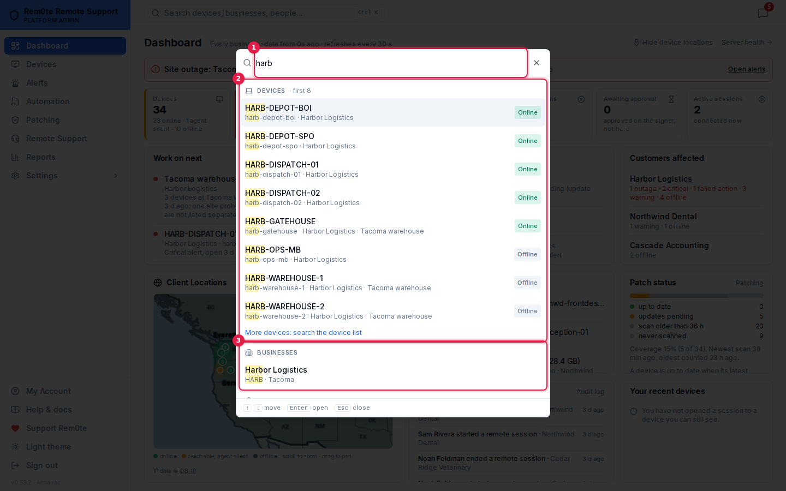

1. **The search box** — at least two characters; the matched part is highlighted in each result.
2. **Devices** — at most eight, online first among equals, with a link to the device list's own search for the rest.
3. **Customers** — then sites, people and open alerts, each group only if you have its list page's permission.

| Group | Matches on | Opens | Needs |
|---|---|---|---|
| **Devices** | Name, hostname, RustDesk ID, serial number, signed-in user, IP address, a network adapter's IPv4, alias | The device's page | *View devices* |
| **Customers** | Name, code, email, city | The customer's page | Nothing beyond being in it (as the Customers list) |
| **Sites** | Name, city, address | The device list filtered to that site | *View devices* |
| **People** | First name, last name, email — "jane doe" finds Jane Doe | The Users list, filtered to that person | *View business users* |
| **Open alerts** | Title (open and acknowledged only) | The device's Monitoring tab, or the alerts list | *See and work alerts* |

**What a device result shows.** Its name, online or offline, customer and site,
and — unless the name itself matched — *which* field matched and its value
(*Serial: 5CG1234XYZ*, *RustDesk ID: 123456789*, *Adapter IP: 10.0.4.17*). Only
the field that matched is returned; the others are not sent. Every one of them
is already on the device's own page for anyone who can open it, which is the
only kind of device search can find.

**Order and limits.** An exact match comes first, then one that starts with
what you typed, then one that contains it; among equals, online devices first,
then by name. Each group shows at most **8**. When there are more, the group
says *first 8*; for devices there is a link to the device list's own search,
which pages through everything (it matches a slightly different set of fields:
OS, customer and site names, but not serial numbers or adapter addresses).
Archived devices and inactive sites are not found, as on their lists.

**You only find what you could already open.** Each group is built from the
same rule as its own list page — not a copy of it: devices from the device
list's scope (a Business User sees only devices assigned to them or shared
company-wide, a technician only their assignment's), customers, sites and
people from their list routes, alerts from the alerts list. A group you have
no permission for is **left out**, never shown as empty. Another customer's
device, site or person is not found by anything you type — not even its exact
hostname or RustDesk ID. Search grants nothing: opening a result applies that
page's own check again.

**Privacy and limits.** Searches are not written to the audit log (a keystroke
is not an event), and the API does not log the query text — an error is
logged with the path only. A reverse proxy in front of Rem0te keeps its own
access log, which records the address of each request, search included.
Results are sent with `Cache-Control: no-store`. Searching is limited to **120
requests a minute per client address**; past that the box says *Too many
searches* until the minute is up. Typing pauses of 200 ms trigger a request,
so ordinary typing stays well inside it.

**How fast.** Measured end to end through the API on a shared scratch
Postgres 16 (Platform Admin, every device in scope): 50–70 ms over 2,000
devices and 300–450 ms over 20,000 — in line with the device list's own
search (56 ms and 320 ms on the same data), which scans the same way. A
two-letter query that matches nearly every device (*pc*) is the slow case:
about 0.3 s at 2,000 and 1 s at 20,000, because every match has to be ranked.
There is no search index; the measured trade-off is in the 0.33 changelog.

### The device workspace (0.31)

Opening a device gives you one page for it.

**The header** says who it is and whether it is reachable: name, status
(*Online*, *Offline since …*, or, in amber, *Reachable (RustDesk) · agent silent
12 d* when RustDesk can reach it but its agent has stopped checking in), customer, site and **last seen**,
marked *stale* when the agent has missed its check-ins. Under it, the
**attention strip** lists what needs looking at, each one a link to the tab that
explains it: open alerts with the worst severity (→ Monitoring), *Restart
pending* and pending updates with the age of the scan (→ Patches), a refused
heartbeat or an out-of-date agent (→ Overview), and which agent the device runs
— *Standard agent*, *Signed agent* or *RustDesk only* (see
[What each agent can do](capabilities.md)).

**Naming it (0.68).** **Rename**, next to the name, sets the name the device
goes by everywhere in Rem0te and a short description shown under it. The agent
never overwrites the name; the hostname is kept, shown beside it when they
differ, still searchable, and *Use hostname* puts it back. **Aliases** on the
Overview's Assignment card are other names it is known by (searchable), added
and removed in place. The Overview's **Notes** card shows the latest three notes
and takes a new one; all of them, and editing, are on History. All of it needs
*Rename/edit devices*, and renames and alias changes are in the audit log.

**The actions:** **Connect**, **Terminal** (Windows), **Tools** (below), **Diagnose** (opens Diagnostics), **Run action**
(opens Actions; disabled, with the reason as its description, when the device
lacks the signed agent or no approval signer is configured), **Patch** (opens
Patches) and **More**: view-only connect (technicians), the diagnostics report,
*Reinstall agent* and *Archive device*, each behind a confirmation that says
what it does. On a phone, Diagnose, Run action and Patch are in **More** as
well, so the buttons are one row.

**The agent's buttons (0.88).** A standard agent shows *Upgrade to full agent*
and *Update agent* beside them. A signed agent's *Check for update now* is in
**More**; when the agent is out of date, the *Agent out of date* chip runs it.
The attention strip names the agent and its version, so there is no separate
"Full agent" badge.

**How old it is (0.88).** Every tab that shows something the device reported
says how old it is, in one place, at the end of the tab row: *Inventory
collected* (Overview, Software), *Last check-in* (Performance), *Last monitoring
report* (Monitoring), *Update scan* (Patches) and *Snapshot taken* (Processes,
Services, Network). It is marked *stale* only where a rule already says so: the
30-minute check-in window, the server's own verdict on the update scan, and a
snapshot over a day old. Nothing reported is *not reported yet*, never fresh.
Diagnostics, Actions, Event logs, Terminal, Files, Chat and History have no
such line; each row there carries its own time.

**Tools (0.75).** **Tools**, beside Connect, opens one panel listing what can be
done to this device, in eight groups: Diagnostics, PowerShell / Scripts,
Services & Processes, Software, Windows Updates, Networking, Security and
Maintenance. Every tool is a way into a flow that already exists — picking one
opens its tab with the right thing chosen (the diagnostic's row marked, the
action picked, the Security log selected) or, for scripts, the script library.
Nothing runs from the panel itself: the tab's own button and confirmation do
that, and the server checks your access, containment and the approval signer
again exactly as before.

| Group | Tools, and the flow each opens |
|---|---|
| Diagnostics | Test connection (Diagnostics tab), Refresh inventory, Disk space, Service health, Top processes, Recent system errors (Diagnostics checks), Download diagnostics report |
| PowerShell / Scripts | Run an approved script (Automation → Scripts; `windows.script.run`) |
| Services & Processes | Services and Processes (their tabs), Start/stop/restart a service (`windows.service.control`, from a row), Restart an allowlisted service and Start the Print Spooler (Actions), End a process (`windows.process.stop`, from a row) |
| Software | Installed software, Install software (`windows.software.install`), Remove a program (`windows.software.remove`) — the Software tab |
| Windows Updates | Check for updates now and Restart pending? (Patches), Restart signals (a Diagnostics check), Install updates (`windows.update.install`, Patches) |
| Networking | Network adapters (Network tab), Network connectivity, DNS resolution, DNS lookup, TCP port test and Routes (Diagnostics checks; the lookup and port test need *Remote connect*), *Flush DNS / renew DHCP — coming later* |
| Security | Windows support (from the inventory), Microsoft Defender, Firewall, BitLocker, Secure Boot and TPM, Local administrators (Diagnostics checks, 0.76), Security event log (Event logs, with Security and Information chosen) |
| Maintenance | Time sync, Windows activation, Unexpected shutdowns, Scheduled tasks, Signed-in sessions (Diagnostics checks, 0.76), Schedule a restart, Cancel a scheduled restart, Collect diagnostic logs (Actions) |

Each tool says whether it can work here, and why not:

| State | Means |
|---|---|
| Available | Opens and can be used now (in direct mode an action is signed when you request it, after a fresh sign-in) |
| Needs approval | An approved action: two approvers authorize it on the approval page before the device runs it |
| Needs a newer agent | The device's agent does not report the action, is older than the release that added it, or is the standard agent and the action needs the full (signed) agent |
| Unsupported here | Linux, macOS (read-only agents) or RustDesk only: nothing on the device can run it |
| Paused | A containment pause on approved actions covers this customer |
| Not reporting | The device is offline or its agent is silent: the request waits for its next check-in (a diagnostic expires after fifteen minutes) |
| Not permitted | Your role does not allow it — it is shown without a button, so nothing you can click would be refused |
| Not set up | No approval signer is configured on this server, so no action can be approved |
| Unavailable | Archived, not enrolled, in the unassigned pool, or never bound to a device secret |
| Coming later | No flow does it yet; it is listed so the gap is visible, and nothing is shown in its place — unknown is never healthy |

The 0.76 checks (security posture, networking, maintenance) are read-only and
need agent 0.76.0 or later; each result is shown as findings marked Healthy,
Warning, Critical, Unknown or Unsupported, and Unknown or Unsupported is never
drawn as Healthy. They have run for real only on GitHub's Windows Server runner
— see [diagnostics.md](diagnostics.md#the-read-only-palette-076).

*Restart pending?* says **Yes**, **No** or **Unknown** from the last update scan;
it says Unknown until a scan has answered. The panel decides only what it shows
(`apps/web/lib/device-tools.ts`, unit-tested by
`apps/web/scripts/unit-device-tools.mjs`); it adds no route and no action. Its
links can be shared: `?tab=diagnostics&check=dns_resolution`,
`?tab=actions&action=windows.logs.collect`, `?tab=events&log=Security`.

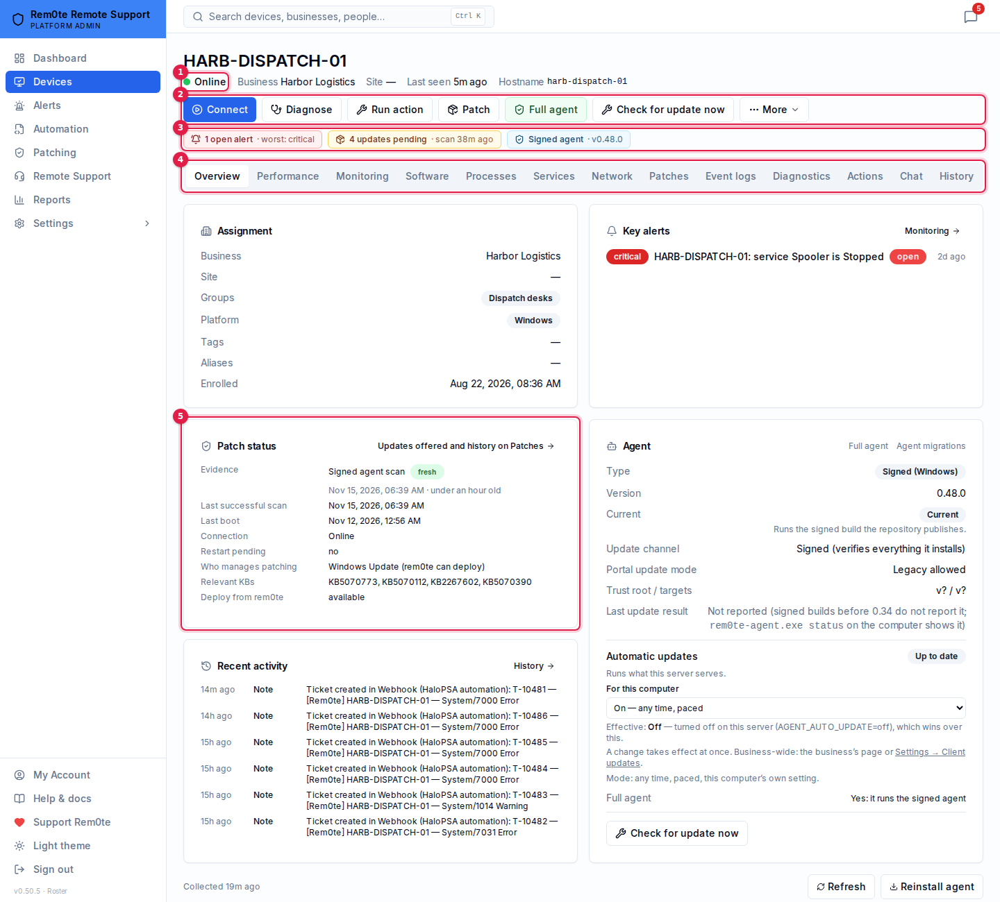

1. **Status** — *Online*, *Offline since …*, or *Reachable (RustDesk) · agent silent …* when the agent has gone quiet.
2. **Actions** — with the reason underneath when one is unavailable (here: no approval signer on this server).
3. **Attention strip** — open alerts, pending updates with the scan's age, and which agent it runs; each a link to its tab.
4. **The tabs** — below.
5. **Patch status** — the Overview's summary of the Patches tab: what the evidence is and how old.

**The tabs**, each linkable with `?tab=`:

| Tab | What is on it |
|---|---|
| Overview | Assignment (from 0.35 with every **group** the device is in — static groups and the rule groups it matches right now, as you would see them in the list; each links to the list filtered by it), key alerts, patch status, the **Agent** card, recent activity, then the hardware, utilisation, storage, network and update cards, each with its age |
| Monitoring | Alerts first (acknowledge and resolve here), then what is watched on this device in words, the agent's last report, and what changed |
| Software | Installed software with a filter, and recent software changes (Windows agents only); **Uninstall** on a program asks the full agent to remove it as an approved action (0.41 — [software-deployment.md](software-deployment.md)) |
| Processes | Every running process, as a snapshot with its age and a Refresh (0.33); from 0.45 **End process** on a row asks the full agent to end it as an approved action ([approved-actions.md](approved-actions.md)) |
| Services | Every service with state, start mode and run-as account; snapshot with age and Refresh (0.33); from 0.45 **Start**, **Stop**, **Restart** and **Startup type** on a row, as approved actions on the full agent, with protected services marked *Protected* |
| Network | Every network connection: addresses, gateway, DNS, DHCP, MAC; snapshot with age and Refresh (0.33) |
| Patches | Patch status, updates offered, Windows Update history |
| Event logs | A page of one Windows event log, on request (Windows agents only); from 0.48 **Ask AI** and **Create ticket** on an entry ([ai-and-tickets.md](ai-and-tickets.md)) |
| Diagnostics | Test connection: server, device and your own RustDesk |
| Actions | Request an approved action and see past requests; from 0.47.1 the Print Spooler's last known state, with **Refresh**, and *Nothing to do* when it is already running |
| Chat | Chat with the person at the device, receipts and earlier transcripts; emoji, files and pictures from 0.44 (signed Windows agent; elsewhere it says why not — [chat.md](chat.md)) |
| History | Remote sessions, technician notes, the AI-written summary (labelled as such) and who can connect |

**The Agent card** (Overview, 0.34) says which agent the device runs (*Standard*,
*Signed*, or the read-only Linux/macOS agent), its version and whether that is the
current one, the update channel and the portal's update mode, and — for a signed
agent — the result of its last update check. Its buttons:

- **Update agent** (standard Windows agent): re-runs the current installer at the
  next check-in. It is the same as *Reinstall agent*: the same permission, refused
  while updates are paused for the customer, and audited.
- **Check for update now** (signed agent): the agent runs its own signed update
  at the next check-in. It installs only what the signed repository lists.
- On Linux and macOS the card prints the exact command to re-run on the device;
  those agents act on nothing the portal sends.
- **Upgrade to full agent** (standard Windows agent): asks for a reason and a
  fresh sign-in, then moves this device to the full (signed) agent at its next
  check-in, keeping its enrolment and RustDesk ID. From 0.37 it is also at the top
  of the device's page, beside Connect, with Update agent, and the *Agent out of
  date* chip opens it. It is always a button: when it can't be used it is
  disabled and says exactly why — no signed release published, no device secret, the
  portal in *Signed only* mode, updates paused, a rollout running. A request can
  be cancelled until it completes. **Devices → Agent migrations** (a tab for
  anyone who may request one, from 0.35; the page itself needs only View
  devices and is linked from every Agent card) lists pending,
  held, not confirmed and completed requests. To move several devices, select
  them on **All devices** and use **Upgrade to full agent…** (at most 200; each one is
  refused with its own reason). See
  [Update signing → Moving existing agents](update-signing.md#moving-existing-agents).

Processes, Services and Network are snapshots, not live views: each says when it
was taken, and **Refresh** asks the device for a new one on its next check-in.
They have no buttons that change the device — restarting a service is a signed
maintenance action on Actions, and ending a process is not offered
([diagnostics.md](diagnostics.md#the-processes-services-and-network-tabs)). Old links
(`?tab=notes`, `?tab=timeline`, `?tab=access-review`) open History.

The Performance tab is described in [metric-history.md](metric-history.md), with its
screenshot; Processes, Services and Network in
[diagnostics.md](diagnostics.md#the-processes-services-and-network-tabs).

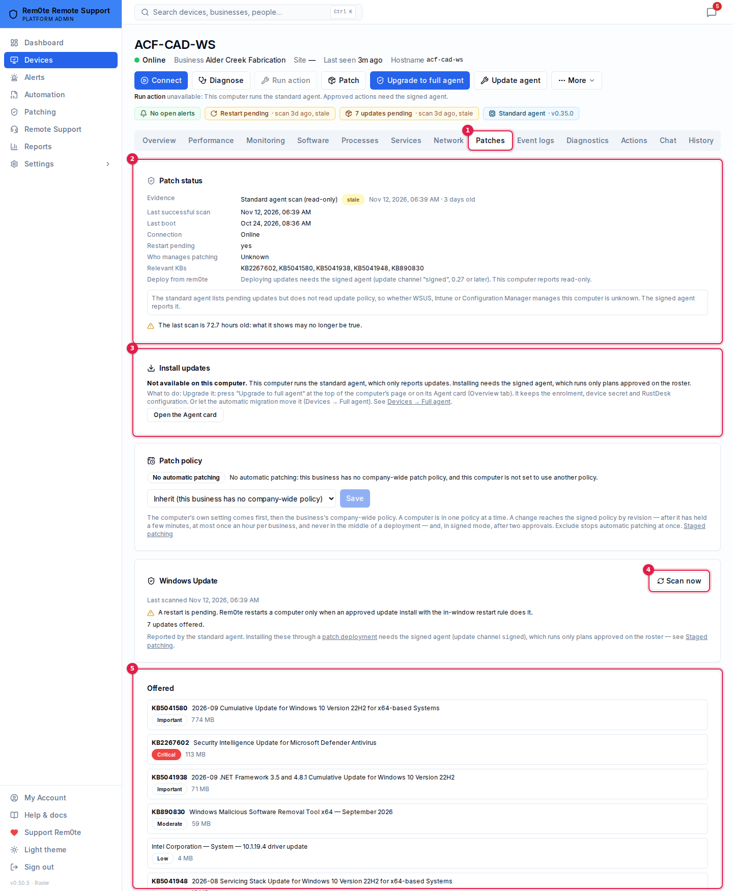

1. **Patches** — the tab.
2. **Patch status** — the evidence (which agent's scan, how old), restart pending, and who manages patching where the signed agent can tell.
3. **Install updates** — deploying from Rem0te; here it says why it is not available on this device.
4. **Scan now** — asks the device for a new Windows Update scan on its next check-in.
5. **Offered** — the updates the last scan listed, with KB, severity and size.

---

## 3. Connect to a device

Use **Connect** on a device's card in **Devices → My devices**, on its row in **All devices**, or at the top of
its page.

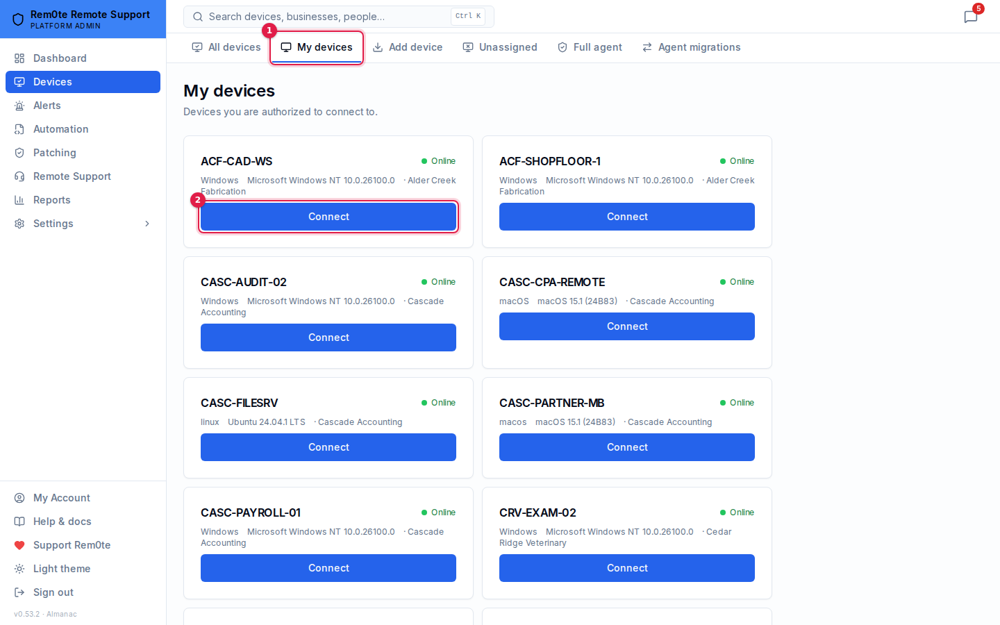

1. **My devices** — the devices this account may connect to.
2. **Connect** — hands the machine's ID and password to your local RustDesk
   client and starts the session.

You do not need to type a password. Rem0te holds the credential for each machine
and passes it to RustDesk for you; if you are prompted for one, something is
wrong — see Troubleshooting below.

Requirements on your own workstation:

- RustDesk must be installed.
- Your RustDesk must be configured for **this** server. If it is pointed at the
  public RustDesk network it will look up the ID there and either fail to find it
  or reach a completely unrelated machine.

Every connection is written to the audit log with who connected, to what, and
when.

### Managed devices (0.73, not switched on by default)

Managed Secure Access is off on every production server; this section applies
only where an administrator has switched it on. **It has been tested only in a
Windows Server lab, never on a desktop or with a real connection.**

A device whose page says **Managed and verified** has no standing password.
Pressing **Connect** (or **View only**) asks the device's agent to open one
session for you:

1. The dialog shows progress: *Authorized*, *Received by the agent*, *Applied*.
   It waits up to 60 seconds. If the agent does not answer (the device is
   offline, or busy), the session is cancelled and the dialog says why; nothing
   was handed over. Try again later — there is no fallback to an old password.
2. When it says *Applied*, press **Download Connect script** and run it. The
   script carries a one-time password for this session only; it works once.
3. What you may do is decided by your role or preset, not by the button: a
   view-only preset gets a view-only session, and if your customer requires
   consent the person at the device is asked to accept. Clipboard and file
   transfer are on only when your customer allows them. A TCP tunnel and a
   remote restart are never available on a managed device.
4. The session ends when you disconnect, at your session limit, after 15
   idle minutes, or when someone disconnects it from the console.

The device's page lists its managed sessions with a timeline. *Launched*
means the Connect script was downloaded; it is **not** *Connected*, which
appears only when the agent saw RustDesk accept a connection. The agent cannot
see who connected or whether consent was accepted, and the timeline says so.

You can end your own session with **Disconnect**. A customer's Owner or Admin,
and Platform Admins, can disconnect any session there, all of a technician's,
or all of a device's (**Remote support → Managed sessions**). A containment pause on
remote access ends open sessions too.

---

## 4. Help someone who is not enrolled

Use **Remote support → Quick Connect** for one-off help where nothing should be installed
permanently — a machine you do not manage, or a person you are helping once.

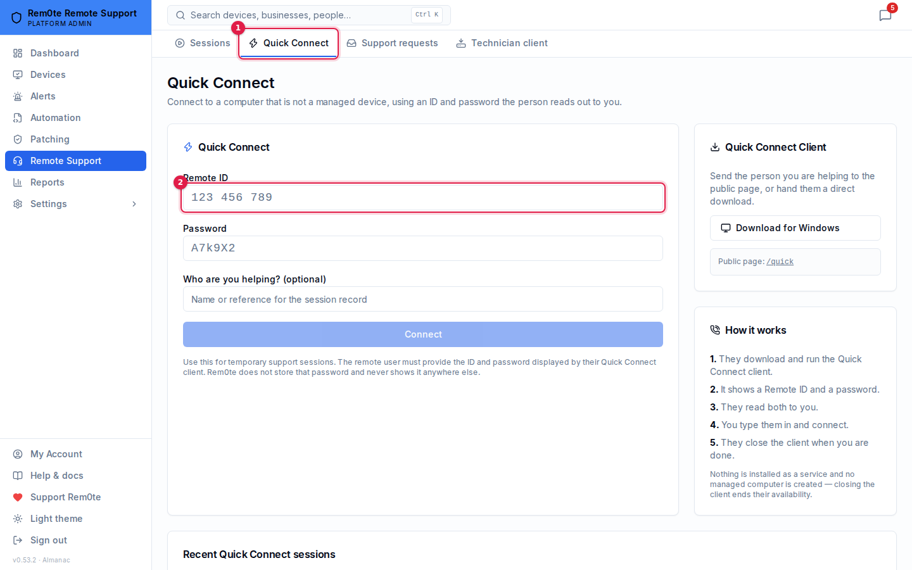

1. **Remote ID** — the 9-digit number their Quick Connect client shows.
2. **Password** — the short code shown next to it.
3. **Who are you helping** — optional label for the session record.

Send them to the public download page (shown on the right of that screen), they
run the client, and they read you the two values. Nothing is installed as a
service and no managed device is created — closing the client ends their
availability.

Rem0te does not store the Quick Connect password and never displays it again.

---

## 5. Enrol a new device

**Devices → Add device** (the *Add device* link under *Devices* in the menu, from 0.64; the button on the Devices
page; or the *Add device* tab) walks through it in six steps on one page:

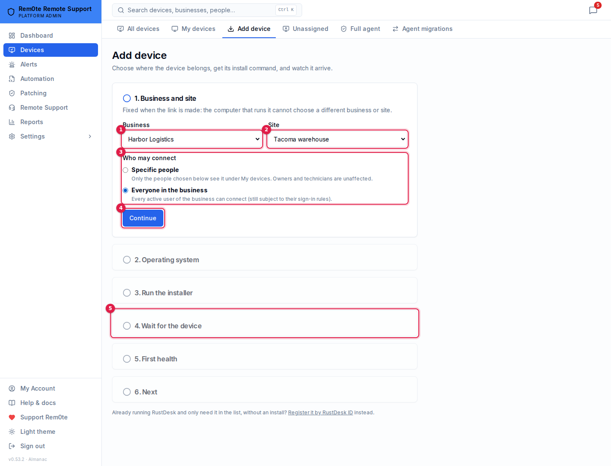

1. **Customer** — only the customers you manage are offered.
2. **Site** — or *No site*; only that customer's sites.
3. **Who may connect** — specific people, or everyone in the customer.
4. **Continue** — the three choices are fixed into the link when it is made.
5. **Wait for the device** — like every later step, greyed until it is its turn; it is where this page watches the
   new device arrive (step 4, below).

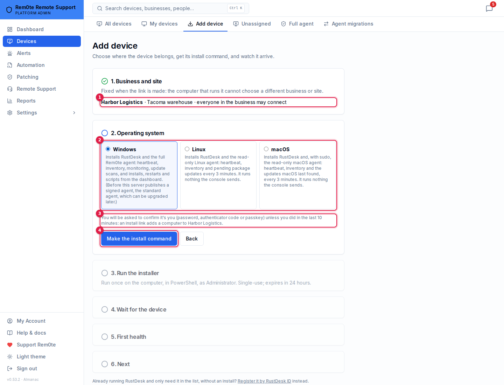

1. **Step 1, done** — what was chosen.
2. **Operating system** — Windows, Linux or macOS, each saying which agent it installs.
3. **The step-up note** — making the link asks you to confirm it is you.
4. **Make the install command** — makes the single-use link.

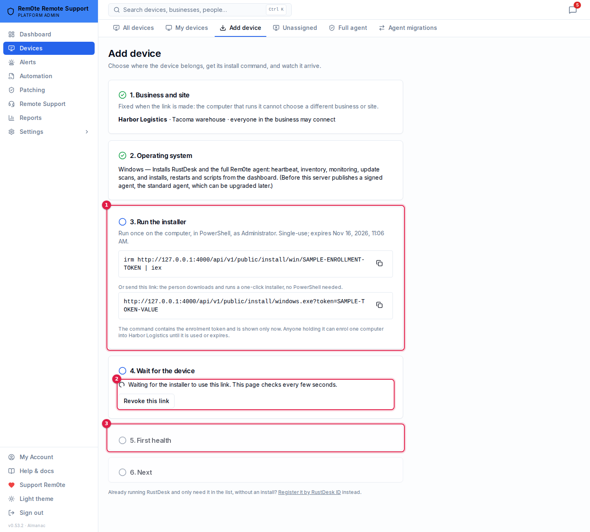

1. **Run the installer** — shown once. (The token is replaced with a placeholder in this screenshot, which predates 0.64: from 0.64 this step has two tabs, *Download installer* and *Command*, described below.)
2. **Wait for the device** — checks every few seconds; *Revoke this link* cancels an unused one.
3. **First health** — fills in from what the server actually receives once the device checks in.

1. **Customer and site.** Pick the customer, then a site or *No site*, and who
   may connect — specific people, or everyone in the customer. All three are
   fixed into the link when it is made: the machine that runs it cannot pick a
   different customer or site. You can only pick a customer you manage; the
   server refuses any other, and a site that is not that customer's.
2. **Operating system.** Windows gets RustDesk and the Rem0te agent (heartbeat,
   inventory, monitoring, update scans). Linux (0.32) and macOS (0.33, run with
   `sudo`) get RustDesk and the read-only agent: heartbeat, inventory and
   pending updates, and nothing the console sends is acted on
   ([inventory.md](inventory.md)).
3. **Run the installer.** Two tabs (0.64). *Download installer* is a button:
   on Windows **Download .exe**, a one-click installer (run it, accept the
   administrator prompt), with the same link to copy and send to the person at
   the machine; on Linux and macOS the install script as a file, run with
   `sudo bash install-rustdesk.sh` (or `install-rustdesk-macos.sh`). *Command*
   is the one-line command (PowerShell as Administrator, or a root shell).
   Windows also has **Download .msi** (0.65) and the silent line
   `msiexec /i rem0te.msi TOKEN=… /qn` to copy; the .msi needs the server to
   publish the signed agent, says so when it cannot be built, leaves the agent
   in place when it is uninstalled, and has never been run on real Windows.
   There is no .pkg; for many devices at once see
   [deployment.md](deployment.md). Every choice carries the same single-use
   enrolment token that expires in 24 hours; downloading does not use it up,
   the device's first check-in does. It is shown **once**: reload the page and
   only the waiting continues. If the command is lost, revoke the link and make a new one.
   Making it asks you to confirm it is you (password, authenticator code or
   passkey) unless you did in the last 10 minutes (0.33): a link adds a device
   to the customer, so a session left open must not be enough. Your choices are
   kept while you confirm, and if you cancel nothing is made — press the button
   again.
4. **Wait for the device.** The page checks every few seconds and says *enrolled*
   only when a device has used this link. You can revoke an unused link here.
5. **First health** — what the server has actually received: the customer and
   site it landed in, online, the agent and its version (after its first
   heartbeat, which the installer starts as it finishes), whether its device
   identity is bound, and whether its first inventory has arrived — or, until
   it has, whether it has been asked for yet, and the agent's reason if the pass
   failed. Each line says *waiting* until it is true; nothing is assumed.
6. **Next** — open the device, its Monitoring tab, or the customer's monitoring
   policies, with the monitors that already apply to it listed.

A Business User who adds a machine for *specific people* that does not include
themselves is told it enrolled, but not shown it: they could not see it in the
list either.

The installer is safe to re-run; it reconfigures an existing install rather than
duplicating it. To re-enrol a machine whose identity is not bound, use *Make an
enrollment link for this device* on its page: it opens Add device bound to
that device.

**It will refuse to report success if the machine never reaches the server.** If
you see an error instead of a summary, read it — it prints the service state,
whether ports 443 and 21116 are reachable, and RustDesk's own log. Those are the
facts that distinguish a firewall problem from a service that is not running.

**Already running RustDesk, and only want it listed?** *Register it by RustDesk
ID* (linked at the bottom of Add device) adds it without installing anything. It
then has no agent: no heartbeat, inventory or monitoring.

---

## 6. Review sessions

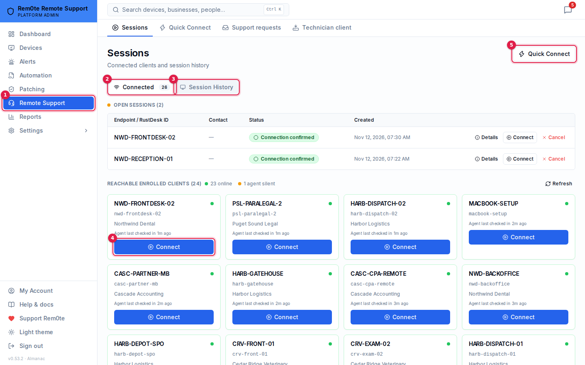

1. **Remote Support** — Sessions is its first tab.
2. **Connected** — open sessions, then the enrolled clients currently online.
3. **Session History** — past sessions with duration and disposition.
4. **Connect** — start a session with that machine.
5. **Quick Connect** — for a machine that is not enrolled; a session can no longer be recorded by hand.

Each session's status says what is actually known about it, in eight stages
(0.91): *Launch requested*, *Authorization granted* (a credential was
released; no session yet), *Client opened* (RustDesk started on your device,
not a connection), *Device connection confirmed*, *Session active* (only
while the remote device's agent still sees the connection, within 10
minutes), *Session ended*, *Session failed* and *Connection state unknown*.
If you press *I'm connected* it reads *Connection confirmed by you*, never
*Session active*. A session's details list each step with its time. The
Sessions page's first tab is **Open now** (open sessions at every stage, and
reachable devices), not "Connected". A launch that
gets no further signal reads **Connection state unknown** after 30 minutes rather than
pretending it failed or succeeded, and duration is shown only when it was
measured. See [connecting.md](connecting.md#what-the-session-status-means-v020).

---

## 7. Keep RustDesk current

**Updates** covers two separate things: Rem0te itself, and the RustDesk client
installed on each managed device.

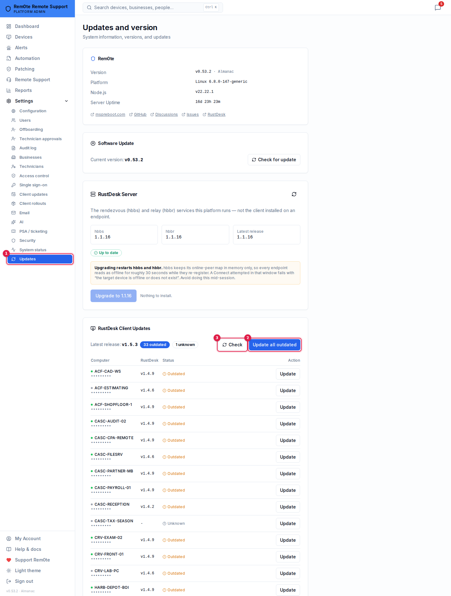

1. **Administration → Updates** — Rem0te's own version, then the RustDesk server and clients.
2. **Update all outdated** — queues every machine that is behind.
3. **Check** — re-reads the latest RustDesk release.

Per-machine status reads:

| Status | Meaning |
| --- | --- |
| **Current** | On the latest release. |
| **Outdated** | Behind; an update can be queued. |
| **Unknown** | The machine has not reported a version yet. Devices enrolled before v0.8.2 only start reporting after their next installer run. |
| **Queued** | An update is staged and applies on the next check-in. |

Queued updates apply on the machine's next heartbeat, within about 3 minutes. An
offline machine applies it whenever it next checks in — nothing is lost. A queued
update clears only once the machine reports the target version, so a failed
install retries instead of silently disappearing.

---

## 8. Support requests

Customers can ask for help through their customer's support link, without an
account. Requests appear under **Remote support → Support requests** if you hold
`support:requests`.

1. **Claim** a request to take it. If someone beat you to it, you are told who.
2. Check **Matched devices**: devices in the customer that match what the
   customer wrote, limited to ones you can connect to.
3. **Connect** through the device's Connect button or Quick Connect.
4. **Complete** it, or **Hand off** to a colleague, or **Release** it back.

The customer's status page shows your first name and the status, nothing else.
See [support-requests.md](support-requests.md).

## 9. Working for several customers

If you have technician assignments, the top bar shows a **customer switcher**.
Pick the customer you are working in; everything you see is then that
customer, limited to what your assignment allows. **All assigned** gives an
overview across all of them, and lists access that is not active right now and
why (expired, outside its hours, awaiting approval). Ask for access to another
customer from there. See [technicians.md](technicians.md).

---

## Troubleshooting

**Start with Test connection.** Every device's page has it, on the
**Diagnostics** tab (the **Diagnose** button opens it). It checks the
server, the device and, with *Check my device*, your own RustDesk, and says
which one is wrong. See [connecting.md](connecting.md#test-connection-v020).

**A device shows Offline but the person says it is on.**
Online is driven by the agent's 3-minute heartbeat. A machine RustDesk can
reach with a broken heartbeat shows amber *Reachable (RustDesk) · agent silent*
instead; one neither can see is Offline. A machine can be running fine while the
heartbeat task is broken. Re-running the installer
reinstalls the task and will now tell you if the machine cannot reach the server.

**Connect says "wrong password".**
The credential Rem0te holds and the one the machine has are out of step, or your
own RustDesk resolved the ID on the public network and reached a different
machine. Check that your workstation's RustDesk points at this server first —
that is the more common cause and the more serious one.

**Connect says "ID does not exist".**
The machine is not registered with this server's rendezvous service. It is either
genuinely offline, or its RustDesk cannot reach the server even though the agent
can. Re-run the installer on it; the verification step now reports exactly which.

**A machine was reported "installed successfully" but never appears.**
That was possible before v0.8.2 and is not any more — the installer now refuses
to claim success unless the server confirms it has seen the machine.
