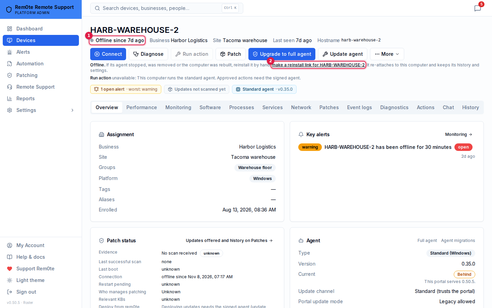
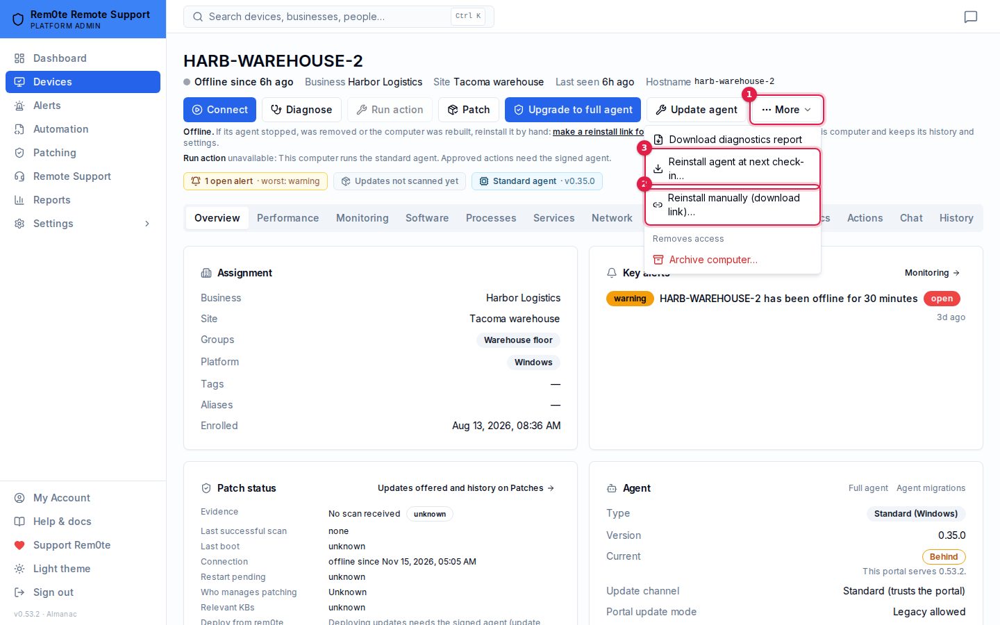
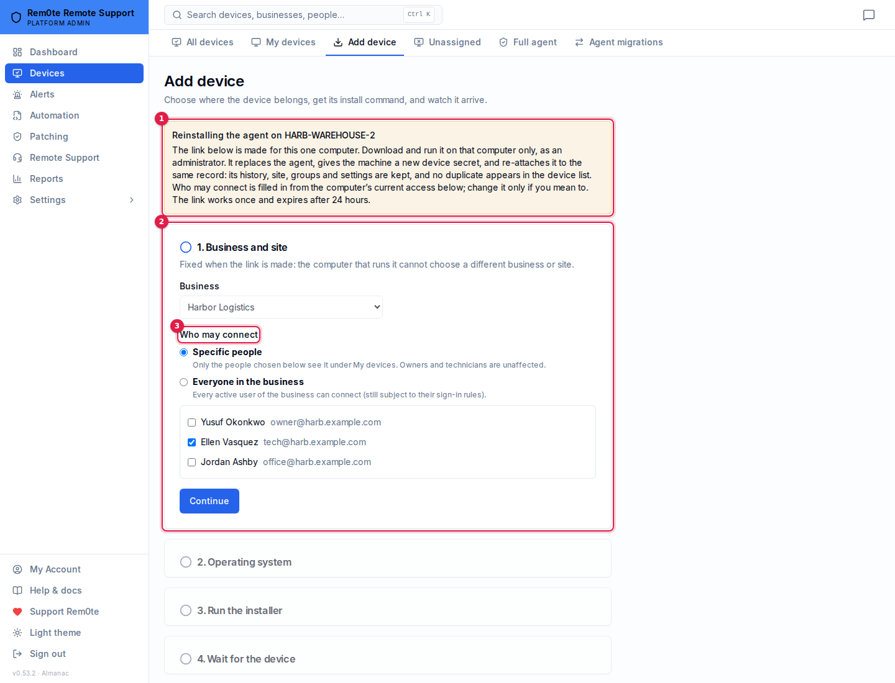
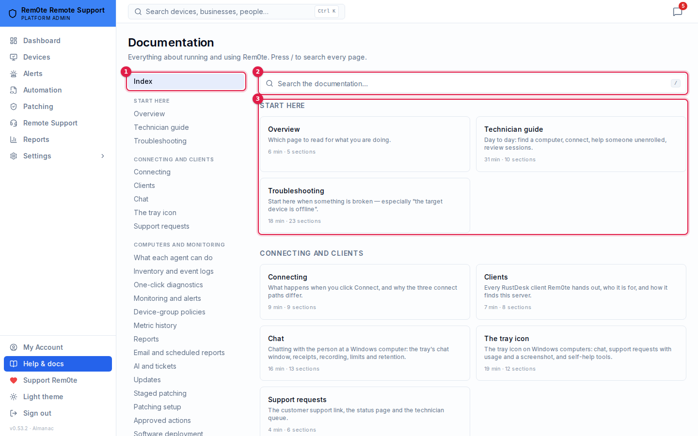
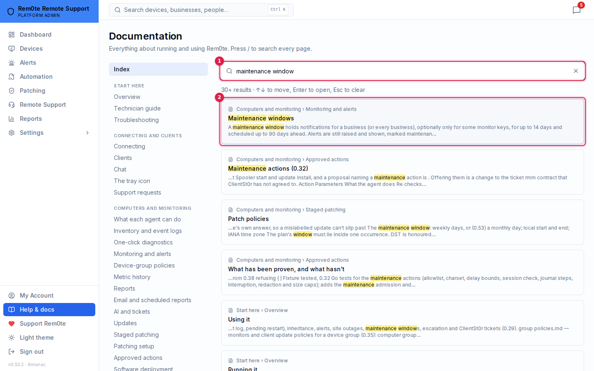
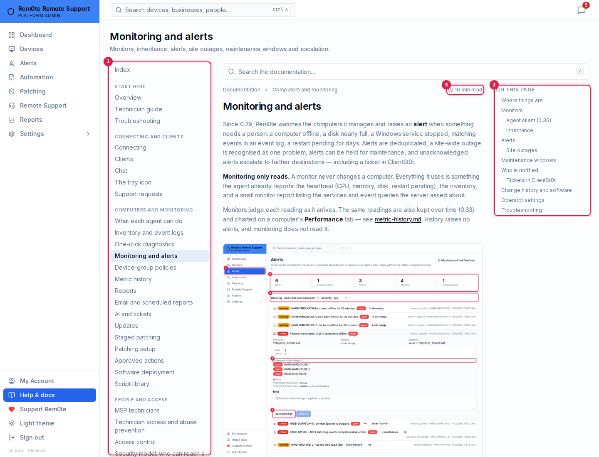

# Troubleshooting

Start here when something does not connect. The single most useful fact on this
page: **the error RustDesk shows almost never names the component that produced
it.**

---

## "Failed to connect: the target device is offline or does not exist"

This is hbbs's answer, relayed by the client. It has four distinct causes that
look identical from the technician's chair, and one command tells them apart.

### First move, always

```bash
sudo deploy/scripts/hbbs-probe.py <rustdesk-id>
```

| Verdict | What it rules out | Go to |
|---|---|---|
| `ONLINE` | Server and device are both fine | [The client you're connecting from](#the-client-youre-connecting-from) |
| `OFFLINE` | Server is fine; device is not registered right now | [Device not registered](#device-not-registered) |
| `ID_NOT_EXIST` | hbbs has never seen this ID | [Device on the wrong server](#device-on-the-wrong-server) |
| `LICENSE_MISMATCH` | Keys disagree | [Key mismatch](#key-mismatch) |

hbbs writes **nothing** to its log when a connection request fails — no line for
an unknown ID, none for an offline peer, none for a key mismatch. Reading
`/var/log/rustdesk-server/hbbs.log` after a failed connect will show you
nothing, which is why this script exists.

### The client you're connecting from

**`ONLINE` means the device is reachable and the server is doing its job.**
The RustDesk on your own machine is asking a different rendezvous server.

The Connect button opens `rustdesk://connection/new/<id>`, which Windows routes
to whichever RustDesk is installed, using whatever server *that* client points
at. The URI scheme has no field for a server address. A stock client — a fresh
install, or an auto-update that replaced a configured build — asks
`rustdesk.com`, where your IDs do not exist.

**Fix:** In Rem0te, click **Connect**. It downloads a small script that installs
RustDesk if the machine has none, points it at this server, and opens the
session. Run it once and subsequent connects work directly.

Or, from **Remote support → Technician client**, run *Set up this computer for Connect*.

Still failing after that:

- **Quit RustDesk completely first** — from the system tray, not just the
  window. A running client will not pick up a configuration change.
- **Uninstalling RustDesk does not clear its settings.** `%APPDATA%\RustDesk`
  survives an uninstall and a fresh install reads the old server straight back
  out of it. Delete that folder, then reinstall.
- **Check what the client actually thinks:** RustDesk → Settings → Network →
  ID/Relay Server. The ID Server must be your Rem0te host and the Key must match
  Rem0te → Settings → RustDesk → Public Key exactly.

### Device not registered

`OFFLINE` — hbbs knows the ID but has no live registration.

- **Within ~30 seconds of an hbbs restart this is normal.** The online-peer map
  is in memory; a restart empties it and clients re-register on their next
  cycle. Every `rustdesk-server` upgrade and every
  `systemctl restart rustdesk-hbbs` opens that window. Wait, probe again.
- Otherwise: the device is off, RustDesk is not running on it, or it has lost
  its route to port 21116. Compare against the device's **Last seen** in
  Rem0te — that is a separate HTTP heartbeat. Heartbeat current but hbbs
  `OFFLINE` means RustDesk specifically is stopped or misconfigured on that
  machine.

### Device on the wrong server

`ID_NOT_EXIST` — hbbs has never seen this ID, so the device is registering
somewhere else, usually `rustdesk.com`.

Re-run the Rem0te installer on it. Installs from before **v0.8.2** wrote the
RustDesk *service* config to a path the service never reads, leaving it running
on defaults pointed at the public servers while every check passed. That fix
only lands by reinstalling.

### Key mismatch

`LICENSE_MISMATCH` — the key presented is not the one hbbs was started with.

```bash
cat /var/lib/rustdesk-server/id_ed25519.pub
```

must equal Rem0te → Settings → RustDesk → Public Key. If you regenerated the
server keypair, every client configured before that moment is now wrong.

hbbs checks the key of the device **making** the connection, not the one
being connected to. hbbs logs it as

```
Authentication failed from <ip> for peer <id> - invalid key
```

in `/var/log/rustdesk-server/hbbs.log`, where `<ip>` is the technician's
machine. So a Key mismatch that starts "after a reinstall" usually means the
technician's RustDesk was reinstalled with a bad key — most often from a
preconfigured download the browser saved as `… (1).exe`, which before 0.19.7
put ` (1)` into the key. Reinstalling over it did not help either: with
RustDesk already running, launching a new installer just hands off to the
running copy, so the old version and the old key both stayed.

From 0.19.8 Connect checks the installed client's version, server and key. If
any is wrong it asks for administrator permission once, stops RustDesk,
upgrades it with `--silent-install` when it is out of date, and rewrites the
server and key in the service's and your own `RustDesk2.toml` (other settings
are kept). The log is `%LOCALAPPDATA%\Rem0te\repair.log`. Declining falls
back to a portable copy configured by its filename — quit RustDesk from the
tray first, or the session is handed to the installed copy with the bad key.

---

## Connected, but the password is rejected

Rem0te stores the device's permanent password encrypted and hands it to the
client. It desyncs if someone ran `rustdesk --password` on the device by hand.
Stage a credential rotation from the device's page, or re-run the installer.

---

## The Connect script closes before you can read it

Every run writes a full log to:

```
%LOCALAPPDATA%\Rem0te\rem0te-last-run.log
```

Open that. It survives the window closing, and it is the fastest way to see
which step failed.

If that log does not exist, PowerShell never started — cmd.exe rejected the
file before running anything. Run the `.cmd` from an open Command Prompt
instead of double-clicking it so the error stays on screen. (0.19.8 shipped a
Connect script whose single command line exceeded cmd.exe's 8191-character
limit and failed exactly this way; fixed in 0.19.9.)

The script also pauses on failure now, so a window that closes instantly
usually means something stopped it before PowerShell ever ran — see below.

To watch it run with the window guaranteed to stay open, start a Command Prompt
first and drag the file into it, or:

```bat
cmd /k "%USERPROFILE%\Downloads\Connect to NAME.cmd"
```

Other reasons it may appear to do nothing:

- **It needs to actually run.** A browser that saved it and did not open it has
  done nothing yet.
- **SmartScreen may block it** — *More info* → *Run anyway*.
- **It deletes itself on completion by design**, because it carries a live
  credential. If you need it again, click Connect again.

The log never contains the password: the error handler prints the failing
command's category, deliberately not the script line, because the whole script
is one line and printing it would put the credential in the log.

---

## A session says "Status unknown"

Nothing confirmed or failed it within 30 minutes of the launch (or 12 hours
after the client opened). That is the honest answer when the remote device's
agent is older than 0.20.0 and cannot report incoming connections, or when two
launches for the same device were open at once, so a connection could not be
attributed to either. Complete the session yourself if you know how it went.

## "Confirm it's you" keeps appearing

That is step-up. It lasts 10 minutes and only for the sign-in it was made in, so
it is asked for again after signing out and back in, or in another browser. If
your account has an authenticator, only its code (or a passkey) is accepted —
not your password. If it never accepts a correct code or password, the account
may be locked out after repeated failures: wait for the lockout to pass.

Clicking **Connect** asks for it too when the launch carries the device's
password (0.30.1). *"Sign in again with your authenticator to reveal a device
password"* means this session began before your authenticator was set up: sign
out and back in. See
[sign-in.md](sign-in.md#step-up).

## SSO sign-in fails

The sign-in page explains the reason. The common ones:

- **"No account is linked to that identity"**: SSO never matches by email.
  Sign in with your password and link the provider from **My Account**.
- **"An account with that email already exists"**: same fix. Provisioning
  never takes over an existing account.
- **"The provider's response could not be verified"**: issuer, client ID,
  secret or redirect URI mismatch. Run **Test discovery** on the provider and
  check that the redirect URI at the provider matches exactly.
- **"did not start in this browser" / "expired"**: start again from the
  sign-in page; the round trip must finish in the same browser within 10
  minutes.

If SSO is unusable for everyone, run on the server:

```bash
sudo bash -c 'set -a; . /etc/reboot-remote/api.env; set +a; cd /opt/reboot-remote/api && node dist/cli/auth-recovery.js --disable-sso --yes'
```

Password sign-in keeps working regardless. See [sign-in.md](sign-in.md#recovery).

## A rotation stays "pending"

The device has not checked in since the new password was staged, so it has
not applied it, and **the old password still works there**. An online device
picks it up within about 3 minutes. An offline one stays pending until it
returns. **Offboarding → Pending rotations** lists every such device.

---

## A device shows online in Rem0te but RustDesk says offline

They are different signals and both are correct.

| Signal | Source | Lifetime |
|---|---|---|
| Rem0te's dot | Agent heartbeat **or** live hbbs registration (0.19.3+) | Re-checked every minute |
| RustDesk | Live registration with hbbs, **in memory only** | Empty after any hbbs restart |

A Connect depends only on the second. `hbbs-probe.py` reports the second.
Since 0.19.3 the dot follows hbbs too, so this disagreement lasts at most a
minute. From 0.35 a device RustDesk can reach whose agent has not checked in
for 30 minutes is not drawn green: it is amber, **Reachable (RustDesk) · agent
silent 12 d** (or *no agent report*), everywhere a device's state is shown.
Remote control should work; monitoring, patching and actions are not reporting.
Use **Update agent** on the device's Agent card, or re-run the installer from
inside a session. The device list's *Online* filter has *Reachable, agent
silent* to find them all, and the dashboard's Devices tile counts them apart.

---

## Devices stuck "Update pending" forever

Only installers from v0.8.2 onward report a RustDesk version *and* understand
the staged-upgrade instruction. An older device can be staged for an upgrade
it will never apply, and the staging never clears because clearing requires the
device to report the target version.

Re-run the installer on those machines by hand. They need it anyway for the
service-config fix.

An *automatic* update that was queued under a device group's policy and then
disappeared after the device left the group was withdrawn on purpose (0.36):
the audit log has `CLIENT_UPDATE_AUTO_WITHDRAWN` with the reason. See
[updates.md](updates.md).

---

## Remote control works but nothing else updates ("agent silent")

The device is amber, *Reachable (RustDesk) · agent silent*: RustDesk is
running and reachable, the Rem0te agent is not checking in. Connect still
works; monitoring, patching, inventory and actions are stale. Use **Update
agent** on its Agent card, or re-run the installer on the machine. To be told
when this happens, add the *Agent silent* monitor (0.36; *Add recommended*
adds it from 0.36.1, [monitoring.md](monitoring.md#agent-silent-036)) — the Offline monitor never
fires for it, because the device is still reachable.

---

## A signed device shows an old agent version and never updates

Before 0.70.1 the console showed the release label a signed device recorded
at its last once-a-day update check. The signed agent is built reproducibly
and carries no version, so releases that do not change it publish the same
binary under a new label (it was byte-identical from 0.63.0 through 0.68.3),
and a device already running that binary records nothing new. A fleet that
was entirely current looked like 0.64.0, 0.67.0 and 0.68.0, and automatic
updates rightly did nothing: they compare the binary's hash with the published
one, not the label.

From 0.70.1 a signed device on the published binary shows the published
release and *Current*, with "installed as …; the same agent" under it on the
Agent card. If one still shows an older version **and** *update due* (or
*Behind* on the Agent card), it really runs another binary: see its Agent
card's *Automatic updates* block for why it has not been asked yet, or click
*Check for update now*. See [updates.md](updates.md).

---

## Reinstalling the agent on a device that is already in Rem0te

**Update agent** and **Reinstall agent at next check-in** both work through the
heartbeat. They are delivered the next time the agent checks in, so they do
nothing for a device whose agent has stopped, was removed, or whose disk was
rebuilt. For that device, make a reinstall link and run it on the machine
yourself:

1. Open the device in **Devices**. When it is not checking in, the line under
   its buttons offers **make a reinstall link for <name>**. The same link is
   always under **More → Reinstall manually (download link)…**, and in the
   row's **⋯** menu in the Devices list.
2. The link opens **Add device** bound to that one device. Its customer is
   fixed, its site is kept, and *who may connect* is filled in from the
   device's current access. Leave that alone unless you mean to change it,
   because the install applies what the link says.
3. Pick the operating system, then download the installer or copy the command.
   Run it on that device only, as an administrator. The link works once and
   expires after 24 hours.

The install gives the machine a new device secret and re-attaches it to the
same record, so its history, site, groups and settings are kept and no
duplicate appears in the list. A reinstall on a new RustDesk ID moves the
record to the new ID. Making the link needs **Add devices**, the same
permission as adding a new one.



1. **Its connectivity** — offline here, for six hours.
2. **make a reinstall link for <name>** — shown while the device is not online.



1. **More.**
2. **Reinstall manually (download link)…** — always offered to someone with **Add devices**, online or not.
3. **Reinstall agent at next check-in…** — the heartbeat-based one, which needs the agent to be checking in.



1. **The banner** — names the device the link is for, and says it works once and expires after 24 hours.
2. **Customer and site** — fixed to the device's own.
3. **Who may connect** — filled in from the device's current access.

---

## A device went offline right after Update or Reinstall agent

Two symptoms, one cause, in Windows installers 0.18.22 through 0.19.1:

- **Refused.** Heartbeats arrive and are rejected: the audit log shows
  `ENDPOINT_HEARTBEAT_REJECTED` with `reason: secret_mismatch` from the moment
  the installer re-ran.
- **Silent.** Nothing arrives at all, often after one last successful
  heartbeat. On the machine, `schtasks /Query /TN Rem0teHeartbeat /V /FO LIST`
  shows the task running every three minutes with **Last Result: 1**, and even
  an elevated Administrator gets *Access denied* reading
  `C:\ProgramData\Rem0te\heartbeat.ps1`. `icacls C:\ProgramData\Rem0te /T`
  lists the files under it with no permissions at all.

Cause: the state-directory lockdown applied a folder-only grant to every file
under `C:\ProgramData\Rem0te`. icacls removed each file's inherited
permissions and then refused the grant, leaving files nobody can open,
SYSTEM included. The heartbeat task could no longer read its own script. The
installer could not read the old device secret, so it made a new one, and it
could not save that either. The one-off enrolment retry task (`enroll.dat`,
written later with correct permissions) was then the only thing still calling
in, and it deletes itself on its first success. That is the "one last
heartbeat". Updates and refreshes queued for the machine are never collected.
Fixed in 0.19.2: the lockdown resets the files to inherit the directory's
permissions, which also repairs a machine already in this state. Every file is
then checked to be readable before the install goes on.

To recover a machine already in this state:

1. Re-run the installer on the machine from a 0.19.2 or later server. Pressing
   **Update** is not enough, because the heartbeat that would act on it is not
   running.
2. Open the device in **Devices**. If the Overview tab shows *This
   device is calling in with a new device secret*, and the address shown is
   where the device really is, press **Accept this device**. The secret the
   repaired installer finds is usually not the one the server last bound.
   Acceptance is refused if the secret has not been seen in 15 minutes, or if
   more than one new secret has been offered for the same RustDesk ID. In that
   case re-run the installer from an enrollment link made for that device.

   Since 0.19.5, accepting also adopts the RustDesk password the reinstall
   reported with that secret. The installer sets a new password and reports it
   once; before 0.19.5 that report was rejected and lost, so after Accept,
   Connect sent the old password and RustDesk answered **wrong password**, with
   no copy of the real one anywhere. A device that was accepted on an older
   server and now refuses its password needs the installer re-run at the
   machine, or a password set in RustDesk there.

---

## A device was archived by mistake

Archived devices refuse every connection. Open the device and press
**Restore**. Grants removed by the archive are not brought back: a device
set to *Assigned users* needs its users assigned again. A *Company-wide*
device needs nothing more.

---

## WebSocket routes answer but nothing works

`/ws/id` and `/ws/relay` need **rustdesk-server 1.1.16 or newer**. 1.1.15
accepts the WebSocket upgrade and immediately drops the connection, so the
routes look healthy and do nothing.

```bash
hbbs --version
sudo deploy/scripts/hbbs-probe.py <id> --ws --host <your-host>
```

Upgrade from **Updates → RustDesk Server**, or see [updates.md](updates.md).

---

## Devices appear briefly then go offline

Port 21116 needs **UDP as well as TCP**. Registration is UDP; a firewall or
port-forward that carries only TCP produces exactly this.

```bash
sudo tcpdump -i any -nn 'udp port 21116'
```

---

## Connect is refused with a reason (v0.23)

The launch policy answers 403 with a code and a sentence; the UI shows the sentence. Most often:

| Code | Meaning | What to do |
|---|---|---|
| `ENDPOINT_CANNOT_ENFORCE_VIEW_ONLY` / `ENDPOINT_CANNOT_ENFORCE_CONSENT` | The device's agent does not report that it can enforce view-only or attended consent. No shipped agent does yet. | Expected for preset-backed technicians. A customer member or a custom assignment with Remote connect can still connect as before. |
| `TEMPORARY_GRANT_REQUIRED` | Preset-backed control needs an activated temporary grant. | Request it, have someone else approve it, then activate it with a fresh sign-in. |
| `PROTECTED_DEVICE_CLASS` | The device is a domain controller, hypervisor, backup server or RMM host. | Nobody can connect interactively without an approved, activated exception from a managed admin workstation. Device attestation does not exist yet, so this cannot currently be satisfied. Check the device class is right (*Security → Technician access*). |
| `IDENTITY_PAUSED` | An activity limit was reached and the identity is paused. | Someone else clears it under *Pauses & alerts*. Suppressing the alert does not lift it. |
| `CONTROL_NOT_GRANTED` / `VIEW_ONLY_NOT_GRANTED` | The person's tier does not include it on this device. | Use the inspector to see which grant applies. |

A queued inventory or event-log command that ends `FAILED` with *"the person who requested this is no longer allowed to"* was re-checked at dispatch after its requester was demoted, revoked or paused. It was never sent to the device.

## Signed updates refused (v0.24)

Signed agents log to `C:\ProgramData\Rem0te\Logs\agent.log`, and `rem0te-agent.exe status` prints their trust state.
The failures follow the TUF spec and fail closed:

| Agent log says | Meaning | Fix |
|---|---|---|
| `signed metadata refused … expired` | The repository's timestamp (or another role) lapsed | `rem0te-release refresh`, then sync to `UPDATE_REPO_DIR` |
| `… bad version number … must be >= N` | The portal serves older metadata than the agent already accepted | Sync the current repository. Never restore old metadata |
| `… not a signed release` / `… is not a signed target` | The pin, rollout or file isn't in signed targets | Sign it, or change the pin |
| `… older than installed …` | A downgrade without `allowDowngrade` | Sign the rollback explicitly, or don't downgrade |
| `stage 2 is running … not the signed agent` | Something other than the signed binary claimed stage 2 | Re-run `migrate` from an official release |
| `no relay pin on this machine` | The machine never migrated | Run `rem0te-agent.exe migrate --portal <host>` |

A **legacy** agent whose *Update* or *Reinstall agent* never happens while the platform is *signed only* is being
contained on purpose. Migrate it. See [update-signing.md](update-signing.md#moving-existing-agents).

## The automatic migration halted, or never starts (0.37)

**Devices → Full agent** says which step is missing and gives its command. The fourth step says why nothing is
moving:

| It says | Meaning | Fix |
|---|---|---|
| *Waiting for step 1 / step 2* | No signed repository, or no `windows/rem0te-agent.exe` in it | `sudo ./deploy/release/rem0te-signed-setup.sh` once, then `sudo rem0te-signed-publish` |
| *The portal is in Signed only* | Nothing is migrated from the portal in that mode, by design | Migrate locally or through GPO/Intune, or switch to Legacy allowed (reviewed) |
| *Choosing a canary* for a long time | No eligible standard Windows device is checking in (paused, in a rollout, opted out, offline) | The held counts say which; the canary must be checking in now |
| *Halted: the canary did not report the signed agent within 2 hours* | The migration script did not run or failed. The standard agent doesn't report its exit code | Run `rem0te-agent.exe status` on the canary, then **Resume** (the same device) or **Restart with another canary** |
| *Halted: the canary reported a failed update* | Its `agent-status.json` result was a failure (shown) | Fix the cause on that device, then resume, or restart with another |

Resume and restart need a Platform Admin and a fresh sign-in. Neither skips the canary. See
[update-signing.md](update-signing.md#moving-devices-automatically-037).

### A device went silent right after fetching its migration (0.37.1 – 0.37.2)

The device page shows the migration *fetched*, then nothing: no heartbeat and no result, while RustDesk still reaches
the machine. `C:\ProgramData\Rem0te\Logs\install.log` ends with *The verified RustDesk build is missing*. Before
0.37.3 the installer's start-up cleanup deleted the agent's staging directory (`setup\signed`) along with
`heartbeat.ps1`, then failed at step 1, so the heartbeat task runs a file that is no longer there.

After 0.37.3 is deployed and published (`sudo rem0te-signed-publish`), open the device's page. From 0.38 its
**Agent** card opens *Stopped checking in after its upgrade* with a one-line command and a copy button: run it once in
PowerShell as administrator on that device. It downloads the published signed agent, checks its digest, and runs
the migration, which keeps the device's identity and installs the signed heartbeat. Before 0.38 the same thing by
hand:

```powershell
& (Get-ChildItem C:\ProgramData\Rem0te-migrate-*\rem0te-agent.exe | Select -First 1).FullName migrate --portal <portal host>
```

If it was the automatic migration's halted canary, **Resume** it once it reports the signed agent.

## "Two agents are reporting from this device" (0.51)

The Agent card shows this when a standard heartbeat has reported in the last
day from a device that runs the signed agent. Two things leave one behind:

- the standard installer run on a device already on the signed agent;
- before 0.51, a standard update handed to a signed device during its own
  install. Both installers register the same `Rem0teHeartbeat` task, so the
  standard one took its place.

Rem0te ignores the standard heartbeat. It changes nothing on the record and is
handed nothing. A standard heartbeat from 0.51 or later hands over by itself
within about half an hour. For an older one, run the card's command in an
elevated PowerShell on the device:

```powershell
& "$env:ProgramFiles\Rem0te\rem0te-agent.exe" update
```

That reinstalls the signed heartbeat and removes the standard leftovers. The
warning clears a day after the last standard report. If the device has
stopped checking in altogether, `C:\ProgramData\Rem0te\Logs\install.log`
and `agent-status.json` say where the last update stopped.

### The tray icon disappeared after an update (before 0.51)

Every signed update replaced `rem0te-agent.exe`, even with the same bytes, and
the tray host leaves when its binary changes. Every session's icon then
disappeared until the next heartbeat started a new host. From 0.51 an
identical agent is not replaced, and a host that is replaced starts its
successor itself. On an older agent, the icon comes back with the next
heartbeat (within 3 minutes), or when the person signs in again.

## Download .msi says it cannot be built, or msiexec fails (0.65)

The `.msi` is built by the server when it is downloaded. Add device shows the
reason in words; the route answers with a code:

| Code | Meaning | What to do |
|---|---|---|
| `MSI_NEEDS_SIGNED_AGENT` (503) | The server publishes no signed agent, and only the signed agent takes a token on its command line. | Use the `.exe` or the command, or publish the signed agent ([update-signing.md](update-signing.md)). |
| `MSI_BUILDER_UNAVAILABLE` (503) | `/usr/bin/wixl` or `/usr/bin/msibuild` is missing on the server. | `sudo apt-get install wixl msitools` on the portal host. No restart is needed. |
| `MSI_BUSY` (503) | Two packages are already being built. | Try again in a moment. |
| `ENROLLMENT_TOKEN_UNUSABLE` (400) | The link was used, expired or was revoked (or the key is used up, expired or revoked). | Make a new link or key. |
| `MSI_TOKEN_INVALID` (400) | The token in the URL is not 16–128 hexadecimal characters. | Copy the link again. |

On the device, `msiexec /i rem0te.msi TOKEN=<token> /qn /l*v "%ProgramData%\Rem0te-msi.log"`
writes a log (`TOKEN` is hidden in it). Exit code 1603 with *"Rem0te: pass
TOKEN=…"* in the log is the launch condition: the package has no token, or the
token has a space or a quote. Any other 1603 is the agent's install failing;
its own log is `%ProgramData%\Rem0te\Logs\agent.log`, as for the `.exe`. The `.msi` has never
been run on real Windows, so please report what you see.

Uninstalling the `.msi` from *Programs and Features* removes only its entry;
the agent keeps running. To remove a device, offboard it from the console.

## Services

```bash
systemctl status reboot-remote-api reboot-remote-web rustdesk-hbbs rustdesk-hbbr
journalctl -u reboot-remote-api -n 50
tail -50 /var/log/rustdesk-server/hbbs.log     # startup and key only — nothing per-connection
```

---

## Reset admin password

```bash
node -e "require('argon2').hash('NewPassword123').then(h => console.log(h))"
sudo -u postgres psql reboot_remote -c \
  "UPDATE \"User\" SET password = 'HASH' WHERE email = 'admin@example.com';"
```

---

## Searching this from inside the product

Everything on this page is also in the app, under **Help & docs → Full documentation**
at the bottom of the sidebar, searchable across every page.



1. **Help & docs** at the bottom of the sidebar, then **Full documentation**.
2. The search box — press <kbd>/</kbd> from anywhere on a documentation page.
   It matches across every page and returns the section, not just the page —
   searching *offline or does not exist* lands on the section above.
3. The index: every page, grouped by what you are doing, with a line on what
   each is for.



1. Type two or more letters; matches are highlighted.
2. Each result names its group, page and section. ↑ ↓ move between them,
   Enter opens one, Esc clears the search.



1. Every page, grouped. Below a wide screen this is the **All pages** button.
2. **On this page** follows where you are. On narrower screens it is a
   collapsible list at the top of the page.
3. Reading time. Every page ends with links to the previous and next page.

---

## See also

- [connecting.md](connecting.md) — how the connect paths work
- [clients.md](clients.md) — which client is which
- [updates.md](updates.md) — Rem0te, clients, and hbbs/hbbr
