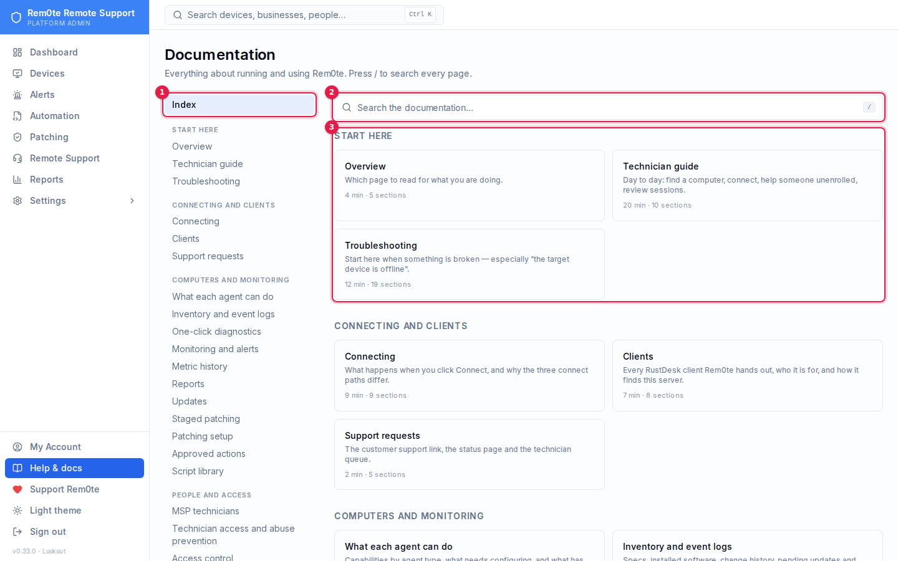
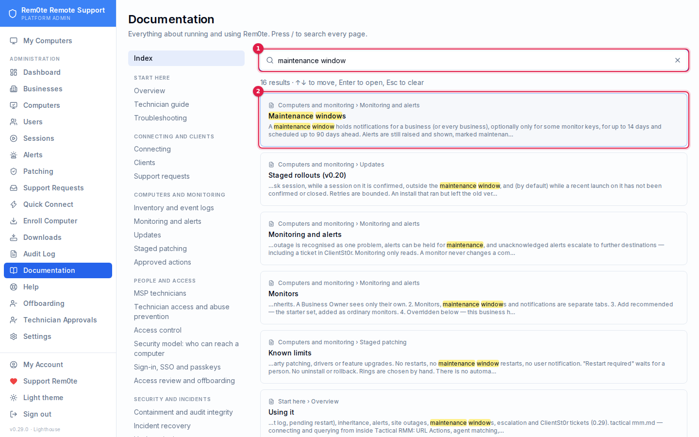
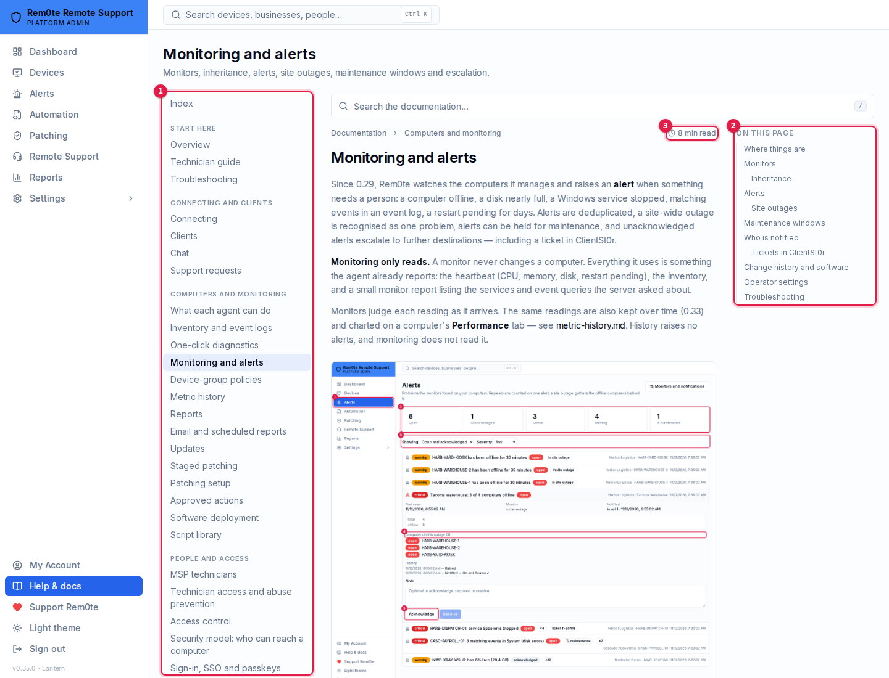

# Troubleshooting

Start here when something does not connect. The single most useful fact on this
page: **the error RustDesk shows almost never names the component that produced
it.**

---

## "Failed to connect: the target device is offline or does not exist"

This is hbbs's answer, relayed by the client. It has four distinct causes that
look identical from the technician's chair, and one command tells them apart.

### First move, always

```bash
sudo deploy/scripts/hbbs-probe.py <rustdesk-id>
```

| Verdict | What it rules out | Go to |
|---|---|---|
| `ONLINE` | Server and endpoint are both fine | [The client you're connecting from](#the-client-youre-connecting-from) |
| `OFFLINE` | Server is fine; endpoint is not registered right now | [Endpoint not registered](#endpoint-not-registered) |
| `ID_NOT_EXIST` | hbbs has never seen this ID | [Endpoint on the wrong server](#endpoint-on-the-wrong-server) |
| `LICENSE_MISMATCH` | Keys disagree | [Key mismatch](#key-mismatch) |

hbbs writes **nothing** to its log when a connection request fails — no line for
an unknown ID, none for an offline peer, none for a key mismatch. Reading
`/var/log/rustdesk-server/hbbs.log` after a failed connect will show you
nothing, which is why this script exists.

### The client you're connecting from

**`ONLINE` means the endpoint is reachable and the server is doing its job.**
The RustDesk on your own machine is asking a different rendezvous server.

The Connect button opens `rustdesk://connection/new/<id>`, which Windows routes
to whichever RustDesk is installed, using whatever server *that* client points
at. The URI scheme has no field for a server address. A stock client — a fresh
install, or an auto-update that replaced a configured build — asks
`rustdesk.com`, where your IDs do not exist.

**Fix:** In Rem0te, click **Connect**. It downloads a small script that installs
RustDesk if the machine has none, points it at this server, and opens the
session. Run it once and subsequent connects work directly.

Or, from **Remote Support → Technician client**, run *Set up this computer for Connect*.

Still failing after that:

- **Quit RustDesk completely first** — from the system tray, not just the
  window. A running client will not pick up a configuration change.
- **Uninstalling RustDesk does not clear its settings.** `%APPDATA%\RustDesk`
  survives an uninstall and a fresh install reads the old server straight back
  out of it. Delete that folder, then reinstall.
- **Check what the client actually thinks:** RustDesk → Settings → Network →
  ID/Relay Server. The ID Server must be your Rem0te host and the Key must match
  Rem0te → Settings → RustDesk → Public Key exactly.

### Endpoint not registered

`OFFLINE` — hbbs knows the ID but has no live registration.

- **Within ~30 seconds of an hbbs restart this is normal.** The online-peer map
  is in memory; a restart empties it and clients re-register on their next
  cycle. Every `rustdesk-server` upgrade and every
  `systemctl restart rustdesk-hbbs` opens that window. Wait, probe again.
- Otherwise: the endpoint is off, RustDesk is not running on it, or it has lost
  its route to port 21116. Compare against the endpoint's **Last seen** in
  Rem0te — that is a separate HTTP heartbeat. Heartbeat current but hbbs
  `OFFLINE` means RustDesk specifically is stopped or misconfigured on that
  machine.

### Endpoint on the wrong server

`ID_NOT_EXIST` — hbbs has never seen this ID, so the endpoint is registering
somewhere else, usually `rustdesk.com`.

Re-run the Rem0te installer on it. Installs from before **v0.8.2** wrote the
RustDesk *service* config to a path the service never reads, leaving it running
on defaults pointed at the public servers while every check passed. That fix
only lands by reinstalling.

### Key mismatch

`LICENSE_MISMATCH` — the key presented is not the one hbbs was started with.

```bash
cat /var/lib/rustdesk-server/id_ed25519.pub
```

must equal Rem0te → Settings → RustDesk → Public Key. If you regenerated the
server keypair, every client configured before that moment is now wrong.

hbbs checks the key of the computer **making** the connection, not the one
being connected to. hbbs logs it as

```
Authentication failed from <ip> for peer <id> - invalid key
```

in `/var/log/rustdesk-server/hbbs.log`, where `<ip>` is the technician's
machine. So a Key mismatch that starts "after a reinstall" usually means the
technician's RustDesk was reinstalled with a bad key — most often from a
preconfigured download the browser saved as `… (1).exe`, which before 0.19.7
put ` (1)` into the key. Reinstalling over it did not help either: with
RustDesk already running, launching a new installer just hands off to the
running copy, so the old version and the old key both stayed.

From 0.19.8 Connect checks the installed client's version, server and key. If
any is wrong it asks for administrator permission once, stops RustDesk,
upgrades it with `--silent-install` when it is out of date, and rewrites the
server and key in the service's and your own `RustDesk2.toml` (other settings
are kept). The log is `%LOCALAPPDATA%\Rem0te\repair.log`. Declining falls
back to a portable copy configured by its filename — quit RustDesk from the
tray first, or the session is handed to the installed copy with the bad key.

---

## Connected, but the password is rejected

Rem0te stores the endpoint's permanent password encrypted and hands it to the
client. It desyncs if someone ran `rustdesk --password` on the endpoint by hand.
Stage a credential rotation from the endpoint's page, or re-run the installer.

---

## The Connect script closes before you can read it

Every run writes a full log to:

```
%LOCALAPPDATA%\Rem0te\rem0te-last-run.log
```

Open that. It survives the window closing, and it is the fastest way to see
which step failed.

If that log does not exist, PowerShell never started — cmd.exe rejected the
file before running anything. Run the `.cmd` from an open Command Prompt
instead of double-clicking it so the error stays on screen. (0.19.8 shipped a
Connect script whose single command line exceeded cmd.exe's 8191-character
limit and failed exactly this way; fixed in 0.19.9.)

The script also pauses on failure now, so a window that closes instantly
usually means something stopped it before PowerShell ever ran — see below.

To watch it run with the window guaranteed to stay open, start a Command Prompt
first and drag the file into it, or:

```bat
cmd /k "%USERPROFILE%\Downloads\Connect to NAME.cmd"
```

Other reasons it may appear to do nothing:

- **It needs to actually run.** A browser that saved it and did not open it has
  done nothing yet.
- **SmartScreen may block it** — *More info* → *Run anyway*.
- **It deletes itself on completion by design**, because it carries a live
  credential. If you need it again, click Connect again.

The log never contains the password: the error handler prints the failing
command's category, deliberately not the script line, because the whole script
is one line and printing it would put the credential in the log.

---

## A session says "Status unknown"

Nothing confirmed or failed it within 30 minutes of the launch (or 12 hours
after the client opened). That is the honest answer when the remote computer's
agent is older than 0.20.0 and cannot report incoming connections, or when two
launches for the same computer were open at once, so a connection could not be
attributed to either. Complete the session yourself if you know how it went.

## "Confirm it's you" keeps appearing

That is step-up. It lasts 10 minutes and only for the sign-in it was made in, so
it is asked for again after signing out and back in, or in another browser. If
your account has an authenticator, only its code (or a passkey) is accepted —
not your password. If it never accepts a correct code or password, the account
may be locked out after repeated failures: wait for the lockout to pass.

Clicking **Connect** asks for it too when the launch carries the computer's
password (0.30.1). *"Sign in again with your authenticator to reveal a computer
password"* means this session began before your authenticator was set up: sign
out and back in. See
[sign-in.md](sign-in.md#step-up).

## SSO sign-in fails

The sign-in page explains the reason. The common ones:

- **"No account is linked to that identity"**: SSO never matches by email.
  Sign in with your password and link the provider from **My Account**.
- **"An account with that email already exists"**: same fix. Provisioning
  never takes over an existing account.
- **"The provider's response could not be verified"**: issuer, client ID,
  secret or redirect URI mismatch. Run **Test discovery** on the provider and
  check that the redirect URI at the provider matches exactly.
- **"did not start in this browser" / "expired"**: start again from the
  sign-in page; the round trip must finish in the same browser within 10
  minutes.

If SSO is unusable for everyone, run on the server:

```bash
sudo bash -c 'set -a; . /etc/reboot-remote/api.env; set +a; cd /opt/reboot-remote/api && node dist/cli/auth-recovery.js --disable-sso --yes'
```

Password sign-in keeps working regardless. See [sign-in.md](sign-in.md#recovery).

## A rotation stays "pending"

The computer has not checked in since the new password was staged, so it has
not applied it, and **the old password still works there**. An online computer
picks it up within about 3 minutes. An offline one stays pending until it
returns. **Offboarding → Pending rotations** lists every such computer.

---

## An endpoint shows online in Rem0te but RustDesk says offline

They are different signals and both are correct.

| Signal | Source | Lifetime |
|---|---|---|
| Rem0te's dot | Agent heartbeat **or** live hbbs registration (0.19.3+) | Re-checked every minute |
| RustDesk | Live registration with hbbs, **in memory only** | Empty after any hbbs restart |

A Connect depends only on the second. `hbbs-probe.py` reports the second.
Since 0.19.3 the dot follows hbbs too, so this disagreement lasts at most a
minute. From 0.35 a computer RustDesk can reach whose agent has not checked in
for 30 minutes is not drawn green: it is amber, **Reachable (RustDesk) · agent
silent 12 d** (or *no agent report*), everywhere a computer's state is shown.
Remote control should work; monitoring, patching and actions are not reporting.
Use **Update agent** on the computer's Agent card, or re-run the installer from
inside a session. The device list's *Online* filter has *Reachable, agent
silent* to find them all, and the dashboard's Devices tile counts them apart.

---

## Endpoints stuck "Update pending" forever

Only installers from v0.8.2 onward report a RustDesk version *and* understand
the staged-upgrade instruction. An older endpoint can be staged for an upgrade
it will never apply, and the staging never clears because clearing requires the
endpoint to report the target version.

Re-run the installer on those machines by hand. They need it anyway for the
service-config fix.

---

## A computer went offline right after Update or Reinstall agent

Two symptoms, one cause, in Windows installers 0.18.22 through 0.19.1:

- **Refused.** Heartbeats arrive and are rejected: the audit log shows
  `ENDPOINT_HEARTBEAT_REJECTED` with `reason: secret_mismatch` from the moment
  the installer re-ran.
- **Silent.** Nothing arrives at all, often after one last successful
  heartbeat. On the machine, `schtasks /Query /TN Rem0teHeartbeat /V /FO LIST`
  shows the task running every three minutes with **Last Result: 1**, and even
  an elevated Administrator gets *Access denied* reading
  `C:\ProgramData\Rem0te\heartbeat.ps1`. `icacls C:\ProgramData\Rem0te /T`
  lists the files under it with no permissions at all.

Cause: the state-directory lockdown applied a folder-only grant to every file
under `C:\ProgramData\Rem0te`. icacls removed each file's inherited
permissions and then refused the grant, leaving files nobody can open,
SYSTEM included. The heartbeat task could no longer read its own script. The
installer could not read the old device secret, so it made a new one, and it
could not save that either. The one-off enrolment retry task (`enroll.dat`,
written later with correct permissions) was then the only thing still calling
in, and it deletes itself on its first success. That is the "one last
heartbeat". Updates and refreshes queued for the machine are never collected.
Fixed in 0.19.2: the lockdown resets the files to inherit the directory's
permissions, which also repairs a machine already in this state. Every file is
then checked to be readable before the install goes on.

To recover a machine already in this state:

1. Re-run the installer on the machine from a 0.19.2 or later server. Pressing
   **Update** is not enough, because the heartbeat that would act on it is not
   running.
2. Open the computer in **Devices**. If the Overview tab shows *This
   computer is calling in with a new device secret*, and the address shown is
   where the computer really is, press **Accept this device**. The secret the
   repaired installer finds is usually not the one the server last bound.
   Acceptance is refused if the secret has not been seen in 15 minutes, or if
   more than one new secret has been offered for the same RustDesk ID. In that
   case re-run the installer from an enrollment link made for that computer.

   Since 0.19.5, accepting also adopts the RustDesk password the reinstall
   reported with that secret. The installer sets a new password and reports it
   once; before 0.19.5 that report was rejected and lost, so after Accept,
   Connect sent the old password and RustDesk answered **wrong password**, with
   no copy of the real one anywhere. A computer that was accepted on an older
   server and now refuses its password needs the installer re-run at the
   machine, or a password set in RustDesk there.

---

## A computer was archived by mistake

Archived computers refuse every connection. Open the computer and press
**Restore**. Grants removed by the archive are not brought back: a computer
set to *Assigned users* needs its users assigned again. A *Company-wide*
computer needs nothing more.

---

## WebSocket routes answer but nothing works

`/ws/id` and `/ws/relay` need **rustdesk-server 1.1.16 or newer**. 1.1.15
accepts the WebSocket upgrade and immediately drops the connection, so the
routes look healthy and do nothing.

```bash
hbbs --version
sudo deploy/scripts/hbbs-probe.py <id> --ws --host <your-host>
```

Upgrade from **Updates → RustDesk Server**, or see [updates.md](updates.md).

---

## Endpoints appear briefly then go offline

Port 21116 needs **UDP as well as TCP**. Registration is UDP; a firewall or
port-forward that carries only TCP produces exactly this.

```bash
sudo tcpdump -i any -nn 'udp port 21116'
```

---

## Connect is refused with a reason (v0.23)

The launch policy answers 403 with a code and a sentence; the UI shows the sentence. Most often:

| Code | Meaning | What to do |
|---|---|---|
| `ENDPOINT_CANNOT_ENFORCE_VIEW_ONLY` / `ENDPOINT_CANNOT_ENFORCE_CONSENT` | The computer's agent does not report that it can enforce view-only or attended consent. No shipped agent does yet. | Expected for preset-backed technicians. A business member or a custom assignment with Remote connect can still connect as before. |
| `TEMPORARY_GRANT_REQUIRED` | Preset-backed control needs an activated temporary grant. | Request it, have someone else approve it, then activate it with a fresh sign-in. |
| `PROTECTED_DEVICE_CLASS` | The computer is a domain controller, hypervisor, backup server or RMM host. | Nobody can connect interactively without an approved, activated exception from a managed admin workstation. Device attestation does not exist yet, so this cannot currently be satisfied. Check the device class is right (*Settings → Security → Technician Access*). |
| `IDENTITY_PAUSED` | An activity limit was reached and the identity is paused. | Someone else clears it under *Pauses & alerts*. Suppressing the alert does not lift it. |
| `CONTROL_NOT_GRANTED` / `VIEW_ONLY_NOT_GRANTED` | The person's tier does not include it on this computer. | Use the inspector to see which grant applies. |

A queued inventory or event-log command that ends `FAILED` with *"the person who requested this is no longer allowed to"* was re-checked at dispatch after its requester was demoted, revoked or paused. It was never sent to the computer.

## Signed updates refused (v0.24)

Signed agents log to `C:\ProgramData\Rem0te\Logs\agent.log`, and `rem0te-agent.exe status` prints their trust state.
The failures follow the TUF spec and fail closed:

| Agent log says | Meaning | Fix |
|---|---|---|
| `signed metadata refused … expired` | The repository's timestamp (or another role) lapsed | `rem0te-release refresh`, then sync to `UPDATE_REPO_DIR` |
| `… bad version number … must be >= N` | The portal serves older metadata than the agent already accepted | Sync the current repository. Never restore old metadata |
| `… not a signed release` / `… is not a signed target` | The pin, rollout or file isn't in signed targets | Sign it, or change the pin |
| `… older than installed …` | A downgrade without `allowDowngrade` | Sign the rollback explicitly, or don't downgrade |
| `stage 2 is running … not the signed agent` | Something other than the signed binary claimed stage 2 | Re-run `migrate` from an official release |
| `no relay pin on this machine` | The machine never migrated | Run `rem0te-agent.exe migrate --portal <host>` |

A **legacy** agent whose *Update* or *Reinstall agent* never happens while the platform is *signed only* is being
contained on purpose. Migrate it. See [update-signing.md](update-signing.md#moving-existing-agents).

## Services

```bash
systemctl status reboot-remote-api reboot-remote-web rustdesk-hbbs rustdesk-hbbr
journalctl -u reboot-remote-api -n 50
tail -50 /var/log/rustdesk-server/hbbs.log     # startup and key only — nothing per-connection
```

---

## Reset admin password

```bash
node -e "require('argon2').hash('NewPassword123').then(h => console.log(h))"
sudo -u postgres psql reboot_remote -c \
  "UPDATE \"User\" SET password = 'HASH' WHERE email = 'admin@example.com';"
```

---

## Searching this from inside the product

Everything on this page is also in the app, under **Help & docs → Full documentation**
at the bottom of the sidebar, searchable across every page.



1. **Help & docs** at the bottom of the sidebar, then **Full documentation**.
2. The search box — press <kbd>/</kbd> from anywhere on a documentation page.
   It matches across every page and returns the section, not just the page —
   searching *offline or does not exist* lands on the section above.
3. The index: every page, grouped by what you are doing, with a line on what
   each is for.



1. Type two or more letters; matches are highlighted.
2. Each result names its group, page and section. ↑ ↓ move between them,
   Enter opens one, Esc clears the search.



1. Every page, grouped. Below a wide screen this is the **All pages** button.
2. **On this page** follows where you are. On narrower screens it is a
   collapsible list at the top of the page.
3. Reading time. Every page ends with links to the previous and next page.

---

## See also

- [connecting.md](connecting.md) — how the connect paths work
- [clients.md](clients.md) — which client is which
- [updates.md](updates.md) — Rem0te, clients, and hbbs/hbbr
