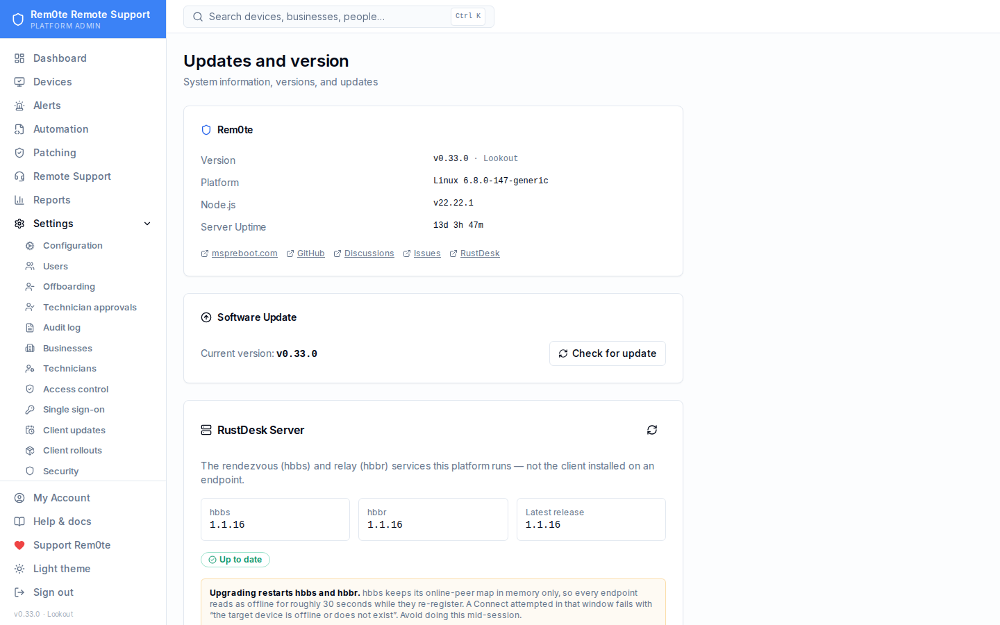

# Updates

Rem0te has three independent things that can be out of date. They are updated
separately, from different places, and confusing them wastes time.

| What | Where | Restart blast radius |
|---|---|---|
| **Rem0te itself** | Updates page → *Check for updates* | API + web restart; sessions in flight are unaffected |
| **RustDesk clients on endpoints** | Updates → *RustDesk Clients* | Per-endpoint, applied on its next heartbeat |
| **RustDesk server (hbbs/hbbr)** | Updates → *RustDesk Server* | **Every endpoint reads offline for ~30s** |

All three live at **/about** in the UI, reachable from the sidebar as
**Updates** (Platform Admin only). The running version is also in the sidebar
footer and on the About page, for everyone signed in — "which version are you
on?" is the first question asked about every problem.

Two more things can be out of date and are **not** on that page. The **Rem0te
agent** on a managed computer is upgraded from that computer's own Overview tab
with *Reinstall agent* — staging a client upgrade will not do it, because that
skips any endpoint already on the latest client, which is usually most of them.
And **Windows updates pending on an endpoint**. Those belong to the machine, not to this
platform, and Rem0te reports them without installing them — see
[inventory.md](inventory.md).



---

## Rem0te itself

*Check for updates* compares `version.json` against the latest GitHub release,
shows the changelog, and runs the update: fetch, build, deploy, restart.

This requires `SOURCE_DIR` to point at a git checkout of the repo. The deploy
target (`/opt/reboot-remote`) is deliberately **not** a git repository — the
updater used to run `git fetch` there and fail on its first step with a bare
"not a git repository", which read like a bug rather than missing
configuration. Unset, it now says exactly that instead of failing halfway.

Deploys add hashed client chunks rather than replacing them. Next.js requests
chunks by content hash, so deleting the previous build's files 404s any browser
that already had the app open — which surfaced as random reloads and
mid-login bounces back to `/login`. Old files go unreferenced; prune them in a
maintenance window, not during a deploy.

---

## RustDesk clients on endpoints

**Updates → RustDesk Clients** lists every managed endpoint with its installed
RustDesk version against the latest release, and stages upgrades per machine or
for everything that is behind.

### How staging works

There is no push channel to an endpoint, and inventing one would mean a second
protocol to secure. This reuses the credential-rotation channel already in
place:

1. You stage an upgrade. The endpoint's record gets a target version.
2. On its next heartbeat (~3 minutes) the endpoint is told to re-run the
   installer, which is idempotent and pins the version this server serves.
3. The endpoint reports its version on the following heartbeat. When it matches
   the target, the staging clears.

Consequences worth knowing:

- **A failed install retries rather than being lost** — the target stays set
  until the endpoint actually reports that version.
- **An endpoint will not reinstall more than once every 30 minutes.** Without
  that floor, any install that did not land on exactly the target version
  became a ~40 MB download every three minutes, indefinitely.
- **Endpoints that have never reported a version show as *Unknown*, not
  *Outdated*.** Flagging every pre-v0.8.2 machine as out of date would be pure
  noise.

### The pre-v0.8.2 trap

Only installers from v0.8.2 onward report a RustDesk version, *and* only those
understand the staged-upgrade instruction in the heartbeat response. An older
endpoint can therefore be staged for an upgrade it will never apply, and the
staging will never clear.

Those machines need the installer re-run — which they need anyway, for the
service-config fix in v0.8.2. From v0.15.0 that can be done from the console
with *Reinstall agent* on the computer's Overview tab, provided the machine has
authenticated with a device secret; one that never has needs a single local
run first. See [inventory.md](inventory.md). See [clients.md](clients.md#managed-installer--rem0te--enroll-computer).

Archived computers are skipped when an update is staged.

> **Before 0.19.0 an update could lock a Windows machine out.** Re-running
> the installer on a computer first enrolled before 0.18.22 lost its device
> secret, so every heartbeat after that was refused and the machine showed
> offline. The installer no longer does this. Machines it already happened to
> can be recovered from the console. See
> [troubleshooting.md](troubleshooting.md#a-computer-went-offline-right-after-update-or-reinstall-agent).

---

## Signed updates (v0.24)

Windows agents that run `rem0te-agent.exe` update only through the offline-signed repository this portal mirrors:
- *Update* and *Reinstall agent* still trigger them.
- What they install is decided by signed metadata, not by the portal.
- Older agents keep updating the legacy way until they migrate, or until the platform is set to *signed only*.

All of this is described in [update-signing.md](update-signing.md).

## Staged rollouts (v0.20)

**Platform → Client Rollouts** controls **which** version, **when**, to
**whom**, and what counts as done. One-click staging above is still there for
a single machine. While a computer has a rollout job, the rollout owns its
updates and one-click staging does not also fire.

### Supported version pin

*Supported version pin* makes every installer, Connect script and Quick
Connect download install exactly that RustDesk version instead of the latest
release. An exact `x.y.z` only. Clear it to go back to latest. Endpoints
running an agent older than 0.20.0 ignore the pin, and a rollout that sees one
install something newer marks that job failed (see below) rather than retrying.

### A rollout

Creating one resolves, up front:

- **The exact version and artifact.** The target and the SHA-256 of
  `rustdesk-<v>-x86_64.exe` are fetched from GitHub and stored. The installer
  an endpoint fetches for its job installs that version with that digest,
  never "latest". If GitHub publishes no digest, the rollout is refused unless
  you allow **signature-only**, in which case the installer requires a valid
  Authenticode signature instead. That is weaker: any signature Windows
  reports as valid is accepted, and the signer is logged but not pinned.
- **The targets.** Specific computers, whole businesses, or both. Both means
  only the listed computers that are in the listed businesses. Neither means
  **every** managed computer. A computer is
  **skipped** with a reason if it is not Windows (staged updates are
  Windows-only), has no device secret, is already on the target, would need a
  downgrade, or is already in another rollout for the same component.
- **Batches.** A pilot group goes first (batch 0), then the rest in batches of
  the size you set.

Agent rollouts can only target this server's own version: the server can only
serve its own agent.

### What happens

| Job state | Moved there by |
|---|---|
| Requested | created; waiting for its batch, window, backoff or an idle session |
| Dispatched | handed out in one heartbeat response; a concurrent heartbeat cannot dispatch it twice |
| Installing | the endpoint fetched the installer for this job's nonce |
| Awaiting verification | an **authenticated** heartbeat reports the approved version |
| Succeeded | version reported, plus hbbs registration, or registration recorded as *unavailable* (not independently verified) |
| Failed | attempts exhausted, or an outcome retrying cannot fix |
| Canceled / Skipped | operator, or nothing to do |

- **Deferral.** A job waits while the endpoint reports an incoming RustDesk
  session, while a session on it is confirmed, outside the maintenance window,
  and (by default) while a recent launch on it has not been confirmed or
  closed.
- **Retries are bounded.** An install that ran but left the old version, or a
  job with no evidence before the verify timeout, retries with exponential
  backoff up to *max attempts*, then fails. Nothing re-runs an installer on
  every heartbeat.
- **Newer than approved fails at once**, without retrying. It means the
  endpoint's agent predates the pin.
- **The failure threshold pauses the rollout.** It is checked on every failure
  and again before each new batch, so a failed pilot stops the fleet.
- **Cancel** stops jobs that have not been dispatched. A dispatched job cannot
  be recalled, because the installer may already be running. It is marked
  canceled and no longer tracked, so check that computer's reported version
  afterwards.

Each computer's page shows its update history with the evidence for every step.

### Recovery (there is no rollback)

RustDesk's installer has no tested downgrade, so Rem0te does not offer a
rollback. If a version misbehaves:

1. **Pause** the rollout (or cancel it). Nothing further is dispatched.
2. **Set the version pin** to the last good version, so nothing newly installed
   or re-run picks up the bad one.
3. For an affected computer: **uninstall RustDesk on it first**, then re-run
   the Rem0te installer, which installs the pinned version and keeps the
   enrolment. The installer only ever upgrades. With a newer RustDesk present
   it leaves it alone, so *Reinstall agent* by itself does not downgrade. The
   uninstall needs someone at the machine, or a tool other than RustDesk:
   uninstalling RustDesk over a RustDesk session ends that session.
4. Check the computer's **Test connection** panel: registration, version and
   heartbeat.

**Agents on the signed chain (0.24)** work differently:
- The installer refuses an older RustDesk build unless the release signer signed that build with
  `allowDowngrade`. There, a rollback is the signer's decision and needs no uninstall.
- A pin or rollout can only name a build that the signed metadata lists.

See [update-signing.md](update-signing.md).

---

## RustDesk server — hbbs and hbbr

**Updates → RustDesk Server** shows the installed version of each binary
against the latest `rustdesk-server` release, and upgrades both in place.

### Why this exists

`install.sh` originally installed hbbs only when none was present. Re-running
it reported "already installed" and left whatever version first landed —
forever. A deployment could sit two releases behind with nothing anywhere
surfacing the fact. That is how the WebSocket routes shipped in v0.8.2 came to
be dead on arrival: 1.1.15 accepts the upgrade on `/ws/id` and immediately
drops the connection, and nothing said the server was old.

`install.sh` now converges to the latest release on every run, and the Updates
page can do it without shell access.

### What the upgrade does

1. Downloads the `hbbs` and `hbbr` `.deb` pair for the latest release to
   `/var/lib/reboot-remote/rustdesk-server/`
2. `dpkg -i` both in **one call**, so a half-failed install cannot leave the
   two binaries on different versions
3. Restarts `rustdesk-hbbs` and `rustdesk-hbbr`

Privileges come from two fixed-path rules in `/etc/sudoers.d/reboot-remote` —
no wildcards, so `dpkg` cannot be steered at any other package.

The systemd drop-ins that pass `-k _` are **not** disturbed. They are drop-ins
precisely because the `rustdesk-server` package owns those unit files and an
in-place edit is silently reverted on upgrade, which would reopen registration
and the relay to anyone who found the host.

### The restart window

> hbbs holds its online-peer map **in memory only**. Restarting it empties that
> map, and every endpoint reads as offline until it re-registers — about 30
> seconds. A Connect attempted inside that window fails with *"the target
> device is offline or does not exist"* and looks exactly like a broken
> endpoint.

Do not upgrade mid-session. After upgrading, wait half a minute before
believing anything the online dots tell you, and confirm with:

```bash
sudo deploy/scripts/hbbs-probe.py <rustdesk-id>
```

### Version floor worth knowing

**1.1.16** is the minimum for RustDesk over WebSocket on 443. The Updates page
flags anything older with *No WebSocket support*, because the failure mode is
otherwise invisible — the routes answer, then hang up.

### By hand

```bash
V=1.1.16
ARCH=amd64   # arm64 on ARM hosts
cd /tmp
wget -q "https://github.com/rustdesk/rustdesk-server/releases/download/$V/rustdesk-server-hbbs_${V}_${ARCH}.deb"
wget -q "https://github.com/rustdesk/rustdesk-server/releases/download/$V/rustdesk-server-hbbr_${V}_${ARCH}.deb"
sudo dpkg -i rustdesk-server-hbbs_${V}_${ARCH}.deb rustdesk-server-hbbr_${V}_${ARCH}.deb
sudo systemctl restart rustdesk-hbbs rustdesk-hbbr
hbbs --version && hbbr --version
```

Back up `/var/lib/rustdesk-server/` first — it holds the server keypair and the
peer database. Losing `id_ed25519` invalidates every configured client.

---

## See also

- [clients.md](clients.md) — which client is which
- [inventory.md](inventory.md) — pending Windows updates on an endpoint, and
  the rest of what the agent collects
- [connecting.md](connecting.md) — the connect paths and their failure modes
- [setup.md](setup.md) — installation and operations
